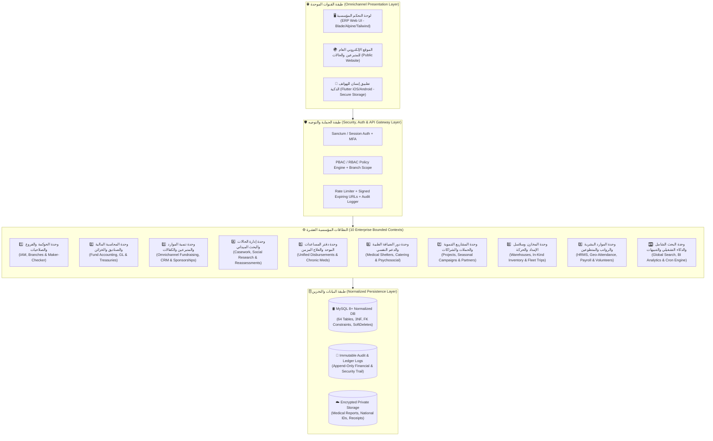
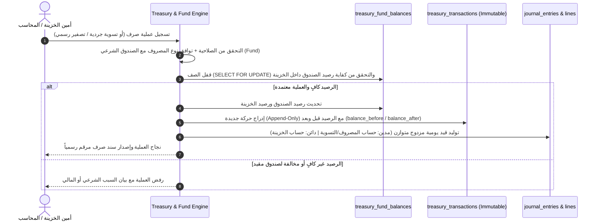
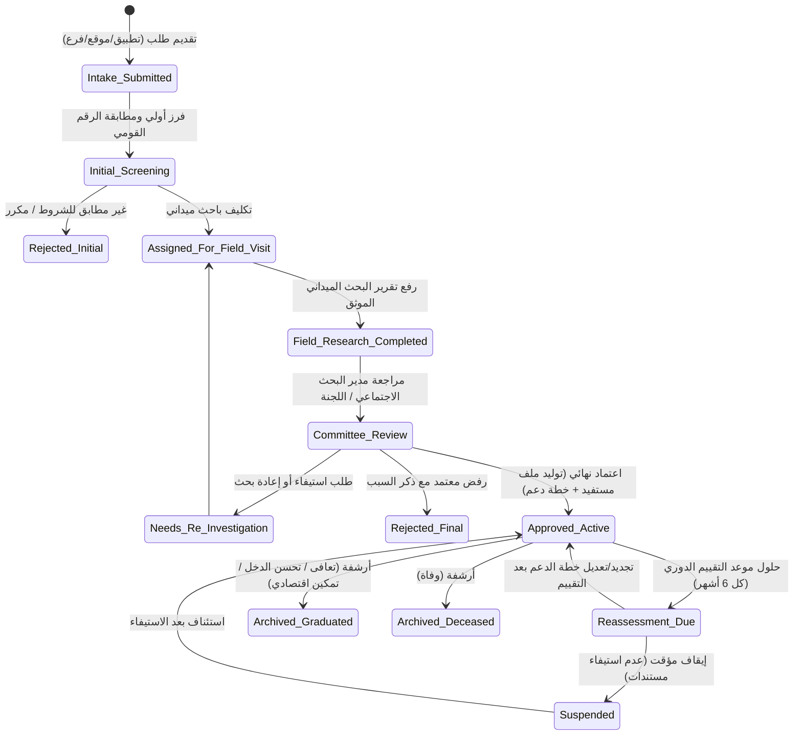

# وثيقة التصميم المعماري المؤسسي الشامل وتوصيف الوحدات (Ensan Enterprise Architecture v2.0)

**إعداد ومراجعة لجنة التصميم العليا:**
- **البروفيسور مارتن شتاين (Prof. Martin Stein):** كبير مصممي الأنظمة المعمارية في العالم (Chief Enterprise Systems Architect).
- **د. عبد الرحمن السعدي (Dr. Abdulrahman Al-Saadi):** كبير خبراء حوكمة العمل الخيري والزكاة والأوقاف والتنمية الاجتماعية.
- **د. ماركوس فانس (Dr. Marcus Vance):** كبير مدققي الأنظمة المالية ومحاسبة الصناديق غير الربحية (`IPSAS / FASB ASC 958 / AAOIFI`).
- **د. ليلى المنصور (Dr. Layla Al-Mansoor):** خبيرة العمليات الإنسانية، إدارة الحالة الاجتماعية، ودور الضيافة الطبية.
- **م. طارق النجار (Eng. Tariq Al-Najjar):** كبير معماريي الأنظمة المؤسسية والأمن السيبراني.
- **م. فيكتور كايل (Viktor Kael — «الشيطان الناقد»):** المراجع الجنائي وصاحب حق الفيتو الهندسي.
- **المجلس الإداري والتنفيذي لمؤسسة إنسان:** المدير المالي، مديرة البحث الاجتماعي، مدير دور الضيافة الطبية، مدير المخازن والحركة، مديرة الموارد البشرية والمتطوعين، ومدير تنمية الموارد والإعلام الرقمي.

---

## 🧭 أولاً: الفلسفة المعمارية الجديدة (The 7 Ironclad Architectural Pillars)

للقضاء النهائي على العشوائية، وتكرار الجداول، وانفصام القنوات، والتلاعب المالي الذي كشفه الفحص الجنائي للنسخة الأولى، يقوم نظام **Ensan v2.0** على **سبع ركائز معمارية غير قابلةفاوض**:

1. **معمارية المونوليث المعياري الموجه بالنطاقات (Modular Monolith with Domain-Driven Design - DDD):**
   - يُقسم النظام إلى **10 وحدات عمل مستقلة النطاق (Bounded Contexts)**. يُمنع منعاً باتاً وجود `Controller` يتجاوز `250 سطراً` (وداعاً لـ `GuestHouseWebController` ذي الـ 1678 سطراً)، ويُمنع أن يقوم `Controller` بكتابة استعلامات Eloquent أو تعديل أرصدة مباشرة؛ كل عملية تمر عبر `Action / UseCase` و `Domain Service` داخل `DB::transaction()`.
2. **بوابة القنوات الموحدة ومصدر الحقيقة الواحد (Omnichannel Single Source of Truth):**
   - إلغاء الانفصام الثلاثي (`donations` vs `web_donations` vs `mobile_donations`، إلخ). لوحة التحكم (ERP)، الموقع الإلكتروني (Web)، وتطبيق الهاتف (Flutter Mobile App) ليست ثلاثة أنظمة منفصلة، بل هي **ثلاث واجهات تصب جميعها في نفس الجداول الأساسية** مع تحديد مصدر القناة `source_channel` وحالة المراجعة `verification_status`.
3. **محاسبة الصناديق الشرعية والقيد المزدوج غير القابل للتعديل (Immutable Double-Entry & Fund Accounting):**
   - كل قرش يدخل أو يخرج يجب أن ينتمي إلى **صندوق مالي محدد (`Fund`)**: (زكاة مال، زكاة فطر، صدقة جارية، كفالة أيتام، علاج أورام، صدقات عامة، صندوق تشغيل إداري).
   - السجلات المالية (`journal_entries`, `treasury_transactions`, `inventory_movements`) **غير قابلة للحذف أو التعديل بعد الترحيل (Append-Only Immutable Ledger)**. أي تصحيح أو إلغاء يتم حصراً عبر **قيد عكسي (`Reversal Entry`)** أو **محضر تسوية جردية معتمد (`Reconciliation Adjustment`)**.
4. **الهيكل الجغرافي المرن متعدد الفروع (Multi-Branch & Geographic Hierarchy):**
   - إلغاء الجداول المسماة بأسماء مدن (`kafr_el_sheikh_*`, `tanta_*`). كل كيان في النظام (موظف، مستفيد، دار ضيافة، مخزن، خزينة، مشروع، مقدم خدمة خارجي) يرتبط بهيكل جغرافي قياسي: `Governorate (محافظة) ⬅️ City/Center (مركز/مدينة) ⬅️ Branch (فرع المؤسسة)`. إضافة فرع جديد في أي محافظة في الجمهورية يتم في 10 ثوانٍ من شاشة الإعدادات دون كتابة سطر كود واحد!
5. **فصل الهوية عن الأدوار التشغيلية (Party / Role Separation Pattern):**
   - جدول `users` مخصص **للمصادقة والدخول فقط (Authentication & Credentials)**.
   - البيانات الوظيفية في `employees`، وبيانات التطوع في `volunteers`، وبيانات المتبرعين في `donors`، وبيانات المستفيدين في `beneficiaries`. يمكن لشخص واحد أن يكون متبرعاً ومتطوعاً في نفس الوقت دون تلويث جدول الموظفين.
6. **دفتر الأستاذ الموحد للمنافع والمساعدات (`Unified Beneficiary Assistance Ledger`):**
   - لا توجد مساعدة تُصرف لمستفيد (سواء كانت كفالة شهرية نقدية، مساعدة طارئة، علاج أورام، شنطة رمضان، وجبة إفطار، إقامة بدار ضيافة، أو صرف عيني من المخزن) إلا وتمر عبر جدول موحد **`beneficiary_disbursements`** يربط المستفيد بمصدر التمويل (الخزينة/المخزن/الكفيل/الحملة) ويعطي كشف حساب تاريخي شامل للحالة بضغطة زر.
7. **محرك الحوكمة والموافقات الثنائية الصارم (Maker-Checker Workflow Engine):**
   - صانع القرار (Maker) لا يمكنه أبداً أن يكون معتمد القرار (Checker) في العمليات الحساسة (تعديل رصيد، صرف فوق السقف، إلغاء تبرع، اعتماد نهائي لحالة، ترحيل مسير رواتب). صلاحيات الموارد البشرية (`hr.*`) معزولة تماماً عن صلاحيات الاعتماد المالي (`finance.approve`).

---

## 🏗️ ثانياً: المخطط المعماري العام للمنظومة (System Architecture Blueprint)



---

## 🧩 ثالثاً: التوصيف التفصيلي الدقيق للوحدات العشر (Comprehensive Module Specifications)

فيما يلي التوصيف الهندسي والإداري الصارم لكل وحدة من وحدات النظام العشر، كما صاغها الخبراء ومديرو الإدارات واعتمدها المهندس الناقد:

---

### الوحدة الأولى (Module 01): الحوكمة، الهيكل الجغرافي، الفروع، والأمن السيبراني (`IAM, Organization & Governance`)
**المسؤول الإداري:** الإدارة العليا + مدير التحول الرقمي وأمن المعلومات.  
**الهدف من الوحدة:** ضبط الهيكلة الجغرافية للفروع، فصل حسابات الدخول عن الكيانات البشرية، فرض صلاحيات دقيقة على مستوى الفرع والعملية، وتشغيل محرك الموافقات الثنائية (Maker-Checker) وسجل التدقيق الجنائي.

#### 1. المكونات والوظائف الدقيقة:
- **إدارة الفروع والنطاق الجغرافي (`Geographic & Branch Registry`):**
  - تعريف المحافظات (`governorates`) والمراكز/المدن (`cities`) والفروع التشغيلية (`branches`).
  - كل فرع (مثل: *فرع كفر الشيخ الرئيسي، فرع طنطا، دار ضيافة كفر الشيخ، دار ضيافة طنطا*) له كود فريد، مدير فرع، خزينة رئيسية، ومخزن رئيسي.
- **نموذج الهوية والصلاحيات المعزول (`Strict RBAC + Branch Scoping`):**
  - التحقق من الصلاحيات يعتمد **حصرياً على مفتاح الدور (`roles.key`) ومفتاح الصلاحية (`permissions.key`)**، ويُمنع منعاً باتاً الاعتماد على الاسم العربي للدور (`roles.name`).
  - كل مستخدم يمكن تقييد رؤيته بفرع واحد أو عدة فروع (`user_branch_access`) أو منحه نطاقاً شاملاً (`is_global_scope = true` للإدارة العليا).
  - فصل الصلاحيات إلى 5 مستويات لكل مورد: `view` (عرض)، `create` (إنشاء)، `update` (تعديل)، `delete` (أرشفة)، و `approve` (اعتماد/ترحيل).
- **محرك الموافقات والحوكمة (`Maker-Checker Approval Workflow Engine`):**
  - أي عملية مصنفة كعملية حساسة في جدول سياسات الحوكمة (`approval_policies`) — مثل: *تعديل/إلغاء حركة مالية، تسوية جرد خزينة أو مخزن، اعتماد حالة بحث اجتماعي، صرف مبلغ يتجاوز السقف المسموح، اعتماد مسير رواتب* — تُنشئ سجل `approval_requests` بحالة `pending`.
  - **قاعدة عدم تضارب المصالح (Anti-Self-Approval Rule):** يمنع المحرك برمجياً أن يكون `reviewed_by_user_id == requested_by_user_id` مهما كانت رتبة الموظف (باستثناء الـ `super_admin` الموثق في سجل التدقيق مع إلزام كتابة سبب التجاوز).
- **الروابط الخارجية المؤقتة الموقعة (`Signed Expiring External Links`):**
  - أي رابط خارجي يُرسل لباحث أو أخصائي نفسي أو متبرع يتم توليده عبر جدول `external_access_tokens` بتاريخ انتهاء صلاحية (`expires_at`)، وعدد مرات استخدام محدد (`max_uses`)، وإمكانية إبطال فوري (`revoked_at`).

---

### الوحدة الثانية (Module 02): المحاسبة المالية، محاسبة الصناديق الشرعية، والخزائن والعهد (`Financial ERP, Fund Accounting & Treasuries`)
**المسؤول الإداري:** أ. خالد المنشاوي (المدير المالي ورئيس المراجعة الداخلية).  
**الهدف من الوحدة:** تطبيق نظام مالي مؤسسي يتوافق مع المعايير المحاسبية للمنظمات غير الربحية (`IPSAS / AAOIFI`)، يفصل أموال الزكاة والصدقات المقيدة عن أموال التشغيل، ويضمن تطابق رصيد كل خزينة مع قيود اليومية بنسبة 100% في كل لحظة.

#### 1. المكونات والوظائف الدقيقة:
- **محاسبة الصناديق الشرعية والمقيدة (`Restricted & Unrestricted Fund Accounting`):**
  - إنشاء جدول الصناديق الشرعية والمالية (`funds`) ويضم أنواع الصناديق:
    1. `zakat_mal` (زكاة مال — مقيد شرعاً بالمصارف الثمانية، نسبة المصروفات الإدارية 0% أو وفق اللائحة الشرعية المعتمدة).
    2. `zakat_fitr` (زكاة فطر — مقيد شرعاً بالفقراء والمساكين قبل صلاة العيد).
    3. `sadaqah_jariya` (صدقة جارية — مقيد بالأصول الدائمة والمشاريع المستدامة مثل الأجهزة الطبية، الأسرة، وصلات المياه).
    4. `restricted_sponsorship` (كفالات مقيدة — أيتام، مرضى أورام، طلاب علم).
    5. `restricted_project` (تبرع مخصص لمشروع أو حملة محددة).
    6. `unrestricted_sadaqah` (صدقات عامة غير مقيدة — تغطي المساعدات العامة والتشغيل).
    7. `waqf_endowment` (ريع أوقاف).
- **إدارة الخزائن والحسابات البنكية والمحافظ الإلكترونية (`Multi-Fund Treasuries`):**
  - كل خزينة (`treasuries` — نقدية، حساب بنكي، فودافون كاش، إنستاباي، ماكينة POS) تحتفظ برصيدها الإجمالي **وتفصيل رصيدها لكل صندوق (`treasury_fund_balances`)**.
  - **منع السحب على المكشوف ومنع الخلط الشرعي:** عند تسجيل مصروف إداري (مثل فاتورة كهرباء المقر أو راتب إداري)، يرفض النظام خصمه من صندوق `zakat_mal` أو `restricted_sponsorship`، ويشترط الصرف من صندوق `unrestricted_sadaqah` أو مخصص التشغيل!
- **نظام التسوية الجردية بدلاً من "التصفير اليدوي التدميري" (`Treasury Reconciliation Protocol`):**
  - **يُحظر نهائياً حذف أي حركة خزينة أو التلاعب بـ `opening_balance`!**
  - إذا أراد المدير المالي تصفير خزينة دار الضيافة أو تعديل رصيدها الفعلي بعد الجرد:
    1. إما أن يقوم بعمل **تحويل خزينة (`Treasury Transfer`)** لتوريد المبلغ المتبقي إلى الخزينة الرئيسية للمؤسسة.
    2. أو ينشئ **محضر تسوية جردية (`treasury_reconciliations`)** يسجل فيه الرصيد الدفتري (`system_balance`) والرصيد الفعلي (`actual_balance`) وسبب الفارق، فيقوم النظام بتوليد حركة تسوية (`adjustment_in` أو `adjustment_out`) وقيد يومية آلي في حساب "فروق التسوية والعجز/الزيادة" مع الاحتفاظ بكامل التاريخ المحاسبي!
- **دفتر الأستاذ العام والقيد المزدوج الآلي (`Automated Double-Entry General Ledger`):**
  - شجرة حسابات هرمية (`chart_of_accounts`) تدعم الأصول، الالتزامات، صافي الأصول المقيدة وغير المقيدة، الإيرادات، والمصروفات.
  - كل حركة مالية معتمدة (تبرع، مصروف، تحويل بين خزائن، صرف مسير رواتب، تسوية عهدة، إهلاك أصل) تولد آلياً `journal_entry` متوازناً ($\sum \text{Debit} = \sum \text{Credit}$) مرتبطاً بالعملية الأصلية عبر `reference_type` و `reference_id`.
- **إدارة العهد النقدية المؤقتة والمستديمة (`Petty Cash & Employee Custodies`):**
  - دورة حياة كاملة للعهدة (`custodies`): طلب عهدة ⬅️ اعتماد وصرف من الخزينة ⬅️ تسجيل فواتير تسوية العهدة (`custody_settlement_items`) ⬅️ استعاضة العهدة (`Replenishment`) أو إقفالها وتوريد المتبقي للخزينة بقيد محاسبي آلي.



---

### الوحدة الثالثة (Module 03): تنمية الموارد، علاقات المتبرعين (CRM)، الكفالات، والقنوات الموحدة (`Omnichannel Fundraising, CRM & Sponsorships`)
**المسؤول الإداري:** أ. عمر السخاوي (مدير تنمية الموارد وعلاقات المتبرعين) + أ. خالد المنشاوي (المدير المالي).  
**الهدف من الوحدة:** توحيد كافة التبرعات النقدية والإلكترونية والعينية من جميع القنوات (الفرع، المندوب، الموقع الإلكتروني، تطبيق الموبايل) في مسار واحد، وإدارة عقود الكفالات الشهرية بمرونة ودقة.

#### 1. المكونات والوظائف الدقيقة:
- **سجل المتبرعين الموحد (`Unified Donor CRM`):**
  - جدول واحد للمتبرعين (`donors`) يخدم لوحة التحكم والموقع وتطبيق الموبايل.
  - عندما يسجل متبرع حساباً في تطبيق الموبايل (`ensan_app`)، يربطه النظام تلقائياً بملفه في جدول `donors` عبر رقم الهاتف أو ينشئ له ملفاً جديداً مرتبطاً بـ `users.id`، فيرى المتبرع فوراً جميع تبرعاته السابقة (سواء تبرع بها في الفرع أو عبر المندوب أو عبر التطبيق) وإيصالاته وحالاته المكفولة!
- **مسار التبرعات الموحد (`Omnichannel Donation Pipeline`):**
  - جدول واحد للتبرعات المالية (`donations`) يحتوي على `source_channel ENUM('erp_branch', 'field_delegate', 'website', 'mobile_app', 'bank_transfer', 'pos')`.
  - التبرعات القادمة من الموقع أو تطبيق الموبايل تدخل بحالة `verification_status = 'pending_review'` مع صورة إيصال التحويل (`payment_proof_path`).
  - بمجرد ضغط المحاسب على **"اعتماد وتحصيل التبرع"**:
    1. تتحول الحالة إلى `verified`.
    2. تُودع القيمة فوراً في الخزينة والصندوق المحددين (`treasury_transactions` + `treasury_fund_balances`).
    3. يُنشأ قيد اليومية المزدوج (`journal_entries`).
    4. يُصدر إيصال إلكتروني رسمي للمتبرع ويصله إشعار فوري على تطبيق الموبايل.
- **تخصيص التبرعات متعدد الوجهات (`Normalized Donation Allocations`):**
  - إلغاء حقول الـ JSON (`split_allocations`, `beneficiary_allocations`) النصية!
  - استبدالها بجدول علائقي قياسي **`donation_allocations`** يسمح بتقسيم التبرع الواحد إلى عدة مخصصات دقيقة (مثلاً: 5,000 جنيه مقسمة إلى 2,000 لمشروع الأمل، 2,000 لحالة مستفيد رقم X، و1,000 لدار الضيافة) مع مفاتيح أجنبية صريحة!
- **محرك عقود الكفالات الشهرية والمشتركة (`Sponsorship Contracts Engine`):**
  - إلغاء الفوضى السابقة (حيث كانت الكفالة مكررة في 4 أماكن وتُمسح عند إضافة كفيل ثانٍ!).
  - إنشاء جدول عقود الكفالات **`sponsorship_contracts`** الذي يربط الكفيل (`donor_id`) بالمكفول (سواء كان أسرة كاملة `beneficiary_id` أو فرداً محدداً من الأسرة/يتيماً `household_member_id` أو مريض أورام) مع تحديد:
    - قيمة الكفالة الشهرية (`monthly_amount`)، دورية السداد (`monthly, quarterly, yearly`)، تاريخ البدء والانتهاء، وحالة العقد (`active, paused, completed, cancelled`).
    - **دعم الكفالة المشتركة (Co-Sponsorship):** يمكن لثلاثة متبرعين أن يكفلوا نفس اليتيم أو المريض (كل متبرع بـ 500 جنيه)، ويحسب النظام تلقائياً إجمالي الكفالة النشطة (`SUM(monthly_amount)`) ونسبة التغطية من الاحتياج الشهري للحالة!
    - جدول استحقاقات الكفالة الشهرية (`sponsorship_installments`) لتتبع الأقساط المسددة والمتأخرة وتنبيه فريق خدمة المتبرعين آلياً.

---

### الوحدة الرابعة (Module 04): إدارة الحالة الاجتماعية، البحث الميداني، وإعادة التقييم الدوري (`Case Management, Social Research & Beneficiary Lifecycle`)
**المسؤول الإداري:** أ. سلمى غانم (مديرة البحث الاجتماعي وإدارة الحالات).  
**الهدف من الوحدة:** هيكلة دورة حياة المستفيد من لحظة تقديم الطلب وحتى التمكين أو الأرشفة عبر آلة حالة (State Machine) صارمة، وتطبيع بيانات الأسرة والملف الطبي والاجتماعي.

#### 1. المكونات والوظائف الدقيقة:
- **تطبيع ملف المستفيد والأسرة والملف الطبي (3NF Normalization):**
  - بدلاً من حشر 55 عموداً و4 أعمدة JSON في جدول `beneficiaries`:
    1. **`beneficiaries` (ملف الحالة/رب الأسرة الأساسي):** الكود الموحد، الرقم القومي، الاسم، الهاتف، الفرع التابع له، تصنيف الحالة، الدخل الشهري الموثق، المصروف الشهري الموثق، درجة الاستحقاق (`vulnerability_score`)، والحالة الراهنة.
    2. **`beneficiary_household_members` (أفراد الأسرة المعالون والأيتام):** الاسم، صلة القرابة، الرقم القومي/شهادة الميلاد، تاريخ الميلاد الحقيقي (مع حقل `estimated_birth_year` منفصل لمن لا يُعرف يوم ميلاده بدلاً من تزوير تاريخ 1 يناير!)، المرحلة التعليمية، الحالة الصحية، الحالة الاجتماعية، الدخل الفردي، وهل هو مريض أو يتيم مكفول.
    3. **`beneficiary_medical_profiles` (الملف الطبي وملف الأورام والأمراض المزمنة):** التشخيص الطبي، نوع وموقع الورم، المستشفى المعالج، الطبيب المعالج، بروتوكول العلاج (كيماوي، إشعاعي، جراحي، هرموني)، وتاريخ بدء البروتوكول.
    4. **`beneficiary_program_enrollments` (التسجيل المتعدد في البرامج والمشاريع):** يسمح للمستفيد الواحد بأن يكون مسجلاً في "مشروع زاد للأيتام" وفي "مشروع مدرار" ومستفيداً من "دار الضيافة" في نفس الوقت دون تعارض أو تكرار لكود المستفيد!
- **آلة الحالة الصارمة لدورة حياة المستفيد (`Beneficiary Lifecycle State Machine`):**



- **ضبط حسابات البحث الميداني (`field_visits`):**
  - توحيد وحدة القياس الزمنية لجميع بنود الدخل والمصروفات في الاستمارة الميدانية لتكون **شهرية (Monthly)** (مع حاسبة مساعدة في الواجهة تضرب المصروف الأسبوعي في `4.33` تلقائياً).
  - ربط توصية الباحث بقيم قياسية موحدة (`approve`, `reject`, `needs_review`)، وإلغاء أي أسماء أشخاص أو إيميلات مكتوبة داخل الكود (`Hardcoded Backdoors`) واستبدالها بصلاحية `casework.final_approve`.
- **تفعيل الأثر الآلي لإعادة التقييم نصف السنوي (`beneficiary_reassessments`):**
  - عند تقديم استمارة إعادة التقييم الدوري (كل 6 أشهر):
    - إذا كانت التوصية `"استمرار بنفس القيمة"`، يتم تحديث `next_reassessment_due_at = +6 months` تلقائياً.
    - إذا كانت التوصية `"زيادة الدعم"` أو `"تخفيض الدعم"` أو `"إيقاف الدعم"` أو `"أرشفة للتعافي/الوفاة"`، يقوم النظام **تلقائياً بإنشاء طلب اعتماد (`approval_request`) لمدير البحث الاجتماعي**، وبمجرد ضغط المدير على "موافقة"، يتم تحديث حالة المستفيد وقيمة كفالته وإخطار قسم الكفالات والمالية فوراً!

---

### الوحدة الخامسة (Module 05): دفتر الأستاذ الموحد للمساعدات والعلاج المزمن (`Unified Assistance Disbursement & Chronic Medication Engine`)
**المسؤول الإداري:** أ. سلمى غانم + أ. خالد المنشاوي + أ. محمود الدسوقي.  
**الهدف من الوحدة:** حل المشكلة الكارثية لعدم معرفة إجمالي ما حصل عليه المستفيد، وإنهاء فوضى تسجيل المساعدات داخل جدول التبرعات الواردة.

#### 1. المكونات والوظائف الدقيقة:
- **دفتر أستاذ المساعدات الموحد (`beneficiary_disbursements`):**
  - جدول مركزي يوثق **كل مساعدة أو خدمة قُدمت لمستفيد**، ويحتوي على:
    - `beneficiary_id` (الحالة المستفيدة) و `household_member_id` (الفرد المستفيد إن وجد).
    - `disbursement_type`: (`monthly_sponsorship` كفالة شهرية، `urgent_cash_aid` مساعدة نقدية طارئة، `medical_medication` صرف علاج/أدوية، `medical_procedure` عملية/أشعة/تحاليل، `in_kind_package` مساعدة عينية/غذائية، `seasonal_ramadan_bag` شنطة رمضان، `seasonal_iftar` وجبات إفطار، `shelter_accommodation` إقامة وإعاشة بدار ضيافة، `marriage_assistance` تيسير زواج، ` infrastructural_aid` وصلة مياه/سقف).
    - `monetary_value`: القيمة المالية الفعلية أو التقديرية للمنفعة.
    - **الربط المحاسبي والمخزني الإلزامي:**
      - إذا كانت المساعدة **نقدية**: ترتبط بـ `expense_id` و `treasury_transaction_id` و `fund_id` (تُخصم فعلياً من الخزينة والصندوق!).
      - إذا كانت المساعدة **عينية من المخزن**: ترتبط بـ `inventory_movement_id` (تُخصم فعلياً من رصيد المخزن!).
      - إذا كانت **إقامة بدار ضيافة**: ترتبط بـ `shelter_stay_id`.
- **جدول خطط العلاج والأدوية الشهرية المزمنة (`chronic_medication_plans`):**
  - بدلاً من دفن اسم العلاج الشهري داخل حقل الملاحظات النصي `notes_cases`:
    - يُسجل لكل مريض جدول أدويته الشهرية الثابتة: اسم الدواء (`medication_name`)، الجرعة، التكلفة الشهرية، الصيدلية أو المندوب المورد (`partner_id`)، تاريخ البدء، تاريخ انتهاء القرار (`end_date`)، وموعد التنبيه قبل الانتهاء (`alert_days_before = 15`).
    - يقوم محرك التنبيهات اليومي (`Cron Job`) بإرسال إشعار آلي لمدير المشروع الطبي والباحث قبل انتهاء العلاج بـ 15 يوماً لتجديد القرار الطبي!

---

### الوحدة السادسة (Module 06): دور الضيافة الطبية، رعاية مرضى الأورام، الإعاشة، والدعم النفسي (`Medical Shelters, Oncology Care & Psychosocial Support`)
**المسؤول الإداري:** د. حاتم الشافعي (مدير دور الضيافة والرعاية الطبية والدعم النفسي).  
**الهدف من الوحدة:** تفكيك الكونترولر العملاق (`GuestHouseWebController`) إلى خدمات معيارية متخصصة، وضبط دورة تسكين المرضى، الإعاشة، العهد، والدعم النفسي.

#### 1. تفكيك `GuestHouseWebController` إلى 6 كونترولرز وخدمات متخصصة:
1. **`ShelterFacilityController`:** إدارة بيانات الدار، الأجنحة (`shelter_wings`)، الغرف، الأسرة (`shelter_beds`)، وحالة كل سرير (`available, occupied, reserved, maintenance, sterilization`) **دون أي أرقام وهمية (`max(3, ...)` أو `max(24, ...)`)** — المؤشرات تعكس الواقع الفعلي في قاعدة البيانات 100%!
2. **`ShelterBookingController`:** استقبال ومراجعة طلبات حجز الأسرة الموحدة (`shelter_booking_requests`) سواء وردت من الموقع أو تطبيق الموبايل أو الهاتف، وفحص التعارض الزمني قبل تأكيد الحجز.
3. **`ShelterStayController`:** إدارة تسكين المرضى (`shelter_stays`):
   - عند البحث عن مريض لتسكينه على سرير: يبحث النظام في جدول `beneficiaries` الموحد؛ فإذا كان المريض مسجلاً مسبقاً (حتى لو في مشروع آخر أو دار ضيافة أخرى)، **يتم تسكينه مباشرة بنفس ملفه وكوده الأصلي دون إنشاء مستفيد مكرر ودون مسح مشروعه الأصلي**!
   - إذا كان مريضاً جديداً تماماً، يتم إنشاء ملف مستفيد وملف طبي له وتسكينه في خطوة ذرية واحدة (`Atomic Transaction`).
   - توثيق كامل لبيانات المرافق (`companion_name, companion_national_id, companion_phone, companion_relation`)، العلامات الحيوية عند الدخول، تاريخ المغادرة المؤقتة أو النهائية، و**حفظ ملاحظات المغادرة (`departure_notes`) وحالة المريض عند الخروج في أعمدة صريحة**.
4. **`ShelterCateringController`:** إدارة الوجبات اليومية (`shelter_meals` و `shelter_meal_servings`):
   - ربط صرف المواد الغذائية للوجبة بحركة صرف مخزني رسمية من مخزن الدار (`inventory_movements`) أو مصروف شراء نقدي عبر `ExpenseService` (مع منع ابتلاع الأخطاء `try/catch` الصامت!).
5. **`ShelterAssetTicketController`:** إدارة أصول الدار (`facility_assets`)، سجلات الصيانة الدورية والطارئة (`asset_maintenances`)، وتذاكر الدعم والشكاوى (`support_tickets`).
6. **`PsychosocialSupportController`:** إدارة جلسات الدعم النفسي وتقييمات الأطفال (`psychosocial_sessions` و `child_assessments`) المرتبطة بملف المستفيد وإقامته.

---

### الوحدة السابعة (Module 07): المشاريع التنموية، الحملات الموسمية، والشراكات المجتمعية (`Projects, Seasonal Campaigns & Partner Network`)
**المسؤول الإداري:** مديرة المشاريع + مدير الحملات الموسمية + مسؤول الشراكات المجتمعية.  
**الهدف من الوحدة:** توحيد إدارة المشاريع والحملات الموسمية (مثل شنط رمضان وإفطار الصائم والأضاحي) وربطها بالمستفيدين الفعليين، وتوحيد جداول الشراكات ومقدمي الخدمات.

#### 1. المكونات والوظائف الدقيقة:
- **المشاريع التنموية والحملات الموسمية (`projects` & `campaigns`):**
  - إلغاء الـ `Global Scope` الخفي الذي كان يخفي أي مشروع يحتوي اسمه على كلمة `"ضيافة"`، واستبداله بحقل تصنيف صريح `project_category ENUM('medical', 'orphans_zad', 'water_midrar', 'shelter', 'seasonal', 'general_relief', 'economic_empowerment')`.
  - ربط مدير المشروع عبر `manager_user_id` الموحد في جميع الإشعارات والتقارير.
  - ميزانية مستهدفة لكل مشروع/حملة (`target_budget`) مرتبطة بصندوقها المحاسبي (`fund_id`)، مع تتبع لحظي لإجمالي التبرعات المحصلة مقابل المصروفات والمساعدات العينية المنصرفة.
- **ربط التوزيعات الموسمية بالمستفيدين الفعليين (`Seasonal Distributions`):**
  - بدلاً من جدولي `ramadan_bags` و `ramadan_iftars` المنفصلين عن جدول المستفيدين واللذين يمسحان التاريخ عند حذف الحملة (`onDelete('cascade')`):
    - جميع التوزيعات الموسمية (شنط رمضان، كراتين الخير، لحوم الأضاحي، كسوة العيد، إفطار صائم) تُدار عبر دفعات توزيع موسمية (`campaign_distributions`) مرتبطة بـ `beneficiary_disbursements` و `inventory_movements` مع `restrictOnDelete()`.
- **توحيد مقدمي الخدمات والوسطاء والشراكات (`Unified External Partners & Agreements`):**
  - **حذف الجداول الثابتة الثمانية:** (`kafr_el_sheikh_services`, `kafr_el_sheikh_brokers`, `kafr_el_sheikh_deliveries`, `tanta_workers`, `oncology_medicine_reps`, `collaborations`, `memberships`, `school_collaborations`).
  - **استبدالها بجدولين مؤسسيين موحدين:**
    1. **`external_partners` (سجل الشركاء ومقدمي الخدمات والوسطاء):** يشمل نوع الشريك `partner_type ENUM('medical_center', 'pharmacy', 'pharma_rep', 'real_estate_broker', 'transport_delivery', 'maintenance_technician', 'commercial_sponsor', 'school_entity', 'ngo_partner')`، مع ربطه بـ `governorate_id` و `city_id` و `branch_id`! بذلك يمكن إضافة سمسار أو مندوب أدوية أو فني في **كفر الشيخ أو طنطا أو القاهرة أو أسوان** في نفس الجدول الموحد!
    2. **`partner_agreements` & `partner_referrals` (اتفاقيات الخصم وإحالات المستفيدين):** توثيق نسبة الخصم الممنوحة للمستفيدين أو المتطوعين، وتوليد خطابات تحويل أو كوبونات خصم (`partner_referrals`) مرتبطة بـ `beneficiary_id` لمعرفة كم مستفيداً استفاد فعلياً من كل شراكة طبية أو تجارية!

---

### الوحدة الثامنة (Module 08): إدارة سلاسل الإمداد، المخازن، التبرعات العينية، والحركة واللوجيستيات (`Supply Chain, Inventory & Fleet Logistics`)
**المسؤول الإداري:** أ. محمود الدسوقي (مدير المخازن واللوجيستيات والحركة).  
**الهدف من الوحدة:** توحيد حسابات المخزون في محرك واحد غير قابل للتلاعب، ربط التبرعات العينية بالمخازن، وإنهاء تشوه تخزين "المشاوير" داخل جدول التبرعات.

#### 1. المكونات والوظائف الدقيقة:
- **محرك المخازن والأرصدة اللحظية الموحد (`Unified Warehouse & Stock Engine`):**
  - جدول المخازن (`warehouses`) مرتبط بـ `branch_id` (بما في ذلك مخازن دور الضيافة كفروع مخزنية قياسية بدلاً من البحث النصي عن كلمة `'كفر'` و `'طنطا'`).
  - جدول الأصناف القياسي (`inventory_items`) مع وحدات القياس، حد إعادة الطلب (`reorder_level`)، وهل الصنف قابل لتاريخ الصلاحية (`tracks_expiry` للأدوية والمواد الغذائية).
  - **جدول أرصدة المخزون المحكوم (`warehouse_stock_balances`):** يحتفظ بالرصيد الفعلي المعتمد (`quantity_on_hand`) والكمية المحجوزة (`quantity_reserved`) لكل صنف في كل مخزن.
  - **دفتر الحركات المخزنية (`inventory_movements`):** يدعم الأنواع الصريحة المعتمدة:
    - `in_purchase` (توريد مشتريات)، `in_donation` (توريد تبرع عيني)، `in_transfer` (وارد تحويل بين مخازن)، `in_adjustment` (زيادة جردية معتمدة).
    - `out_beneficiary` (صرف لمستفيد)، `out_catering` (صرف لمطبخ دار الضيافة/الإطعام)، `out_campaign` (صرف لحملة موسمية)، `out_transfer` (صادر تحويل لمخزن آخر)، `out_adjustment` (عجز/تالف جردي معتمد).
  - **مصدر واحد فقط لحساب الرصيد:** جميع الشاشات والتقارير تقرأ من `warehouse_stock_balances` الذي لا يتحدث إلا عند اعتماد حركة في `inventory_movements` داخل `DB::transaction()` مع قفل الصف (`lockForUpdate`).
- **مسار التبرعات العينية الموحد (`In-Kind Donations Lifecycle`):**
  - عندما يرسل متبرع طلب تبرع عيني (أدوية، أجهزة طبية، ملابس، مواد غذائية) عبر التطبيق أو الموقع أو الفرع:
    - يُسجل في `in_kind_donations` بحالة `pending_pickup` ⬅️ تكليف مندوب لاستلامه عبر رحلة لوجيستية (`logistics_trip_id`) ⬅️ فحص الأصناف واستلامها في المخزن المختص ⬅️ توليد حركة إضافة مخزنية (`in_donation`) وإصدار سند استلام عيني للمتبرع.
- **إدارة الحركة والمناديب والمشاوير (`Fleet, Delegates & Logistics Trips`):**
  - **إلغاء استخدام جدول `donations` لتسجيل المشاوير نهائياً!**
  - توحيد إدارة الحركة في:
    1. **`delegates` (المناديب والسائقون):** بيانات المندوب، المركبة، الفرع، والعهدة.
    2. **`travel_routes` (خطوط السير والتعريفات القياسية).**
    3. **`logistics_trips` (الرحلات والمشاوير الميدانية — المجدولة والمنفذة):** غرض المشوار (`donation_collection` تحصيل تبرع، `in_kind_pickup` استلام تبرع عيني، `aid_delivery` توصيل مساعدة/علاج لمستفيد، `patient_transport` نقل مريض، `administrative_errand` مشوار إداري)، تكلفة المواصلات، تكلفة الوقود، والمصروفات الإضافية، مع ربطها المباشر بسند الصرف المالي (`expense_id`) أو التبرع المحصل (`donation_id`).

---

### الوحدة التاسعة (Module 09): الموارد البشرية، الحضور الجغرافي الموثق، الرواتب، وشؤون المتطوعين (`HRMS, Geo-Attendance, Payroll & Volunteers`)
**المسؤول الإداري:** أ. ندى جودة (مديرة الموارد البشرية وشؤون المتطوعين).  
**الهدف من الوحدة:** فصل ملفات الموظفين عن المتطوعين، توثيق الحضور والانصراف بالبصمة الجغرافية والصورة في أعمدة صريحة، وأتمتة مسير الرواتب وربطه بالمحاسبة المالية.

#### 1. المكونات والوظائف الدقيقة:
- **سجل الموظفين والهيكل الوظيفي (`employees`):**
  - مرتبط اختيارياً بـ `users.id`، ويحتوي على الرقم الوظيفي، الرقم القومي، الفرع (`branch_id`)، القسم (`department_id`)، المسمى الوظيفي، نوع التعاقد، تاريخ التعيين، الراتب الأساسي، البدلات الثابتة، ورقم الحساب البنكي/المحفظة.
- **نظام الحضور والانصراف الجغرافي الموثق (`employee_attendances`):**
  - إلغاء حشر رابط صورة السيلفي داخل حقل الملاحظات النصي!
  - جدول `employee_attendances` يحتوي على أعمدة صريحة ومفهرسة:
    - `check_in_at`, `check_in_lat`, `check_in_lng`, `check_in_photo_path`, `check_in_distance_meters`, `is_within_geofence`.
    - `check_out_at`, `check_out_lat`, `check_out_lng`, `check_out_photo_path`.
    - حساب آلي لدقائق التأخير (`late_minutes`) وساعات العمل الإضافي (`overtime_minutes`) بناءً على وردية الفرع.
- **محرك مسير الرواتب المعتمد (`payroll_runs` & `payroll_items`):**
  - إلغاء تخزين تفاصيل رواتب الموظفين كـ JSON في خلية واحدة (`payrolls.items_data`)!
  - جدول تشغيل المسير الشهري (`payroll_runs`) وجدول مفردات راتب كل موظف (`payroll_items`) لتتبع: الراتب الأساسي، المكافآت، الإضافي، خصم الغياب والتأخير، السلف المستقطعة، التأمينات، وصافي الراتب المستحق (`net_salary`).
  - عند اعتماد المسير وصرفه من الخزينة، يتم توليد قيد اليومية وسند الصرف المالي وربطه بـ `payroll_run_id` بعلاقة `FOREIGN KEY` صريحة.
- **إدارة المتطوعين الموحدة (`volunteers` & `volunteer_activities`):**
  - دمج طلبات التطوع من الموقع (`web_volunteer_requests`) والموبايل (`mobile_volunteer_requests`) في جدول موحد **`volunteer_applications`**.
  - عند قبول المتطوع، يُنشأ له ملف في جدول **`volunteers`** مرتبط بفرعه ومهاراته، مع تتبع حضوره ومهامه وساعاته التطوعية في **`volunteer_logs`** وإصدار شهادات التطوع آلياً.

---

### الوحدة العاشرة (Module 10): محرك البحث الشامل الموحد، الذكاء التشغيلي، والتنبيهات الآلية (`Unified Global Search, BI Analytics & Alerts`)
**المسؤول الإداري:** جميع الإدارات التنفيذية.  
**الهدف من الوحدة:** تمكين أي مستخدم (وفق صلاحياته) من الوصول الفوري لأي سجل أو شاشة في النظام، وتوليد تنبيهات استباقية تمنع سقوط أي حالة أو كفالة أو علاج سهواً.

#### 1. المكونات والوظائف الدقيقة:
- **محرك البحث الشامل الفوري (`Global Search Engine`):**
  - شريط بحث موحد في أعلى جميع الشاشات يعمل بكفاءة سواء تم فتح النظام عبر `/dashboard` أو `/public/...`.
  - يدعم البحث من أول حرف/كلمة في:
    1. **شاشات وأقسام النظام (55+ شاشة فرعية ورئيسية).**
    2. **الأفراد والكيانات البشرية:** المستفيدون وأفراد أسرهم (بالاسم، الكود، الرقم القومي، الهاتف)، المتبرعون، الكفلاء، الموظفون، المتطوعون، والمناديب.
    3. **العمليات المالية:** التبرعات، الإيرادات، المصروفات، حركات الخزائن، العهد، ومسيرات الرواتب.
    4. **العمليات الميدانية والطبية:** الأبحاث الميدانية، إقامات دور الضيافة، الحجوزات، المشاريع، الحملات، المخازن، الأصناف، والشركاء.
- **محرك الجدولة والتنبيهات الاستباقية الآلي (`Automated Cron & Alert Engine`):**
  - مهام مجدولة يومية (`Laravel Scheduler`) تطلق إشعارات داخل النظام وعبر البريد/تطبيق الموبايل في الحالات التالية:
    1. **تنبيه تجديد العلاج المزمن:** قبل انتهاء قرار العلاج الشهري الثابت بـ `15 يوماً`.
    2. **تنبيه إعادة التقييم نصف السنوي:** عند حلول موعد `next_reassessment_due_at` للحالات النشطة.
    3. **تنبيه استحقاق أقساط الكفالات الشهرية:** تذكير بقوائم الكفالات المستحقة هذا الشهر والمتأخرة.
    4. **تنبيه الحد الأدنى للمخزون والصلاحية:** عند وصول صنف مخزني لحد إعادة الطلب أو اقتراب انتهاء صلاحية دواء/غذاء بـ `30 يوماً`.
    5. **تنبيه الصيانة الدورية لأصول دور الضيافة.**

---

## 📂 رابعاً: الهيكلة البرمجية القياسية للمشروع (Target Codebase Directory Structure)

لضمان نظافة الكود ومنع عودة الكونترولرز العملاقة (God Controllers)، تُنظم ملفات `app/` في Laravel وفق البنية المعيارية التالية:

```text
app/
├── Domains/
│   ├── Governance/          # الفروع، الأدوار، الصلاحيات، Maker-Checker، التدقيق
│   ├── Finance/             # شجرة الحسابات، الصناديق الشرعية، القيود، الخزائن، العهد
│   ├── Fundraising/         # المتبرعون، التبرعات الموحدة، التخصيصات، عقود الكفالات
│   ├── Casework/            # المستفيدون، أفراد الأسرة، الملفات الطبية، الأبحاث، إعادة التقييم
│   ├── Disbursements/       # دفتر المساعدات الموحد، خطط العلاج المزمن
│   ├── MedicalShelter/      # دور الضيافة، الأجنحة، الأسرة، الحجوزات، الإقامات، الوجبات، الدعم النفسي
│   ├── Programs/            # المشاريع، الحملات الموسمية، الشركاء ومقدمو الخدمات، الإحالات
│   ├── SupplyChain/         # المخازن، الأصناف، الأرصدة، الحركات، التبرعات العينية، المناديب والمشاوير
│   ├── HumanResources/      # الموظفون، الحضور الجغرافي، الإجازات، الرواتب، المتطوعون
│   └── Intelligence/        # البحث الشامل الموحد، التقارير، محرك التنبيهات المجدولة
├── Http/
│   ├── Controllers/
│   │   ├── Web/             # كونترولرز رشيقة (Thin Controllers <= 200 lines) مقسمة حسب الـ Domains
│   │   └── Api/V2/          # واجهات برمجية موحدة للموبايل والموقع الخارجي (Omnichannel API)
│   ├── Middleware/          # EnsureBranchAccess, EnforceMakerChecker, VerifySignedExternalToken
│   └── Requests/            # التحقق الصارم من المدخلات وتوحيد الـ Enums
└── Support/
    ├── Enums/               # جميع الـ Enums الموحدة في النظام (PHP 8.2 Backed Enums)
    └── ValueObjects/        # Money, GeoCoordinates, NationalId
```

---

## ✅ خامساً: مصادقة الخبراء والشيطان الناقد على المعمارية الجديدة

- **البروفيسور مارتن شتاين:** *«بفصل النظام إلى 10 نطاقات واضحة (Bounded Contexts) وتطبيق بوابة القنوات الموحدة (Omnichannel)، تخلصنا من 67 جدولاً مكرراً ومن الكونترولرز العملاقة، وأصبح النظام قابلاً للتوسع لـ 100 فرع دون تعديل سطر واحد في قاعدة البيانات.»*
- **د. عبد الرحمن السعدي & د. ماركوس فانس:** *«إدخال محاسبة الصناديق الشرعية (`Fund Accounting`) ودفتر الأستاذ غير القابل للتعديل (`Immutable Double-Entry Ledger`) مع بروتوكول التسوية الجردية يضمن سلامة الذمة المالية والشرعية للمؤسسة أمام المتبرعين والجهات الرقابية.»*
- **د. ليلى المنصور:** *«دفتر الأستاذ الموحد للمساعدات (`beneficiary_disbursements`) وربط الفرد والأسرة ببرامج متعددة مع تفعيل الأثر الآلي لإعادة التقييم نصف السنوي وتنبيهات العلاج المزمن يحول النظام إلى منصة إدارة حالة إنسانية وطبية عالمية المستوى.»*
- **م. فيكتور كايل (الشيطان الناقد):** *«لقد اختبرتُ هذه المعمارية ضد كافة سيناريوهات التلاعب والانهيار التي فككتُ بها النظام القديم. لا توجد هنا أي بوابة خلفية، ولا حذف لحركات الخزائن، ولا خلط بين التبرعات والمصروفات والمشاوير. أعتمد هذه الوثيقة وأحيلكم الآن إلى الوثيقة الثالثة والأهم: **المخطط الهندسي الشامل لقاعدة البيانات الجديدة (`ENSAN_DATABASE_SCHEMA.md`)**.»*
