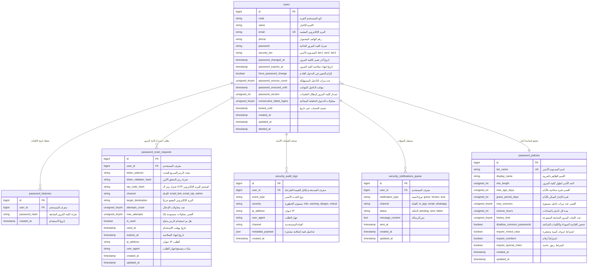

# المخطط المعماري الكامل لقاعدة بيانات الهوية والأمان
## Database Schema Blueprint for Ensan IAM & Password Lifecycle Management

---

### وثيقة رقم: `ENSAN-DB-SEC-2026-V1`
**المعد والمشرف:** البروفيسور مارتن شتاين ود. ماركوس فالك  
**المراجع الأمني والناقد:** المهندس فيكتور كايل (Devil's Advocate)  
**حالة الوثيقة:** مواصفة معمارية نهائية معتمدة (Production-Ready Architecture)  
**محرك قاعدة البيانات:** MySQL 8.0+ / MariaDB 10.5+ (InnoDB Engine, utf8mb4_unicode_ci)  

---

## 1. المخطط العلائقي الشامل لقاعدة البيانات (Entity-Relationship Diagram)



---

## 2. مواصفات الجداول وحقولها الدقيقة (Data Dictionary)

### أ. تحديثات جدول المستخدمين الأساسي (`users` Table Alterations)
يتم دعم جدول المستخدمين القائم بحقول إدارة دورة حياة الأمان والهوية:

| اسم الحقل | النوع الفني (Data Type) | القيود والفهارس | الوصف والغرض المعماري |
| :--- | :--- | :--- | :--- |
| `security_tier` | `VARCHAR(32)` | `DEFAULT 'tier2_field'`, `INDEX` | المستوى الأمني للمستخدم (`tier1_financial`, `tier2_field`, `tier3_volunteer`). |
| `password_changed_at` | `TIMESTAMP` | `NULLABLE` | تاريخ ووقت آخر تغيير فعلي لكلمة المرور؛ يُستخدم لحساب تاريخ انتهاء الصلاحية. |
| `password_expires_at` | `TIMESTAMP` | `NULLABLE`, `INDEX` | التاريخ الدقيق لانتهاء الصلاحية المحسوب تلقائياً حسب سياسة المستوى التابع له. |
| `force_password_change` | `TINYINT(1)` | `DEFAULT 0`, `INDEX` | علامة حتمية: إذا كانت `1` يُجبر المستخدم على التغيير فوراً دون إمكانية التخطي أو التأجيل. |
| `password_snooze_count` | `TINYINT UNSIGNED`| `DEFAULT 0` | رصيد مرات التأجيل المستهلكة من قبل المستخدم خلال مرحلة الاحتكاك (بحد أقصى مسموح). |
| `password_snoozed_until`| `TIMESTAMP` | `NULLABLE` | في حال استخدم تأجيلاً مؤقتاً، يسجل الموعد الذي ستظهر فيه نافذة الاحتكاك الإلزامية مجدداً. |
| `password_version` | `INT UNSIGNED` | `DEFAULT 1` | عداد ترقية؛ عند تغيير كلمة المرور يُزاد بـ 1 لإبطال جميع الجلسات القديمة في أجهزة أخرى فوراً. |
| `consecutive_failed_logins`| `TINYINT UNSIGNED`| `DEFAULT 0` | عداد محاولات الدخول الفاشلة المتتالية لحماية الحساب من هجمات التخمين التلقائي. |
| `locked_until` | `TIMESTAMP` | `NULLABLE`, `INDEX` | تاريخ وتوقيت رفع القفل التلقائي عن الحساب في حال تعرض لمحاولات اختراق متكررة. |

---

### ب. جدول سياسات كلمات المرور (`password_policies` Table)
جدول مركزي يسمح للإدارة بتعديل سياسات الأمان حسب المستويات دون الحاجة لتعديل الكود المصدري:

```sql
CREATE TABLE `password_policies` (
  `id` BIGINT UNSIGNED NOT NULL AUTO_INCREMENT,
  `tier_name` VARCHAR(32) NOT NULL UNIQUE COMMENT 'المفتاح البرمجي للمستوى: tier1_financial, tier2_field, tier3_volunteer',
  `display_name` VARCHAR(100) NOT NULL COMMENT 'الاسم التعريفي بالعربية',
  `min_length` INT UNSIGNED NOT NULL DEFAULT 10 COMMENT 'الحد الأدنى للطول',
  `max_age_days` INT UNSIGNED NOT NULL DEFAULT 90 COMMENT 'صلاحية كلمة المرور بالأيام',
  `grace_period_days` INT UNSIGNED NOT NULL DEFAULT 7 COMMENT 'أيام مهلة الإنذار المبكر قبل المنع',
  `max_snoozes` TINYINT UNSIGNED NOT NULL DEFAULT 3 COMMENT 'أقصى عدد مرات تأجيل مسموحة',
  `snooze_hours` INT UNSIGNED NOT NULL DEFAULT 8 COMMENT 'ساعات التأجيل لكل مرة',
  `history_limit` TINYINT UNSIGNED NOT NULL DEFAULT 6 COMMENT 'عدد كلمات المرور السابقة المحظور تكرارها',
  `disallow_common_passwords` TINYINT(1) NOT NULL DEFAULT 1 COMMENT 'حظر القائمة السوداء والكلمات الشائعة',
  `require_mixed_case` TINYINT(1) NOT NULL DEFAULT 0 COMMENT 'اشتراط حروف كبيرة وصغيرة',
  `require_numbers` TINYINT(1) NOT NULL DEFAULT 1 COMMENT 'اشتراط أرقام',
  `require_special_chars` TINYINT(1) NOT NULL DEFAULT 0 COMMENT 'اشتراط رموز خاصة (اختياري للعبارات الطويلة)',
  `created_at` TIMESTAMP NULL DEFAULT CURRENT_TIMESTAMP,
  `updated_at` TIMESTAMP NULL DEFAULT CURRENT_TIMESTAMP ON UPDATE CURRENT_TIMESTAMP,
  PRIMARY KEY (`id`)
) ENGINE=InnoDB DEFAULT CHARSET=utf8mb4 COLLATE=utf8mb4_unicode_ci COMMENT='سياسات كلمات المرور بحسب المستويات الأمنية';
```

---

### ج. جدول تاريخ كلمات المرور السابقة (`password_histories` Table)
يمنع دوران كلمات المرور أو إعادة إدخال نفس الكلمة القديمة:

```sql
CREATE TABLE `password_histories` (
  `id` BIGINT UNSIGNED NOT NULL AUTO_INCREMENT,
  `user_id` BIGINT UNSIGNED NOT NULL COMMENT 'معرف المستخدم صاحب الكلمة',
  `password_hash` VARCHAR(255) NOT NULL COMMENT 'تجزئة كلمة المرور المشفرة بـ Argon2id أو Bcrypt',
  `created_at` TIMESTAMP NOT NULL DEFAULT CURRENT_TIMESTAMP COMMENT 'تاريخ الاستخدام',
  PRIMARY KEY (`id`),
  KEY `idx_pwd_hist_user_id` (`user_id`),
  CONSTRAINT `fk_pwd_hist_user` FOREIGN KEY (`user_id`) REFERENCES `users` (`id`) ON DELETE CASCADE
) ENGINE=InnoDB DEFAULT CHARSET=utf8mb4 COLLATE=utf8mb4_unicode_ci COMMENT='سجل كلمات المرور السابقة لمنع التكرار';
```

---

### د. جدول طلبات الاسترداد والرموز المؤقتة (`password_reset_requests` Table)
إدارة طلبات استعادة الحسابات عبر البريد الإلكتروني المعتمد (رابط مباشر مشفر أو كود OTP رقمي) بأعلى معايير التشفير:

```sql
CREATE TABLE `password_reset_requests` (
  `id` BIGINT UNSIGNED NOT NULL AUTO_INCREMENT,
  `user_id` BIGINT UNSIGNED NOT NULL COMMENT 'معرف المستخدم الطالب',
  `token_selector` CHAR(16) NOT NULL COMMENT 'محدد الرمز المشفر للبحث السريع في قاعدة البيانات',
  `token_validator_hash` CHAR(64) NOT NULL COMMENT 'تجزئة رمز التحقق الآمنة (SHA-256) لمنع تسريب الرابط',
  `otp_code_hash` VARCHAR(255) NULL DEFAULT NULL COMMENT 'تجزئة رمز الـ OTP المشفر المكون من 6 أرقام المرسل عبر البريد',
  `channel` ENUM('email_link', 'email_otp', 'admin_assisted') NOT NULL DEFAULT 'email_link' COMMENT 'نوع الاسترداد: رابط بريد، كود OTP بريد، أو دعم إداري',
  `target_destination` VARCHAR(191) NOT NULL COMMENT 'البريد الإلكتروني الموجه له (مقنع جزئياً للأمان)',
  `attempts_count` TINYINT UNSIGNED NOT NULL DEFAULT 0 COMMENT 'عدد المحاولات الخاطئة المدخلة',
  `max_attempts` TINYINT UNSIGNED NOT NULL DEFAULT 3 COMMENT 'الحد الأقصى للمحاولات قبل الإلغاء والحظر',
  `is_used` TINYINT(1) NOT NULL DEFAULT 0 COMMENT 'هل تم استهلاك الرمز بنجاح',
  `used_at` TIMESTAMP NULL DEFAULT NULL COMMENT 'توقيت الاستهلاك الناجح',
  `expires_at` TIMESTAMP NOT NULL COMMENT 'تاريخ ووقت انتهاء الصلاحية الحتمي (15 دقيقة للرابط، 10 دقائق للـ OTP)',
  `ip_address` VARCHAR(45) NOT NULL COMMENT 'عنوان IP طالب الاسترداد',
  `user_agent` TEXT NULL COMMENT 'بيانات المتصفح أو التطبيق الطالب',
  `created_at` TIMESTAMP NULL DEFAULT CURRENT_TIMESTAMP,
  `updated_at` TIMESTAMP NULL DEFAULT CURRENT_TIMESTAMP ON UPDATE CURRENT_TIMESTAMP,
  PRIMARY KEY (`id`),
  KEY `idx_reset_selector` (`token_selector`),
  KEY `idx_reset_user_exp` (`user_id`, `expires_at`, `is_used`),
  CONSTRAINT `fk_pwd_reset_user` FOREIGN KEY (`user_id`) REFERENCES `users` (`id`) ON DELETE CASCADE
) ENGINE=InnoDB DEFAULT CHARSET=utf8mb4 COLLATE=utf8mb4_unicode_ci COMMENT='طلبات استرداد ورموز التحقق المؤقتة عبر البريد الإلكتروني';
```

---

### هـ. جدول سجل التدقيق الأمني الجنائي (`security_audit_logs` Table)
يوثق كل حركة أمنية بدقة جنائية لمراجعة الحسابات والامتثال المالي:

```sql
CREATE TABLE `security_audit_logs` (
  `id` BIGINT UNSIGNED NOT NULL AUTO_INCREMENT,
  `user_id` BIGINT UNSIGNED NULL DEFAULT NULL COMMENT 'معرف المستخدم إن وُجد',
  `event_type` VARCHAR(64) NOT NULL COMMENT 'نوع الحدث: login_failed, reset_requested, pwd_changed, snooze_used, account_locked, emergency_bypass',
  `severity` ENUM('info', 'warning', 'danger', 'critical') NOT NULL DEFAULT 'info' COMMENT 'مستوى الخطورة',
  `ip_address` VARCHAR(45) NOT NULL COMMENT 'عنوان IP مصدر العملية',
  `user_agent` TEXT NULL COMMENT 'بصمة المتصفح أو التطبيق',
  `channel` VARCHAR(32) NULL DEFAULT NULL COMMENT 'القناة المستخدمة إن وجدت',
  `metadata_payload` JSON NULL COMMENT 'بيانات إضافية مشفرة بصيغة JSON (تفاصيل الخطأ، أسباب الرفض)',
  `created_at` TIMESTAMP NOT NULL DEFAULT CURRENT_TIMESTAMP,
  PRIMARY KEY (`id`),
  KEY `idx_audit_user_event` (`user_id`, `event_type`),
  KEY `idx_audit_created` (`created_at`),
  KEY `idx_audit_severity` (`severity`)
) ENGINE=InnoDB DEFAULT CHARSET=utf8mb4 COLLATE=utf8mb4_unicode_ci COMMENT='سجل التدقيق الأمني الجنائي غير القابل للتعديل';
```

---

### و. جدول طابور الإشعارات الأمنية التراكمية (`security_notifications_queue` Table)
إدارة إرسال الإشعارات والتنبيهات المجدولة لمتابعة المتكاسلين:

```sql
CREATE TABLE `security_notifications_queue` (
  `id` BIGINT UNSIGNED NOT NULL AUTO_INCREMENT,
  `user_id` BIGINT UNSIGNED NOT NULL COMMENT 'معرف المستخدم المستهدف',
  `notification_type` ENUM('grace_reminder', 'friction_warning', 'soft_lock_warning', 'hard_lock_alert') NOT NULL,
  `channel` ENUM('in_app', 'email') NOT NULL DEFAULT 'in_app',
  `status` ENUM('pending', 'sent', 'failed') NOT NULL DEFAULT 'pending',
  `message_content` TEXT NOT NULL COMMENT 'نص التنبيه الإداري الموجه للمستخدم',
  `sent_at` TIMESTAMP NULL DEFAULT NULL,
  `error_details` TEXT NULL,
  `created_at` TIMESTAMP NULL DEFAULT CURRENT_TIMESTAMP,
  `updated_at` TIMESTAMP NULL DEFAULT CURRENT_TIMESTAMP ON UPDATE CURRENT_TIMESTAMP,
  PRIMARY KEY (`id`),
  KEY `idx_sec_notif_status` (`status`, `channel`),
  KEY `idx_sec_notif_user` (`user_id`),
  CONSTRAINT `fk_sec_notif_user` FOREIGN KEY (`user_id`) REFERENCES `users` (`id`) ON DELETE CASCADE
) ENGINE=InnoDB DEFAULT CHARSET=utf8mb4 COLLATE=utf8mb4_unicode_ci COMMENT='طابور إدارة وتتبع الإشعارات الأمنية';
```

---

## 3. البيانات الافتراضية الأولية (Database Seed Data)

تضمين السياسات الأساسية المعتمدة للمستويات الأمنية الثلاثة في `password_policies`:

```sql
INSERT INTO `password_policies` 
(`tier_name`, `display_name`, `min_length`, `max_age_days`, `grace_period_days`, `max_snoozes`, `snooze_hours`, `history_limit`, `disallow_common_passwords`, `require_mixed_case`, `require_numbers`, `require_special_chars`) 
VALUES
('tier1_financial', 'المستوى السيادي والمالي (خزائن، محاسبون، إدارة)', 14, 90, 5, 2, 4, 10, 1, 1, 1, 1),
('tier2_field', 'المستوى الميداني والعملياتي (مناديب، باحثون، ضيافة)', 10, 180, 7, 3, 8, 6, 1, 0, 1, 0),
('tier3_volunteer', 'المستوى التطوعي والخدمي (متطوعون، مهام عامة)', 8, 365, 14, 5, 12, 3, 1, 0, 0, 0)
ON DUPLICATE KEY UPDATE `updated_at` = CURRENT_TIMESTAMP;
```

---

## 4. استراتيجية الصيانة والتنظيف التلقائي (Automated Purge & Archival)

لحماية أداء قاعدة البيانات على المدى الطويل:
1. **أرشفة سجلات الاسترداد (`password_reset_requests`):**
   - يتم تشغيل أمر دوري مجدول (`php artisan auth:purge-expired-resets`) كل ليلة لحذف الطلبات منتهية الصلاحية التي تجاوزت 48 ساعة.
2. **حد تاريخ كلمات المرور (`password_histories`):**
   - عند إدراج كلمة مرور جديدة، يتم حذف السجلات القديمة التي تتجاوز حد `history_limit` المحدد في سياسة المستخدم (مثلاً الاحتفاظ بآخر 6 فقط وحذف ما قبلها تلقائياً).
3. **أرشفة سجل التدقيق (`security_audit_logs`):**
   - السجلات من مستوى `info` تُنقل إلى جدول أرشيفي شهري (`security_audit_logs_archive`) بعد مرور 180 يوماً، بينما تبقى سجلات `danger` و `critical` لمدة 3 سنوات التزاماً بالمعايير الرقابية والمالية.

