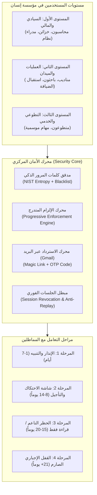
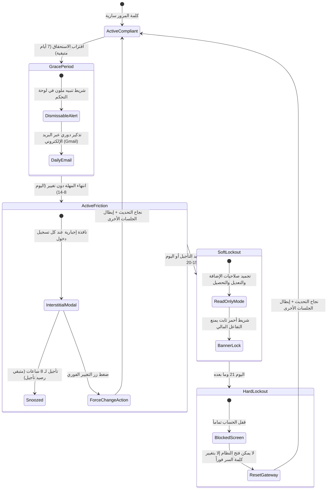
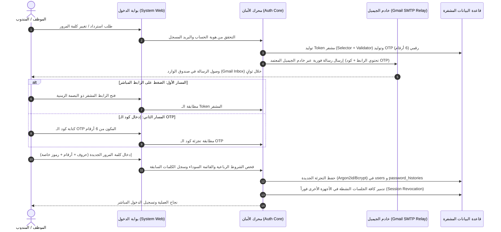

# المعمارية الأمنية المتقدمة لإدارة الهوية وكلمات المرور (IAM Architecture)
## نظام مؤسسة إنسان الخيرية والتنموية — الإصدار المعتمد 2.2

---

### وثيقة رقم: `ENSAN-IAM-ARCH-2026-V2.2`
**المعد والمشرف:** البروفيسور مارتن شتاين ود. ماركوس فالك  
**المراجع الأمني والناقد:** المهندس فيكتور كايل (Devil's Advocate)  
**مراجعة العمليات وسلوك المستخدم:** د. إلينا رومانوفا وأ. نادية الألفي  
**تاريخ الاعتماد:** 17 نوفمبر 2026  

---

## 1. الرؤية المعمارية وأهداف المنظومة

تهدف هذه المعمارية إلى حل المعادلة الصعبة في المؤسسات غير الهادفة للربح (NGOs): **تحقيق أعلى درجات الأمان السيبراني المتوافق مع معايير NIST SP 800-63B دون التسبب في شلل العمل الميداني أو حرمان المستفيدين من المساعدات العاجلة**.

---

## 2. مصفوفة المستويات الأمنية للمستخدمين (3-Tier Security Matrix)

لا يمكن تطبيق نفس السياسة التعسفية على الجميع؛ لذلك يقسم النظام مستخدمي مؤسسة إنسان إلى 3 مستويات دقيقة:

| المستوى الأمني | الأدوار والوظائف التابعة | متطلبات كلمة المرور | قنوات الاسترداد المعتمدة | فترة الصلاحية والتغيير الإلزامي |
| :--- | :--- | :--- | :--- | :--- |
| **المستوى 1: السيادي والمالي (Tier 1 - Sovereign/Financial)** | مدير عام، مدير مالي، أمين خزينة، مبرمج، مدير قاعدة بيانات، مسؤول الموارد البشرية | 14 حرفاً على الأقل، فحص الانتروبيا، حظر آخر 10 كلمات سابقة | بريد رسمي عبر الجيميل (Gmail Workspace) حصراً (رابط مشفر + كود OTP) | إلزامي كل 90 يوماً، مهلة سماح قصوى 5 أيام |
| **المستوى 2: الميدان والعمليات (Tier 2 - Field & Operations)** | مناديب التحصيل، باحثو الحالات، موظفو العلاقات العامة، استقبال دار الضيافة | 10 إلى 12 حرفاً (حروف + أرقام + رموز خاصة)، فحص القائمة السوداء، حظر آخر 6 كلمات | بريد إلكتروني معتمد عبر الجيميل (رابط مشفر أو كود OTP رقمي) | إلزامي كل 180 يوماً، مهلة سماح متدرجة 21 يوماً |
| **المستوى 3: التطوعي والخدمي (Tier 3 - Volunteers)** | متطوعو التعبئة، شباب الفعاليات، متطوعو العلاقات المجتمعية | 8 أحرف على الأقل، حظر الكلمات المبتذلة (123456 وغيرها) | بريد إلكتروني معتمد (رابط مباشر أو كود OTP) | سنوي أو عند الطلب، دون تعطيل للمتطوع |

---

## 3. محرك تدقيق كلمات المرور الذكي (Password Validation Engine)

تطبيقاً لمعايير **NIST SP 800-63B**:

### أ. القواعد المعمارية الإلزامية لتكوين كلمة المرور:
1. **التركيبة الرباعية الإلزامية (حروف + أرقام + رموز خاصة):**
   - الحد الأدنى للطول: **10 إلى 12 خانة**.
   - أن تحتوي على **حروف كبيرة (A-Z) وحروف صغيرة (a-z)**.
   - أن تحتوي على **أرقام (0-9)**.
   - أن تحتوي على **رموز خاصة (@#$%!&*^_+=?~-)**.
2. **فحص القائمة السوداء المحلية (Custom Blacklist):**
   - حظر أي كلمة سر تحتوي على: `ensan`, `إنسان`, `kafr`, `tanta`, `charity`, `admin`, `system`.
   - حظر احتواء كلمة المرور على اسم الموظف، كنيته، كود المستخدم (`D-XXXX` أو `V-XXXX`)، أو رقم هاتفه.
3. **فحص كلمات المرور المسربة والشائعة (Dictionary & Leaked Corpus):**
   - مطابقة كلمة المرور مع قائمة أفضل 10,000 كلمة مرور مسربة عالمياً لمنع الأنماط المبتذلة.
4. **منع التكرار (Anti-Recycling History):**
   - حظر إعادة استخدام آخر 6 كلمات مرور مسجلة في سجل تاريخ المستخدم.

### ب. مؤشر القوة اللحظي (Interactive Strength & Feedback Meter):
في الواجهة الأمامية، بدلاً من إظهار رسائل خطأ محبطة بعد إرسال النموذج:
- يظهر مؤشر ديناميكي (Dynamic Entropy Bar) يقيم قوة العبارة لحظياً (ضعيف - متوسط - قوي - ممتاز).
- يقدم نصائح ذكية: *"أضف كلمة أخرى لجعلها عبارة مرور سهلة الحفظ وعصية على الاختراق"*.

---

## 4. محرك الإلزام المتدرج للمماطلين (Progressive Enforcement Engine - PEE)

لحسم مشكلة "الناس اللي بتكبّر دماغها وتطنش"، لا يعتمد النظام على مجرد "إشعار" عابر، بل على **آلة حالة زمنية صارمة (State Machine)**:

### تفاصيل المراحل الأربع:

#### المرحلة 1: الإنذار المبكر المهذب (Early Grace Phase — الأيام 1 إلى 7)
- **الهدف:** توعية الموظف الحريص دون إزعاجه أثناء أداء مهامه.
- **الإجراء:** يظهر شريط تنبيه أخضر/أصفر في أعلى لوحة التحكم يوضح: *"تاريخ استحقاق تجديد كلمة المرور يحل بعد X أيام حرصاً على أمان بيانات المستفيدين"*. يمكن إغلاق الشريط.
- **التواصل:** إرسال إشعار تذكيري عبر البريد الإلكتروني.

#### المرحلة 2: نافذة الاحتكاك النشط والتأجيل المحدود (Active Friction Gate — الأيام 8 إلى 14)
- **الهدف:** كسر حالة التسويف لدى "المكبرين دماغهم".
- **الإجراء:** عند كل تسجيل دخول، تظهر نافذة كاملة (Modal Block) تمنع الوصول للوحة التحكم إلا بأحد خيارين:
  1. زر [تغيير كلمة المرور الآن].
  2. زر [تأجيل التغيير لـ 8 ساعات] — **يملك المستخدم رصيد 3 تأجيلات فقط (Max 3 Snoozes)**. عند استهلاكها ينطفئ زر التأجيل تماماً.

#### المرحلة 3: الحظر التشغيلي الناعم (Soft Lockdown / Read-Only — الأيام 15 إلى 20)
- **الهدف:** ممارسة ضغط تشغيلي فوري دون إيقاف الاطلاع على البيانات الهامة.
- **الإجراء:**
  - يتم تحويل صلاحيات المستخدم فورياً إلى **قراءة فقط (Read-Only Mode)**.
  - تُعطل أزرار الإجراءات: `[حفظ تبرع جديد]`، `[صرف مساعدة]`، `[تعديل حالة]`، `[ترحيل قيود]`.
  - تظهر رسالة نظام حمراء: *"تم تجميد صلاحيات الإدخال الخاصة بك نظراً لتجاوز موعد تحديث كلمة المرور. يرجى التحديث لاستعادة الصلاحيات فورا"*.

#### المرحلة 4: القفل الإجباري الصارم (Hard Lockout Gate — اليوم 21 وما بعده)
- **الهدف:** الحسم الأمني المطلق.
- **الإجراء:** يتم منع المستخدم تماماً من الدخول للنظام، وتحويله قسرياً إلى شاشة التعيين الإجباري (`/auth/force-password-change`)، ولا يمكن تصفح أي رابط داخل النظام حتى إتمام التعيين بنجاح.

---

## 5. محرك الاسترداد المعتمد: البريد الإلكتروني عبر الجيميل (Gmail - Magic Link & OTP Code)

يعتمد النظام **البريد الإلكتروني المعتمد للموظف عبر الجيميل (Gmail / Google Workspace)** كقناة حصرية معتمدة وآمنة للاسترداد وتحديث كلمات المرور، مع تزويد المستخدم بخيارين متكاملين داخل نفس الرسالة:
1. **الخيار الأول: الرابط المشفر المباشر (Cryptographic Magic Link):** رابط آمن مشفر بـ HMAC-SHA256 يتيح للموظف بضغطة واحدة فتح شاشة تعيين كلمة المرور الجديدة.
2. **الخيار الثاني: كود التحقق الرقمي المباشر (6-Digit OTP Code):** رمز رقمي من 6 أرقام يظهر بوضوح في الرسالة لتمكين الموظف من نسخه ولصقه في شاشة التحقق داخل النظام دون الحاجة لفتح الرابط في متصفح خارجي.

### أ. الأمان التشفيري للروابط السحرية عبر الجيميل (Cryptographic Magic Links):
1. **تشفير المعاملين (Split-Token Approach):**
   - الرمز لا يُخزن في قاعدة البيانات بصيغته الصريحة (Plaintext)، بل يُقسم إلى جزأين:
     - `$selector` (16 حرفاً): للبحث السريع في جدول `password_reset_requests`.
     - `$validator` (64 حرفاً): يُخزن مشفراً بـ `hash('sha256', $validator)` لمطابقته بزمن ثابت لمنع هجمات التوقيت (Timing Attacks).
2. **صلاحية الرابط:** **15 دقيقة فقط**، واستخدام لمرة واحدة (One-Time Use)؛ بمجرد الضغط عليه واستخدامه يُحرق الرمز فوراً (`is_used = 1`).

### ب. المواصفات الفنية لكود التحقق الرقمي (6-Digit Email OTP):
1. **التوليد العشوائي الآمن:**
   - توليد رقم عشوائي مشفر عبر دالة `random_int(100000, 999999)`.
   - تخزين التجزئة فقط في قاعدة البيانات عبر `Hash::make($otp)`.
2. **حدود المحاولات والحماية من التخمين (Rate Limiting):**
   - صلاحية كود الـ OTP: **10 دقائق**.
   - حد أقصى **3 محاولات إدخال خاطئة**؛ عند المحاولة الرابعة يُلغى الكود تماماً، ويُجمد طلب الاسترداد لـ 15 دقيقة مع تسجيل محاولة اختراق محتملة في `security_audit_logs`.
3. **توثيق خادم البريد (Mail Deliverability & Anti-Spam):**
   - الاعتماد الكامل على نطاق المؤسسة الموثق عبر **Google Workspace / Gmail SMTP** مع تفعيل سجلات `SPF` و `DKIM` و `DMARC` لضمان هبوط رسائل الاسترداد مباشرة في صندوق الوارد (Inbox) وتفادي تصنيفها كـ Spam نهائياً.

---

## 6. حماية الجلسات وكسر مسارات التهرب (Session & Token Hardening)

عندما يقوم أي مستخدم بتغيير كلمة مروره (أو يجبر على ذلك):
1. **تدمير الجلسات المفتوحة (Concurrent Session Revocation):**
   - يقوم النظام بتحديث عمود `password_version` أو تجزئة كلمة المرور في جدول المستخدم.
   - كود حماية الجلسة `LoginWebController` يتحقق في كل طلب (Middleware) من تطابق تجزئة كلمة المرور مع الجلسة (`_sec_pwd_hash`). عند عدم التطابق، تُسقط الجلسة فوراً ويُطرد المستخدم.
   - حذف سجلات `remember_token` القديمة من قاعدة البيانات فوراً لمنع التذكر التلقائي في أجهزة الموظف الأخرى أو الأجهزة المسروقة.
2. **سجل تدقيق الأمان الجنائي (Security Audit Trail):**
   - تسجيل كل حدث (طلب استرداد، محاولة OTP صحيحة أو خاطئة، تغيير كلمة مرور، تأجيل، قفل حساب) مع رقم الـ IP، والـ User-Agent، ونوع القناة المستخدمة في جدول مستقل لا يمكن حذفه.

---

## 7. بروتوكول طوارئ العمليات الميدانية (Field Emergency Protocol)

لتجنب تعطل المندوب أثناء وجوده في قرية نائية أو أمام متتبرع كبير:
- **رمز الطوارئ الميداني للاستخدام لمرة واحدة (Field Emergency One-Time Bypass):**
  - في حال انقطاع الإنترنت أو تعذر الوصول للبريد، يستطيع مدير الفرع أو الـ Super Admin، بعد التحقق الهاتفي من هوية المندوب، توليد **رمز طوارئ مؤقت** صالح لمدة **ساعتين فقط**.
  - يسمح هذا الرمز للمندوب بإنهاء إيصال التبرع المفتوح، مع توثيق اسم المدير الذي أصدر الرمز في سجل المخاطر الأمني تلقائياً.

