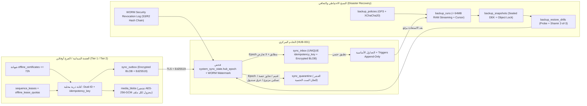

# المخطط الهندسي الشامل لقاعدة البيانات المؤسسية (Ensan Enterprise Database Schema v2.1)

**النسخة:** `v2.1 — Enterprise Offline-First, Cryptographic Backup & Zero-Trust Governance Edition`  
**تاريخ المراجعة والتحديث:** 16 نوفمبر 2026 (إصدار المراجعة النهائية قبل التصديق)  
**النطاق الجغرافي والتشغيلي:** المقر الرئيسي بكفر الشيخ، فرع طنطا، دور الضيافة الطبية، المكاتب الفرعية، أجهزة الباحثين الميدانيين (Tier 2)، البوابة الإلكترونية، وتطبيق الهاتف المحمول.

**إعداد ومراجعة المجلس الأعلى لإعادة التصميم:**
- **البروفيسور مارتن شتاين (Prof. Martin Stein)** — كبير مصممي الأنظمة المعمارية وقواعد البيانات المؤسسية.
- **د. ماركوس فانس (Dr. Marcus Vance)** — خبير المحاسبة المالية ومحاسبة الصناديق (`IPSAS / AAOIFI`).
- **د. عبد الرحمن السعدي (Dr. Abdulrahman Al-Saadi)** — خبير حوكمة العمل الخيري ومصارف الزكاة والأوقاف.
- **م. طارق النجار (Eng. Tariq Al-Najjar)** — كبير معماريي البيانات والأمن السيبراني والتشفير الميداني.
- **بمشاركة ومصادقة المديرين الإداريين الستة:** خالد المنشاوي (CFO)، سلمى غانم (البحث الاجتماعي والحالات)، د. حاتم الشافعي (دور الضيافة والأورام)، محمود الدسوقي (سلاسل الإمداد والمخازن واللوجيستيات)، ندى جودة (الموارد البشرية والتطوع)، وعمر السخاوي (تنمية الموارد وCRM والقنوات الموحدة).
- **التدقيق الجنائي وبوابات القبول الصارمة (10 Acceptance Gates):** **م. فيكتور كايل (Viktor Kael — «الشيطان الناقد»)**.

---

## 📐 أولاً: دستور هندسة البيانات المحدث لـ `v2.1` (10 قواعد صارمة غير قابلة للتفاوض)

تم ترقية دستور البيانات من 8 قواعد في `v2.0` إلى **10 قوانين معمارية ملزمة على مستوى محرك `InnoDB / MySQL 8.0+` وطبقة التطبيق**، بحيث يستحيل تجاوزها برمجياً أو عبر أي مزامنة أوفلاين:

1. **التطبيع القياسي الثالث (`3NF Normalization`) واجتثاث أعمدة الـ JSON العشوائية:**
   - يُحظر تخزين الكيانات القابلة للاستعلام أو الربط المالي/الاجتماعي داخل نصوص `JSON` (بما في ذلك إزالة أعمدة `medrar_details`، `zad_details`، و`ramadan_details` التي أُضيفت في تهجير `2026_11_15_100000` ونقلها إلى الجدول العلائقي `field_visit_program_assessments`، وإزالة `family_members` و`condition_photos` و`items_data` و`allocations`).
   - يُحصر استخدام `JSON` حصراً في حالتين تدقيقيتين غير قابلتين للاستعلام العلائقي (مع استبدال أي حمولة JSON عارية في طوابير المزامنة بحمولة مشفرة وموقّعة `LONGBLOB`):
     1. لقطات التدقيق الجنائي (`audit_logs.old_values` / `new_values`).
     2. لقطات طلبات الاعتماد الثنائي (`approval_requests.payload_before` / `payload_after`).
     *(ملاحظة: يُستخدم `TEXT` في `sync_quarantine.signed_lease_grant_json` فقط لإعادة إعمار التوقيع الممنوح أثناء المراجعة).*

2. **الأمان المرجعي الصارم وحظر `ON DELETE CASCADE` (`Zero Orphaned FKs & Strict RESTRICT`):**
   - كل عمود ينتهي بـ `_id` أو يشير لمرجع يملك قيد `FOREIGN KEY` صريح على مستوى المحرك.
   - **تُفرض سياسة `ON DELETE RESTRICT` إلزامياً** على كافة الجداول المالية، وجداول المستفيدين، والأسر، والمستندات، وسجلات التدقيق، والمستخدمين، والموظفين، والمتطوعين، والمخازن، ودور الضيافة، وطوابير المزامنة والنسخ الاحتياطي. يُمنع استخدام `ON DELETE CASCADE` نهائياً لحماية التاريخ المؤسسي من أي حذف متسلسل عرضي أو خبيث.
   - تُطبق الأرشفة الآمنة (`deleted_at TIMESTAMP NULL`) على الكيانات التشغيلية، بينما تُمنع حتى الأرشفة عن دفاتر الأستاذ غير القابلة للتعديل.

3. **نمط المعرف المزدوج القياسي (`Dual-ID Pattern`) على كل جدول قابل للمزامنة:**
   - الإبقاء على `id BIGINT UNSIGNED AUTO_INCREMENT PRIMARY KEY` لضمان كفاءة فهارس `B-Tree` والترابط المحلي السريع داخل الخادم أو العقدة.
   - إضافة الأعمدة الأربعة القياسية إلزامياً لكل جدول يقبل الإنشاء أو التعديل عبر العقد الطرفية أو المزامنة:
     - `public_ulid CHAR(26) UNIQUE NOT NULL` — المعرف الكوني القابل للفرز زمنياً والمستقل عن العقدة.
     - `origin_node_id VARCHAR(16) NOT NULL DEFAULT 'HUB-001'` — معرف العقدة المنشئة للسجل (`HUB-001`, `BR-KFS-01`, `DEV-RES-042`).
     - `sync_version BIGINT UNSIGNED NOT NULL DEFAULT 1` — رقم النسخة المتزايد لكشف التعارضات (`Optimistic Concurrency`).
     - `hub_epoch INT UNSIGNED NOT NULL DEFAULT 1` — حقبة السيرفر المركزي وقت الإنشاء؛ يرتفع آلياً `+1` بعد أي استعادة من نسخة احتياطية (`Restore`) لمنع العقد القديمة من تلويث القاعدة المستعادة.

4. **منع التكرار المفروض بقاعدة البيانات (`Database-Enforced Idempotency`):**
   - يُضاف عمود `idempotency_key VARCHAR(64) UNIQUE NOT NULL` (يقبل UUIDv4/v7 وULID) إلى كل جدول مالي، أو ميداني، أو مخزني، أو سكني، أو تقييمي، أو أمني يقبل الإرسال من الشبكة أو المزامنة أوفلاين (`treasury_transactions`, `donations`, `donation_allocations`, `expenses`, `beneficiary_disbursements`, `field_visits`, `shelter_stays`, `inventory_movements`, `sequence_leases`, `offline_lease_quotas`, `media_blobs`, `sync_outbox`, `sync_inbox`, `hourly_leave_permissions`, إلخ).
   - أي إعادة إرسال لنفس العملية تُقابل بقيد `UNIQUE` فتُعاد نتيجتها بأمان (`duplicate_ignored`) دون مضاعفة أرصدة أو إيصالات.

5. **الدقة الحسابية المالية (`DECIMAL(15, 2)`) ومبدأ الدفاتر غير القابلة للتعديل (`Append-Only Immutable Ledgers`):**
   - تُخزن كافة المبالغ المالية والنقدية بلا استثناء بنوع `DECIMAL(15, 2)` (بما في ذلك `charity_guide_exhibitions.exhibition_amount`) وكميات المخزون بنوع `DECIMAL(14, 3)`. يُمنع `FLOAT` و`DOUBLE` قطعياً.
   - جداول الأستاذ (`journal_entries`, `journal_entry_lines`, `treasury_transactions`, `inventory_movements`, `beneficiary_disbursements`, `audit_logs`) هي جداول **`Append-Only`** محمية بمحفزات قاعدة البيانات (`BEFORE UPDATE / BEFORE DELETE Triggers`) تمنع التعديل أو الحذف نهائياً. التصحيح يتم حصراً بحركة عكسية مرتبطة عبر `reversal_of_*_id UNIQUE`.

6. **توحيد القنوات (`Omnichannel Unification`):**
   - دمج كافة القنوات (`erp_branch`, `field_delegate_offline`, `offline_node`, `website`, `mobile_app`, `bank_transfer`, `pos`) في الجداول الأساسية عبر عمود `source_channel` الصريح دون أي جداول موازية (`web_*` أو `mobile_*`).

7. **توحيد البعد الجغرافي (`Unified Geographic Dimension`):**
   - ربط كافة الكيانات والفروع والأدلة والشركاء بمفاتيح `governorate_id`، `city_id`، و`branch_id`، وإزالة أي جداول أو أعمدة نصية حرة مسماة بأسماء مدن.

8. **الفصل الصارم للهوية عن الأدوار الوظيفية (`Identity vs. Profile Separation`):**
   - جدول `users` مخصص حصراً للمصادقة (`Authentication`) والأمن (`is_super_admin`, `security_stamp`, `token_version`).
   - البيانات الوظيفية والرواتب في `employees`، والمتطوعون في `volunteers`، والمتبرعون في `donors`، والمستفيدون في `beneficiaries`.

9. **عزل الصناديق الشرعية (`Fund Segregation`) ومنع الاعتماد الذاتي (`Anti-Self-Approval`):**
   - عزل كل جنيه داخل كل خزينة حسب الصندوق الشرعي (`treasury_fund_balances`) مع منع صرف المصروفات الإدارية من الصناديق المقيدة (`funds.allows_admin_expenses = FALSE`).
   - فرض قيود `CHECK` على مستوى قاعدة البيانات لمنع اعتماد الطلبات أو التقييمات لنفس المستخدم (`requested_by_user_id <> reviewed_by_user_id` و`evaluator_user_id <> subject_user_id`).

10. **سلامة العمل أوفلاين والتعافي من الكوارث (`Offline-First Cryptographic & Lease Integrity`):**
    - حماية جلسات الأوفلاين بشهادات موقّعة قصيرة الأمد (`offline_certificates` بحد أقصى 72 ساعة مع `user_key_kdf_salt` خاص بكل شهادة/مستخدم)، وحزم تسلسلات إيصالات معزولة (`sequence_leases` مع `signed_lease_grant` + `offline_receipt_allocations` بصيغة `{NODE}-E{EPOCH}-{SEQ}`)، وحصص عهد ومخزون وأسرّة مقيدة زمنياً (`offline_lease_quotas` بأعمدة مبلغ/كمية مفصولة)، وقيد التسكين الأحادي في الأسرّة (`UNIQUE(shelter_bed_id, active_stay_flag)`)، وتخزين مرفقات مشفر بعزل لكل ملف (`Per-Blob Isolated Encryption` في `media_blobs`)، ونسخ احتياطي مشفر (`X25519+XChaCha20Poly1305` / `X25519+AES256GCM`) محصن بـ `Object Lock` مع سجل إبطال غير قابل للتعديل (`WORM Security Revocation Log`) ومناورات استعادة (`backup_restore_drills`).

---

## 🔄 ثانياً: مصفوفة اختزال وتوحيد الجداول (من 140+ جدولاً مشتتاً في `v1` وتراكمات نوفمبر إلى 111 جدولاً مؤسسياً محكماً في `v2.1` عبر 11 نطاقاً)

> **توضيح هيكلي:** انطلقت خطة `v2.0` من اختزال 131 جدولاً قديماً إلى 68 كياناً/جدولاً أساسياً (72 جدولاً فعلياً مع الجداول التفصيلية). في **`v2.1`**، أُضيف **النطاق الحادي عشر الكامل (14 جدولاً)** للأوفلاين والمزامنة والنسخ الاحتياطي، مع استيعاب **إضافات نوفمبر 2026 الفعلية** وتطبيع سلسلة الإمداد والضبط الأمني والمالي وفصل أذون الساعات ومعارض الخيرات ليبلغ إجمالي الجداول القياسية **111 جدولاً مؤسسياً منضبطاً بالكامل بـ `3NF`** (حيث تشكل نواة الـ ~82 جدولاً تشغيلياً + 29 جدولاً تفصيلياً وتنفيذياً لأمن الوثائق، تقييمات الأداء، الأذونات بالساعات وأرصدتها، التوظيف الآمن بدون تسلسل، دليل الخيرات ومعارضه، دفعات المخزون، ومناورات الاستعادة).

| الجداول القديمة في `v1` أو إضافات نوفمبر 2026 غير المنضبطة | الخلل المرصود | التوحيد والإصلاح في `v2.1` | الجدول/الجداول البديلة في `v2.1` |
| :--- | :--- | :--- | :--- |
| `users` (تخليط الصلاحيات + `role` نصي + `salary` + `leave_balance` + `volunteer_hours` + `project_role`) | ثغرة تصعيد صلاحيات وخلط الهوية بالرواتب والتطوع | فصل المصادقة وإضافة `is_super_admin` و`security_stamp` و`token_version` | `users` + `roles` (`key`) + `role_user` + `permission_user` + `auth_revocation_events` + `employees` + `volunteers` |
| `donations`, `web_donations`, `mobile_donations`, `revenues` | 4 جداول متوازية وتداخل الإيصالات والمشاوير | توحيد القنوات + ترقيم `{NODE}-E{EPOCH}-{SEQ}` + `idempotency_key` | `donations` + `donation_allocations` + `donation_proofs` |
| `beneficiaries` (55 عموداً + JSON) + `zad_families` + `mobile_case_applications` | تكرار ثلاثي لأفراد الأسرة وفشل التطبيع | تطبيع كامل + تجزئة الهوية القومية + تقييمات مسار المشروع | `beneficiaries` + `beneficiary_household_members` + `beneficiary_medical_profiles` + `case_intake_applications` |
| `field_visits` (`medrar_details`, `zad_details`, `ramadan_details`, `family_members`, `condition_photos` JSON) | إدخال 3 أعمدة JSON جديدة في 15 نوفمبر 2026 | اجتثاث الـ JSON إلى جدول علائقي موحد + `media_blobs` | `field_visits` + `field_visit_program_assessments` + `beneficiary_documents` |
| `charity_guides` (`governorate`, `center`, `village` نصي + `exhibition_amount` VARCHAR) | أعمدة جغرافية نصية حرة ومبلغ معرض محشور كـ VARCHAR بدون SoftDeletes | ربط جغرافي صريح + فصل المعارض لجدول فرعي بمبلغ `DECIMAL(15,2)` + `SoftDeletes` + `Dual-ID` | `charity_guides` + `charity_guide_exhibitions` |
| `kafr_el_sheikh_*`, `tanta_workers`, `oncology_medicine_reps`, `collaborations`, `memberships` | 8 جداول جغرافية متكررة | توحيد في جدول مزودي الخدمات والشركاء | `external_service_providers` + `partner_agreements` + `partner_referrals` |
| `guest_houses`, `guest_house_stays` (بلا `active_stay_flag`), `web/mobile_room_bookings` | فقدان `departure_notes` وخطر التسكين المزدوج أوفلاين | توحيد دور الضيافة + قيد `UNIQUE(shelter_bed_id, active_stay_flag)` | `medical_shelters`, `shelter_wings`, `shelter_beds`, `shelter_booking_requests`, `shelter_stays`, `shelter_meals`, `shelter_meal_servings`, `facility_assets`, `shelter_asset_maintenances`, `psychological_support_reports` |
| `scheduled_trips`, `delegate_trips`, `donations` (مشاوير) + `inventory_transactions` | خلط المشاوير بالتبرعات وتضارب أرصدة المخزون | فصل اللوجيستيات والمشتريات والدفعات وتاريخ الصلاحية | `warehouses`, `item_categories`, `items`, `warehouse_stock_balances`, `item_batches`, `inventory_movements`, `suppliers`, `purchase_orders`, `purchase_order_items`, `delegates`, `travel_routes`, `logistics_trips`, `trip_stops` |
| `leaves` (`from_time`/`to_time` دون حصة شهرية), `hr_documents` (تخزين غير موثق), `employee_evaluations`, `volunteer_evaluations`, `job_applications` | غياب منع التقييم الذاتي، تعارض الحسابات الموقوفة/بدون حساب، ثغرة تعداد التوظيف، وخلط أذون الساعات بالإجازات | فصل أذون الساعات والأرصدة الشهرية، جعل `subject_user_id NULLABLE`، `128-bit CSPRNG` للتوظيف، و`media_blobs` + `document_access_acl` | `employees`, `employee_attendances`, `employee_leaves`, `hourly_leave_permissions`, `employee_monthly_permission_balances`, `employee_tasks`, `payroll_runs`, `payroll_items`, `hr_documents`, `employee_evaluations`, `volunteer_evaluations`, `job_applications`, `volunteer_applications`, `volunteers`, `volunteer_assignments`, `volunteer_logs` |
| لا يوجد نظام أوفلاين أو نسخ احتياطي مهيكَل في `v1` و`v2.0` | انقطاع الفروع، تضارب الإيصالات، وخطر `Restore` الصامت | بناء النطاق الحادي عشر الكامل للمزامنة والتشفير والتعافي | `system_sync_state`, `offline_nodes`, `offline_certificates`, `sequence_leases`, `offline_receipt_allocations`, `offline_lease_quotas`, `media_blobs`, `sync_outbox`, `sync_inbox`, `sync_quarantine`, `backup_policies`, `backup_runs`, `backup_snapshots`, `backup_restore_drills` |

---

## 🗺️ ثالثاً: المخطط العلائقي الشامل (`Master Mermaid ER Diagram & Offline/DR Architecture`)

### 1. المخطط العلائقي المؤسسي عبر النطاقات الـ 11 (`Master ER Diagram`)

```mermaid
erDiagram
    GOVERNORATES ||--o{ CITIES : contains
    GOVERNORATES ||--o{ BRANCHES : hosts
    BRANCHES ||--o{ USERS : assigns_primary
    USERS ||--o{ ROLE_USER : holds_roles
    ROLES ||--o{ ROLE_USER : granted_to
    ROLES ||--o{ PERMISSION_ROLE : bundles
    PERMISSIONS ||--o{ PERMISSION_ROLE : included_in
    USERS ||--o{ PERMISSION_USER : granted_direct
    USERS ||--o{ AUTH_REVOCATION_EVENTS : revoked_by
    USERS ||--o| EMPLOYEES : "has HR profile"
    USERS ||--o| VOLUNTEERS : "has volunteer profile"
    USERS ||--o| DONORS : "has donor account"
    MEDIA_BLOBS ||--o{ DOCUMENT_ACCESS_ACL : governed_by

    FUNDS ||--o{ TREASURY_FUND_BALANCES : segregates
    TREASURIES ||--o{ TREASURY_FUND_BALANCES : holds
    TREASURIES ||--o{ TREASURY_TRANSACTIONS : logs_immutable
    FINANCIAL_CLOSURES ||--o{ JOURNAL_ENTRIES : locks_period
    JOURNAL_ENTRIES ||--|{ JOURNAL_ENTRY_LINES : comprises
    CHART_OF_ACCOUNTS ||--o{ JOURNAL_ENTRY_LINES : posts_to
    FUNDS ||--o{ JOURNAL_ENTRY_LINES : tracks_fund
    PAYROLL_RUNS ||--|| PAYROLL_ACCOUNTING_POSTINGS : posts_gl

    DONORS ||--o{ DONATIONS : contributes
    DONATIONS ||--|{ DONATION_ALLOCATIONS : splits_into
    DONATIONS ||--o{ DONATION_PROOFS : evidenced_by
    DONORS ||--o{ SPONSORSHIP_CONTRACTS : commits_to
    SPONSORSHIP_CONTRACTS ||--o{ SPONSORSHIP_INSTALLMENTS : schedules

    BENEFICIARIES ||--o{ BENEFICIARY_HOUSEHOLD_MEMBERS : includes
    BENEFICIARIES ||--o| BENEFICIARY_MEDICAL_PROFILES : diagnoses
    BENEFICIARIES ||--o{ FIELD_VISITS : researched_in
    FIELD_VISITS ||--o| FIELD_VISIT_PROGRAM_ASSESSMENTS : details_3nf
    BENEFICIARIES ||--o{ BENEFICIARY_REASSESSMENTS : reviewed_every_6m
    BENEFICIARIES ||--o{ BENEFICIARY_DISBURSEMENTS : receives_aid
    BENEFICIARIES ||--o{ BENEFICIARY_CHRONIC_PRESCRIPTIONS : prescribed
    BRANCHES ||--o{ CHARITY_GUIDES : coordinates
    CHARITY_GUIDES ||--o{ CHARITY_GUIDE_EXHIBITIONS : organizes

    MEDICAL_SHELTERS ||--|{ SHELTER_WINGS : contains
    SHELTER_WINGS ||--|{ SHELTER_BEDS : houses
    SHELTER_BEDS ||--o{ SHELTER_STAYS : "occupied uniquely via active_stay_flag"
    BENEFICIARIES ||--o{ SHELTER_STAYS : accommodated
    BENEFICIARIES ||--o{ PSYCHOLOGICAL_SUPPORT_REPORTS : assessed_by

    WAREHOUSES ||--o{ WAREHOUSE_STOCK_BALANCES : tracks
    ITEMS ||--o{ WAREHOUSE_STOCK_BALANCES : stocked_as
    ITEMS ||--o{ ITEM_BATCHES : tracked_by_lot
    ITEM_BATCHES ||--o{ INVENTORY_MOVEMENTS : moves_batch
    SUPPLIERS ||--o{ PURCHASE_ORDERS : fulfills
    LOGISTICS_TRIPS ||--|{ TRIP_STOPS : visits

    EMPLOYEES ||--o{ EMPLOYEE_ATTENDANCES : clocks_gps
    EMPLOYEES ||--o{ EMPLOYEE_LEAVES : requests_days
    EMPLOYEES ||--o{ HOURLY_LEAVE_PERMISSIONS : requests_hours
    EMPLOYEES ||--o{ EMPLOYEE_MONTHLY_PERMISSION_BALANCES : tracks_quota
    EMPLOYEES ||--o{ EMPLOYEE_EVALUATIONS : evaluated_in
    VOLUNTEERS ||--o{ VOLUNTEER_EVALUATIONS : evaluated_in
    VOLUNTEERS ||--o{ VOLUNTEER_ASSIGNMENTS : assigned_to
    MEDIA_BLOBS ||--o{ HR_DOCUMENTS : encrypts_file
    MEDIA_BLOBS ||--o{ JOB_APPLICATIONS : stores_cv

    OFFLINE_NODES ||--o{ OFFLINE_CERTIFICATES : authenticates_with
    OFFLINE_NODES ||--o{ SEQUENCE_LEASES : leases_numbers
    SEQUENCE_LEASES ||--o{ OFFLINE_RECEIPT_ALLOCATIONS : allocates_seq
    OFFLINE_NODES ||--o{ OFFLINE_LEASE_QUOTAS : bounded_by_quota
    OFFLINE_NODES ||--o{ SYNC_OUTBOX : queues_locally
    SYNC_INBOX ||--o| SYNC_QUARANTINE : isolates_conflict
    BACKUP_POLICIES ||--o{ BACKUP_RUNS : triggers
    BACKUP_RUNS ||--o| BACKUP_SNAPSHOTS : produces
    BACKUP_SNAPSHOTS ||--o{ BACKUP_RESTORE_DRILLS : verified_by
```

### 2. معمارية تدفق الأوفلاين، حواجز الحقبة (`Epoch Fencing`)، والنسخ الاحتياطي المشفر

---

## 🏛️ رابعاً: التوصيف الجدولي الدقيق والكامل لجميع الجداول عبر النطاقات الـ 11 (111 جدولاً)

> **تذكير بالقيود القياسية المطبقة على كافة الجداول القابلة للمزامنة:**
> أينما ورد اختصار **`[Dual-ID Standard Columns]`** داخل الجداول أدناه، فإنه يمثل الأعمدة الأربعة الإلزامية التالية بالترتيب والدقة:
> - `public_ulid CHAR(26) UNIQUE NOT NULL`
> - `origin_node_id VARCHAR(16) NOT NULL DEFAULT 'HUB-001'`
> - `sync_version BIGINT UNSIGNED NOT NULL DEFAULT 1`
> - `hub_epoch INT UNSIGNED NOT NULL DEFAULT 1`
> وأينما ورد **`[Timestamps + SoftDeletes]`** فإنه يمثل `created_at TIMESTAMP NULL`, `updated_at TIMESTAMP NULL`, `deleted_at TIMESTAMP NULL`.

---

### النطاق الأول (Domain 01): الجغرافيا، الهوية، الصلاحيات، الأمن، والحوكمة (16 جدولاً)

#### 1. جدول المحافظات (`governorates`)
| اسم العمود | نوع البيانات | القيود والفهارس | الوصف التشغيلي |
| :--- | :--- | :--- | :--- |
| `id` | `BIGINT UNSIGNED` | `PK, AUTO_INCREMENT` | المعرف الفريد للمحافظة |
| `public_ulid` | `CHAR(26)` | `UNIQUE, NOT NULL` | المعرف العالمي القابل للمزامنة |
| `code` | `VARCHAR(20)` | `UNIQUE, NOT NULL` | كود المحافظة القياسي (`KFS`, `GHB`, `CAI`) |
| `name_ar` | `VARCHAR(100)` | `NOT NULL, INDEX` | اسم المحافظة بالعربية |
| `name_en` | `VARCHAR(100)` | `NULLABLE` | اسم المحافظة بالإنجليزية |
| `is_active` | `BOOLEAN` | `NOT NULL DEFAULT TRUE, INDEX` | حالة التفعيل |
| `created_at / updated_at` | `TIMESTAMP` | `NULLABLE` | طوابع الإنشاء والتحديث |

#### 2. جدول المراكز والمدن والقرى (`cities`)
| اسم العمود | نوع البيانات | القيود والفهارس | الوصف التشغيلي |
| :--- | :--- | :--- | :--- |
| `id` | `BIGINT UNSIGNED` | `PK, AUTO_INCREMENT` | المعرف الفريد للمدينة/المركز/القرية |
| `public_ulid` | `CHAR(26)` | `UNIQUE, NOT NULL` | المعرف العالمي |
| `governorate_id` | `BIGINT UNSIGNED` | `FK -> governorates(id) ON DELETE RESTRICT, NOT NULL, INDEX` | المحافظة التابع لها |
| `parent_city_id` | `BIGINT UNSIGNED` | `FK -> cities(id) ON DELETE RESTRICT, NULLABLE, INDEX` | المركز الأم (للربط الهرمي للقرى) |
| `name_ar` | `VARCHAR(120)` | `NOT NULL, INDEX` | الاسم بالعربية (دسوق، طنطا، بلطيم...) |
| `type` | `ENUM('city','center','village','district')` | `NOT NULL DEFAULT 'center'` | تصنيف الوحدة الجغرافية |
| `is_active` | `BOOLEAN` | `NOT NULL DEFAULT TRUE` | حالة التفعيل |
| `created_at / updated_at` | `TIMESTAMP` | `NULLABLE` | طوابع الوقت |

#### 3. جدول فروع ومقرات المؤسسة (`branches`)
| اسم العمود | نوع البيانات | القيود والفهارس | الوصف التشغيلي |
| :--- | :--- | :--- | :--- |
| `id` | `BIGINT UNSIGNED` | `PK, AUTO_INCREMENT` | المعرف الفريد للفرع |
| `public_ulid` | `CHAR(26)` | `UNIQUE, NOT NULL` | المعرف العالمي |
| `code` | `VARCHAR(30)` | `UNIQUE, NOT NULL` | كود الفرع (`BR-KFS-01`, `BR-TNT-01`) |
| `name` | `VARCHAR(150)` | `NOT NULL` | اسم الفرع أو المقر |
| `branch_type` | `ENUM('hq','regional_branch','medical_shelter','collection_office')` | `NOT NULL, INDEX` | نوع المقر |
| `governorate_id` | `BIGINT UNSIGNED` | `FK -> governorates(id) ON DELETE RESTRICT, NOT NULL` | المحافظة |
| `city_id` | `BIGINT UNSIGNED` | `FK -> cities(id) ON DELETE RESTRICT, NOT NULL` | المدينة / المركز |
| `address` | `VARCHAR(255)` | `NULLABLE` | العنوان التفصيلي |
| `latitude` | `DECIMAL(10, 7)` | `NULLABLE` | خط العرض (مرجع Geofence للحضور) |
| `longitude` | `DECIMAL(10, 7)` | `NULLABLE` | خط الطول |
| `geofence_radius_meters` | `INT UNSIGNED` | `NOT NULL DEFAULT 150` | نصف قطر السماح الجغرافي بالأمتار |
| `manager_user_id` | `BIGINT UNSIGNED` | `FK -> users(id) ON DELETE RESTRICT, NULLABLE` | مدير الفرع المسؤول |
| `is_active` | `BOOLEAN` | `NOT NULL DEFAULT TRUE, INDEX` | حالة التشغيل |
| `created_at / updated_at / deleted_at` | `TIMESTAMP` | `NULLABLE` | طوابع الوقت والحذف الآمن |

#### 4. جدول حسابات المصادقة الموحد (`users`)
> **إصلاح الثغرة الأمنية الجسيمة:** إلغاء الاعتماد على العمود النصي `role` في فحص الصلاحيات، واستبداله بعمود `is_super_admin` الصريح + `security_stamp` + `token_version` لإبطال الجلسات فوراً عند تغيير الصلاحية أو الإيقاف.

| اسم العمود | نوع البيانات | القيود والفهارس | الوصف التشغيلي |
| :--- | :--- | :--- | :--- |
| `id` | `BIGINT UNSIGNED` | `PK, AUTO_INCREMENT` | المعرف الفريد للحساب |
| `public_ulid` | `CHAR(26)` | `UNIQUE, NOT NULL` | المعرف العالمي |
| `origin_node_id` | `VARCHAR(16)` | `NOT NULL DEFAULT 'HUB-001'` | العقدة المنشئة |
| `sync_version` | `BIGINT UNSIGNED` | `NOT NULL DEFAULT 1` | رقم نسخة المزامنة |
| `hub_epoch` | `INT UNSIGNED` | `NOT NULL DEFAULT 1` | حقبة السيرفر |
| `name` | `VARCHAR(150)` | `NOT NULL, INDEX` | الاسم الكامل |
| `email` | `VARCHAR(150)` | `UNIQUE, NULLABLE` | البريد الإلكتروني |
| `phone` | `VARCHAR(30)` | `UNIQUE, NOT NULL, INDEX` | رقم الهاتف الأساسي (مفتاح المصادقة الموحد) |
| `password` | `VARCHAR(255)` | `NOT NULL` | كلمة المرور المشفرة (`Argon2id`) |
| `is_super_admin` | `BOOLEAN` | `NOT NULL DEFAULT FALSE, INDEX` | **العلم الصريح والمحصور للمدير الأعلى للنظام فقط** |
| `account_type` | `ENUM('staff','volunteer','donor','system_admin')` | `NOT NULL, INDEX` | تصنيف الحساب (للعزل عن بيانات الموارد البشرية) |
| `primary_branch_id` | `BIGINT UNSIGNED` | `FK -> branches(id) ON DELETE RESTRICT, NULLABLE, INDEX` | الفرع الأساسي للحساب |
| `is_global_scope` | `BOOLEAN` | `NOT NULL DEFAULT FALSE` | صلاحية الاطلاع على كافة الفروع (تُمنح للإدارة العليا فقط) |
| `security_stamp` | `CHAR(36)` | `NOT NULL` | ختم أمني يتجدد تلقائياً عند تغيير كلمة المرور أو الدور |
| `token_version` | `INT UNSIGNED` | `NOT NULL DEFAULT 1` | عداد إبطال التوكنات وجلسات الأوفلاين الفوري |
| `is_active` | `BOOLEAN` | `NOT NULL DEFAULT TRUE, INDEX` | حالة الحساب (نشط / موقوف) |
| `avatar_blob_ulid` | `CHAR(26)` | `FK -> media_blobs(blob_ulid) ON DELETE RESTRICT, NULLABLE` | معرف الصورة الشخصية في المخزن الموحد |
| `last_login_at` | `TIMESTAMP` | `NULLABLE` | آخر دخول ناجح |
| `last_login_ip` | `VARCHAR(45)` | `NULLABLE` | عنوان IP لآخر دخول |
| `created_at / updated_at / deleted_at` | `TIMESTAMP` | `NULLABLE` | طوابع الوقت والأرشفة |

#### 5. جدول الأدوار الوظيفية (`roles`)
> **قاعدة أمنية:** يعتمد النظام في الفحص البرمجي على عمود `key` حصراً، أما `name_ar` فللعرض في الواجهة فقط.

| اسم العمود | نوع البيانات | القيود والفهارس | الوصف التشغيلي |
| :--- | :--- | :--- | :--- |
| `id` | `BIGINT UNSIGNED` | `PK, AUTO_INCREMENT` | المعرف الفريد للدور |
| `public_ulid` | `CHAR(26)` | `UNIQUE, NOT NULL` | المعرف العالمي |
| `key` | `VARCHAR(80)` | `UNIQUE, NOT NULL` | المفتاح البرمجي الثابت (`super_admin`, `cfo`, `branch_manager`...) |
| `name_ar` | `VARCHAR(120)` | `NOT NULL` | المسمى العربي للعرض فقط |
| `description` | `VARCHAR(255)` | `NULLABLE` | توصيف الدور وحدوده |
| `is_system_protected` | `BOOLEAN` | `NOT NULL DEFAULT FALSE` | حماية الأدوار الحرجة من التعديل أو الحذف |
| `created_at / updated_at / deleted_at` | `TIMESTAMP` | `NULLABLE` | طوابع الوقت والأرشفة |

#### 6. جدول كتالوج الصلاحيات الذرية (`permissions`)
| اسم العمود | نوع البيانات | القيود والفهارس | الوصف التشغيلي |
| :--- | :--- | :--- | :--- |
| `id` | `BIGINT UNSIGNED` | `PK, AUTO_INCREMENT` | المعرف الفريد للصلاحية |
| `key` | `VARCHAR(120)` | `UNIQUE, NOT NULL` | مفتاح الصلاحية القياسي (`donations.view`, `donations.approve`, `hr_documents.manage`) |
| `module_group` | `VARCHAR(60)` | `NOT NULL, INDEX` | المجموعة البرمجية (`finance`, `casework`, `shelter`, `hr`, `sync`) |
| `action_type` | `ENUM('view','create','update','delete','approve','export','manage')` | `NOT NULL` | نوع الإجراء |
| `name_ar` | `VARCHAR(150)` | `NOT NULL` | الوصف العربي الدقيق للصلاحية |
| `created_at / updated_at` | `TIMESTAMP` | `NULLABLE` | طوابع الوقت |

#### 7. جدول ربط الأدوار بالصلاحيات (`permission_role`)
| اسم العمود | نوع البيانات | القيود والفهارس | الوصف التشغيلي |
| :--- | :--- | :--- | :--- |
| `permission_id` | `BIGINT UNSIGNED` | `FK -> permissions(id) ON DELETE RESTRICT, NOT NULL` | الصلاحية |
| `role_id` | `BIGINT UNSIGNED` | `FK -> roles(id) ON DELETE RESTRICT, NOT NULL` | الدور الوظيفي |
| `PRIMARY KEY` | `(permission_id, role_id)` | `PK` | منع التكرار |
| `created_at` | `TIMESTAMP` | `NULLABLE` | تاريخ الربط |

#### 8. جدول ربط المستخدمين بالأدوار ونطاق الفروع (`role_user`)
| اسم العمود | نوع البيانات | القيود والفهارس | الوصف التشغيلي |
| :--- | :--- | :--- | :--- |
| `id` | `BIGINT UNSIGNED` | `PK, AUTO_INCREMENT` | المعرف |
| `user_id` | `BIGINT UNSIGNED` | `FK -> users(id) ON DELETE RESTRICT, NOT NULL, INDEX` | المستخدم |
| `role_id` | `BIGINT UNSIGNED` | `FK -> roles(id) ON DELETE RESTRICT, NOT NULL, INDEX` | الدور المسند |
| `branch_id` | `BIGINT UNSIGNED` | `FK -> branches(id) ON DELETE RESTRICT, NULLABLE, INDEX` | الفرع المقيد (`NULL` = كافة فروع المستخدم إذا `is_global_scope=TRUE`) |
| `branch_scope_guard` | `BIGINT UNSIGNED` | `GENERATED ALWAYS AS (COALESCE(branch_id, 0)) STORED` | عمود حماية لضمان عدم تكرار `NULL` |
| `assigned_by_user_id` | `BIGINT UNSIGNED` | `FK -> users(id) ON DELETE RESTRICT, NULLABLE` | المسؤول المانح |
| `created_at / updated_at` | `TIMESTAMP` | `NULLABLE` | طوابع الوقت (`UNIQUE(user_id, role_id, branch_scope_guard)`) |

#### 9. جدول الصلاحيات المباشرة للمستخدمين (`permission_user`)
| اسم العمود | نوع البيانات | القيود والفهارس | الوصف التشغيلي |
| :--- | :--- | :--- | :--- |
| `id` | `BIGINT UNSIGNED` | `PK, AUTO_INCREMENT` | المعرف |
| `user_id` | `BIGINT UNSIGNED` | `FK -> users(id) ON DELETE RESTRICT, NOT NULL, INDEX` | المستخدم |
| `permission_id` | `BIGINT UNSIGNED` | `FK -> permissions(id) ON DELETE RESTRICT, NOT NULL, INDEX` | الصلاحية المباشرة |
| `branch_id` | `BIGINT UNSIGNED` | `FK -> branches(id) ON DELETE RESTRICT, NULLABLE` | الفرع المخصص للصلاحية |
| `branch_scope_guard` | `BIGINT UNSIGNED` | `GENERATED ALWAYS AS (COALESCE(branch_id, 0)) STORED` | حارس منع التكرار |
| `granted_by_user_id` | `BIGINT UNSIGNED` | `FK -> users(id) ON DELETE RESTRICT, NULLABLE` | المانح |
| `expires_at` | `TIMESTAMP` | `NULLABLE, INDEX` | صلاحية مؤقتة تنتهي آلياً (إن وجدت) |
| `created_at / updated_at` | `TIMESTAMP` | `NULLABLE` | (`UNIQUE(user_id, permission_id, branch_scope_guard)`) |

#### 10. جدول سياسات الموافقات الثنائية (`approval_policies` — Maker-Checker Rules)
| اسم العمود | نوع البيانات | القيود والفهارس | الوصف التشغيلي |
| :--- | :--- | :--- | :--- |
| `id` | `BIGINT UNSIGNED` | `PK, AUTO_INCREMENT` | المعرف |
| `action_key` | `VARCHAR(100)` | `UNIQUE, NOT NULL` | العملية (`expense.approve`, `treasury.reconcile`, `donation.reverse`, `payroll.post`, `sync_quarantine.resolve`) |
| `module_name` | `VARCHAR(60)` | `NOT NULL` | الوحدة |
| `threshold_amount` | `DECIMAL(15, 2)` | `NULLABLE` | الحد المالي لتفعيل السياسة |
| `required_permission_key` | `VARCHAR(120)` | `NOT NULL` | مفتاح الصلاحية اللازم للمعتمد (`Checker`) |
| `allow_self_approval` | `BOOLEAN` | `NOT NULL DEFAULT FALSE` | مقفل على `FALSE` للعمليات المالية والحساسة |
| `is_active` | `BOOLEAN` | `NOT NULL DEFAULT TRUE` | حالة التفعيل |
| `created_at / updated_at` | `TIMESTAMP` | `NULLABLE` | طوابع الوقت |

#### 11. جدول طلبات الموافقة والاعتماد (`approval_requests`)
| اسم العمود | نوع البيانات | القيود والفهارس | الوصف التشغيلي |
| :--- | :--- | :--- | :--- |
| `id` | `BIGINT UNSIGNED` | `PK, AUTO_INCREMENT` | المعرف |
| `public_ulid` | `CHAR(26)` | `UNIQUE, NOT NULL` | المعرف العالمي |
| `idempotency_key` | `VARCHAR(64)` | `UNIQUE, NOT NULL` | مفتاح عدم التكرار |
| `[Dual-ID Columns]` | `origin_node_id, sync_version, hub_epoch` | `NOT NULL` | أعمدة المزامنة القياسية |
| `policy_id` | `BIGINT UNSIGNED` | `FK -> approval_policies(id) ON DELETE RESTRICT, NOT NULL` | السياسة المطبقة |
| `branch_id` | `BIGINT UNSIGNED` | `FK -> branches(id) ON DELETE RESTRICT, NULLABLE, INDEX` | الفرع المعني |
| `target_type` | `VARCHAR(120)` | `NOT NULL, INDEX` | اسم الكيان المستهدف |
| `target_id` | `BIGINT UNSIGNED` | `NULLABLE, INDEX` | معرف السجل المستهدف |
| `target_public_ulid` | `CHAR(26)` | `NULLABLE, INDEX` | المعرف العالمي للسجل المستهدف (للمطابقة عبر العقد والأوفلاين) |
| `operation_type` | `ENUM('create','update','delete','reverse','reconcile','status_change','quarantine_resolve')` | `NOT NULL` | نوع الإجراء |
| `payload_before` | `JSON` | `NULLABLE` | الحالة قبل التعديل (للتدقيق فقط) |
| `payload_after` | `JSON` | `NOT NULL` | البيانات المطلوب اعتمادها |
| `status` | `ENUM('pending','approved','rejected','cancelled')` | `NOT NULL DEFAULT 'pending', INDEX` | حالة الطلب |
| `requested_by_user_id` | `BIGINT UNSIGNED` | `FK -> users(id) ON DELETE RESTRICT, NOT NULL, INDEX` | صانع الطلب (`Maker`) |
| `request_reason` | `TEXT` | `NULLABLE` | مبرر الطلب |
| `reviewed_by_user_id` | `BIGINT UNSIGNED` | `FK -> users(id) ON DELETE RESTRICT, NULLABLE, INDEX` | المعتمد (`Checker`) |
| `review_notes` | `TEXT` | `NULLABLE` | ملاحظات المراجعة |
| `reviewed_at` | `TIMESTAMP` | `NULLABLE` | وقت الاعتماد/الرفض |
| `CONSTRAINT chk_anti_self_approval` | `CHECK` | `(reviewed_by_user_id IS NULL OR requested_by_user_id <> reviewed_by_user_id)` | **حاجز منع الاعتماد الذاتي الصارم على مستوى القاعدة** |
| `created_at / updated_at` | `TIMESTAMP` | `NULLABLE` | طوابع الوقت |

#### 12. جدول الروابط الخارجية المؤقتة الموقعة (`external_access_tokens`)
| اسم العمود | نوع البيانات | القيود والفهارس | الوصف التشغيلي |
| :--- | :--- | :--- | :--- |
| `id` | `BIGINT UNSIGNED` | `PK, AUTO_INCREMENT` | المعرف |
| `token_hash` | `CHAR(64)` | `UNIQUE, NOT NULL` | بصمة `SHA-256` للرابط المؤقت |
| `purpose` | `ENUM('reassessment_form','psychosocial_form','donor_receipt','job_tracking')` | `NOT NULL, INDEX` | الغرض المسموح |
| `target_type` | `VARCHAR(120)` | `NOT NULL` | الكيان المستهدف |
| `target_id` | `BIGINT UNSIGNED` | `NOT NULL` | المعرف المستهدف |
| `max_uses` | `TINYINT UNSIGNED` | `NOT NULL DEFAULT 1` | الحد الأقصى للاستخدام |
| `used_count` | `TINYINT UNSIGNED` | `NOT NULL DEFAULT 0` | عدد مرات الاستخدام الفعلي |
| `expires_at` | `TIMESTAMP` | `NOT NULL, INDEX` | وقت انتهاء الصلاحية الإلزامي |
| `revoked_at` | `TIMESTAMP` | `NULLABLE` | وقت الإبطال اليدوي |
| `created_by_user_id` | `BIGINT UNSIGNED` | `FK -> users(id) ON DELETE RESTRICT, NULLABLE` | منشئ الرابط |
| `created_at` | `TIMESTAMP` | `NOT NULL` | وقت الإنشاء |

#### 13. جدول قوائم التحكم بالوصول للوثائق والملفات الخاصة (`document_access_acl`)
> **يعالج ثغرة تخزين ملفات الموارد البشرية والسير الذاتية والمستندات الطبية بمخازن عامة:** يفرض فحص ACL قبل إصدار أي رابط تنزيل مؤقت من `media_blobs`.

| اسم العمود | نوع البيانات | القيود والفهارس | الوصف التشغيلي |
| :--- | :--- | :--- | :--- |
| `id` | `BIGINT UNSIGNED` | `PK, AUTO_INCREMENT` | المعرف |
| `public_ulid` | `CHAR(26)` | `UNIQUE, NOT NULL` | المعرف العالمي |
| `blob_ulid` | `CHAR(26)` | `FK -> media_blobs(blob_ulid) ON DELETE RESTRICT, NOT NULL, INDEX` | الملف المحمي في التخزين المشفر |
| `entity_type` | `ENUM('hr_document','job_application_cv','beneficiary_document','donation_proof','attendance_selfie')` | `NOT NULL, INDEX` | تصنيف الوثيقة |
| `entity_id` | `BIGINT UNSIGNED` | `NOT NULL, INDEX` | معرف السجل المالك |
| `entity_public_ulid` | `CHAR(26)` | `NULLABLE, INDEX` | المعرف العالمي للسجل المالك |
| `principal_type` | `ENUM('role','user','department','branch')` | `NOT NULL` | نوع الجهة المخولة |
| `principal_id` | `BIGINT UNSIGNED` | `NOT NULL` | معرف الدور أو المستخدم أو القسم أو الفرع |
| `access_level` | `ENUM('view_watermarked','download_original','manage')` | `NOT NULL DEFAULT 'view_watermarked'` | مستوى الوصول الممنوح |
| `expires_at` | `TIMESTAMP` | `NULLABLE, INDEX` | تاريخ انتهاء التفويض |
| `granted_by_user_id` | `BIGINT UNSIGNED` | `FK -> users(id) ON DELETE RESTRICT, NOT NULL` | مانح التفويض |
| `created_at / revoked_at` | `TIMESTAMP` | `NULLABLE` | وقت المنح أو السحب |
| `active_acl_flag` | `TINYINT(1)` | `GENERATED ALWAYS AS (IF(revoked_at IS NULL, 1, NULL)) STORED` | **حارس إعادة منح التفويض: `UNIQUE(blob_ulid, principal_type, principal_id, active_acl_flag)`** |

#### 14. جدول السجل الجنائي للتدقيق (`audit_logs` — Immutable Append-Only)
| اسم العمود | نوع البيانات | القيود والفهارس | الوصف التشغيلي |
| :--- | :--- | :--- | :--- |
| `id` | `BIGINT UNSIGNED` | `PK, AUTO_INCREMENT` | المعرف المتسلسل |
| `public_ulid` | `CHAR(26)` | `UNIQUE, NOT NULL` | المعرف العالمي |
| `idempotency_key` | `VARCHAR(64)` | `UNIQUE, NOT NULL` | منع تكرار سجل التدقيق عند المزامنة |
| `[Dual-ID Columns]` | `origin_node_id, sync_version, hub_epoch` | `NOT NULL` | بيانات العقدة والحقبة |
| `user_id` | `BIGINT UNSIGNED` | `FK -> users(id) ON DELETE RESTRICT, NULLABLE, INDEX` | المنفذ |
| `branch_id` | `BIGINT UNSIGNED` | `FK -> branches(id) ON DELETE RESTRICT, NULLABLE, INDEX` | الفرع |
| `event_type` | `VARCHAR(60)` | `NOT NULL, INDEX` | الحدث (`created`, `updated`, `approved`, `reversed`, `quarantined`, `restored`) |
| `auditable_type` | `VARCHAR(120)` | `NOT NULL, INDEX` | اسم الكيان |
| `auditable_id` | `BIGINT UNSIGNED` | `NOT NULL, INDEX` | معرف السجل |
| `auditable_public_ulid` | `CHAR(26)` | `NULLABLE, INDEX` | المعرف العالمي للسجل المتتبع |
| `old_values` | `JSON` | `NULLABLE` | القيم السابقة |
| `new_values` | `JSON` | `NULLABLE` | القيم الجديدة |
| `ip_address` | `VARCHAR(45)` | `NULLABLE` | عنوان IP |
| `user_agent` | `VARCHAR(255)` | `NULLABLE` | وكيل المستخدم / بصمة الجهاز |
| `created_at` | `TIMESTAMP(3)` | `NOT NULL, INDEX` | وقت الحدث بدقة المللي ثانية (لا يُحدث ولا يُحذف) |

#### 15. جدول مفاتيح الوصول البرمجية (`personal_access_tokens`)
| اسم العمود | نوع البيانات | القيود والفهارس | الوصف التشغيلي |
| :--- | :--- | :--- | :--- |
| `id` | `BIGINT UNSIGNED` | `PK, AUTO_INCREMENT` | المعرف |
| `tokenable_type` | `VARCHAR(120)` | `NOT NULL` | فئة المالك (`App\Models\User`) |
| `tokenable_id` | `BIGINT UNSIGNED` | `NOT NULL, INDEX` | معرف المستخدم |
| `name` | `VARCHAR(120)` | `NOT NULL` | اسم الجهاز / العميل |
| `token_hash` | `CHAR(64)` | `UNIQUE, NOT NULL` | تجزئة `SHA-256` للتوكن |
| `token_version_snapshot` | `INT UNSIGNED` | `NOT NULL` | لقطة `users.token_version` وقت الإصدار (يُرفض إذا اختلف!) |
| `hub_epoch` | `INT UNSIGNED` | `NOT NULL DEFAULT 1` | حقبة السيرفر وقت إصدار التوكن (يُبطل تلقائياً عند أي استعادة `Restore`) |
| `abilities` | `VARCHAR(500)` | `NOT NULL DEFAULT '*'` | نطاق الصلاحيات الممنوحة للتوكن |
| `last_used_at` | `TIMESTAMP` | `NULLABLE` | آخر استخدام |
| `expires_at` | `TIMESTAMP` | `NOT NULL, INDEX` | تاريخ انتهاء التوكن الإجباري |
| `revoked_at` | `TIMESTAMP` | `NULLABLE, INDEX` | تاريخ الإلغاء الفوري |
| `created_at / updated_at` | `TIMESTAMP` | `NULLABLE` | طوابع الوقت |

#### 16. جدول أحداث الإبطال الأمني الفوري (`auth_revocation_events`)
| اسم العمود | نوع البيانات | القيود والفهارس | الوصف التشغيلي |
| :--- | :--- | :--- | :--- |
| `id` | `BIGINT UNSIGNED` | `PK, AUTO_INCREMENT` | المعرف |
| `public_ulid` | `CHAR(26)` | `UNIQUE, NOT NULL` | المعرف العالمي |
| `user_id` | `BIGINT UNSIGNED` | `FK -> users(id) ON DELETE RESTRICT, NOT NULL, INDEX` | المستخدم المستهدف بالإبطال |
| `reason` | `ENUM('password_changed','role_or_permission_changed','user_suspended','device_lost','offline_cert_revoked','security_incident')` | `NOT NULL, INDEX` | سبب الإبطال |
| `previous_token_version` | `INT UNSIGNED` | `NOT NULL` | رقم النسخة السابق |
| `new_token_version` | `INT UNSIGNED` | `NOT NULL` | رقم النسخة الجديد |
| `triggered_by_user_id` | `BIGINT UNSIGNED` | `FK -> users(id) ON DELETE RESTRICT, NULLABLE` | المسؤول الذي فعّل الإبطال |
| `revoked_at` | `TIMESTAMP` | `NOT NULL, INDEX` | وقت السريان الفوري |

---

### النطاق الثاني (Domain 02): المحاسبة المالية، الصناديق الشرعية، الخزائن، العهد، والمصروفات (14 جدولاً)

#### 17. جدول الصناديق الشرعية والمالية (`funds` — Fund Accounting Core)
| اسم العمود | نوع البيانات | القيود والفهارس | الوصف التشغيلي |
| :--- | :--- | :--- | :--- |
| `id` | `BIGINT UNSIGNED` | `PK, AUTO_INCREMENT` | المعرف الفريد للصندوق |
| `public_ulid` | `CHAR(26)` | `UNIQUE, NOT NULL` | المعرف العالمي |
| `code` | `VARCHAR(30)` | `UNIQUE, NOT NULL` | الكود القياسي (`FND-ZAKAT-MAL`, `FND-SADAQA-JAR`, `FND-ORPHANS`, `FND-ONCOLOGY`, `FND-ADMIN`) |
| `name_ar` | `VARCHAR(120)` | `NOT NULL` | اسم الصندوق بالعربية |
| `restriction_type` | `ENUM('sharia_restricted','donor_restricted','unrestricted','operational')` | `NOT NULL, INDEX` | تصنيف التقييد الشرعي والقانوني |
| `allows_admin_expenses` | `BOOLEAN` | `NOT NULL DEFAULT FALSE` | **`FALSE` لأموال الزكاة والكفالات المقيدة** |
| `max_admin_overhead_pct` | `DECIMAL(5, 2)` | `NOT NULL DEFAULT 0.00` | الحد الأقصى القانوني للنسبة الإدارية (`CONSTRAINT chk_fund_admin_pct CHECK (allows_admin_expenses = TRUE OR max_admin_overhead_pct = 0.00)`) |
| `is_active` | `BOOLEAN` | `NOT NULL DEFAULT TRUE` | حالة التفعيل |
| `created_at / updated_at` | `TIMESTAMP` | `NULLABLE` | طوابع الوقت |

#### 18. جدول شجرة الحسابات المحاسبية (`chart_of_accounts`)
| اسم العمود | نوع البيانات | القيود والفهارس | الوصف التشغيلي |
| :--- | :--- | :--- | :--- |
| `id` | `BIGINT UNSIGNED` | `PK, AUTO_INCREMENT` | المعرف |
| `public_ulid` | `CHAR(26)` | `UNIQUE, NOT NULL` | المعرف العالمي |
| `code` | `VARCHAR(30)` | `UNIQUE, NOT NULL` | رقم الحساب المحاسبي (`10101`, `40101`, `50101`...) |
| `name_ar` | `VARCHAR(150)` | `NOT NULL` | اسم الحساب بالعربية |
| `name_en` | `VARCHAR(150)` | `NULLABLE` | اسم الحساب بالإنجليزية |
| `parent_id` | `BIGINT UNSIGNED` | `FK -> chart_of_accounts(id) ON DELETE RESTRICT, NULLABLE` | الحساب الأب |
| `account_type` | `ENUM('asset','liability','net_assets','revenue','expense')` | `NOT NULL, INDEX` | نوع الحساب |
| `normal_balance` | `ENUM('debit','credit')` | `NOT NULL` | الطبيعة المحاسبية |
| `is_postable` | `BOOLEAN` | `NOT NULL DEFAULT TRUE` | يقبل ترحيل قيود مباشرة أم حساب أب تجميعي |
| `default_fund_id` | `BIGINT UNSIGNED` | `FK -> funds(id) ON DELETE RESTRICT, NULLABLE` | الصندوق الافتراضي |
| `is_active` | `BOOLEAN` | `NOT NULL DEFAULT TRUE` | الحالة |
| `created_at / updated_at` | `TIMESTAMP` | `NULLABLE` | طوابع الوقت |

#### 19. جدول الخزائن والحسابات البنكية والمحافظ (`treasuries`)
| اسم العمود | نوع البيانات | القيود والفهارس | الوصف التشغيلي |
| :--- | :--- | :--- | :--- |
| `id` | `BIGINT UNSIGNED` | `PK, AUTO_INCREMENT` | المعرف |
| `public_ulid` | `CHAR(26)` | `UNIQUE, NOT NULL` | المعرف العالمي |
| `[Dual-ID Columns]` | `origin_node_id, sync_version, hub_epoch` | `NOT NULL` | أعمدة المزامنة |
| `code` | `VARCHAR(30)` | `UNIQUE, NOT NULL` | كود الخزينة (`TR-KFS-CASH`, `TR-SHELTER-KFS`, `TR-VOD-01`) |
| `name` | `VARCHAR(150)` | `NOT NULL` | اسم الخزينة / الحساب البنكي |
| `branch_id` | `BIGINT UNSIGNED` | `FK -> branches(id) ON DELETE RESTRICT, NOT NULL, INDEX` | الفرع التابع له |
| `specialization_scope` | `ENUM('main','reception','medical_shelter','project','campaign','bank_gateway')` | `NOT NULL, INDEX` | **نطاق العزل التخصصي للخزينة (منع خلط خزينة الاستقبال بدار الضيافة)** |
| `medical_shelter_id` | `BIGINT UNSIGNED` | `FK -> medical_shelters(id) ON DELETE RESTRICT, NULLABLE, INDEX` | دار الضيافة المرتبطة (إن كانت `medical_shelter`) |
| `project_id` | `BIGINT UNSIGNED` | `FK -> projects(id) ON DELETE RESTRICT, NULLABLE, INDEX` | المشروع المرتبط (إن كانت `project`) |
| `campaign_id` | `BIGINT UNSIGNED` | `FK -> campaigns(id) ON DELETE RESTRICT, NULLABLE, INDEX` | الحملة المرتبطة (إن كانت `campaign`) |
| `gl_account_id` | `BIGINT UNSIGNED` | `FK -> chart_of_accounts(id) ON DELETE RESTRICT, NOT NULL` | الحساب المقابل في شجرة الحسابات |
| `treasury_type` | `ENUM('cash_safe','bank_account','mobile_wallet','instapay','pos_terminal')` | `NOT NULL, INDEX` | نوع الوعاء النقدي |
| `account_number` | `VARCHAR(100)` | `NULLABLE` | رقم الحساب / المحفظة / IBAN |
| `currency` | `CHAR(3)` | `NOT NULL DEFAULT 'EGP'` | العملة |
| `opening_balance` | `DECIMAL(15, 2)` | `NOT NULL DEFAULT 0.00` | الرصيد الافتتاحي عند الإنشاء (ثابت) |
| `current_balance` | `DECIMAL(15, 2)` | `NOT NULL DEFAULT 0.00` | الرصيد الكلي الفعلي (يطابق مجموع `treasury_fund_balances`) |
| `custodian_user_id` | `BIGINT UNSIGNED` | `FK -> users(id) ON DELETE RESTRICT, NULLABLE` | أمين الخزينة المسؤول |
| `is_active` | `BOOLEAN` | `NOT NULL DEFAULT TRUE` | الحالة |
| `created_at / updated_at / deleted_at` | `TIMESTAMP` | `NULLABLE` | طوابع الوقت والأرشفة |

#### 20. جدول أرصدة الصناديق داخل كل خزينة (`treasury_fund_balances`)
| اسم العمود | نوع البيانات | القيود والفهارس | الوصف التشغيلي |
| :--- | :--- | :--- | :--- |
| `id` | `BIGINT UNSIGNED` | `PK, AUTO_INCREMENT` | المعرف |
| `treasury_id` | `BIGINT UNSIGNED` | `FK -> treasuries(id) ON DELETE RESTRICT, NOT NULL` | الخزينة |
| `fund_id` | `BIGINT UNSIGNED` | `FK -> funds(id) ON DELETE RESTRICT, NOT NULL` | الصندوق الشرعي |
| `balance` | `DECIMAL(15, 2)` | `NOT NULL DEFAULT 0.00` | الرصيد المعزول لهذا الصندوق داخل الخزينة |
| `updated_at` | `TIMESTAMP` | `NULLABLE` | (`UNIQUE(treasury_id, fund_id)`, `CHECK (balance >= 0.00)`) |

#### 21. جدول الفترات والإغلاقات المالية (`financial_closures`)
| اسم العمود | نوع البيانات | القيود والفهارس | الوصف التشغيلي |
| :--- | :--- | :--- | :--- |
| `id` | `BIGINT UNSIGNED` | `PK, AUTO_INCREMENT` | المعرف |
| `public_ulid` | `CHAR(26)` | `UNIQUE, NOT NULL` | المعرف العالمي |
| `period_code` | `VARCHAR(20)` | `UNIQUE, NOT NULL` | كود الفترة (`FY2026-M11`, `FY2026-ANNUAL`) |
| `period_type` | `ENUM('monthly','quarterly','annual')` | `NOT NULL DEFAULT 'monthly'` | نوع الإقفال |
| `branch_id` | `BIGINT UNSIGNED` | `FK -> branches(id) ON DELETE RESTRICT, NULLABLE, INDEX` | الفرع (`NULL` = إقفال مركزي شامل) |
| `start_date` | `DATE` | `NOT NULL` | تاريخ بداية الفترة |
| `end_date` | `DATE` | `NOT NULL` | تاريخ نهاية الفترة |
| `status` | `ENUM('open','closing_review','closed')` | `NOT NULL DEFAULT 'open', INDEX` | يمنع الترحيل لأي تاريخ يقع في فترة `closed` |
| `closure_hash_sha256` | `CHAR(64)` | `NULLABLE` | بصمة التحقق لأرصدة ميزان المراجعة لحظة الإقفال |
| `closed_by_user_id` | `BIGINT UNSIGNED` | `FK -> users(id) ON DELETE RESTRICT, NULLABLE` | المدير المالي المعتمد للإقفال |
| `closed_at` | `TIMESTAMP` | `NULLABLE` | وقت الإقفال النهائي |
| `created_at / updated_at` | `TIMESTAMP` | `NULLABLE` | طوابع الوقت |

#### 22. جدول رأس قيود اليومية (`journal_entries` — Append-Only Immutable)
| اسم العمود | نوع البيانات | القيود والفهارس | الوصف التشغيلي |
| :--- | :--- | :--- | :--- |
| `id` | `BIGINT UNSIGNED` | `PK, AUTO_INCREMENT` | المعرف الفريد للقيد |
| `public_ulid` | `CHAR(26)` | `UNIQUE, NOT NULL` | المعرف العالمي |
| `idempotency_key` | `VARCHAR(64)` | `UNIQUE, NOT NULL` | منع ازدواج القيد المحاسبي |
| `[Dual-ID Columns]` | `origin_node_id, sync_version, hub_epoch` | `NOT NULL` | أعمدة المزامنة |
| `entry_number` | `VARCHAR(48)` | `UNIQUE, NOT NULL` | رقم القيد المتسلسل (`{NODE}-E{EPOCH}-JE-{SEQ}`) |
| `financial_closure_id` | `BIGINT UNSIGNED` | `FK -> financial_closures(id) ON DELETE RESTRICT, NOT NULL, INDEX` | الفترة المالية |
| `branch_id` | `BIGINT UNSIGNED` | `FK -> branches(id) ON DELETE RESTRICT, NOT NULL, INDEX` | الفرع |
| `entry_date` | `DATE` | `NOT NULL, INDEX` | تاريخ القيد |
| `reference_type` | `VARCHAR(100)` | `NOT NULL, INDEX` | الكيان المصدر (`Donation`, `Expense`, `TreasuryReconciliation`, `PayrollRun`) |
| `reference_id` | `BIGINT UNSIGNED` | `NOT NULL, INDEX` | رقم الكيان المصدر |
| `description` | `VARCHAR(500)` | `NOT NULL` | البيان |
| `total_debit` | `DECIMAL(15, 2)` | `NOT NULL` | إجمالي المدين (`CHECK (total_debit = total_credit AND total_debit > 0)`) |
| `total_credit` | `DECIMAL(15, 2)` | `NOT NULL` | إجمالي الدائن |
| `status` | `ENUM('posted','reversed')` | `NOT NULL DEFAULT 'posted', INDEX` | حالة القيد |
| `reversal_of_entry_id` | `BIGINT UNSIGNED` | `FK -> journal_entries(id) ON DELETE RESTRICT, UNIQUE, NULLABLE` | القيد المعكوس (`UNIQUE` تمنع عكسه مرتين) |
| `created_by_user_id` | `BIGINT UNSIGNED` | `FK -> users(id) ON DELETE RESTRICT, NOT NULL` | المحاسب المنشئ |
| `created_at` | `TIMESTAMP(3)` | `NOT NULL, INDEX` | وقت الترحيل (Append-Only) |

#### 23. جدول سطور قيود اليومية (`journal_entry_lines` — Append-Only Immutable)
| اسم العمود | نوع البيانات | القيود والفهارس | الوصف التشغيلي |
| :--- | :--- | :--- | :--- |
| `id` | `BIGINT UNSIGNED` | `PK, AUTO_INCREMENT` | المعرف |
| `public_ulid` | `CHAR(26)` | `UNIQUE, NOT NULL` | المعرف العالمي |
| `journal_entry_id` | `BIGINT UNSIGNED` | `FK -> journal_entries(id) ON DELETE RESTRICT, NOT NULL, INDEX` | القيد الأب |
| `account_id` | `BIGINT UNSIGNED` | `FK -> chart_of_accounts(id) ON DELETE RESTRICT, NOT NULL, INDEX` | الحساب المحاسبي |
| `fund_id` | `BIGINT UNSIGNED` | `FK -> funds(id) ON DELETE RESTRICT, NOT NULL, INDEX` | الصندوق الشرعي المتأثر |
| `branch_id` | `BIGINT UNSIGNED` | `FK -> branches(id) ON DELETE RESTRICT, NOT NULL, INDEX` | مركز التكلفة / الفرع |
| `project_id` | `BIGINT UNSIGNED` | `FK -> projects(id) ON DELETE RESTRICT, NULLABLE, INDEX` | المشروع (إن وجد) |
| `debit` | `DECIMAL(15, 2)` | `NOT NULL DEFAULT 0.00` | المدين |
| `credit` | `DECIMAL(15, 2)` | `NOT NULL DEFAULT 0.00` | الدائن (`CHECK ((debit > 0 AND credit = 0) OR (credit > 0 AND debit = 0))`) |
| `line_description` | `VARCHAR(255)` | `NULLABLE` | بيان السطر |

#### 24. جدول دفتر حركات الخزائن (`treasury_transactions` — Append-Only Immutable Ledger)
| اسم العمود | نوع البيانات | القيود والفهارس | الوصف التشغيلي |
| :--- | :--- | :--- | :--- |
| `id` | `BIGINT UNSIGNED` | `PK, AUTO_INCREMENT` | المعرف |
| `public_ulid` | `CHAR(26)` | `UNIQUE, NOT NULL` | المعرف العالمي |
| `idempotency_key` | `VARCHAR(64)` | `UNIQUE, NOT NULL` | **حاجز عدم التكرار على مستوى القاعدة** |
| `[Dual-ID Columns]` | `origin_node_id, sync_version, hub_epoch` | `NOT NULL` | أعمدة المزامنة |
| `transaction_number` | `VARCHAR(48)` | `UNIQUE, NOT NULL` | رقم السند (`{NODE}-E{EPOCH}-TTX-{SEQ}`) |
| `sequence_lease_id` | `BIGINT UNSIGNED` | `FK -> sequence_leases(id) ON DELETE RESTRICT, NULLABLE` | حزمة التسلسل الممنوحة إن أُنشئت أوفلاين |
| `treasury_id` | `BIGINT UNSIGNED` | `FK -> treasuries(id) ON DELETE RESTRICT, NOT NULL, INDEX` | الخزينة |
| `fund_id` | `BIGINT UNSIGNED` | `FK -> funds(id) ON DELETE RESTRICT, NOT NULL, INDEX` | الصندوق الشرعي |
| `journal_entry_id` | `BIGINT UNSIGNED` | `FK -> journal_entries(id) ON DELETE RESTRICT, NOT NULL, INDEX` | القيد المحاسبي المرتبط |
| `direction` | `ENUM('inflow','outflow')` | `NOT NULL, INDEX` | اتجاه الحركة |
| `category` | `ENUM('donation','expense','transfer_in','transfer_out','custody_issue','custody_return','payroll_payout','reconciliation_adj','reversal')` | `NOT NULL, INDEX` | تصنيف الحركة |
| `amount` | `DECIMAL(15, 2)` | `NOT NULL` | قيمة الحركة (`CHECK (amount > 0)`) |
| `balance_before` | `DECIMAL(15, 2)` | `NOT NULL` | الرصيد اللحظي قبل الحركة |
| `balance_after` | `DECIMAL(15, 2)` | `NOT NULL` | الرصيد اللحظي بعد الحركة |
| `reference_type` | `VARCHAR(100)` | `NOT NULL, INDEX` | الكيان المرجعي |
| `reference_id` | `BIGINT UNSIGNED` | `NOT NULL, INDEX` | معرف الكيان المرجعي |
| `reversal_of_tx_id` | `BIGINT UNSIGNED` | `FK -> treasury_transactions(id) ON DELETE RESTRICT, UNIQUE, NULLABLE` | الحركة المعكوسة (`UNIQUE` تمنع عكس الحركة مرتين) |
| `description` | `VARCHAR(500)` | `NOT NULL` | البيان |
| `created_by_user_id` | `BIGINT UNSIGNED` | `FK -> users(id) ON DELETE RESTRICT, NOT NULL` | المنفذ |
| `created_at` | `TIMESTAMP(3)` | `NOT NULL, INDEX` | وقت التنفيذ الدقيق (Append-Only) |

#### 25. جدول محاضر الجرد والتسوية للخزائن (`treasury_reconciliations`)
| اسم العمود | نوع البيانات | القيود والفهارس | الوصف التشغيلي |
| :--- | :--- | :--- | :--- |
| `id` | `BIGINT UNSIGNED` | `PK, AUTO_INCREMENT` | المعرف |
| `public_ulid` | `CHAR(26)` | `UNIQUE, NOT NULL` | المعرف العالمي |
| `idempotency_key` | `VARCHAR(64)` | `UNIQUE, NOT NULL` | مفتاح عدم التكرار |
| `[Dual-ID Columns]` | `origin_node_id, sync_version, hub_epoch` | `NOT NULL` | أعمدة المزامنة |
| `reconciliation_number` | `VARCHAR(48)` | `UNIQUE, NOT NULL` | رقم المحضر |
| `treasury_id` | `BIGINT UNSIGNED` | `FK -> treasuries(id) ON DELETE RESTRICT, NOT NULL, INDEX` | الخزينة |
| `fund_id` | `BIGINT UNSIGNED` | `FK -> funds(id) ON DELETE RESTRICT, NOT NULL` | الصندوق المتأثر |
| `system_balance_before` | `DECIMAL(15, 2)` | `NOT NULL` | الرصيد الدفتري |
| `actual_counted_balance` | `DECIMAL(15, 2)` | `NOT NULL` | الرصيد الفعلي المجرود |
| `variance_amount` | `DECIMAL(15, 2)` | `NOT NULL` | الفارق (`actual - system`) |
| `reason` | `TEXT` | `NOT NULL` | مبرر التسوية |
| `status` | `ENUM('pending_approval','approved','rejected')` | `NOT NULL DEFAULT 'pending_approval', INDEX` | الحالة |
| `treasury_transaction_id` | `BIGINT UNSIGNED` | `FK -> treasury_transactions(id) ON DELETE RESTRICT, NULLABLE` | حركة التسوية الناتجة |
| `requested_by_user_id` | `BIGINT UNSIGNED` | `FK -> users(id) ON DELETE RESTRICT, NOT NULL` | طالب التسوية |
| `approved_by_user_id` | `BIGINT UNSIGNED` | `FK -> users(id) ON DELETE RESTRICT, NULLABLE` | المعتمد (`<> requested_by_user_id`) |
| `approved_at` | `TIMESTAMP` | `NULLABLE` | وقت الاعتماد (`CONSTRAINT chk_rec_no_self CHECK (approved_by_user_id IS NULL OR requested_by_user_id <> approved_by_user_id)`) |
| `created_at / updated_at` | `TIMESTAMP` | `NULLABLE` | طوابع الوقت |

#### 26. جدول العهد النقدية للموظفين (`employee_custodies`)
| اسم العمود | نوع البيانات | القيود والفهارس | الوصف التشغيلي |
| :--- | :--- | :--- | :--- |
| `id` | `BIGINT UNSIGNED` | `PK, AUTO_INCREMENT` | المعرف |
| `public_ulid` | `CHAR(26)` | `UNIQUE, NOT NULL` | المعرف العالمي |
| `idempotency_key` | `VARCHAR(64)` | `UNIQUE, NOT NULL` | مفتاح عدم التكرار |
| `[Dual-ID Columns]` | `origin_node_id, sync_version, hub_epoch` | `NOT NULL` | أعمدة المزامنة |
| `custody_number` | `VARCHAR(48)` | `UNIQUE, NOT NULL` | رقم العهدة |
| `branch_id` | `BIGINT UNSIGNED` | `FK -> branches(id) ON DELETE RESTRICT, NOT NULL, INDEX` | الفرع |
| `medical_shelter_id` | `BIGINT UNSIGNED` | `FK -> medical_shelters(id) ON DELETE RESTRICT, NULLABLE, INDEX` | دار الضيافة (إن كانت عهدة دار ضيافة) |
| `holder_employee_id` | `BIGINT UNSIGNED` | `FK -> employees(id) ON DELETE RESTRICT, NOT NULL, INDEX` | الموظف حامل العهدة |
| `holder_user_id` | `BIGINT UNSIGNED` | `FK -> users(id) ON DELETE RESTRICT, NOT NULL, INDEX` | حساب المستخدم المالي المقابل |
| `treasury_id` | `BIGINT UNSIGNED` | `FK -> treasuries(id) ON DELETE RESTRICT, NOT NULL` | الخزينة المصدرة (يجب أن تتوافق مع `medical_shelter_id` إن وجد) |
| `fund_id` | `BIGINT UNSIGNED` | `FK -> funds(id) ON DELETE RESTRICT, NOT NULL` | الصندوق الشرعي |
| `custody_type` | `ENUM('permanent_petty_cash','temporary_mission','shelter_petty_cash')` | `NOT NULL` | نوع العهدة |
| `issued_amount` | `DECIMAL(15, 2)` | `NOT NULL` | قيمة العهدة المنصرفة |
| `spent_amount` | `DECIMAL(15, 2)` | `NOT NULL DEFAULT 0.00` | إجمالي المسوى من فواتير معتمدة |
| `remaining_balance` | `DECIMAL(15, 2)` | `NOT NULL` | المتبقي بعهدة الموظف |
| `status` | `ENUM('pending','active','partially_settled','closed','cancelled')` | `NOT NULL DEFAULT 'pending', INDEX` | الحالة |
| `issued_at` | `TIMESTAMP` | `NULLABLE` | تاريخ التسليم |
| `closed_at` | `TIMESTAMP` | `NULLABLE` | تاريخ الإغلاق النهائي |
| `created_at / updated_at / deleted_at` | `TIMESTAMP` | `NULLABLE` | طوابع الوقت والأرشفة |

#### 27. جدول بنود تسوية العهد (`custody_settlement_items`)
| اسم العمود | نوع البيانات | القيود والفهارس | الوصف التشغيلي |
| :--- | :--- | :--- | :--- |
| `id` | `BIGINT UNSIGNED` | `PK, AUTO_INCREMENT` | المعرف |
| `public_ulid` | `CHAR(26)` | `UNIQUE, NOT NULL` | المعرف العالمي |
| `idempotency_key` | `VARCHAR(64)` | `UNIQUE, NOT NULL` | مفتاح عدم التكرار |
| `[Dual-ID Columns]` | `origin_node_id, sync_version, hub_epoch` | `NOT NULL` | أعمدة المزامنة |
| `employee_custody_id` | `BIGINT UNSIGNED` | `FK -> employee_custodies(id) ON DELETE RESTRICT, NOT NULL, INDEX` | العهدة الأب |
| `expense_id` | `BIGINT UNSIGNED` | `FK -> expenses(id) ON DELETE RESTRICT, NULLABLE` | سند المصروف المعتمد الناتج |
| `item_date` | `DATE` | `NOT NULL` | تاريخ الفاتورة |
| `amount` | `DECIMAL(15, 2)` | `NOT NULL` | المبلغ |
| `expense_category_id` | `BIGINT UNSIGNED` | `FK -> expense_categories(id) ON DELETE RESTRICT, NOT NULL` | تصنيف المصروف |
| `beneficiary_id` | `BIGINT UNSIGNED` | `FK -> beneficiaries(id) ON DELETE RESTRICT, NULLABLE` | المستفيد (إن وجد) |
| `description` | `VARCHAR(500)` | `NOT NULL` | البيان |
| `receipt_blob_ulid` | `CHAR(26)` | `FK -> media_blobs(blob_ulid) ON DELETE RESTRICT, NULLABLE` | صورة الفاتورة المؤيدة |
| `status` | `ENUM('pending','approved','rejected')` | `NOT NULL DEFAULT 'pending'` | حالة الاعتماد |
| `approved_by_user_id` | `BIGINT UNSIGNED` | `FK -> users(id) ON DELETE RESTRICT, NULLABLE` | المعتمد |
| `created_at / updated_at` | `TIMESTAMP` | `NULLABLE` | طوابع الوقت |

#### 28. جدول تصنيفات المصروفات (`expense_categories`)
| اسم العمود | نوع البيانات | القيود والفهارس | الوصف التشغيلي |
| :--- | :--- | :--- | :--- |
| `id` | `BIGINT UNSIGNED` | `PK, AUTO_INCREMENT` | المعرف |
| `code` | `VARCHAR(30)` | `UNIQUE, NOT NULL` | كود البند (`EXP-AID`, `EXP-MED`, `EXP-SHELTER`, `EXP-ADMIN`) |
| `name_ar` | `VARCHAR(120)` | `NOT NULL` | الاسم بالعربية |
| `default_gl_account_id` | `BIGINT UNSIGNED` | `FK -> chart_of_accounts(id) ON DELETE RESTRICT, NOT NULL` | حساب المصروف الافتراضي |
| `is_admin_overhead` | `BOOLEAN` | `NOT NULL DEFAULT FALSE` | هل يعد مصروفاً إدارياً (ممنوع من أموال الزكاة!) |
| `requires_receipt_attachment` | `BOOLEAN` | `NOT NULL DEFAULT TRUE` | إلزامية إرفاق فاتورة |
| `is_active` | `BOOLEAN` | `NOT NULL DEFAULT TRUE` | التفعيل |

#### 29. جدول سندات الصرف والمصروفات (`expenses`)
| اسم العمود | نوع البيانات | القيود والفهارس | الوصف التشغيلي |
| :--- | :--- | :--- | :--- |
| `id` | `BIGINT UNSIGNED` | `PK, AUTO_INCREMENT` | المعرف |
| `public_ulid` | `CHAR(26)` | `UNIQUE, NOT NULL` | المعرف العالمي |
| `idempotency_key` | `VARCHAR(64)` | `UNIQUE, NOT NULL` | مفتاح عدم التكرار |
| `[Dual-ID Columns]` | `origin_node_id, sync_version, hub_epoch` | `NOT NULL` | أعمدة المزامنة |
| `voucher_number` | `VARCHAR(48)` | `UNIQUE, NOT NULL` | رقم سند الصرف (`{NODE}-E{EPOCH}-EXP-{SEQ}`) |
| `branch_id` | `BIGINT UNSIGNED` | `FK -> branches(id) ON DELETE RESTRICT, NOT NULL, INDEX` | الفرع |
| `treasury_id` | `BIGINT UNSIGNED` | `FK -> treasuries(id) ON DELETE RESTRICT, NOT NULL, INDEX` | الخزينة المنصرف منها |
| `fund_id` | `BIGINT UNSIGNED` | `FK -> funds(id) ON DELETE RESTRICT, NOT NULL, INDEX` | الصندوق الشرعي المنصرف منه |
| `expense_category_id` | `BIGINT UNSIGNED` | `FK -> expense_categories(id) ON DELETE RESTRICT, NOT NULL, INDEX` | تصنيف المصروف |
| `gl_expense_account_id` | `BIGINT UNSIGNED` | `FK -> chart_of_accounts(id) ON DELETE RESTRICT, NOT NULL` | حساب المصروف في شجرة الحسابات |
| `expense_scope` | `ENUM('beneficiary_aid','project_program','campaign_seasonal','shelter_operation','logistics_trip','hr_payroll','purchase_order','general_admin')` | `NOT NULL, INDEX` | نطاق المصروف |
| `amount` | `DECIMAL(15, 2)` | `NOT NULL` | القيمة (`CHECK (amount > 0)`) |
| `expense_date` | `DATE` | `NOT NULL, INDEX` | تاريخ الصرف |
| `beneficiary_id` | `BIGINT UNSIGNED` | `FK -> beneficiaries(id) ON DELETE RESTRICT, NULLABLE, INDEX` | المستفيد |
| `project_id` | `BIGINT UNSIGNED` | `FK -> projects(id) ON DELETE RESTRICT, NULLABLE, INDEX` | المشروع |
| `campaign_id` | `BIGINT UNSIGNED` | `FK -> campaigns(id) ON DELETE RESTRICT, NULLABLE, INDEX` | الحملة |
| `medical_shelter_id` | `BIGINT UNSIGNED` | `FK -> medical_shelters(id) ON DELETE RESTRICT, NULLABLE, INDEX` | دار الضيافة |
| `external_service_provider_id` | `BIGINT UNSIGNED` | `FK -> external_service_providers(id) ON DELETE RESTRICT, NULLABLE` | مقدم الخدمة / المستشفى / الصيدلية |
| `supplier_id` | `BIGINT UNSIGNED` | `FK -> suppliers(id) ON DELETE RESTRICT, NULLABLE` | المورد (في المشتريات) |
| `status` | `ENUM('draft','pending_approval','approved_paid','reversed','rejected')` | `NOT NULL DEFAULT 'pending_approval', INDEX` | الحالة |
| `description` | `TEXT` | `NOT NULL` | البيان |
| `invoice_blob_ulid` | `CHAR(26)` | `FK -> media_blobs(blob_ulid) ON DELETE RESTRICT, NULLABLE` | مرفق الفاتورة المشفر |
| `offline_lease_quota_id` | `BIGINT UNSIGNED` | `FK -> offline_lease_quotas(id) ON DELETE RESTRICT, NULLABLE, INDEX` | حصة العهدة المخصصة للعقدة أوفلاين (إن صُرف أوفلاين) |
| `created_by_user_id` | `BIGINT UNSIGNED` | `FK -> users(id) ON DELETE RESTRICT, NOT NULL` | المنشئ |
| `approved_by_user_id` | `BIGINT UNSIGNED` | `FK -> users(id) ON DELETE RESTRICT, NULLABLE` | المعتمد (`<> created_by_user_id`) |
| `created_at / updated_at / deleted_at` | `TIMESTAMP` | `NULLABLE` | (`CONSTRAINT chk_exp_no_self CHECK (approved_by_user_id IS NULL OR created_by_user_id <> approved_by_user_id)`) |

#### 30. جدول ربط مسيرات الرواتب بالترحيل المحاسبي (`payroll_accounting_postings`)
| اسم العمود | نوع البيانات | القيود والفهارس | الوصف التشغيلي |
| :--- | :--- | :--- | :--- |
| `id` | `BIGINT UNSIGNED` | `PK, AUTO_INCREMENT` | المعرف |
| `public_ulid` | `CHAR(26)` | `UNIQUE, NOT NULL` | المعرف العالمي |
| `idempotency_key` | `VARCHAR(64)` | `UNIQUE, NOT NULL` | مفتاح عدم التكرار |
| `payroll_run_id` | `BIGINT UNSIGNED` | `FK -> payroll_runs(id) ON DELETE RESTRICT, UNIQUE, NOT NULL` | مسير الرواتب المعتمد |
| `journal_entry_id` | `BIGINT UNSIGNED` | `FK -> journal_entries(id) ON DELETE RESTRICT, UNIQUE, NOT NULL` | قيد اليومية العام للرواتب |
| `expense_id` | `BIGINT UNSIGNED` | `FK -> expenses(id) ON DELETE RESTRICT, UNIQUE, NOT NULL` | سند الصرف المجمع |
| `treasury_transaction_id` | `BIGINT UNSIGNED` | `FK -> treasury_transactions(id) ON DELETE RESTRICT, UNIQUE, NOT NULL` | حركة الصرف الفعلية من الخزينة |
| `fund_id` | `BIGINT UNSIGNED` | `FK -> funds(id) ON DELETE RESTRICT, NOT NULL` | الصندوق (يجب أن يكون `allows_admin_expenses = TRUE`) |
| `posted_amount` | `DECIMAL(15, 2)` | `NOT NULL` | إجمالي صافي الرواتب المرحلة |
| `posted_by_user_id` | `BIGINT UNSIGNED` | `FK -> users(id) ON DELETE RESTRICT, NOT NULL` | المحاسب المرحّل |
| `posted_at` | `TIMESTAMP` | `NOT NULL` | وقت الترحيل النهائي |

---

### النطاق الثالث (Domain 03): تنمية الموارد، المتبرعون (CRM)، التبرعات الموحدة، وعقود الكفالات (6 جداول)

#### 31. جدول سجل المتبرعين والكفلاء الموحد (`donors`)
| اسم العمود | نوع البيانات | القيود والفهارس | الوصف التشغيلي |
| :--- | :--- | :--- | :--- |
| `id` | `BIGINT UNSIGNED` | `PK, AUTO_INCREMENT` | المعرف |
| `public_ulid` | `CHAR(26)` | `UNIQUE, NOT NULL` | المعرف العالمي |
| `[Dual-ID Columns]` | `origin_node_id, sync_version, hub_epoch` | `NOT NULL` | أعمدة المزامنة |
| `donor_code` | `VARCHAR(30)` | `UNIQUE, NOT NULL` | الكود الموحد (`DNR-000001`) |
| `user_id` | `BIGINT UNSIGNED` | `FK -> users(id) ON DELETE RESTRICT, UNIQUE, NULLABLE` | حساب البوابة/الموبايل |
| `branch_id` | `BIGINT UNSIGNED` | `FK -> branches(id) ON DELETE RESTRICT, NOT NULL, INDEX` | الفرع الأساسي |
| `donor_type` | `ENUM('individual','corporate','foundation','anonymous')` | `NOT NULL DEFAULT 'individual', INDEX` | نوع المتبرع |
| `full_name` | `VARCHAR(150)` | `NOT NULL, INDEX` | اسم المتبرع |
| `phone` | `VARCHAR(30)` | `NOT NULL, INDEX` | الهاتف الأساسي |
| `secondary_phone` | `VARCHAR(30)` | `NULLABLE` | هاتف بديل / واتساب |
| `email` | `VARCHAR(150)` | `NULLABLE, INDEX` | البريد الإلكتروني |
| `national_id_hash` | `CHAR(64)` | `NULLABLE, INDEX` | تجزئة الرقم القومي (للمطابقة الآمنة) |
| `governorate_id` | `BIGINT UNSIGNED` | `FK -> governorates(id) ON DELETE RESTRICT, NULLABLE` | المحافظة |
| `city_id` | `BIGINT UNSIGNED` | `FK -> cities(id) ON DELETE RESTRICT, NULLABLE` | المدينة |
| `address` | `VARCHAR(255)` | `NULLABLE` | العنوان |
| `assigned_marketer_user_id` | `BIGINT UNSIGNED` | `FK -> users(id) ON DELETE RESTRICT, NULLABLE` | مسؤول خدمة المتبرعين |
| `total_donated_amount` | `DECIMAL(15, 2)` | `NOT NULL DEFAULT 0.00` | إجمالي التبرعات المعتمدة |
| `last_donation_at` | `TIMESTAMP` | `NULLABLE` | تاريخ آخر تبرع |
| `created_at / updated_at / deleted_at` | `TIMESTAMP` | `NULLABLE` | طوابع الوقت والأرشفة |

#### 32. جدول التبرعات الموحد (`donations` — Omnichannel & Offline-Ready)
| اسم العمود | نوع البيانات | القيود والفهارس | الوصف التشغيلي |
| :--- | :--- | :--- | :--- |
| `id` | `BIGINT UNSIGNED` | `PK, AUTO_INCREMENT` | المعرف |
| `public_ulid` | `CHAR(26)` | `UNIQUE, NOT NULL` | المعرف العالمي |
| `idempotency_key` | `VARCHAR(64)` | `UNIQUE, NOT NULL` | مفتاح عدم التكرار |
| `[Dual-ID Columns]` | `origin_node_id, sync_version, hub_epoch` | `NOT NULL` | أعمدة المزامنة |
| `receipt_number` | `VARCHAR(48)` | `UNIQUE, NOT NULL` | **رقم الإيصال المعزول حسب العقدة والحقبة `{NODE}-E{EPOCH}-{SEQ}`** |
| `sequence_lease_id` | `BIGINT UNSIGNED` | `FK -> sequence_leases(id) ON DELETE RESTRICT, NULLABLE` | حزمة التسلسل الممنوحة إن أُصدر أوفلاين |
| `manual_book_receipt_no` | `VARCHAR(40)` | `NULLABLE, INDEX` | رقم الإيصال الدفتري الورقي |
| `source_channel` | `ENUM('erp_branch','field_delegate_offline','offline_node','website','mobile_app','bank_transfer','pos')` | `NOT NULL, INDEX` | قناة الورود (موحدة لتحصيل المندوب أوفلاين) |
| `donor_id` | `BIGINT UNSIGNED` | `FK -> donors(id) ON DELETE RESTRICT, NULLABLE, INDEX` | المتبرع (`RESTRICT` يمنع مسح التبرعات) |
| `branch_id` | `BIGINT UNSIGNED` | `FK -> branches(id) ON DELETE RESTRICT, NOT NULL, INDEX` | الفرع المحصل |
| `treasury_id` | `BIGINT UNSIGNED` | `FK -> treasuries(id) ON DELETE RESTRICT, NULLABLE, INDEX` | الخزينة المودع بها |
| `primary_fund_id` | `BIGINT UNSIGNED` | `FK -> funds(id) ON DELETE RESTRICT, NOT NULL, INDEX` | الصندوق الشرعي الأساسي |
| `donation_kind` | `ENUM('cash','in_kind')` | `NOT NULL DEFAULT 'cash', INDEX` | نوع التبرع (نقدي / عيني) |
| `amount` | `DECIMAL(15, 2)` | `NOT NULL` | القيمة الإجمالية (`CHECK (amount > 0)`) |
| `currency` | `CHAR(3)` | `NOT NULL DEFAULT 'EGP'` | العملة |
| `exchange_rate` | `DECIMAL(10, 4)` | `NOT NULL DEFAULT 1.0000` | سعر الصرف |
| `amount_in_base_currency` | `DECIMAL(15, 2)` | `NOT NULL` | المعادل بالجنيه المصري |
| `payment_method` | `ENUM('cash','vodafone_cash','instapay','bank_deposit','online_card','cheque','pos','in_kind_goods')` | `NOT NULL, INDEX` | وسيلة السداد |
| `payment_reference` | `VARCHAR(120)` | `NULLABLE, INDEX` | الرقم المرجعي للتحويل |
| `donation_date` | `DATE` | `NOT NULL, INDEX` | تاريخ التبرع |
| `collected_by_delegate_id` | `BIGINT UNSIGNED` | `FK -> delegates(id) ON DELETE RESTRICT, NULLABLE` | المندوب المحصل |
| `logistics_trip_id` | `BIGINT UNSIGNED` | `FK -> logistics_trips(id) ON DELETE RESTRICT, NULLABLE` | رحلة التحصيل |
| `verification_status` | `ENUM('pending_review','verified_posted','rejected','reversed')` | `NOT NULL DEFAULT 'pending_review', INDEX` | حالة الاعتماد والترحيل |
| `verified_by_user_id` | `BIGINT UNSIGNED` | `FK -> users(id) ON DELETE RESTRICT, NULLABLE` | المحاسب المعتمد |
| `verified_at` | `TIMESTAMP` | `NULLABLE` | وقت الترحيل |
| `created_by_user_id` | `BIGINT UNSIGNED` | `FK -> users(id) ON DELETE RESTRICT, NULLABLE` | المسجل |
| `notes` | `TEXT` | `NULLABLE` | ملاحظات |
| `created_at / updated_at / deleted_at` | `TIMESTAMP` | `NULLABLE` | طوابع الوقت والأرشفة |

#### 33. جدول تخصيصات التبرع (`donation_allocations`)
| اسم العمود | نوع البيانات | القيود والفهارس | الوصف التشغيلي |
| :--- | :--- | :--- | :--- |
| `id` | `BIGINT UNSIGNED` | `PK, AUTO_INCREMENT` | المعرف |
| `public_ulid` | `CHAR(26)` | `UNIQUE, NOT NULL` | المعرف العالمي |
| `idempotency_key` | `VARCHAR(64)` | `UNIQUE, NOT NULL` | مفتاح عدم التكرار |
| `[Dual-ID Columns]` | `origin_node_id, sync_version, hub_epoch` | `NOT NULL` | أعمدة المزامنة |
| `donation_id` | `BIGINT UNSIGNED` | `FK -> donations(id) ON DELETE RESTRICT, NOT NULL, INDEX` | التبرع الأب |
| `fund_id` | `BIGINT UNSIGNED` | `FK -> funds(id) ON DELETE RESTRICT, NOT NULL, INDEX` | الصندوق الموجه إليه |
| `allocated_amount` | `DECIMAL(15, 2)` | `NOT NULL` | المبلغ المخصص |
| `project_id` | `BIGINT UNSIGNED` | `FK -> projects(id) ON DELETE RESTRICT, NULLABLE, INDEX` | المشروع |
| `campaign_id` | `BIGINT UNSIGNED` | `FK -> campaigns(id) ON DELETE RESTRICT, NULLABLE, INDEX` | الحملة |
| `medical_shelter_id` | `BIGINT UNSIGNED` | `FK -> medical_shelters(id) ON DELETE RESTRICT, NULLABLE, INDEX` | دار الضيافة |
| `beneficiary_id` | `BIGINT UNSIGNED` | `FK -> beneficiaries(id) ON DELETE RESTRICT, NULLABLE, INDEX` | المستفيد |
| `household_member_id` | `BIGINT UNSIGNED` | `FK -> beneficiary_household_members(id) ON DELETE RESTRICT, NULLABLE` | فرد الأسرة / اليتيم |
| `sponsorship_contract_id` | `BIGINT UNSIGNED` | `FK -> sponsorship_contracts(id) ON DELETE RESTRICT, NULLABLE` | عقد الكفالة |
| `sponsorship_installment_id` | `BIGINT UNSIGNED` | `FK -> sponsorship_installments(id) ON DELETE RESTRICT, NULLABLE` | قسط الكفالة المسدد |
| `created_at / updated_at` | `TIMESTAMP` | `NULLABLE` | طوابع الوقت |

#### 34. جدول إثباتات الدفع وبوابات التحصيل (`donation_proofs`)
> يدمج صور إيصالات التحويل ومعاملات بوابات الدفع الإلكتروني (`Paymob`, `Fawry`, `InstaPay`, `Bank API`) في هيكل موحد دون وضع ملفات عامة أو `JSON` عشوائي.

| اسم العمود | نوع البيانات | القيود والفهارس | الوصف التشغيلي |
| :--- | :--- | :--- | :--- |
| `id` | `BIGINT UNSIGNED` | `PK, AUTO_INCREMENT` | المعرف |
| `public_ulid` | `CHAR(26)` | `UNIQUE, NOT NULL` | المعرف العالمي |
| `idempotency_key` | `VARCHAR(64)` | `UNIQUE, NOT NULL` | مفتاح عدم التكرار |
| `donation_id` | `BIGINT UNSIGNED` | `FK -> donations(id) ON DELETE RESTRICT, NOT NULL, INDEX` | التبرع المرتبط |
| `proof_type` | `ENUM('transfer_receipt_image','gateway_webhook','pos_slip','cheque_scan','delegate_handover')` | `NOT NULL, INDEX` | نوع الإثبات |
| `media_blob_ulid` | `CHAR(26)` | `FK -> media_blobs(blob_ulid) ON DELETE RESTRICT, NULLABLE` | صورة الإيصال أو الشيك المشفرة |
| `gateway_name` | `VARCHAR(60)` | `NULLABLE, INDEX` | اسم البوابة (`paymob`, `fawry`, `bank_misr`) |
| `external_transaction_id` | `VARCHAR(120)` | `UNIQUE, NULLABLE` | رقم العملية الفريد من البوابة |
| `gateway_status` | `ENUM('initiated','authorized','captured','failed','refunded')` | `NULLABLE` | حالة البوابة |
| `gateway_signature_verified` | `BOOLEAN` | `NOT NULL DEFAULT FALSE` | هل تم التحقق من التوقيع التشفيري للـ Webhook؟ |
| `verified_by_user_id` | `BIGINT UNSIGNED` | `FK -> users(id) ON DELETE RESTRICT, NULLABLE` | المراجع المالي |
| `verified_at` | `TIMESTAMP` | `NULLABLE` | وقت المطابقة |
| `created_at / updated_at` | `TIMESTAMP` | `NULLABLE` | طوابع الوقت |

#### 35. جدول عقود الكفالات الدورية والمشتركة (`sponsorship_contracts`)
| اسم العمود | نوع البيانات | القيود والفهارس | الوصف التشغيلي |
| :--- | :--- | :--- | :--- |
| `id` | `BIGINT UNSIGNED` | `PK, AUTO_INCREMENT` | المعرف |
| `public_ulid` | `CHAR(26)` | `UNIQUE, NOT NULL` | المعرف العالمي |
| `idempotency_key` | `VARCHAR(64)` | `UNIQUE, NOT NULL` | مفتاح عدم التكرار |
| `[Dual-ID Columns]` | `origin_node_id, sync_version, hub_epoch` | `NOT NULL` | أعمدة المزامنة |
| `contract_number` | `VARCHAR(48)` | `UNIQUE, NOT NULL` | رقم العقد (`SPN-2026-00001`) |
| `donor_id` | `BIGINT UNSIGNED` | `FK -> donors(id) ON DELETE RESTRICT, NOT NULL, INDEX` | الكفيل |
| `beneficiary_id` | `BIGINT UNSIGNED` | `FK -> beneficiaries(id) ON DELETE RESTRICT, NOT NULL, INDEX` | ملف الأسرة |
| `household_member_id` | `BIGINT UNSIGNED` | `FK -> beneficiary_household_members(id) ON DELETE RESTRICT, NULLABLE, INDEX` | الفرد المكفول تحديداً |
| `fund_id` | `BIGINT UNSIGNED` | `FK -> funds(id) ON DELETE RESTRICT, NOT NULL` | الصندوق الشرعي |
| `sponsorship_type` | `ENUM('orphan','oncology_patient','widow_family','student','chronic_medication')` | `NOT NULL, INDEX` | نوع الكفالة |
| `monthly_amount` | `DECIMAL(15, 2)` | `NOT NULL` | قيمة الالتزام الشهري |
| `billing_cycle` | `ENUM('monthly','quarterly','semi_annual','annual')` | `NOT NULL DEFAULT 'monthly'` | دورية التحصيل |
| `preferred_collection_day` | `TINYINT UNSIGNED` | `NOT NULL DEFAULT 1` | يوم التحصيل (`1..28`) |
| `start_date` | `DATE` | `NOT NULL` | تاريخ البدء |
| `end_date` | `DATE` | `NULLABLE` | تاريخ الانتهاء |
| `status` | `ENUM('active','paused','completed','cancelled')` | `NOT NULL DEFAULT 'active', INDEX` | حالة العقد |
| `cancellation_reason` | `VARCHAR(255)` | `NULLABLE` | سبب الإيقاف |
| `created_by_user_id` | `BIGINT UNSIGNED` | `FK -> users(id) ON DELETE RESTRICT, NOT NULL` | المسجل |
| `created_at / updated_at / deleted_at` | `TIMESTAMP` | `NULLABLE` | طوابع الوقت والأرشفة |

#### 36. جدول أقساط واستحقاقات الكفالات الشهرية (`sponsorship_installments`)
| اسم العمود | نوع البيانات | القيود والفهارس | الوصف التشغيلي |
| :--- | :--- | :--- | :--- |
| `id` | `BIGINT UNSIGNED` | `PK, AUTO_INCREMENT` | المعرف |
| `public_ulid` | `CHAR(26)` | `UNIQUE, NOT NULL` | المعرف العالمي |
| `idempotency_key` | `VARCHAR(64)` | `UNIQUE, NOT NULL` | مفتاح عدم التكرار |
| `[Dual-ID Columns]` | `origin_node_id, sync_version, hub_epoch` | `NOT NULL` | أعمدة المزامنة |
| `sponsorship_contract_id` | `BIGINT UNSIGNED` | `FK -> sponsorship_contracts(id) ON DELETE RESTRICT, NOT NULL` | عقد الكفالة |
| `due_month` | `CHAR(7)` | `NOT NULL` | شهر الاستحقاق (`YYYY-MM`) — (`UNIQUE(sponsorship_contract_id, due_month)`) |
| `due_date` | `DATE` | `NOT NULL, INDEX` | تاريخ الاستحقاق |
| `amount_due` | `DECIMAL(15, 2)` | `NOT NULL` | المبلغ المستحق |
| `amount_paid` | `DECIMAL(15, 2)` | `NOT NULL DEFAULT 0.00` | المبلغ المحصل |
| `status` | `ENUM('upcoming','due','partially_paid','paid','overdue','waived')` | `NOT NULL DEFAULT 'upcoming', INDEX` | الحالة |
| `paid_at` | `TIMESTAMP` | `NULLABLE` | تاريخ السداد |
| `disbursement_id` | `BIGINT UNSIGNED` | `FK -> beneficiary_disbursements(id) ON DELETE RESTRICT, NULLABLE` | سند الصرف المقابل للمستفيد |
| `created_at / updated_at` | `TIMESTAMP` | `NULLABLE` | طوابع الوقت |

---

### النطاق الرابع (Domain 04): الحالات، الأسرة، البحث الميداني، إعادة التقييم، ودليل الخيرات (11 جدولاً)

#### 37. جدول الملف الأساسي الموحد للمستفيد / الأسرة (`beneficiaries`)
> **حماية الخصوصية والتعمية (`PII Protection`):** يُخزن الرقم القومي مشفراً في `national_id_encrypted` مع بصمة حتمية في `national_id_hash` لمنع التكرار والبحث السريع دون كشف الرقم الخام في الفهارس!

| اسم العمود | نوع البيانات | القيود والفهارس | الوصف التشغيلي |
| :--- | :--- | :--- | :--- |
| `id` | `BIGINT UNSIGNED` | `PK, AUTO_INCREMENT` | المعرف |
| `public_ulid` | `CHAR(26)` | `UNIQUE, NOT NULL` | المعرف العالمي |
| `idempotency_key` | `VARCHAR(64)` | `UNIQUE, NOT NULL` | مفتاح عدم التكرار |
| `[Dual-ID Columns]` | `origin_node_id, sync_version, hub_epoch` | `NOT NULL` | أعمدة المزامنة |
| `beneficiary_code` | `VARCHAR(48)` | `UNIQUE, NOT NULL` | الكود الموحد (`{NODE}-E{EPOCH}-BEN-{SEQ}` أو `BEN-2026-...`) |
| `legacy_code` | `VARCHAR(30)` | `NULLABLE, INDEX` | كود الأرشيف القديم |
| `branch_id` | `BIGINT UNSIGNED` | `FK -> branches(id) ON DELETE RESTRICT, NOT NULL, INDEX` | الفرع المسؤول |
| `full_name` | `VARCHAR(150)` | `NOT NULL, INDEX` | الاسم الرباعي |
| `national_id_hash` | `CHAR(64)` | `UNIQUE, NULLABLE` | بصمة `HMAC-SHA256` للرقم القومي (14 رقماً) |
| `national_id_encrypted` | `VARBINARY(255)` | `NULLABLE` | الرقم القومي المشفر (`AES-256-GCM`) |
| `gender` | `ENUM('male','female')` | `NOT NULL` | النوع |
| `birth_date` | `DATE` | `NULLABLE` | تاريخ الميلاد الموثق |
| `birth_date_estimated` | `BOOLEAN` | `NOT NULL DEFAULT FALSE` | هل التاريخ تقديري؟ |
| `birth_year` | `SMALLINT UNSIGNED` | `NULLABLE` | سنة الميلاد التقديرية عند غياب شهادة الميلاد |
| `marital_status` | `ENUM('single','married','widowed','divorced','abandoned')` | `NOT NULL, INDEX` | الحالة الاجتماعية |
| `phone` | `VARCHAR(30)` | `NOT NULL, INDEX` | الهاتف الأساسي |
| `whatsapp_phone` | `VARCHAR(30)` | `NULLABLE` | واتساب |
| `governorate_id` | `BIGINT UNSIGNED` | `FK -> governorates(id) ON DELETE RESTRICT, NOT NULL, INDEX` | المحافظة |
| `city_id` | `BIGINT UNSIGNED` | `FK -> cities(id) ON DELETE RESTRICT, NOT NULL, INDEX` | المركز / القرية |
| `address` | `VARCHAR(255)` | `NOT NULL` | العنوان |
| `housing_type` | `ENUM('owned','old_rent','new_rent','hosted','informal_shelter')` | `NULLABLE` | نوع السكن |
| `housing_condition` | `ENUM('good','moderate','poor','dilapidated_needs_roof')` | `NULLABLE` | حالة السكن |
| `household_size` | `TINYINT UNSIGNED` | `NOT NULL DEFAULT 1` | عدد الأفراد |
| `verified_monthly_income` | `DECIMAL(15, 2)` | `NOT NULL DEFAULT 0.00` | الدخل الشهري الموثق |
| `verified_monthly_expenses` | `DECIMAL(15, 2)` | `NOT NULL DEFAULT 0.00` | المصروف الشهري الموثق |
| `net_monthly_deficit` | `DECIMAL(15, 2)` | `NOT NULL DEFAULT 0.00` | العجز الصافي |
| `vulnerability_grade` | `ENUM('A_critical','B_high','C_moderate','D_low')` | `NOT NULL DEFAULT 'B_high', INDEX` | درجة الأولوية |
| `case_category` | `ENUM('orphans_widow','oncology_patient','chronic_illness','extreme_poverty','disabled','elderly','debtor')` | `NOT NULL, INDEX` | تصنيف الحالة |
| `eligible_project_path` | `ENUM('general','zad_orphans','amal_oncology','midrar_water_roof','medical_shelter','ramadan_seasonal')` | `NOT NULL DEFAULT 'general', INDEX` | **مسار المشروع المؤهل له (تحديث 12 نوفمبر 2026)** |
| `primary_assistance_plan` | `ENUM('monthly_sponsorship','one_time_financial','in_kind_food','medical_treatment','shelter_only','comprehensive')` | `NOT NULL, INDEX` | خطة المساعدة المعتمدة |
| `approved_monthly_aid_limit` | `DECIMAL(15, 2)` | `NOT NULL DEFAULT 0.00` | سقف المساعدة الشهرية |
| `status` | `ENUM('intake','under_research','committee_review','active','suspended','rejected','archived_graduated','archived_deceased')` | `NOT NULL DEFAULT 'intake', INDEX` | حالة آلة الحالة |
| `next_reassessment_due_at` | `DATE` | `NULLABLE, INDEX` | موعد التقييم نصف السنوي |
| `approved_by_user_id` | `BIGINT UNSIGNED` | `FK -> users(id) ON DELETE RESTRICT, NULLABLE` | المعتمد |
| `approved_at` | `TIMESTAMP` | `NULLABLE` | وقت الاعتماد |
| `notes` | `TEXT` | `NULLABLE` | ملاحظات |
| `created_at / updated_at / deleted_at` | `TIMESTAMP` | `NULLABLE` | طوابع الوقت والأرشفة |

#### 38. جدول أفراد الأسرة المعالين والأيتام (`beneficiary_household_members`)
| اسم العمود | نوع البيانات | القيود والفهارس | الوصف التشغيلي |
| :--- | :--- | :--- | :--- |
| `id` | `BIGINT UNSIGNED` | `PK, AUTO_INCREMENT` | المعرف |
| `public_ulid` | `CHAR(26)` | `UNIQUE, NOT NULL` | المعرف العالمي |
| `idempotency_key` | `VARCHAR(64)` | `UNIQUE, NOT NULL` | مفتاح عدم التكرار |
| `[Dual-ID Columns]` | `origin_node_id, sync_version, hub_epoch` | `NOT NULL` | أعمدة المزامنة |
| `beneficiary_id` | `BIGINT UNSIGNED` | `FK -> beneficiaries(id) ON DELETE RESTRICT, NOT NULL, INDEX` | الأسرة الأم |
| `member_code` | `VARCHAR(48)` | `UNIQUE, NOT NULL` | كود الفرد (`BEN-...-M01`) |
| `full_name` | `VARCHAR(150)` | `NOT NULL, INDEX` | الاسم |
| `national_id_hash` | `CHAR(64)` | `NULLABLE, INDEX` | بصمة الرقم القومي |
| `national_id_encrypted` | `VARBINARY(255)` | `NULLABLE` | الرقم القومي المشفر |
| `relation` | `ENUM('spouse','son','daughter','mother','father','brother','sister','grandchild','other_dependent')` | `NOT NULL` | صلة القرابة |
| `gender` | `ENUM('male','female')` | `NOT NULL` | النوع |
| `birth_date` | `DATE` | `NULLABLE` | تاريخ الميلاد الموثق |
| `birth_date_estimated` | `BOOLEAN` | `NOT NULL DEFAULT FALSE` | هل التاريخ تقديري؟ |
| `birth_year` | `SMALLINT UNSIGNED` | `NULLABLE` | سنة الميلاد التقديرية |
| `is_orphan` | `BOOLEAN` | `NOT NULL DEFAULT FALSE, INDEX` | يتيم؟ |
| `is_patient` | `BOOLEAN` | `NOT NULL DEFAULT FALSE, INDEX` | المريض الأساسي؟ |
| `education_stage` | `ENUM('infant','kindergarten','primary','preparatory','secondary','technical','university','graduated','dropout','illiterate')` | `NULLABLE` | المرحلة التعليمية |
| `school_or_university_name` | `VARCHAR(150)` | `NULLABLE` | المؤسسة التعليمية |
| `marital_status` | `ENUM('single','married','widowed','divorced')` | `NOT NULL DEFAULT 'single'` | الحالة الاجتماعية |
| `occupation` | `VARCHAR(120)` | `NULLABLE` | العمل |
| `monthly_income` | `DECIMAL(15, 2)` | `NOT NULL DEFAULT 0.00` | الدخل الشهري للفرد |
| `health_status_summary` | `VARCHAR(255)` | `NULLABLE` | الحالة الصحية |
| `required_sponsorship_amount` | `DECIMAL(15, 2)` | `NOT NULL DEFAULT 0.00` | الكفالة المطلوبة |
| `active_sponsored_amount` | `DECIMAL(15, 2)` | `NOT NULL DEFAULT 0.00` | الكفالة النشطة الفعلية |
| `is_active` | `BOOLEAN` | `NOT NULL DEFAULT TRUE` | ضمن الإعالة حالياً |
| `created_at / updated_at / deleted_at` | `TIMESTAMP` | `NULLABLE` | طوابع الوقت والأرشفة |

#### 39. جدول الملف الطبي وملف الأورام (`beneficiary_medical_profiles`)
| اسم العمود | نوع البيانات | القيود والفهارس | الوصف التشغيلي |
| :--- | :--- | :--- | :--- |
| `id` | `BIGINT UNSIGNED` | `PK, AUTO_INCREMENT` | المعرف |
| `public_ulid` | `CHAR(26)` | `UNIQUE, NOT NULL` | المعرف العالمي |
| `[Dual-ID Columns]` | `origin_node_id, sync_version, hub_epoch` | `NOT NULL` | أعمدة المزامنة |
| `beneficiary_id` | `BIGINT UNSIGNED` | `FK -> beneficiaries(id) ON DELETE RESTRICT, NOT NULL, INDEX` | ملف الأسرة |
| `household_member_id` | `BIGINT UNSIGNED` | `FK -> beneficiary_household_members(id) ON DELETE RESTRICT, NULLABLE` | المريض من أفراد الأسرة |
| `primary_diagnosis` | `VARCHAR(255)` | `NOT NULL` | التشخيص الأساسي |
| `is_oncology_case` | `BOOLEAN` | `NOT NULL DEFAULT FALSE, INDEX` | حالة أورام؟ |
| `tumor_type_and_location` | `VARCHAR(200)` | `NULLABLE` | نوع ومكان الورم |
| `cancer_stage` | `ENUM('stage_I','stage_II','stage_III','stage_IV','remission','unknown')` | `NULLABLE` | مرحلة المرض |
| `treatment_protocol` | `ENUM('chemotherapy','radiotherapy','surgery','immunotherapy','hormonal','palliative','combined','follow_up')` | `NULLABLE` | بروتوكول العلاج |
| `chemo_sessions_taken` | `SMALLINT UNSIGNED` | `NOT NULL DEFAULT 0` | جلسات الكيماوي المنفذة |
| `chemo_sessions_remaining` | `SMALLINT UNSIGNED` | `NOT NULL DEFAULT 0` | الجلسات المتبقية |
| `radiation_sessions_taken` | `SMALLINT UNSIGNED` | `NOT NULL DEFAULT 0` | جلسات الإشعاعي المنفذة |
| `radiation_sessions_remaining` | `SMALLINT UNSIGNED` | `NOT NULL DEFAULT 0` | جلسات الإشعاعي المتبقية |
| `treating_hospital_name` | `VARCHAR(200)` | `NULLABLE, INDEX` | المستشفى / المعهد المعالج |
| `treating_physician_name` | `VARCHAR(150)` | `NULLABLE` | الطبيب المعالج |
| `blood_type` | `ENUM('A+','A-','B+','B-','AB+','AB-','O+','O-','unknown')` | `NOT NULL DEFAULT 'unknown'` | فصيلة الدم |
| `has_chronic_diseases` | `BOOLEAN` | `NOT NULL DEFAULT FALSE` | أمراض مزمنة مصاحبة |
| `chronic_diseases_details` | `TEXT` | `NULLABLE` | تفاصيل المزمن والحساسيات |
| `mobility_status` | `ENUM('independent','needs_companion','wheelchair','bedridden')` | `NOT NULL DEFAULT 'independent'` | القدرة الحركية (مهمة للتسكين) |
| `dietary_restrictions` | `VARCHAR(255)` | `NULLABLE` | التغذية الخاصة لمطبخ الدار |
| `created_at / updated_at` | `TIMESTAMP` | `NULLABLE` | طوابع الوقت |

#### 40. جدول طلبات استقبال الحالات الموحد (`case_intake_applications`)
| اسم العمود | نوع البيانات | القيود والفهارس | الوصف التشغيلي |
| :--- | :--- | :--- | :--- |
| `id` | `BIGINT UNSIGNED` | `PK, AUTO_INCREMENT` | المعرف |
| `public_ulid` | `CHAR(26)` | `UNIQUE, NOT NULL` | المعرف العالمي |
| `idempotency_key` | `VARCHAR(64)` | `UNIQUE, NOT NULL` | مفتاح عدم التكرار |
| `[Dual-ID Columns]` | `origin_node_id, sync_version, hub_epoch` | `NOT NULL` | أعمدة المزامنة |
| `application_number` | `VARCHAR(48)` | `UNIQUE, NOT NULL` | رقم الطلب (`{NODE}-E{EPOCH}-APP-{SEQ}`) |
| `source_channel` | `ENUM('mobile_app','website','branch_walk_in','offline_node','phone_call','referral')` | `NOT NULL, INDEX` | القناة |
| `branch_id` | `BIGINT UNSIGNED` | `FK -> branches(id) ON DELETE RESTRICT, NOT NULL, INDEX` | الفرع المختص |
| `requested_program_category` | `ENUM('zad_orphans','amal_oncology','midrar_water_roof','medical_shelter','ramadan_seasonal','urgent_relief','general')` | `NOT NULL, INDEX` | المسار المطلوب |
| `applicant_name` | `VARCHAR(150)` | `NOT NULL, INDEX` | اسم الحالة |
| `national_id_hash` | `CHAR(64)` | `NOT NULL, INDEX` | بصمة الرقم القومي (لمنع تكرار الحالات) |
| `national_id_encrypted` | `VARBINARY(255)` | `NOT NULL` | الرقم القومي المشفر |
| `phone` | `VARCHAR(30)` | `NOT NULL, INDEX` | الهاتف |
| `governorate_id` | `BIGINT UNSIGNED` | `FK -> governorates(id) ON DELETE RESTRICT, NOT NULL` | المحافظة |
| `city_id` | `BIGINT UNSIGNED` | `FK -> cities(id) ON DELETE RESTRICT, NOT NULL` | المركز / القرية |
| `address` | `VARCHAR(255)` | `NOT NULL` | العنوان |
| `summary_of_need` | `TEXT` | `NOT NULL` | وصف الاحتياج |
| `status` | `ENUM('submitted','screening','assigned_for_visit','visit_completed','approved','rejected','duplicate')` | `NOT NULL DEFAULT 'submitted', INDEX` | الحالة |
| `assigned_researcher_user_id` | `BIGINT UNSIGNED` | `FK -> users(id) ON DELETE RESTRICT, NULLABLE` | الباحث المكلف |
| `converted_beneficiary_id` | `BIGINT UNSIGNED` | `FK -> beneficiaries(id) ON DELETE RESTRICT, NULLABLE` | ملف المستفيد الناتج |
| `rejection_reason` | `TEXT` | `NULLABLE` | سبب الرفض |
| `submitted_by_user_id` | `BIGINT UNSIGNED` | `FK -> users(id) ON DELETE RESTRICT, NULLABLE` | مقدم الطلب |
| `created_at / updated_at / deleted_at` | `TIMESTAMP` | `NULLABLE` | طوابع الوقت والأرشفة |

#### 41. جدول الأبحاث الاجتماعية والزيارات الميدانية (`field_visits`)
> **إصلاح 3NF:** إزالة `medrar_details` و`zad_details` و`ramadan_details` و`family_members` و`condition_photos` كأعمدة JSON، وتوحيد `monthly_expense_food` ليكون شهرياً دائماً.

| اسم العمود | نوع البيانات | القيود والفهارس | الوصف التشغيلي |
| :--- | :--- | :--- | :--- |
| `id` | `BIGINT UNSIGNED` | `PK, AUTO_INCREMENT` | المعرف |
| `public_ulid` | `CHAR(26)` | `UNIQUE, NOT NULL` | المعرف العالمي |
| `idempotency_key` | `VARCHAR(64)` | `UNIQUE, NOT NULL` | مفتاح عدم التكرار |
| `[Dual-ID Columns]` | `origin_node_id, sync_version, hub_epoch` | `NOT NULL` | أعمدة المزامنة |
| `visit_number` | `VARCHAR(48)` | `UNIQUE, NOT NULL` | رقم الزيارة (`{NODE}-E{EPOCH}-VST-{SEQ}`) |
| `intake_application_id` | `BIGINT UNSIGNED` | `FK -> case_intake_applications(id) ON DELETE RESTRICT, NULLABLE` | طلب الحالة |
| `beneficiary_id` | `BIGINT UNSIGNED` | `FK -> beneficiaries(id) ON DELETE RESTRICT, NOT NULL, INDEX` | المستفيد |
| `branch_id` | `BIGINT UNSIGNED` | `FK -> branches(id) ON DELETE RESTRICT, NOT NULL, INDEX` | الفرع |
| `charity_guide_id` | `BIGINT UNSIGNED` | `FK -> charity_guides(id) ON DELETE RESTRICT, NULLABLE, INDEX` | دليل الخيرات المرجعي بالقرية |
| `researcher_user_id` | `BIGINT UNSIGNED` | `FK -> users(id) ON DELETE RESTRICT, NOT NULL, INDEX` | الباحث الميداني |
| `visit_date` | `DATE` | `NOT NULL, INDEX` | تاريخ الزيارة |
| `eligible_project_path` | `ENUM('general','zad_orphans','amal_oncology','midrar_water_roof','medical_shelter','ramadan_seasonal')` | `NOT NULL DEFAULT 'general', INDEX` | مسار المشروع المؤهل له |
| `gps_latitude` | `DECIMAL(10, 7)` | `NULLABLE` | خط العرض الملتقط ميدانياً |
| `gps_longitude` | `DECIMAL(10, 7)` | `NULLABLE` | خط الطول الملتقط ميدانياً |
| `monthly_income_salary` | `DECIMAL(15, 2)` | `NOT NULL DEFAULT 0.00` | دخل راتب/معاش |
| `monthly_income_gov_aid` | `DECIMAL(15, 2)` | `NOT NULL DEFAULT 0.00` | تكافل وكرامة |
| `monthly_income_other_charities` | `DECIMAL(15, 2)` | `NOT NULL DEFAULT 0.00` | جمعيات أخرى |
| `monthly_income_free_work` | `DECIMAL(15, 2)` | `NOT NULL DEFAULT 0.00` | عمل حر/يومية |
| `total_monthly_income` | `DECIMAL(15, 2)` | `NOT NULL` | إجمالي الدخل الشهري |
| `monthly_expense_rent` | `DECIMAL(15, 2)` | `NOT NULL DEFAULT 0.00` | الإيجار الشهري |
| `monthly_expense_utilities` | `DECIMAL(15, 2)` | `NOT NULL DEFAULT 0.00` | المرافق الشهرية |
| `monthly_expense_food` | `DECIMAL(15, 2)` | `NOT NULL DEFAULT 0.00` | الطعام **الشهري الموحد** |
| `monthly_expense_medical` | `DECIMAL(15, 2)` | `NOT NULL DEFAULT 0.00` | العلاج الشهري |
| `monthly_expense_education` | `DECIMAL(15, 2)` | `NOT NULL DEFAULT 0.00` | التعليم الشهري |
| `monthly_expense_debt_installments` | `DECIMAL(15, 2)` | `NOT NULL DEFAULT 0.00` | أقساط الديون الشهرية |
| `total_monthly_expenses` | `DECIMAL(15, 2)` | `NOT NULL` | إجمالي المصروف الشهري |
| `field_report_summary` | `TEXT` | `NOT NULL` | تقرير الباحث الميداني |
| `researcher_recommendation` | `ENUM('approve','reject','needs_review')` | `NOT NULL, INDEX` | توصية الباحث |
| `recommended_monthly_aid` | `DECIMAL(15, 2)` | `NOT NULL DEFAULT 0.00` | مبلغ المساعدة المقترح |
| `committee_decision` | `ENUM('pending','approved','rejected','returned_for_edit')` | `NOT NULL DEFAULT 'pending', INDEX` | قرار لجنة الاعتماد |
| `committee_decision_notes` | `TEXT` | `NULLABLE` | ملاحظات اللجنة |
| `decided_by_user_id` | `BIGINT UNSIGNED` | `FK -> users(id) ON DELETE RESTRICT, NULLABLE` | رئيس اللجنة (`<> researcher_user_id` عند الحوكمة الصارمة) |
| `decided_at` | `TIMESTAMP` | `NULLABLE` | وقت القرار |
| `created_at / updated_at / deleted_at` | `TIMESTAMP` | `NULLABLE` | طوابع الوقت والأرشفة |

#### 42. جدول التقييمات التخصصية للمشاريع في الزيارة الميدانية (`field_visit_program_assessments`)
> **البديل العلائقي 3NF الكامل لأعمدة `medrar_details` و`zad_details` و`ramadan_details` JSON!**

| اسم العمود | نوع البيانات | القيود والفهارس | الوصف التشغيلي |
| :--- | :--- | :--- | :--- |
| `id` | `BIGINT UNSIGNED` | `PK, AUTO_INCREMENT` | المعرف |
| `public_ulid` | `CHAR(26)` | `UNIQUE, NOT NULL` | المعرف العالمي |
| `field_visit_id` | `BIGINT UNSIGNED` | `FK -> field_visits(id) ON DELETE RESTRICT, NOT NULL, INDEX` | الزيارة الميدانية الأب |
| `program_track` | `ENUM('midrar_water_roof','zad_orphans','ramadan_seasonal')` | `NOT NULL, INDEX` | المسار التخصصي (`UNIQUE(field_visit_id, program_track)`) |
| `midrar_need_type` | `ENUM('water_connection','roof_wood','roof_concrete','bathroom_renovation','both')` | `NULLABLE` | نوع تدخل مدرار |
| `midrar_area_sqm` | `DECIMAL(8, 2)` | `NULLABLE` | مساحة السقف بالمتر المربع |
| `midrar_ownership_verified` | `BOOLEAN` | `NULLABLE` | تحقق الملكية/العداد |
| `midrar_estimated_cost` | `DECIMAL(15, 2)` | `NULLABLE` | التكلفة التقديرية لمدرار |
| `zad_orphans_count` | `TINYINT UNSIGNED` | `NULLABLE` | عدد الأيتام المؤهلين لزاد |
| `zad_school_enrollment_verified` | `BOOLEAN` | `NULLABLE` | تحقق القيد الدراسي |
| `zad_needs_tuition_or_supplies` | `BOOLEAN` | `NULLABLE` | احتياج مصروفات ومستلزمات مدرسية |
| `ramadan_box_tier` | `ENUM('small_family','medium_family','large_family')` | `NULLABLE` | فئة شنطة رمضان |
| `ramadan_hot_meals_eligible` | `BOOLEAN` | `NULLABLE` | الاستحقاق لإفطار صائم يومي |
| `technical_notes` | `TEXT` | `NULLABLE` | ملاحظات المعاينة الفنية |
| `created_at / updated_at` | `TIMESTAMP` | `NULLABLE` | طوابع الوقت |

#### 43. جدول إعادة التقييم الدوري نصف السنوي (`beneficiary_reassessments`)
| اسم العمود | نوع البيانات | القيود والفهارس | الوصف التشغيلي |
| :--- | :--- | :--- | :--- |
| `id` | `BIGINT UNSIGNED` | `PK, AUTO_INCREMENT` | المعرف |
| `public_ulid` | `CHAR(26)` | `UNIQUE, NOT NULL` | المعرف العالمي |
| `idempotency_key` | `VARCHAR(64)` | `UNIQUE, NOT NULL` | مفتاح عدم التكرار |
| `[Dual-ID Columns]` | `origin_node_id, sync_version, hub_epoch` | `NOT NULL` | أعمدة المزامنة |
| `beneficiary_id` | `BIGINT UNSIGNED` | `FK -> beneficiaries(id) ON DELETE RESTRICT, NOT NULL, INDEX` | المستفيد |
| `researcher_user_id` | `BIGINT UNSIGNED` | `FK -> users(id) ON DELETE RESTRICT, NULLABLE` | الباحث المقيم |
| `reassessed_at` | `DATE` | `NOT NULL, INDEX` | تاريخ التقييم |
| `current_household_size` | `TINYINT UNSIGNED` | `NOT NULL` | عدد الأفراد الحالي |
| `current_monthly_income` | `DECIMAL(15, 2)` | `NOT NULL` | الدخل الشهري الحالي |
| `current_monthly_expenses` | `DECIMAL(15, 2)` | `NOT NULL` | المصروفات الشهرية الحالية |
| `condition_progression` | `ENUM('improved','stable','deteriorated','cured_graduated','deceased')` | `NOT NULL, INDEX` | تطور الحالة |
| `recommendation_action` | `ENUM('continue_same_aid','increase_aid','decrease_aid','suspend_aid','archive_graduated','archive_deceased')` | `NOT NULL, INDEX` | التوصية |
| `recommended_new_monthly_aid` | `DECIMAL(15, 2)` | `NULLABLE` | الدعم المقترح الجديد |
| `detailed_report` | `TEXT` | `NOT NULL` | التقرير المفصل |
| `review_status` | `ENUM('pending_manager_review','applied_to_beneficiary','rejected')` | `NOT NULL DEFAULT 'pending_manager_review', INDEX` | حالة الاعتماد |
| `reviewed_by_user_id` | `BIGINT UNSIGNED` | `FK -> users(id) ON DELETE RESTRICT, NULLABLE` | المدير المعتمد |
| `next_reassessment_due_at` | `DATE` | `NOT NULL, INDEX` | موعد التقييم القادم (+6 أشهر) |
| `created_at / updated_at` | `TIMESTAMP` | `NULLABLE` | طوابع الوقت |

#### 44. جدول تسجيل المستفيدين في البرامج والمشاريع (`beneficiary_program_enrollments`)
| اسم العمود | نوع البيانات | القيود والفهارس | الوصف التشغيلي |
| :--- | :--- | :--- | :--- |
| `id` | `BIGINT UNSIGNED` | `PK, AUTO_INCREMENT` | المعرف |
| `public_ulid` | `CHAR(26)` | `UNIQUE, NOT NULL` | المعرف العالمي |
| `[Dual-ID Columns]` | `origin_node_id, sync_version, hub_epoch` | `NOT NULL` | أعمدة المزامنة |
| `beneficiary_id` | `BIGINT UNSIGNED` | `FK -> beneficiaries(id) ON DELETE RESTRICT, NOT NULL, INDEX` | المستفيد |
| `project_id` | `BIGINT UNSIGNED` | `FK -> projects(id) ON DELETE RESTRICT, NULLABLE, INDEX` | المشروع |
| `campaign_id` | `BIGINT UNSIGNED` | `FK -> campaigns(id) ON DELETE RESTRICT, NULLABLE, INDEX` | الحملة |
| `medical_shelter_id` | `BIGINT UNSIGNED` | `FK -> medical_shelters(id) ON DELETE RESTRICT, NULLABLE, INDEX` | دار الضيافة |
| `enrollment_date` | `DATE` | `NOT NULL` | تاريخ التسجيل |
| `status` | `ENUM('active','completed','withdrawn')` | `NOT NULL DEFAULT 'active', INDEX` | الحالة |
| `notes` | `TEXT` | `NULLABLE` | ملاحظات |
| `created_at / updated_at` | `TIMESTAMP` | `NULLABLE` | طوابع الوقت |

#### 45. جدول مستندات ومرفقات الحالة (`beneficiary_documents`)
| اسم العمود | نوع البيانات | القيود والفهارس | الوصف التشغيلي |
| :--- | :--- | :--- | :--- |
| `id` | `BIGINT UNSIGNED` | `PK, AUTO_INCREMENT` | المعرف |
| `public_ulid` | `CHAR(26)` | `UNIQUE, NOT NULL` | المعرف العالمي |
| `idempotency_key` | `VARCHAR(64)` | `UNIQUE, NOT NULL` | مفتاح عدم التكرار |
| `[Dual-ID Columns]` | `origin_node_id, sync_version, hub_epoch` | `NOT NULL` | أعمدة المزامنة |
| `beneficiary_id` | `BIGINT UNSIGNED` | `FK -> beneficiaries(id) ON DELETE RESTRICT, NOT NULL, INDEX` | المستفيد |
| `field_visit_id` | `BIGINT UNSIGNED` | `FK -> field_visits(id) ON DELETE RESTRICT, NULLABLE, INDEX` | الزيارة الميدانية المرتبطة (بديل `condition_photos` JSON) |
| `document_type` | `ENUM('national_id_card','birth_certificate','death_certificate','medical_report','pathology_report','prescription','income_proof','rent_contract','field_photo','other')` | `NOT NULL, INDEX` | نوع المستند |
| `title` | `VARCHAR(150)` | `NOT NULL` | العنوان |
| `blob_ulid` | `CHAR(26)` | `FK -> media_blobs(blob_ulid) ON DELETE RESTRICT, NOT NULL` | الملف المشفر في التخزين الموحد |
| `expires_at` | `DATE` | `NULLABLE, INDEX` | تاريخ انتهاء المستند (إن وجد) |
| `uploaded_by_user_id` | `BIGINT UNSIGNED` | `FK -> users(id) ON DELETE RESTRICT, NOT NULL` | الرافع |
| `created_at / updated_at / deleted_at` | `TIMESTAMP` | `NULLABLE` | طوابع الوقت والأرشفة |

#### 46. جدول دليل الخيرات ومنسقي القرى (`charity_guides` — مطور من إضافة 13 نوفمبر 2026)
> **إصلاح هيكلي (`3NF`):** استبدال النصوص الحرة بمفاتيح جغرافية علائقية صارمة، وفصل المعارض الخيرية ومبالغها إلى جدول فرعي مستقل (`charity_guide_exhibitions`) مع `SoftDeletes` و`Dual-ID`.

| اسم العمود | نوع البيانات | القيود والفهارس | الوصف التشغيلي |
| :--- | :--- | :--- | :--- |
| `id` | `BIGINT UNSIGNED` | `PK, AUTO_INCREMENT` | المعرف |
| `public_ulid` | `CHAR(26)` | `UNIQUE, NOT NULL` | المعرف العالمي |
| `idempotency_key` | `VARCHAR(64)` | `UNIQUE, NOT NULL` | مفتاح عدم التكرار |
| `[Dual-ID Columns]` | `origin_node_id, sync_version, hub_epoch` | `NOT NULL` | أعمدة المزامنة |
| `governorate_id` | `BIGINT UNSIGNED` | `FK -> governorates(id) ON DELETE RESTRICT, NOT NULL, INDEX` | المحافظة |
| `city_id` | `BIGINT UNSIGNED` | `FK -> cities(id) ON DELETE RESTRICT, NOT NULL, INDEX` | المركز / المدينة |
| `branch_id` | `BIGINT UNSIGNED` | `FK -> branches(id) ON DELETE RESTRICT, NOT NULL, INDEX` | الفرع المشرف |
| `village_city_id` | `BIGINT UNSIGNED` | `FK -> cities(id) ON DELETE RESTRICT, NULLABLE, INDEX` | القرية (من جدول `cities` إذا مسجلة) |
| `village_name` | `VARCHAR(120)` | `NOT NULL, INDEX` | اسم القرية / العزبة |
| `coordinator_name` | `VARCHAR(150)` | `NOT NULL, INDEX` | اسم الدليل / المنسق المجتمعي |
| `phone` | `VARCHAR(30)` | `NULLABLE, INDEX` | الهاتف الأساسي |
| `secondary_phone` | `VARCHAR(30)` | `NULLABLE` | الهاتف البديل |
| `notes` | `TEXT` | `NULLABLE` | ملاحظات الدعاية والتنسيق المجتمعي |
| `is_active` | `BOOLEAN` | `NOT NULL DEFAULT TRUE, INDEX` | حالة التفعيل |
| `created_by_user_id` | `BIGINT UNSIGNED` | `FK -> users(id) ON DELETE RESTRICT, NULLABLE` | المسجل |
| `created_at / updated_at / deleted_at` | `TIMESTAMP` | `NULLABLE` | طوابع الوقت والحذف الآمن (`SoftDeletes`) |

#### 47. جدول المعارض الخيرية التابعة لدليل الخيرات (`charity_guide_exhibitions` — جديد `3NF`)
> **فصل المعارض الخيرية المتكررة عن سجل المنسق (`charity_guides`):** يتيح إقامة عدة معارض سنوياً في القرية الواحدة وربط حصيلتها مباشرة بحركة الخزينة `treasury_transactions`.

| اسم العمود | نوع البيانات | القيود والفهارس | الوصف التشغيلي |
| :--- | :--- | :--- | :--- |
| `id` | `BIGINT UNSIGNED` | `PK, AUTO_INCREMENT` | المعرف |
| `public_ulid` | `CHAR(26)` | `UNIQUE, NOT NULL` | المعرف العالمي |
| `idempotency_key` | `VARCHAR(64)` | `UNIQUE, NOT NULL` | مفتاح عدم التكرار |
| `[Dual-ID Columns]` | `origin_node_id, sync_version, hub_epoch` | `NOT NULL` | أعمدة المزامنة |
| `charity_guide_id` | `BIGINT UNSIGNED` | `FK -> charity_guides(id) ON DELETE RESTRICT, NOT NULL, INDEX` | دليل الخيرات المنظم بالقرية |
| `branch_id` | `BIGINT UNSIGNED` | `FK -> branches(id) ON DELETE RESTRICT, NOT NULL, INDEX` | الفرع المشرف |
| `exhibition_name` | `VARCHAR(180)` | `NOT NULL` | اسم / وصف المعرض الخيري |
| `exhibition_date` | `DATE` | `NOT NULL, INDEX` | تاريخ إقامة المعرض |
| `exhibition_amount` | `DECIMAL(15, 2)` | `NOT NULL DEFAULT 0.00` | الحصيلة المالية للمعرض (`CHECK (exhibition_amount >= 0.00)`) |
| `treasury_transaction_id` | `BIGINT UNSIGNED` | `FK -> treasury_transactions(id) ON DELETE RESTRICT, NULLABLE, INDEX` | حركة توريد الحصيلة للخزينة (إن وُجدت) |
| `notes` | `TEXT` | `NULLABLE` | ملاحظات المعرض |
| `created_by_user_id` | `BIGINT UNSIGNED` | `FK -> users(id) ON DELETE RESTRICT, NULLABLE` | المسجل |
| `created_at / updated_at / deleted_at` | `TIMESTAMP` | `NULLABLE` | طوابع الوقت والحذف الآمن (`SoftDeletes`) |

---

### النطاق الخامس (Domain 05): دفتر الأستاذ الموحد للمساعدات والعلاج المزمن (2 جدولان محوريان)

#### 48. جدول دفتر الأستاذ المركزي الموحد للمساعدات والمنافع (`beneficiary_disbursements` — Append-Only)
| اسم العمود | نوع البيانات | القيود والفهارس | الوصف التشغيلي |
| :--- | :--- | :--- | :--- |
| `id` | `BIGINT UNSIGNED` | `PK, AUTO_INCREMENT` | المعرف |
| `public_ulid` | `CHAR(26)` | `UNIQUE, NOT NULL` | المعرف العالمي |
| `idempotency_key` | `VARCHAR(64)` | `UNIQUE, NOT NULL` | مفتاح عدم التكرار |
| `[Dual-ID Columns]` | `origin_node_id, sync_version, hub_epoch` | `NOT NULL` | أعمدة المزامنة |
| `disbursement_number` | `VARCHAR(48)` | `UNIQUE, NOT NULL` | رقم سند الصرف (`{NODE}-E{EPOCH}-DSB-{SEQ}`) |
| `sequence_lease_id` | `BIGINT UNSIGNED` | `FK -> sequence_leases(id) ON DELETE RESTRICT, NULLABLE` | حزمة التسلسل أوفلاين |
| `beneficiary_id` | `BIGINT UNSIGNED` | `FK -> beneficiaries(id) ON DELETE RESTRICT, NOT NULL, INDEX` | المستفيد الرئيسي |
| `household_member_id` | `BIGINT UNSIGNED` | `FK -> beneficiary_household_members(id) ON DELETE RESTRICT, NULLABLE, INDEX` | الفرد المستفيد |
| `branch_id` | `BIGINT UNSIGNED` | `FK -> branches(id) ON DELETE RESTRICT, NOT NULL, INDEX` | الفرع المنفذ |
| `fund_id` | `BIGINT UNSIGNED` | `FK -> funds(id) ON DELETE RESTRICT, NOT NULL, INDEX` | الصندوق الشرعي الممول |
| `project_id` | `BIGINT UNSIGNED` | `FK -> projects(id) ON DELETE RESTRICT, NULLABLE, INDEX` | المشروع |
| `campaign_id` | `BIGINT UNSIGNED` | `FK -> campaigns(id) ON DELETE RESTRICT, NULLABLE, INDEX` | الحملة الموسمية |
| `disbursement_type` | `ENUM('monthly_sponsorship','urgent_cash_aid','chronic_medication','medical_procedure','in_kind_food_box','in_kind_clothing','in_kind_appliance','seasonal_ramadan_bag','seasonal_iftar_meal','shelter_stay_service','water_connection','roof_reconstruction','debt_relief','marriage_aid')` | `NOT NULL, INDEX` | نوع المساعدة الدقيق |
| `fulfillment_channel` | `ENUM('cash_treasury','employee_custody','warehouse_inventory','medical_shelter','external_partner_voucher')` | `NOT NULL, INDEX` | قناة التنفيذ |
| `monetary_value` | `DECIMAL(15, 2)` | `NOT NULL` | القيمة المالية الفعلية أو التقديرية |
| `quantity` | `DECIMAL(14, 3)` | `NOT NULL DEFAULT 1.000` | الكمية |
| `expense_id` | `BIGINT UNSIGNED` | `FK -> expenses(id) ON DELETE RESTRICT, NULLABLE, INDEX` | سند الصرف المالي |
| `treasury_transaction_id` | `BIGINT UNSIGNED` | `FK -> treasury_transactions(id) ON DELETE RESTRICT, NULLABLE, INDEX` | حركة الخزينة المالية المرتبطة بالصرف النقدي |
| `inventory_movement_id` | `BIGINT UNSIGNED` | `FK -> inventory_movements(id) ON DELETE RESTRICT, NULLABLE, INDEX` | حركة الصرف المخزنية |
| `shelter_stay_id` | `BIGINT UNSIGNED` | `FK -> shelter_stays(id) ON DELETE RESTRICT, NULLABLE, INDEX` | إقامة دار الضيافة |
| `sponsorship_installment_id` | `BIGINT UNSIGNED` | `FK -> sponsorship_installments(id) ON DELETE RESTRICT, NULLABLE` | قسط الكفالة |
| `offline_lease_quota_id` | `BIGINT UNSIGNED` | `FK -> offline_lease_quotas(id) ON DELETE RESTRICT, NULLABLE, INDEX` | حصة التفويض أوفلاين (عهدة/مخزون) |
| `reversal_of_disbursement_id` | `BIGINT UNSIGNED` | `FK -> beneficiary_disbursements(id) ON DELETE RESTRICT, UNIQUE, NULLABLE` | حركة العكس المحاسبي (Append-Only) |
| `disbursed_at` | `DATE` | `NOT NULL, INDEX` | تاريخ التسليم الفعلي |
| `recipient_national_id_hash` | `CHAR(64)` | `NULLABLE` | بصمة الرقم القومي للمستلم الفعلي |
| `delivery_blob_ulid` | `CHAR(26)` | `FK -> media_blobs(blob_ulid) ON DELETE RESTRICT, NULLABLE` | صورة كشف الاستلام / التوقيع المشفرة |
| `delivered_by_user_id` | `BIGINT UNSIGNED` | `FK -> users(id) ON DELETE RESTRICT, NOT NULL` | الموظف / الباحث المسلم |
| `notes` | `TEXT` | `NULLABLE` | تفاصيل إضافية |
| `created_at` | `TIMESTAMP(3)` | `NOT NULL, INDEX` | طابع الإنشاء (Append-Only) |

#### 49. جدول قرارات وخطط صرف العلاج المزمن (`beneficiary_chronic_prescriptions`)
| اسم العمود | نوع البيانات | القيود والفهارس | الوصف التشغيلي |
| :--- | :--- | :--- | :--- |
| `id` | `BIGINT UNSIGNED` | `PK, AUTO_INCREMENT` | المعرف |
| `public_ulid` | `CHAR(26)` | `UNIQUE, NOT NULL` | المعرف العالمي |
| `idempotency_key` | `VARCHAR(64)` | `UNIQUE, NOT NULL` | مفتاح عدم التكرار |
| `[Dual-ID Columns]` | `origin_node_id, sync_version, hub_epoch` | `NOT NULL` | أعمدة المزامنة |
| `prescription_number` | `VARCHAR(48)` | `UNIQUE, NOT NULL` | رقم القرار العلاجي |
| `beneficiary_id` | `BIGINT UNSIGNED` | `FK -> beneficiaries(id) ON DELETE RESTRICT, NOT NULL, INDEX` | المريض |
| `household_member_id` | `BIGINT UNSIGNED` | `FK -> beneficiary_household_members(id) ON DELETE RESTRICT, NULLABLE` | فرد الأسرة المريض |
| `medication_names` | `TEXT` | `NOT NULL` | قائمة الأدوية والجرعات المعتمدة |
| `estimated_monthly_cost` | `DECIMAL(15, 2)` | `NOT NULL` | التكلفة الشهرية المعتمدة |
| `dispensing_provider_id` | `BIGINT UNSIGNED` | `FK -> external_service_providers(id) ON DELETE RESTRICT, NULLABLE` | الصيدلية المتعاقدة للصرف |
| `prescription_blob_ulid` | `CHAR(26)` | `FK -> media_blobs(blob_ulid) ON DELETE RESTRICT, NULLABLE` | صورة الروشتة الطبية المعتمدة |
| `start_date` | `DATE` | `NOT NULL` | تاريخ بدء القرار |
| `end_date` | `DATE` | `NOT NULL, INDEX` | تاريخ انتهاء الصلاحية |
| `duration_months` | `TINYINT UNSIGNED` | `NOT NULL` | مدة القرار بالأشهر |
| `alert_days_before_expiry` | `TINYINT UNSIGNED` | `NOT NULL DEFAULT 15` | التنبيه قبل الانتهاء |
| `last_renewal_alert_sent_at` | `TIMESTAMP` | `NULLABLE` | تاريخ آخر إشعار تجديد |
| `status` | `ENUM('active','expiring_soon','expired_needs_renewal','renewed','stopped')` | `NOT NULL DEFAULT 'active', INDEX` | حالة القرار |
| `approved_by_user_id` | `BIGINT UNSIGNED` | `FK -> users(id) ON DELETE RESTRICT, NOT NULL` | المعتمد الطبي/الإداري |
| `created_at / updated_at / deleted_at` | `TIMESTAMP` | `NULLABLE` | طوابع الوقت والأرشفة |

---

### النطاق السادس (Domain 06): دور الضيافة الطبية، الإقامة، الإعاشة، الأصول، والدعم النفسي (10 جداول)

#### 50. جدول دور الضيافة الطبية (`medical_shelters`)
| اسم العمود | نوع البيانات | القيود والفهارس | الوصف التشغيلي |
| :--- | :--- | :--- | :--- |
| `id` | `BIGINT UNSIGNED` | `PK, AUTO_INCREMENT` | المعرف |
| `public_ulid` | `CHAR(26)` | `UNIQUE, NOT NULL` | المعرف العالمي |
| `[Dual-ID Columns]` | `origin_node_id, sync_version, hub_epoch` | `NOT NULL` | أعمدة المزامنة |
| `code` | `VARCHAR(30)` | `UNIQUE, NOT NULL` | كود الدار (`SHL-KFS-01`, `SHL-TNT-01`) |
| `name` | `VARCHAR(150)` | `NOT NULL` | اسم دار الضيافة |
| `branch_id` | `BIGINT UNSIGNED` | `FK -> branches(id) ON DELETE RESTRICT, NOT NULL, INDEX` | الفرع التابع لها |
| `governorate_id` | `BIGINT UNSIGNED` | `FK -> governorates(id) ON DELETE RESTRICT, NOT NULL` | المحافظة |
| `city_id` | `BIGINT UNSIGNED` | `FK -> cities(id) ON DELETE RESTRICT, NOT NULL` | المدينة |
| `address` | `VARCHAR(255)` | `NOT NULL` | العنوان |
| `phone` | `VARCHAR(30)` | `NOT NULL` | الهاتف |
| `manager_user_id` | `BIGINT UNSIGNED` | `FK -> users(id) ON DELETE RESTRICT, NULLABLE` | مدير الدار |
| `default_treasury_id` | `BIGINT UNSIGNED` | `FK -> treasuries(id) ON DELETE RESTRICT, NULLABLE` | خزينة الدار المعزولة |
| `default_warehouse_id` | `BIGINT UNSIGNED` | `FK -> warehouses(id) ON DELETE RESTRICT, NULLABLE` | مخزن الدار الصريح (بديل البحث النصي) |
| `status` | `ENUM('active','maintenance','closed')` | `NOT NULL DEFAULT 'active', INDEX` | الحالة |
| `created_at / updated_at / deleted_at` | `TIMESTAMP` | `NULLABLE` | طوابع الوقت والأرشفة |

#### 51. جدول الأجنحة والغرف (`shelter_wings`)
| اسم العمود | نوع البيانات | القيود والفهارس | الوصف التشغيلي |
| :--- | :--- | :--- | :--- |
| `id` | `BIGINT UNSIGNED` | `PK, AUTO_INCREMENT` | المعرف |
| `public_ulid` | `CHAR(26)` | `UNIQUE, NOT NULL` | المعرف العالمي |
| `[Dual-ID Columns]` | `origin_node_id, sync_version, hub_epoch` | `NOT NULL` | أعمدة المزامنة |
| `medical_shelter_id` | `BIGINT UNSIGNED` | `FK -> medical_shelters(id) ON DELETE RESTRICT, NOT NULL, INDEX` | دار الضيافة |
| `code` | `VARCHAR(30)` | `NOT NULL` | كود الجناح (`UNIQUE(medical_shelter_id, code)`) |
| `name` | `VARCHAR(120)` | `NOT NULL` | اسم الجناح / الدور |
| `floor_number` | `TINYINT` | `NOT NULL DEFAULT 1` | رقم الطابق |
| `gender_allocation` | `ENUM('male','female','children','family_isolation')` | `NOT NULL, INDEX` | التخصيص |
| `is_active` | `BOOLEAN` | `NOT NULL DEFAULT TRUE` | حالة التفعيل |
| `created_at / updated_at / deleted_at` | `TIMESTAMP` | `NULLABLE` | طوابع الوقت والأرشفة |

#### 52. جدول الأسرة وحصص تفويضها (`shelter_beds`)
| اسم العمود | نوع البيانات | القيود والفهارس | الوصف التشغيلي |
| :--- | :--- | :--- | :--- |
| `id` | `BIGINT UNSIGNED` | `PK, AUTO_INCREMENT` | المعرف |
| `public_ulid` | `CHAR(26)` | `UNIQUE, NOT NULL` | المعرف العالمي |
| `[Dual-ID Columns]` | `origin_node_id, sync_version, hub_epoch` | `NOT NULL` | أعمدة المزامنة |
| `medical_shelter_id` | `BIGINT UNSIGNED` | `FK -> medical_shelters(id) ON DELETE RESTRICT, NOT NULL, INDEX` | دار الضيافة |
| `shelter_wing_id` | `BIGINT UNSIGNED` | `FK -> shelter_wings(id) ON DELETE RESTRICT, NOT NULL, INDEX` | الجناح |
| `room_number` | `VARCHAR(20)` | `NOT NULL` | رقم الغرفة |
| `bed_code` | `VARCHAR(30)` | `NOT NULL` | كود السرير (`UNIQUE(medical_shelter_id, bed_code)`) |
| `bed_type` | `ENUM('standard','medical_adjustable','icu_equipped','pediatric')` | `NOT NULL DEFAULT 'standard'` | نوع السرير |
| `status` | `ENUM('available','occupied','reserved','sterilization','maintenance')` | `NOT NULL DEFAULT 'available', INDEX` | الحالة اللحظية |
| `lease_owner_node_id` | `VARCHAR(16)` | `NULLABLE, INDEX` | **العقدة الطرفية المفوضة بتسكين هذا السرير أوفلاين** |
| `lease_expires_at` | `TIMESTAMP` | `NULLABLE, INDEX` | انتهاء تفويض العقدة على السرير |
| `created_at / updated_at / deleted_at` | `TIMESTAMP` | `NULLABLE` | طوابع الوقت والأرشفة |

#### 53. جدول طلبات حجز الأسرة الموحد (`shelter_booking_requests`)
| اسم العمود | نوع البيانات | القيود والفهارس | الوصف التشغيلي |
| :--- | :--- | :--- | :--- |
| `id` | `BIGINT UNSIGNED` | `PK, AUTO_INCREMENT` | المعرف |
| `public_ulid` | `CHAR(26)` | `UNIQUE, NOT NULL` | المعرف العالمي |
| `idempotency_key` | `VARCHAR(64)` | `UNIQUE, NOT NULL` | مفتاح عدم التكرار |
| `[Dual-ID Columns]` | `origin_node_id, sync_version, hub_epoch` | `NOT NULL` | أعمدة المزامنة |
| `booking_number` | `VARCHAR(48)` | `UNIQUE, NOT NULL` | رقم الحجز |
| `source_channel` | `ENUM('website','mobile_app','phone_call','hospital_referral','walk_in','offline_node')` | `NOT NULL, INDEX` | قناة الحجز |
| `medical_shelter_id` | `BIGINT UNSIGNED` | `FK -> medical_shelters(id) ON DELETE RESTRICT, NOT NULL, INDEX` | الدار المطلوبة |
| `beneficiary_id` | `BIGINT UNSIGNED` | `FK -> beneficiaries(id) ON DELETE RESTRICT, NULLABLE, INDEX` | المريض المسجل (إن وجد) |
| `patient_name` | `VARCHAR(150)` | `NOT NULL` | اسم المريض |
| `patient_national_id_hash` | `CHAR(64)` | `NOT NULL, INDEX` | بصمة الرقم القومي |
| `patient_phone` | `VARCHAR(30)` | `NOT NULL` | الهاتف |
| `companion_name` | `VARCHAR(150)` | `NULLABLE` | اسم المرافق |
| `companion_phone` | `VARCHAR(30)` | `NULLABLE` | هاتف المرافق |
| `companion_relation` | `VARCHAR(60)` | `NULLABLE` | صلة القرابة |
| `diagnosis_summary` | `VARCHAR(255)` | `NOT NULL` | ملخص التشخيص |
| `hospital_appointment_date` | `DATE` | `NULLABLE` | موعد المستشفى |
| `expected_check_in_date` | `DATE` | `NOT NULL, INDEX` | تاريخ الوصول المتوقع |
| `expected_nights` | `SMALLINT UNSIGNED` | `NOT NULL DEFAULT 1` | عدد الليالي المتوقع |
| `preferred_bed_id` | `BIGINT UNSIGNED` | `FK -> shelter_beds(id) ON DELETE RESTRICT, NULLABLE` | السرير المرشح |
| `status` | `ENUM('pending','approved_reserved','checked_in','rejected','cancelled','no_show')` | `NOT NULL DEFAULT 'pending', INDEX` | الحالة |
| `reviewed_by_user_id` | `BIGINT UNSIGNED` | `FK -> users(id) ON DELETE RESTRICT, NULLABLE` | المراجع |
| `rejection_reason` | `TEXT` | `NULLABLE` | سبب الرفض |
| `created_at / updated_at / deleted_at` | `TIMESTAMP` | `NULLABLE` | طوابع الوقت والأرشفة |

#### 54. جدول إقامات المرضى والمرافقين بدار الضيافة (`shelter_stays`)
> **بوابة فيكتور كايل الحاسمة لمنع التسكين المزدوج أوفلاين (`Double-Bed Occupancy Guard`):**
> العمود المولد `active_stay_flag` يساوي `1` فقط عندما تكون الإقامة نشطة، و`NULL` عند المغادرة، مما يجعل الفهرس الفريد **`UNIQUE(shelter_bed_id, active_stay_flag)`** يمنع استحالةً رياضية تسكين مريضين على نفس السرير حتى عند تزامن عقدتي أوفلاين!

| اسم العمود | نوع البيانات | القيود والفهارس | الوصف التشغيلي |
| :--- | :--- | :--- | :--- |
| `id` | `BIGINT UNSIGNED` | `PK, AUTO_INCREMENT` | المعرف |
| `public_ulid` | `CHAR(26)` | `UNIQUE, NOT NULL` | المعرف العالمي |
| `idempotency_key` | `VARCHAR(64)` | `UNIQUE, NOT NULL` | مفتاح عدم التكرار |
| `[Dual-ID Columns]` | `origin_node_id, sync_version, hub_epoch` | `NOT NULL` | أعمدة المزامنة |
| `stay_number` | `VARCHAR(48)` | `UNIQUE, NOT NULL` | رقم الإقامة (`{NODE}-E{EPOCH}-STY-{SEQ}`) |
| `medical_shelter_id` | `BIGINT UNSIGNED` | `FK -> medical_shelters(id) ON DELETE RESTRICT, NOT NULL, INDEX` | دار الضيافة |
| `shelter_wing_id` | `BIGINT UNSIGNED` | `FK -> shelter_wings(id) ON DELETE RESTRICT, NOT NULL` | الجناح |
| `shelter_bed_id` | `BIGINT UNSIGNED` | `FK -> shelter_beds(id) ON DELETE RESTRICT, NOT NULL, INDEX` | السرير المشغول |
| `active_stay_flag` | `TINYINT UNSIGNED` | `GENERATED ALWAYS AS (CASE WHEN status IN ('active_in_house','temporary_hospital_leave') AND deleted_at IS NULL THEN 1 ELSE NULL END) STORED` | **حارس التسكين المزدوج: `UNIQUE(shelter_bed_id, active_stay_flag)`** |
| `beneficiary_id` | `BIGINT UNSIGNED` | `FK -> beneficiaries(id) ON DELETE RESTRICT, NOT NULL, INDEX` | المريض |
| `booking_request_id` | `BIGINT UNSIGNED` | `FK -> shelter_booking_requests(id) ON DELETE RESTRICT, NULLABLE` | طلب الحجز |
| `has_companion` | `BOOLEAN` | `NOT NULL DEFAULT FALSE` | يوجد مرافق؟ |
| `companion_name` | `VARCHAR(150)` | `NULLABLE` | اسم المرافق |
| `companion_national_id_hash` | `CHAR(64)` | `NULLABLE` | بصمة قومي المرافق |
| `companion_phone` | `VARCHAR(30)` | `NULLABLE` | هاتف المرافق |
| `companion_relation` | `VARCHAR(60)` | `NULLABLE` | صلة القرابة |
| `companion_bed_id` | `BIGINT UNSIGNED` | `FK -> shelter_beds(id) ON DELETE RESTRICT, NULLABLE` | سرير المرافق إن خصص منفصلاً |
| `check_in_at` | `DATETIME` | `NOT NULL, INDEX` | وقت الدخول الفعلي |
| `expected_check_out_at` | `DATETIME` | `NULLABLE` | وقت الخروج المتوقع |
| `actual_check_out_at` | `DATETIME` | `NULLABLE, INDEX` | وقت الخروج النهائي |
| `temporary_leave_at` | `DATETIME` | `NULLABLE` | وقت الخروج المؤقت للجلسة |
| `temporary_return_at` | `DATETIME` | `NULLABLE` | وقت العودة |
| `status` | `ENUM('active_in_house','temporary_hospital_leave','departed_completed','transferred_to_hospital','departed_against_advice')` | `NOT NULL DEFAULT 'active_in_house', INDEX` | الحالة اللحظية |
| `admission_notes` | `TEXT` | `NULLABLE` | ملاحظات الدخول |
| `departure_notes` | `TEXT` | `NULLABLE` | **ملاحظات المغادرة وحالة الخروج** |
| `manager_notes` | `TEXT` | `NULLABLE` | ملاحظات مشرف الدار |
| `admitted_by_user_id` | `BIGINT UNSIGNED` | `FK -> users(id) ON DELETE RESTRICT, NOT NULL` | المسكن |
| `discharged_by_user_id` | `BIGINT UNSIGNED` | `FK -> users(id) ON DELETE RESTRICT, NULLABLE` | مسجل الخروج |
| `created_at / updated_at / deleted_at` | `TIMESTAMP` | `NULLABLE` | طوابع الوقت والأرشفة |

#### 55. جدول الوجبات اليومية بدار الضيافة (`shelter_meals`)
| اسم العمود | نوع البيانات | القيود والفهارس | الوصف التشغيلي |
| :--- | :--- | :--- | :--- |
| `id` | `BIGINT UNSIGNED` | `PK, AUTO_INCREMENT` | المعرف |
| `public_ulid` | `CHAR(26)` | `UNIQUE, NOT NULL` | المعرف العالمي |
| `idempotency_key` | `VARCHAR(64)` | `UNIQUE, NOT NULL` | مفتاح عدم التكرار |
| `[Dual-ID Columns]` | `origin_node_id, sync_version, hub_epoch` | `NOT NULL` | أعمدة المزامنة |
| `medical_shelter_id` | `BIGINT UNSIGNED` | `FK -> medical_shelters(id) ON DELETE RESTRICT, NOT NULL, INDEX` | دار الضيافة |
| `meal_date` | `DATE` | `NOT NULL, INDEX` | تاريخ الوجبة |
| `meal_type` | `ENUM('breakfast','lunch','dinner','snack')` | `NOT NULL` | نوع الوجبة |
| `meal_category` | `ENUM('standard','therapeutic_oncology','pediatric')` | `NOT NULL DEFAULT 'standard'` | التصنيف الغذائي (`UNIQUE(medical_shelter_id, meal_date, meal_type, meal_category)`) |
| `menu_description` | `VARCHAR(500)` | `NOT NULL` | مكونات الوجبة |
| `patients_portions_count` | `SMALLINT UNSIGNED` | `NOT NULL DEFAULT 0` | حصص المرضى |
| `companions_portions_count` | `SMALLINT UNSIGNED` | `NOT NULL DEFAULT 0` | حصص المرافقين |
| `staff_portions_count` | `SMALLINT UNSIGNED` | `NOT NULL DEFAULT 0` | حصص الموظفين |
| `total_portions` | `SMALLINT UNSIGNED` | `NOT NULL` | الإجمالي |
| `funding_source` | `ENUM('warehouse_stock','direct_purchase','in_kind_donor')` | `NOT NULL` | مصدر التوفير |
| `inventory_movement_id` | `BIGINT UNSIGNED` | `FK -> inventory_movements(id) ON DELETE RESTRICT, NULLABLE` | إذن الصرف المخزني |
| `expense_id` | `BIGINT UNSIGNED` | `FK -> expenses(id) ON DELETE RESTRICT, NULLABLE` | سند الصرف المالي |
| `total_cost` | `DECIMAL(15, 2)` | `NOT NULL DEFAULT 0.00` | التكلفة الإجمالية |
| `created_by_user_id` | `BIGINT UNSIGNED` | `FK -> users(id) ON DELETE RESTRICT, NOT NULL` | المسجل |
| `created_at / updated_at` | `TIMESTAMP` | `NULLABLE` | طوابع الوقت |

#### 56. جدول توزيع الوجبات على المقيمين (`shelter_meal_servings`)
| اسم العمود | نوع البيانات | القيود والفهارس | الوصف التشغيلي |
| :--- | :--- | :--- | :--- |
| `id` | `BIGINT UNSIGNED` | `PK, AUTO_INCREMENT` | المعرف |
| `public_ulid` | `CHAR(26)` | `UNIQUE, NOT NULL` | المعرف العالمي |
| `idempotency_key` | `VARCHAR(64)` | `UNIQUE, NOT NULL` | مفتاح عدم التكرار |
| `shelter_meal_id` | `BIGINT UNSIGNED` | `FK -> shelter_meals(id) ON DELETE RESTRICT, NOT NULL, INDEX` | الوجبة الأم |
| `shelter_stay_id` | `BIGINT UNSIGNED` | `FK -> shelter_stays(id) ON DELETE RESTRICT, NOT NULL, INDEX` | ملف الإقامة |
| `beneficiary_id` | `BIGINT UNSIGNED` | `FK -> beneficiaries(id) ON DELETE RESTRICT, NOT NULL` | المريض |
| `served_to_patient` | `BOOLEAN` | `NOT NULL DEFAULT TRUE` | استلم المريض؟ |
| `served_to_companion` | `BOOLEAN` | `NOT NULL DEFAULT FALSE` | استلم المرافق؟ (يعالج وجبة بدون مرافق!) |
| `dietary_notes` | `VARCHAR(255)` | `NULLABLE` | ملاحظات التغذية العلاجية |
| `created_at` | `TIMESTAMP` | `NOT NULL` | (`UNIQUE(shelter_meal_id, shelter_stay_id)`) |

#### 57. جدول الأصول الثابتة وتجهيزات الدور والفروع (`facility_assets`)
| اسم العمود | نوع البيانات | القيود والفهارس | الوصف التشغيلي |
| :--- | :--- | :--- | :--- |
| `id` | `BIGINT UNSIGNED` | `PK, AUTO_INCREMENT` | المعرف |
| `public_ulid` | `CHAR(26)` | `UNIQUE, NOT NULL` | المعرف العالمي |
| `[Dual-ID Columns]` | `origin_node_id, sync_version, hub_epoch` | `NOT NULL` | أعمدة المزامنة |
| `asset_code` | `VARCHAR(40)` | `UNIQUE, NOT NULL` | كود الأصل الثابت |
| `branch_id` | `BIGINT UNSIGNED` | `FK -> branches(id) ON DELETE RESTRICT, NOT NULL, INDEX` | الفرع |
| `medical_shelter_id` | `BIGINT UNSIGNED` | `FK -> medical_shelters(id) ON DELETE RESTRICT, NULLABLE, INDEX` | دار الضيافة |
| `shelter_wing_id` | `BIGINT UNSIGNED` | `FK -> shelter_wings(id) ON DELETE RESTRICT, NULLABLE` | الجناح |
| `name` | `VARCHAR(150)` | `NOT NULL` | اسم الأصل / الجهاز |
| `category` | `ENUM('medical_device','furniture','appliance','it_equipment','vehicle','building_system')` | `NOT NULL, INDEX` | الفئة |
| `serial_number` | `VARCHAR(100)` | `NULLABLE, INDEX` | الرقم التسلسلي |
| `purchase_date` | `DATE` | `NULLABLE` | تاريخ الشراء |
| `purchase_cost` | `DECIMAL(15, 2)` | `NOT NULL DEFAULT 0.00` | التكلفة |
| `funded_by_fund_id` | `BIGINT UNSIGNED` | `FK -> funds(id) ON DELETE RESTRICT, NULLABLE` | الصندوق الممول |
| `condition_status` | `ENUM('excellent','good','needs_maintenance','under_repair','scrapped')` | `NOT NULL DEFAULT 'good', INDEX` | الحالة الفنية |
| `next_maintenance_due_date` | `DATE` | `NULLABLE, INDEX` | موعد الصيانة الوقائية القادم |
| `created_at / updated_at / deleted_at` | `TIMESTAMP` | `NULLABLE` | طوابع الوقت والأرشفة |

#### 58. جدول صيانة أصول دور الضيافة والمقرات (`shelter_asset_maintenances`)
| اسم العمود | نوع البيانات | القيود والفهارس | الوصف التشغيلي |
| :--- | :--- | :--- | :--- |
| `id` | `BIGINT UNSIGNED` | `PK, AUTO_INCREMENT` | المعرف |
| `public_ulid` | `CHAR(26)` | `UNIQUE, NOT NULL` | المعرف العالمي |
| `idempotency_key` | `VARCHAR(64)` | `UNIQUE, NOT NULL` | مفتاح عدم التكرار |
| `[Dual-ID Columns]` | `origin_node_id, sync_version, hub_epoch` | `NOT NULL` | أعمدة المزامنة |
| `facility_asset_id` | `BIGINT UNSIGNED` | `FK -> facility_assets(id) ON DELETE RESTRICT, NOT NULL, INDEX` | الأصل المستهدف |
| `maintenance_type` | `ENUM('preventive','corrective','calibration','emergency')` | `NOT NULL` | نوع الصيانة |
| `performed_at` | `DATE` | `NOT NULL, INDEX` | تاريخ الصيانة |
| `external_service_provider_id` | `BIGINT UNSIGNED` | `FK -> external_service_providers(id) ON DELETE RESTRICT, NULLABLE` | فني / شركة الصيانة |
| `cost` | `DECIMAL(15, 2)` | `NOT NULL DEFAULT 0.00` | تكلفة الصيانة |
| `expense_id` | `BIGINT UNSIGNED` | `FK -> expenses(id) ON DELETE RESTRICT, NULLABLE` | سند الصرف المالي |
| `report_notes` | `TEXT` | `NOT NULL` | تقرير الصيانة |
| `next_scheduled_date` | `DATE` | `NULLABLE` | الموعد القادم |
| `recorded_by_user_id` | `BIGINT UNSIGNED` | `FK -> users(id) ON DELETE RESTRICT, NOT NULL` | المسجل |
| `created_at / updated_at` | `TIMESTAMP` | `NULLABLE` | طوابع الوقت |

#### 59. جدول تقارير وجلسات الدعم النفسي (`psychological_support_reports`)
| اسم العمود | نوع البيانات | القيود والفهارس | الوصف التشغيلي |
| :--- | :--- | :--- | :--- |
| `id` | `BIGINT UNSIGNED` | `PK, AUTO_INCREMENT` | المعرف |
| `public_ulid` | `CHAR(26)` | `UNIQUE, NOT NULL` | المعرف العالمي |
| `idempotency_key` | `VARCHAR(64)` | `UNIQUE, NOT NULL` | مفتاح عدم التكرار |
| `[Dual-ID Columns]` | `origin_node_id, sync_version, hub_epoch` | `NOT NULL` | أعمدة المزامنة |
| `report_number` | `VARCHAR(48)` | `UNIQUE, NOT NULL` | رقم التقرير النفسي |
| `beneficiary_id` | `BIGINT UNSIGNED` | `FK -> beneficiaries(id) ON DELETE RESTRICT, NOT NULL, INDEX` | الأسرة / المريض |
| `household_member_id` | `BIGINT UNSIGNED` | `FK -> beneficiary_household_members(id) ON DELETE RESTRICT, NULLABLE, INDEX` | الطفل / الفرد (يعكس إضافة 3 نوفمبر 2026) |
| `shelter_stay_id` | `BIGINT UNSIGNED` | `FK -> shelter_stays(id) ON DELETE RESTRICT, NULLABLE, INDEX` | الإقامة المرتبطة (إن كانت داخل الدار) |
| `specialist_user_id` | `BIGINT UNSIGNED` | `FK -> users(id) ON DELETE RESTRICT, NOT NULL, INDEX` | الأخصائي النفسي |
| `session_date` | `DATE` | `NOT NULL, INDEX` | تاريخ الجلسة |
| `session_type` | `ENUM('adult_oncology_support','child_psychological_assessment','family_counseling','recreational_trip')` | `NOT NULL, INDEX` | نوع الجلسة |
| `mood_and_behavior_rating` | `TINYINT UNSIGNED` | `NULLABLE` | التقييم (`1..10`) |
| `psychological_findings` | `TEXT` | `NOT NULL` | الملاحظات الإكلينيكية والسلوكية |
| `intervention_plan` | `TEXT` | `NULLABLE` | خطة التدخل النفسي |
| `follow_up_required` | `BOOLEAN` | `NOT NULL DEFAULT FALSE` | يتطلب متابعة؟ |
| `next_session_date` | `DATE` | `NULLABLE, INDEX` | موعد الجلسة القادمة |
| `created_at / updated_at / deleted_at` | `TIMESTAMP` | `NULLABLE` | طوابع الوقت والأرشفة |

---

### النطاق السابع (Domain 07): المشاريع التنموية، الحملات الموسمية، والشركاء ومقدمو الخدمات (5 جداول)

#### 60. جدول المشاريع التنموية والطبية (`projects`)
> **إصلاح هيكلي:** إضافة عمود `project_type` الصريح وإلغاء البحث النصي عن اسم المشروع (`زاد` / `مدرار` / `أمل`)!

| اسم العمود | نوع البيانات | القيود والفهارس | الوصف التشغيلي |
| :--- | :--- | :--- | :--- |
| `id` | `BIGINT UNSIGNED` | `PK, AUTO_INCREMENT` | المعرف |
| `public_ulid` | `CHAR(26)` | `UNIQUE, NOT NULL` | المعرف العالمي |
| `[Dual-ID Columns]` | `origin_node_id, sync_version, hub_epoch` | `NOT NULL` | أعمدة المزامنة |
| `code` | `VARCHAR(30)` | `UNIQUE, NOT NULL` | الكود (`PRJ-ZAD`, `PRJ-AMAL`, `PRJ-MIDRAR`) |
| `name` | `VARCHAR(150)` | `NOT NULL, INDEX` | اسم المشروع |
| `slug` | `VARCHAR(160)` | `UNIQUE, NOT NULL` | الرابط النصي |
| `project_type` | `ENUM('zad_orphans','amal_oncology','midrar_water_roof','medical_shelter','education_support','general_relief')` | `NOT NULL, INDEX` | **النوع البرمجي الصريح للمشروع** |
| `default_fund_id` | `BIGINT UNSIGNED` | `FK -> funds(id) ON DELETE RESTRICT, NOT NULL` | الصندوق الشرعي الافتراضي |
| `branch_id` | `BIGINT UNSIGNED` | `FK -> branches(id) ON DELETE RESTRICT, NULLABLE` | الفرع المشرف |
| `manager_user_id` | `BIGINT UNSIGNED` | `FK -> users(id) ON DELETE RESTRICT, NULLABLE` | مدير المشروع |
| `target_amount` | `DECIMAL(15, 2)` | `NOT NULL DEFAULT 0.00` | المستهدف التمويلي |
| `collected_amount` | `DECIMAL(15, 2)` | `NOT NULL DEFAULT 0.00` | المحصل الفعلي |
| `disbursed_amount` | `DECIMAL(15, 2)` | `NOT NULL DEFAULT 0.00` | المنصرف الفعلي |
| `is_published_on_web_mobile` | `BOOLEAN` | `NOT NULL DEFAULT TRUE, INDEX` | النشر في البوابة والتطبيق |
| `status` | `ENUM('planning','active','paused','completed','archived')` | `NOT NULL DEFAULT 'active', INDEX` | الحالة |
| `description` | `TEXT` | `NULLABLE` | الوصف |
| `cover_blob_ulid` | `CHAR(26)` | `FK -> media_blobs(blob_ulid) ON DELETE RESTRICT, NULLABLE` | صورة الغلاف |
| `created_at / updated_at / deleted_at` | `TIMESTAMP` | `NULLABLE` | طوابع الوقت والأرشفة |

#### 61. جدول الحملات الموسمية والإغاثية (`campaigns`)
| اسم العمود | نوع البيانات | القيود والفهارس | الوصف التشغيلي |
| :--- | :--- | :--- | :--- |
| `id` | `BIGINT UNSIGNED` | `PK, AUTO_INCREMENT` | المعرف |
| `public_ulid` | `CHAR(26)` | `UNIQUE, NOT NULL` | المعرف العالمي |
| `[Dual-ID Columns]` | `origin_node_id, sync_version, hub_epoch` | `NOT NULL` | أعمدة المزامنة |
| `code` | `VARCHAR(30)` | `UNIQUE, NOT NULL` | كود الحملة |
| `name` | `VARCHAR(150)` | `NOT NULL` | اسم الحملة |
| `project_id` | `BIGINT UNSIGNED` | `FK -> projects(id) ON DELETE RESTRICT, NULLABLE` | المشروع الأب |
| `branch_id` | `BIGINT UNSIGNED` | `FK -> branches(id) ON DELETE RESTRICT, NULLABLE` | الفرع |
| `fund_id` | `BIGINT UNSIGNED` | `FK -> funds(id) ON DELETE RESTRICT, NOT NULL` | الصندوق الشرعي |
| `season_type` | `ENUM('ramadan_bags','ramadan_iftar','eid_adha_udhiya','eid_clothing','winter_blankets','back_to_school','urgent_convoy','general_campaign')` | `NOT NULL, INDEX` | نوع الحملة |
| `start_date` | `DATE` | `NOT NULL` | البداية |
| `end_date` | `DATE` | `NOT NULL` | النهاية |
| `target_amount` | `DECIMAL(15, 2)` | `NOT NULL DEFAULT 0.00` | المبلغ المستهدف |
| `target_units_count` | `INT UNSIGNED` | `NOT NULL DEFAULT 0` | عدد الوحدات المستهدف (شنط/وجبات) |
| `unit_cost` | `DECIMAL(15, 2)` | `NOT NULL DEFAULT 0.00` | تكلفة الوحدة |
| `collected_amount` | `DECIMAL(15, 2)` | `NOT NULL DEFAULT 0.00` | المحصل |
| `distributed_units_count` | `INT UNSIGNED` | `NOT NULL DEFAULT 0` | الموزع فعلياً |
| `manager_user_id` | `BIGINT UNSIGNED` | `FK -> users(id) ON DELETE RESTRICT, NULLABLE` | مدير الحملة |
| `status` | `ENUM('upcoming','active','completed','archived')` | `NOT NULL DEFAULT 'upcoming', INDEX` | الحالة |
| `is_published_on_web_mobile` | `BOOLEAN` | `NOT NULL DEFAULT TRUE` | الظهور العام |
| `created_at / updated_at / deleted_at` | `TIMESTAMP` | `NULLABLE` | طوابع الوقت والأرشفة |

#### 62. جدول مقدمي الخدمات الخارجية والشركاء الموحد (`external_service_providers`)
> **بديل الجداول الجغرافية الـ 8 الملغاة (`kafr_el_sheikh_services`, `kafr_el_sheikh_brokers`, `kafr_el_sheikh_deliveries`, `tanta_workers`, `oncology_medicine_reps`, `collaborations`, `memberships`, `school_collaborations`).**

| اسم العمود | نوع البيانات | القيود والفهارس | الوصف التشغيلي |
| :--- | :--- | :--- | :--- |
| `id` | `BIGINT UNSIGNED` | `PK, AUTO_INCREMENT` | المعرف |
| `public_ulid` | `CHAR(26)` | `UNIQUE, NOT NULL` | المعرف العالمي |
| `[Dual-ID Columns]` | `origin_node_id, sync_version, hub_epoch` | `NOT NULL` | أعمدة المزامنة |
| `provider_code` | `VARCHAR(30)` | `UNIQUE, NOT NULL` | كود مقدم الخدمة (`PRV-2026-0001`) |
| `provider_type` | `ENUM('hospital_medical_center','radiology_lab','pharmacy','pharma_company_rep','real_estate_broker','transport_delivery_driver','maintenance_worker','commercial_shop','school_educational','ngo_charity')` | `NOT NULL, INDEX` | التصنيف الدقيق |
| `name` | `VARCHAR(150)` | `NOT NULL, INDEX` | الاسم |
| `specialty_or_profession` | `VARCHAR(120)` | `NULLABLE, INDEX` | التخصص / المهنة / شركة الأدوية |
| `governorate_id` | `BIGINT UNSIGNED` | `FK -> governorates(id) ON DELETE RESTRICT, NOT NULL, INDEX` | المحافظة |
| `city_id` | `BIGINT UNSIGNED` | `FK -> cities(id) ON DELETE RESTRICT, NULLABLE, INDEX` | المدينة / المركز |
| `branch_id` | `BIGINT UNSIGNED` | `FK -> branches(id) ON DELETE RESTRICT, NULLABLE, INDEX` | الفرع المتعامل |
| `phone` | `VARCHAR(30)` | `NOT NULL, INDEX` | الهاتف الأساسي |
| `secondary_phone` | `VARCHAR(30)` | `NULLABLE` | هاتف بديل |
| `contact_person_name` | `VARCHAR(150)` | `NULLABLE` | مسؤول التواصل |
| `address` | `VARCHAR(255)` | `NULLABLE` | العنوان |
| `working_hours` | `VARCHAR(150)` | `NULLABLE` | مواعيد العمل |
| `rating` | `TINYINT UNSIGNED` | `NOT NULL DEFAULT 5` | تقييم الجودة (`1..5`) |
| `is_active` | `BOOLEAN` | `NOT NULL DEFAULT TRUE, INDEX` | التفعيل |
| `notes` | `TEXT` | `NULLABLE` | ملاحظات |
| `created_at / updated_at / deleted_at` | `TIMESTAMP` | `NULLABLE` | طوابع الوقت والأرشفة |

#### 63. جدول اتفاقيات التعاون والخصومات (`partner_agreements`)
| اسم العمود | نوع البيانات | القيود والفهارس | الوصف التشغيلي |
| :--- | :--- | :--- | :--- |
| `id` | `BIGINT UNSIGNED` | `PK, AUTO_INCREMENT` | المعرف |
| `public_ulid` | `CHAR(26)` | `UNIQUE, NOT NULL` | المعرف العالمي |
| `[Dual-ID Columns]` | `origin_node_id, sync_version, hub_epoch` | `NOT NULL` | أعمدة المزامنة |
| `external_service_provider_id` | `BIGINT UNSIGNED` | `FK -> external_service_providers(id) ON DELETE RESTRICT, NOT NULL, INDEX` | الشريك |
| `agreement_title` | `VARCHAR(150)` | `NOT NULL` | عنوان الاتفاقية |
| `services_covered` | `TEXT` | `NOT NULL` | الخدمات المشمولة |
| `beneficiary_discount_pct` | `DECIMAL(5, 2)` | `NOT NULL DEFAULT 0.00` | خصم المستفيدين |
| `volunteer_discount_pct` | `DECIMAL(5, 2)` | `NOT NULL DEFAULT 0.00` | خصم المتطوعين |
| `staff_discount_pct` | `DECIMAL(5, 2)` | `NOT NULL DEFAULT 0.00` | خصم الموظفين |
| `activation_mechanism` | `ENUM('membership_card','stamped_referral_letter','electronic_code')` | `NOT NULL` | آلية التفعيل |
| `start_date` | `DATE` | `NOT NULL` | البداية |
| `end_date` | `DATE` | `NULLABLE` | النهاية |
| `status` | `ENUM('active','expired','terminated')` | `NOT NULL DEFAULT 'active', INDEX` | الحالة |
| `created_at / updated_at / deleted_at` | `TIMESTAMP` | `NULLABLE` | طوابع الوقت والأرشفة |

#### 64. جدول خطابات التحويل للشركاء (`partner_referrals`)
| اسم العمود | نوع البيانات | القيود والفهارس | الوصف التشغيلي |
| :--- | :--- | :--- | :--- |
| `id` | `BIGINT UNSIGNED` | `PK, AUTO_INCREMENT` | المعرف |
| `public_ulid` | `CHAR(26)` | `UNIQUE, NOT NULL` | المعرف العالمي |
| `idempotency_key` | `VARCHAR(64)` | `UNIQUE, NOT NULL` | مفتاح عدم التكرار |
| `[Dual-ID Columns]` | `origin_node_id, sync_version, hub_epoch` | `NOT NULL` | أعمدة المزامنة |
| `referral_number` | `VARCHAR(48)` | `UNIQUE, NOT NULL` | رقم خطاب التحويل |
| `external_service_provider_id` | `BIGINT UNSIGNED` | `FK -> external_service_providers(id) ON DELETE RESTRICT, NOT NULL, INDEX` | مقدم الخدمة |
| `partner_agreement_id` | `BIGINT UNSIGNED` | `FK -> partner_agreements(id) ON DELETE RESTRICT, NULLABLE` | الاتفاقية |
| `beneficiary_id` | `BIGINT UNSIGNED` | `FK -> beneficiaries(id) ON DELETE RESTRICT, NULLABLE, INDEX` | المستفيد المحول |
| `volunteer_id` | `BIGINT UNSIGNED` | `FK -> volunteers(id) ON DELETE RESTRICT, NULLABLE` | المتطوع المستفيد (إن وجد) |
| `service_requested` | `VARCHAR(255)` | `NOT NULL` | الخدمة المطلوبة |
| `estimated_cost_before_discount` | `DECIMAL(15, 2)` | `NOT NULL DEFAULT 0.00` | التكلفة قبل الخصم |
| `discount_amount` | `DECIMAL(15, 2)` | `NOT NULL DEFAULT 0.00` | قيمة الخصم |
| `net_cost_covered_by_charity` | `DECIMAL(15, 2)` | `NOT NULL DEFAULT 0.00` | صافي ما تتحمله الجمعية |
| `expense_id` | `BIGINT UNSIGNED` | `FK -> expenses(id) ON DELETE RESTRICT, NULLABLE` | سند الصرف المالي |
| `status` | `ENUM('issued','redeemed','cancelled')` | `NOT NULL DEFAULT 'issued', INDEX` | الحالة |
| `issued_by_user_id` | `BIGINT UNSIGNED` | `FK -> users(id) ON DELETE RESTRICT, NOT NULL` | مصدر الخطاب |
| `issued_at` | `TIMESTAMP` | `NOT NULL` | وقت الإصدار |
| `created_at / updated_at` | `TIMESTAMP` | `NULLABLE` | طوابع الوقت |

---

### النطاق الثامن (Domain 08): المخازن، المشتريات، الدفعات الدوائية، وسلاسل الإمداد واللوجيستيات (13 جدولاً)

#### 65. جدول المخازن (`warehouses`)
| اسم العمود | نوع البيانات | القيود والفهارس | الوصف التشغيلي |
| :--- | :--- | :--- | :--- |
| `id` | `BIGINT UNSIGNED` | `PK, AUTO_INCREMENT` | المعرف |
| `public_ulid` | `CHAR(26)` | `UNIQUE, NOT NULL` | المعرف العالمي |
| `[Dual-ID Columns]` | `origin_node_id, sync_version, hub_epoch` | `NOT NULL` | أعمدة المزامنة |
| `code` | `VARCHAR(30)` | `UNIQUE, NOT NULL` | كود المخزن |
| `name` | `VARCHAR(150)` | `NOT NULL` | اسم المخزن |
| `branch_id` | `BIGINT UNSIGNED` | `FK -> branches(id) ON DELETE RESTRICT, NOT NULL, INDEX` | الفرع |
| `medical_shelter_id` | `BIGINT UNSIGNED` | `FK -> medical_shelters(id) ON DELETE RESTRICT, NULLABLE, INDEX` | دار الضيافة (إن كان مخزن دار) |
| `warehouse_type` | `ENUM('central','branch_general','medical_pharmacy','shelter_pantry','seasonal_campaign')` | `NOT NULL, INDEX` | نوع المخزن |
| `keeper_user_id` | `BIGINT UNSIGNED` | `FK -> users(id) ON DELETE RESTRICT, NOT NULL` | أمين المخزن |
| `address` | `VARCHAR(255)` | `NULLABLE` | العنوان |
| `is_active` | `BOOLEAN` | `NOT NULL DEFAULT TRUE` | الحالة |
| `created_at / updated_at / deleted_at` | `TIMESTAMP` | `NULLABLE` | طوابع الوقت والأرشفة |

#### 66. جدول تصنيفات الأصناف المخزنية (`item_categories`)
| اسم العمود | نوع البيانات | القيود والفهارس | الوصف التشغيلي |
| :--- | :--- | :--- | :--- |
| `id` | `BIGINT UNSIGNED` | `PK, AUTO_INCREMENT` | المعرف |
| `public_ulid` | `CHAR(26)` | `UNIQUE, NOT NULL` | المعرف العالمي |
| `code` | `VARCHAR(30)` | `UNIQUE, NOT NULL` | كود الفئة |
| `name_ar` | `VARCHAR(120)` | `NOT NULL` | اسم الفئة (`أغذية`, `أدوية أورام`, `مستلزمات طبية`, `بطاطين وملابس`) |
| `parent_id` | `BIGINT UNSIGNED` | `FK -> item_categories(id) ON DELETE RESTRICT, NULLABLE` | الفئة الأب |
| `tracks_expiry_default` | `BOOLEAN` | `NOT NULL DEFAULT FALSE` | تتبع الصلاحية افتراضياً |
| `is_active` | `BOOLEAN` | `NOT NULL DEFAULT TRUE` | الحالة |

#### 67. جدول دليل الأصناف المخزنية والدوائية (`items`)
| اسم العمود | نوع البيانات | القيود والفهارس | الوصف التشغيلي |
| :--- | :--- | :--- | :--- |
| `id` | `BIGINT UNSIGNED` | `PK, AUTO_INCREMENT` | المعرف |
| `public_ulid` | `CHAR(26)` | `UNIQUE, NOT NULL` | المعرف العالمي |
| `[Dual-ID Columns]` | `origin_node_id, sync_version, hub_epoch` | `NOT NULL` | أعمدة المزامنة |
| `sku_code` | `VARCHAR(40)` | `UNIQUE, NOT NULL` | كود الصنف الفريد |
| `item_category_id` | `BIGINT UNSIGNED` | `FK -> item_categories(id) ON DELETE RESTRICT, NOT NULL, INDEX` | التصنيف |
| `name` | `VARCHAR(180)` | `NOT NULL, INDEX` | اسم الصنف |
| `unit_of_measure` | `ENUM('piece','box','pack','kg','liter','bag','carton','meal','ampoule','vial')` | `NOT NULL` | وحدة القياس |
| `standard_unit_cost` | `DECIMAL(15, 2)` | `NOT NULL DEFAULT 0.00` | التكلفة التقديرية القياسية |
| `reorder_threshold_qty` | `DECIMAL(14, 3)` | `NOT NULL DEFAULT 0.000` | حد إعادة الطلب |
| `tracks_expiry_date` | `BOOLEAN` | `NOT NULL DEFAULT FALSE` | يتطلب رقم تشغيلة وتاريخ صلاحية |
| `is_active` | `BOOLEAN` | `NOT NULL DEFAULT TRUE` | التفعيل |
| `created_at / updated_at / deleted_at` | `TIMESTAMP` | `NULLABLE` | طوابع الوقت والأرشفة |

#### 68. جدول الأرصدة المخزنية اللحظية المعتمدة (`warehouse_stock_balances`)
| اسم العمود | نوع البيانات | القيود والفهارس | الوصف التشغيلي |
| :--- | :--- | :--- | :--- |
| `id` | `BIGINT UNSIGNED` | `PK, AUTO_INCREMENT` | المعرف |
| `warehouse_id` | `BIGINT UNSIGNED` | `FK -> warehouses(id) ON DELETE RESTRICT, NOT NULL` | المخزن |
| `item_id` | `BIGINT UNSIGNED` | `FK -> items(id) ON DELETE RESTRICT, NOT NULL` | الصنف (`UNIQUE(warehouse_id, item_id)`) |
| `quantity_on_hand` | `DECIMAL(14, 3)` | `NOT NULL DEFAULT 0.000` | الرصيد الفعلي المتاح (`CHECK (quantity_on_hand >= 0)`) |
| `quantity_reserved` | `DECIMAL(14, 3)` | `NOT NULL DEFAULT 0.000` | الرصيد المحجوز (`CHECK (quantity_reserved >= 0 AND quantity_reserved <= quantity_on_hand)`) |
| `last_movement_at` | `TIMESTAMP` | `NULLABLE` | تاريخ آخر حركة |

#### 69. جدول تشغيلات وتواريخ صلاحية الأصناف (`item_batches`)
| اسم العمود | نوع البيانات | القيود والفهارس | الوصف التشغيلي |
| :--- | :--- | :--- | :--- |
| `id` | `BIGINT UNSIGNED` | `PK, AUTO_INCREMENT` | المعرف |
| `public_ulid` | `CHAR(26)` | `UNIQUE, NOT NULL` | المعرف العالمي |
| `[Dual-ID Columns]` | `origin_node_id, sync_version, hub_epoch` | `NOT NULL` | أعمدة المزامنة |
| `warehouse_id` | `BIGINT UNSIGNED` | `FK -> warehouses(id) ON DELETE RESTRICT, NOT NULL, INDEX` | المخزن |
| `item_id` | `BIGINT UNSIGNED` | `FK -> items(id) ON DELETE RESTRICT, NOT NULL, INDEX` | الصنف |
| `batch_lot_number` | `VARCHAR(60)` | `NOT NULL` | رقم التشغيلة (`UNIQUE(warehouse_id, item_id, batch_lot_number)`) |
| `expiry_date` | `DATE` | `NULLABLE, INDEX` | تاريخ انتهاء الصلاحية (لصرف `FEFO`) |
| `quantity_remaining` | `DECIMAL(14, 3)` | `NOT NULL DEFAULT 0.000` | المتبقي من التشغيلة (`CHECK (quantity_remaining >= 0)`) |
| `unit_cost` | `DECIMAL(15, 2)` | `NOT NULL DEFAULT 0.00` | تكلفة الوحدة الفعلية لهذه الدفعة |
| `received_at` | `DATE` | `NOT NULL` | تاريخ الاستلام |
| `created_at / updated_at` | `TIMESTAMP` | `NULLABLE` | طوابع الوقت |

#### 70. جدول دفتر الحركات المخزنية الموحد (`inventory_movements` — Append-Only Immutable)
| اسم العمود | نوع البيانات | القيود والفهارس | الوصف التشغيلي |
| :--- | :--- | :--- | :--- |
| `id` | `BIGINT UNSIGNED` | `PK, AUTO_INCREMENT` | المعرف |
| `public_ulid` | `CHAR(26)` | `UNIQUE, NOT NULL` | المعرف العالمي |
| `idempotency_key` | `VARCHAR(64)` | `UNIQUE, NOT NULL` | مفتاح عدم التكرار |
| `[Dual-ID Columns]` | `origin_node_id, sync_version, hub_epoch` | `NOT NULL` | أعمدة المزامنة |
| `movement_number` | `VARCHAR(48)` | `UNIQUE, NOT NULL` | رقم الإذن (`{NODE}-E{EPOCH}-INV-{SEQ}`) |
| `sequence_lease_id` | `BIGINT UNSIGNED` | `FK -> sequence_leases(id) ON DELETE RESTRICT, NULLABLE` | حزمة التسلسل أوفلاين |
| `warehouse_id` | `BIGINT UNSIGNED` | `FK -> warehouses(id) ON DELETE RESTRICT, NOT NULL, INDEX` | المخزن |
| `item_id` | `BIGINT UNSIGNED` | `FK -> items(id) ON DELETE RESTRICT, NOT NULL, INDEX` | الصنف |
| `item_batch_id` | `BIGINT UNSIGNED` | `FK -> item_batches(id) ON DELETE RESTRICT, NULLABLE, INDEX` | التشغيلة / الصلاحية |
| `movement_type` | `ENUM('in_purchase','in_donation','in_transfer','in_adjustment','out_beneficiary','out_shelter_catering','out_campaign','out_transfer','out_damaged_expired','reversal')` | `NOT NULL, INDEX` | نوع الحركة |
| `direction` | `ENUM('in','out')` | `NOT NULL, INDEX` | الاتجاه |
| `quantity` | `DECIMAL(14, 3)` | `NOT NULL` | الكمية (`CHECK (quantity > 0)`) |
| `unit_cost` | `DECIMAL(15, 2)` | `NOT NULL DEFAULT 0.00` | تكلفة الوحدة |
| `balance_before` | `DECIMAL(14, 3)` | `NOT NULL` | الرصيد قبل الحركة |
| `balance_after` | `DECIMAL(14, 3)` | `NOT NULL` | الرصيد بعد الحركة |
| `counterpart_warehouse_id` | `BIGINT UNSIGNED` | `FK -> warehouses(id) ON DELETE RESTRICT, NULLABLE` | المخزن المقابل عند التحويل |
| `beneficiary_id` | `BIGINT UNSIGNED` | `FK -> beneficiaries(id) ON DELETE RESTRICT, NULLABLE, INDEX` | المستفيد المنصرف له |
| `donation_id` | `BIGINT UNSIGNED` | `FK -> donations(id) ON DELETE RESTRICT, NULLABLE` | التبرع العيني المورد منه |
| `purchase_order_id` | `BIGINT UNSIGNED` | `FK -> purchase_orders(id) ON DELETE RESTRICT, NULLABLE` | أمر الشراء المورد منه |
| `offline_lease_quota_id` | `BIGINT UNSIGNED` | `FK -> offline_lease_quotas(id) ON DELETE RESTRICT, NULLABLE, INDEX` | حصة المخزون المحجوزة للعقدة أوفلاين |
| `reversal_of_movement_id` | `BIGINT UNSIGNED` | `FK -> inventory_movements(id) ON DELETE RESTRICT, UNIQUE, NULLABLE` | الحركة المعكوسة |
| `status` | `ENUM('pending_approval','approved_posted','rejected','reversed')` | `NOT NULL DEFAULT 'approved_posted', INDEX` | الحالة |
| `created_by_user_id` | `BIGINT UNSIGNED` | `FK -> users(id) ON DELETE RESTRICT, NOT NULL` | أمين المخزن |
| `approved_by_user_id` | `BIGINT UNSIGNED` | `FK -> users(id) ON DELETE RESTRICT, NULLABLE` | المعتمد |
| `notes` | `TEXT` | `NULLABLE` | البيان |
| `created_at` | `TIMESTAMP(3)` | `NOT NULL, INDEX` | وقت التنفيذ (Append-Only) |

#### 71. جدول الموردين (`suppliers`)
| اسم العمود | نوع البيانات | القيود والفهارس | الوصف التشغيلي |
| :--- | :--- | :--- | :--- |
| `id` | `BIGINT UNSIGNED` | `PK, AUTO_INCREMENT` | المعرف |
| `public_ulid` | `CHAR(26)` | `UNIQUE, NOT NULL` | المعرف العالمي |
| `[Dual-ID Columns]` | `origin_node_id, sync_version, hub_epoch` | `NOT NULL` | أعمدة المزامنة |
| `supplier_code` | `VARCHAR(30)` | `UNIQUE, NOT NULL` | كود المورد (`SUP-0001`) |
| `name` | `VARCHAR(150)` | `NOT NULL, INDEX` | اسم المورد / الشركة |
| `tax_id` | `VARCHAR(40)` | `NULLABLE, INDEX` | البطاقة الضريبية / السجل التجاري |
| `phone` | `VARCHAR(30)` | `NOT NULL, INDEX` | الهاتف |
| `governorate_id` | `BIGINT UNSIGNED` | `FK -> governorates(id) ON DELETE RESTRICT, NOT NULL` | المحافظة |
| `city_id` | `BIGINT UNSIGNED` | `FK -> cities(id) ON DELETE RESTRICT, NULLABLE` | المدينة |
| `address` | `VARCHAR(255)` | `NULLABLE` | العنوان |
| `is_active` | `BOOLEAN` | `NOT NULL DEFAULT TRUE` | الحالة |
| `created_at / updated_at / deleted_at` | `TIMESTAMP` | `NULLABLE` | طوابع الوقت والأرشفة |

#### 72. جدول أوامر الشراء (`purchase_orders`)
| اسم العمود | نوع البيانات | القيود والفهارس | الوصف التشغيلي |
| :--- | :--- | :--- | :--- |
| `id` | `BIGINT UNSIGNED` | `PK, AUTO_INCREMENT` | المعرف |
| `public_ulid` | `CHAR(26)` | `UNIQUE, NOT NULL` | المعرف العالمي |
| `idempotency_key` | `VARCHAR(64)` | `UNIQUE, NOT NULL` | مفتاح عدم التكرار |
| `[Dual-ID Columns]` | `origin_node_id, sync_version, hub_epoch` | `NOT NULL` | أعمدة المزامنة |
| `po_number` | `VARCHAR(48)` | `UNIQUE, NOT NULL` | رقم أمر الشراء (`PO-2026-00001`) |
| `branch_id` | `BIGINT UNSIGNED` | `FK -> branches(id) ON DELETE RESTRICT, NOT NULL, INDEX` | الفرع |
| `warehouse_id` | `BIGINT UNSIGNED` | `FK -> warehouses(id) ON DELETE RESTRICT, NOT NULL` | المخزن المستلم |
| `supplier_id` | `BIGINT UNSIGNED` | `FK -> suppliers(id) ON DELETE RESTRICT, NOT NULL, INDEX` | المورد |
| `fund_id` | `BIGINT UNSIGNED` | `FK -> funds(id) ON DELETE RESTRICT, NOT NULL` | الصندوق الممول |
| `order_date` | `DATE` | `NOT NULL, INDEX` | تاريخ الأمر |
| `total_amount` | `DECIMAL(15, 2)` | `NOT NULL` | الإجمالي |
| `expense_id` | `BIGINT UNSIGNED` | `FK -> expenses(id) ON DELETE RESTRICT, NULLABLE` | سند الصرف المالي المرتبط |
| `status` | `ENUM('draft','pending_approval','approved','partially_received','received','cancelled')` | `NOT NULL DEFAULT 'draft', INDEX` | الحالة |
| `created_by_user_id` | `BIGINT UNSIGNED` | `FK -> users(id) ON DELETE RESTRICT, NOT NULL` | المنشئ |
| `approved_by_user_id` | `BIGINT UNSIGNED` | `FK -> users(id) ON DELETE RESTRICT, NULLABLE` | المعتمد (`<> created_by_user_id`) |
| `created_at / updated_at / deleted_at` | `TIMESTAMP` | `NULLABLE` | طوابع الوقت والأرشفة |

#### 73. جدول بنود أوامر الشراء (`purchase_order_items`)
| اسم العمود | نوع البيانات | القيود والفهارس | الوصف التشغيلي |
| :--- | :--- | :--- | :--- |
| `id` | `BIGINT UNSIGNED` | `PK, AUTO_INCREMENT` | المعرف |
| `purchase_order_id` | `BIGINT UNSIGNED` | `FK -> purchase_orders(id) ON DELETE RESTRICT, NOT NULL, INDEX` | أمر الشراء |
| `item_id` | `BIGINT UNSIGNED` | `FK -> items(id) ON DELETE RESTRICT, NOT NULL` | الصنف |
| `ordered_qty` | `DECIMAL(14, 3)` | `NOT NULL` | الكمية المطلوبة |
| `received_qty` | `DECIMAL(14, 3)` | `NOT NULL DEFAULT 0.000` | الكمية المستلمة فعلياً |
| `unit_price` | `DECIMAL(15, 2)` | `NOT NULL` | سعر الوحدة |
| `line_total` | `DECIMAL(15, 2)` | `NOT NULL` | إجمالي البند |

#### 74. جدول المناديب والسائقين (`delegates`)
| اسم العمود | نوع البيانات | القيود والفهارس | الوصف التشغيلي |
| :--- | :--- | :--- | :--- |
| `id` | `BIGINT UNSIGNED` | `PK, AUTO_INCREMENT` | المعرف |
| `public_ulid` | `CHAR(26)` | `UNIQUE, NOT NULL` | المعرف العالمي |
| `[Dual-ID Columns]` | `origin_node_id, sync_version, hub_epoch` | `NOT NULL` | أعمدة المزامنة |
| `user_id` | `BIGINT UNSIGNED` | `FK -> users(id) ON DELETE RESTRICT, UNIQUE, NULLABLE` | حساب المستخدم |
| `employee_id` | `BIGINT UNSIGNED` | `FK -> employees(id) ON DELETE RESTRICT, NULLABLE` | الملف الوظيفي |
| `branch_id` | `BIGINT UNSIGNED` | `FK -> branches(id) ON DELETE RESTRICT, NOT NULL, INDEX` | الفرع |
| `name` | `VARCHAR(150)` | `NOT NULL` | الاسم |
| `phone` | `VARCHAR(30)` | `NOT NULL, INDEX` | الهاتف |
| `vehicle_type` | `ENUM('motorcycle','car','van','truck','public_transport')` | `NOT NULL` | نوع المركبة |
| `plate_number` | `VARCHAR(30)` | `NULLABLE` | رقم اللوحة |
| `is_active` | `BOOLEAN` | `NOT NULL DEFAULT TRUE` | الحالة |
| `created_at / updated_at / deleted_at` | `TIMESTAMP` | `NULLABLE` | طوابع الوقت والأرشفة |

#### 75. جدول خطوط السير القياسية (`travel_routes`)
| اسم العمود | نوع البيانات | القيود والفهارس | الوصف التشغيلي |
| :--- | :--- | :--- | :--- |
| `id` | `BIGINT UNSIGNED` | `PK, AUTO_INCREMENT` | المعرف |
| `public_ulid` | `CHAR(26)` | `UNIQUE, NOT NULL` | المعرف العالمي |
| `branch_id` | `BIGINT UNSIGNED` | `FK -> branches(id) ON DELETE RESTRICT, NOT NULL, INDEX` | الفرع |
| `origin_name` | `VARCHAR(150)` | `NOT NULL` | نقطة الانطلاق |
| `destination_name` | `VARCHAR(150)` | `NOT NULL` | الوجهة |
| `distance_km` | `DECIMAL(8, 2)` | `NULLABLE` | المسافة بالكيلومتر |
| `standard_allowance_cost` | `DECIMAL(15, 2)` | `NOT NULL DEFAULT 0.00` | البدل المالي القياسي للخط |
| `is_active` | `BOOLEAN` | `NOT NULL DEFAULT TRUE` | التفعيل |

#### 76. جدول الرحلات والمشاوير اللوجيستية الموحد (`logistics_trips`)
> **فصل كامل ونهائي عن جدول التبرعات `donations`!**

| اسم العمود | نوع البيانات | القيود والفهارس | الوصف التشغيلي |
| :--- | :--- | :--- | :--- |
| `id` | `BIGINT UNSIGNED` | `PK, AUTO_INCREMENT` | المعرف |
| `public_ulid` | `CHAR(26)` | `UNIQUE, NOT NULL` | المعرف العالمي |
| `idempotency_key` | `VARCHAR(64)` | `UNIQUE, NOT NULL` | مفتاح عدم التكرار |
| `[Dual-ID Columns]` | `origin_node_id, sync_version, hub_epoch` | `NOT NULL` | أعمدة المزامنة |
| `trip_number` | `VARCHAR(48)` | `UNIQUE, NOT NULL` | رقم الرحلة (`{NODE}-E{EPOCH}-TRP-{SEQ}`) |
| `branch_id` | `BIGINT UNSIGNED` | `FK -> branches(id) ON DELETE RESTRICT, NOT NULL, INDEX` | الفرع |
| `delegate_id` | `BIGINT UNSIGNED` | `FK -> delegates(id) ON DELETE RESTRICT, NOT NULL, INDEX` | المندوب / السائق |
| `travel_route_id` | `BIGINT UNSIGNED` | `FK -> travel_routes(id) ON DELETE RESTRICT, NULLABLE` | خط السير القياسي |
| `trip_purpose` | `ENUM('donation_collection','in_kind_pickup','beneficiary_aid_delivery','patient_hospital_transport','inter_warehouse_transfer','admin_errand')` | `NOT NULL, INDEX` | غرض الرحلة |
| `scheduled_at` | `DATETIME` | `NOT NULL, INDEX` | الموعد المجدول |
| `started_at` | `DATETIME` | `NULLABLE` | وقت الانطلاق |
| `completed_at` | `DATETIME` | `NULLABLE` | وقت الانتهاء |
| `transport_fare_cost` | `DECIMAL(15, 2)` | `NOT NULL DEFAULT 0.00` | تكلفة المواصلات |
| `fuel_cost` | `DECIMAL(15, 2)` | `NOT NULL DEFAULT 0.00` | تكلفة الوقود |
| `other_expenses_cost` | `DECIMAL(15, 2)` | `NOT NULL DEFAULT 0.00` | مصروفات أخرى |
| `total_trip_cost` | `DECIMAL(15, 2)` | `NOT NULL DEFAULT 0.00` | إجمالي تكلفة الرحلة |
| `expense_id` | `BIGINT UNSIGNED` | `FK -> expenses(id) ON DELETE RESTRICT, NULLABLE` | سند الصرف المالي |
| `status` | `ENUM('scheduled','in_progress','completed','cancelled')` | `NOT NULL DEFAULT 'scheduled', INDEX` | الحالة |
| `notes` | `TEXT` | `NULLABLE` | ملاحظات |
| `created_by_user_id` | `BIGINT UNSIGNED` | `FK -> users(id) ON DELETE RESTRICT, NOT NULL` | المنشئ |
| `created_at / updated_at / deleted_at` | `TIMESTAMP` | `NULLABLE` | طوابع الوقت والأرشفة |

#### 77. جدول محطات وتوقفات الرحلة اللوجيستية (`trip_stops`)
| اسم العمود | نوع البيانات | القيود والفهارس | الوصف التشغيلي |
| :--- | :--- | :--- | :--- |
| `id` | `BIGINT UNSIGNED` | `PK, AUTO_INCREMENT` | المعرف |
| `public_ulid` | `CHAR(26)` | `UNIQUE, NOT NULL` | المعرف العالمي |
| `idempotency_key` | `VARCHAR(64)` | `UNIQUE, NOT NULL` | مفتاح عدم التكرار |
| `logistics_trip_id` | `BIGINT UNSIGNED` | `FK -> logistics_trips(id) ON DELETE RESTRICT, NOT NULL, INDEX` | الرحلة الأب |
| `stop_sequence` | `TINYINT UNSIGNED` | `NOT NULL` | ترتيب المحطة (`UNIQUE(logistics_trip_id, stop_sequence)`) |
| `stop_type` | `ENUM('donation_pickup','in_kind_pickup','beneficiary_delivery','hospital_transport','warehouse_drop')` | `NOT NULL` | نوع المحطة |
| `donor_id` | `BIGINT UNSIGNED` | `FK -> donors(id) ON DELETE RESTRICT, NULLABLE` | المتبرع |
| `beneficiary_id` | `BIGINT UNSIGNED` | `FK -> beneficiaries(id) ON DELETE RESTRICT, NULLABLE` | المستفيد / المريض |
| `donation_id` | `BIGINT UNSIGNED` | `FK -> donations(id) ON DELETE RESTRICT, NULLABLE` | التبرع المحصل |
| `address` | `VARCHAR(255)` | `NOT NULL` | عنوان المحطة |
| `gps_lat` | `DECIMAL(10, 7)` | `NULLABLE` | خط العرض الفعلي |
| `gps_lng` | `DECIMAL(10, 7)` | `NULLABLE` | خط الطول الفعلي |
| `status` | `ENUM('pending','arrived','completed','failed_no_response','skipped')` | `NOT NULL DEFAULT 'pending'` | حالة المحطة |
| `arrived_at` | `DATETIME` | `NULLABLE` | وقت الوصول |
| `completed_at` | `DATETIME` | `NULLABLE` | وقت الإتمام |
| `notes` | `VARCHAR(500)` | `NULLABLE` | ملاحظات المحطة |

---

### النطاق التاسع (Domain 09): الموارد البشرية، الحضور، الإجازات وأذون الساعات، الوثائق المشفرة، التقييمات، التوظيف، والمتطوعون (17 جدولاً)

#### 78. جدول الأقسام الإدارية (`departments`)
| اسم العمود | نوع البيانات | القيود والفهارس | الوصف التشغيلي |
| :--- | :--- | :--- | :--- |
| `id` | `BIGINT UNSIGNED` | `PK, AUTO_INCREMENT` | المعرف |
| `public_ulid` | `CHAR(26)` | `UNIQUE, NOT NULL` | المعرف العالمي |
| `code` | `VARCHAR(30)` | `UNIQUE, NOT NULL` | كود القسم |
| `name_ar` | `VARCHAR(120)` | `NOT NULL` | اسم القسم |
| `manager_user_id` | `BIGINT UNSIGNED` | `FK -> users(id) ON DELETE RESTRICT, NULLABLE` | مدير القسم |
| `is_active` | `BOOLEAN` | `NOT NULL DEFAULT TRUE` | الحالة |

#### 79. جدول الملفات الوظيفية للموظفين (`employees`)
| اسم العمود | نوع البيانات | القيود والفهارس | الوصف التشغيلي |
| :--- | :--- | :--- | :--- |
| `id` | `BIGINT UNSIGNED` | `PK, AUTO_INCREMENT` | المعرف |
| `public_ulid` | `CHAR(26)` | `UNIQUE, NOT NULL` | المعرف العالمي |
| `[Dual-ID Columns]` | `origin_node_id, sync_version, hub_epoch` | `NOT NULL` | أعمدة المزامنة |
| `employee_code` | `VARCHAR(30)` | `UNIQUE, NOT NULL` | الكود الوظيفي (`EMP-0001`) |
| `user_id` | `BIGINT UNSIGNED` | `FK -> users(id) ON DELETE RESTRICT, UNIQUE, NULLABLE` | حساب المصادقة |
| `branch_id` | `BIGINT UNSIGNED` | `FK -> branches(id) ON DELETE RESTRICT, NOT NULL, INDEX` | الفرع |
| `department_id` | `BIGINT UNSIGNED` | `FK -> departments(id) ON DELETE RESTRICT, NOT NULL, INDEX` | القسم |
| `full_name` | `VARCHAR(150)` | `NOT NULL, INDEX` | الاسم الرباعي |
| `national_id_hash` | `CHAR(64)` | `UNIQUE, NOT NULL` | بصمة الرقم القومي |
| `national_id_encrypted` | `VARBINARY(255)` | `NOT NULL` | الرقم القومي المشفر |
| `phone` | `VARCHAR(30)` | `NOT NULL, INDEX` | الهاتف |
| `job_title` | `VARCHAR(120)` | `NOT NULL` | المسمى الوظيفي |
| `employment_type` | `ENUM('full_time','part_time','contract','daily')` | `NOT NULL DEFAULT 'full_time'` | نوع التعاقد |
| `hire_date` | `DATE` | `NOT NULL` | تاريخ التعيين |
| `termination_date` | `DATE` | `NULLABLE` | تاريخ انتهاء الخدمة |
| `basic_salary` | `DECIMAL(15, 2)` | `NOT NULL DEFAULT 0.00` | الراتب الأساسي |
| `housing_allowance` | `DECIMAL(15, 2)` | `NOT NULL DEFAULT 0.00` | بدل سكن |
| `transport_allowance` | `DECIMAL(15, 2)` | `NOT NULL DEFAULT 0.00` | بدل انتقال |
| `social_insurance_deduction` | `DECIMAL(15, 2)` | `NOT NULL DEFAULT 0.00` | خصم التأمينات |
| `annual_leave_balance_days` | `DECIMAL(5, 1)` | `NOT NULL DEFAULT 21.0` | رصيد الإجازات السنوية بالأيام |
| `monthly_permission_minutes_quota` | `SMALLINT UNSIGNED` | `NOT NULL DEFAULT 240` | **حصة الأذونات الشهرية بالدقائق (معزولة عن الرصيد اليومي!)** |
| `bank_or_wallet_account` | `VARCHAR(100)` | `NULLABLE` | حساب صرف الراتب |
| `shift_start_time` | `TIME` | `NOT NULL DEFAULT '09:00:00'` | بداية الوردية |
| `shift_end_time` | `TIME` | `NOT NULL DEFAULT '17:00:00'` | نهاية الوردية |
| `status` | `ENUM('active','on_leave','suspended','terminated')` | `NOT NULL DEFAULT 'active', INDEX` | الحالة |
| `created_at / updated_at / deleted_at` | `TIMESTAMP` | `NULLABLE` | طوابع الوقت والأرشفة |

#### 80. جدول الحضور والانصراف الجغرافي المقاوم للتلاعب الزمني (`employee_attendances`)
| اسم العمود | نوع البيانات | القيود والفهارس | الوصف التشغيلي |
| :--- | :--- | :--- | :--- |
| `id` | `BIGINT UNSIGNED` | `PK, AUTO_INCREMENT` | المعرف |
| `public_ulid` | `CHAR(26)` | `UNIQUE, NOT NULL` | المعرف العالمي |
| `idempotency_key` | `VARCHAR(64)` | `UNIQUE, NOT NULL` | مفتاح عدم التكرار |
| `[Dual-ID Columns]` | `origin_node_id, sync_version, hub_epoch` | `NOT NULL` | أعمدة المزامنة |
| `employee_id` | `BIGINT UNSIGNED` | `FK -> employees(id) ON DELETE RESTRICT, NOT NULL, INDEX` | الموظف |
| `branch_id` | `BIGINT UNSIGNED` | `FK -> branches(id) ON DELETE RESTRICT, NOT NULL, INDEX` | الفرع |
| `attendance_date` | `DATE` | `NOT NULL, INDEX` | التاريخ (`UNIQUE(employee_id, attendance_date)`) |
| `check_in_at` | `DATETIME` | `NULLABLE` | وقت الحضور |
| `check_in_lat` | `DECIMAL(10, 7)` | `NULLABLE` | خط عرض الحضور |
| `check_in_lng` | `DECIMAL(10, 7)` | `NULLABLE` | خط طول الحضور |
| `check_in_distance_meters` | `INT UNSIGNED` | `NULLABLE` | المسافة عن الفرع |
| `is_within_geofence` | `BOOLEAN` | `NOT NULL DEFAULT TRUE` | داخل النطاق الجغرافي؟ |
| `device_captured_at` | `DATETIME(3)` | `NULLABLE` | **وقت الجهاز الفعلي لحظة التقاط البصمة** |
| `monotonic_clock_delta` | `BIGINT SIGNED` | `NULLABLE` | **انحراف ساعة الجهاز عن الساعة الرتيبة/الخادم بالثواني (لكشف تزوير الوقت أوفلاين)** |
| `selfie_blob_ulid` | `CHAR(26)` | `FK -> media_blobs(blob_ulid) ON DELETE RESTRICT, NULLABLE` | **سيلفي الحضور المشفر في المخزن الموحد** |
| `check_out_at` | `DATETIME` | `NULLABLE` | وقت الانصراف |
| `check_out_lat` | `DECIMAL(10, 7)` | `NULLABLE` | خط عرض الانصراف |
| `check_out_lng` | `DECIMAL(10, 7)` | `NULLABLE` | خط طول الانصراف |
| `check_out_selfie_blob_ulid` | `CHAR(26)` | `FK -> media_blobs(blob_ulid) ON DELETE RESTRICT, NULLABLE` | سيلفي الانصراف المشفر |
| `worked_minutes` | `SMALLINT UNSIGNED` | `NOT NULL DEFAULT 0` | دقائق العمل الفعلية |
| `late_minutes` | `SMALLINT UNSIGNED` | `NOT NULL DEFAULT 0` | دقائق التأخير |
| `overtime_minutes` | `SMALLINT UNSIGNED` | `NOT NULL DEFAULT 0` | دقائق الإضافي |
| `status` | `ENUM('present','late','absent','on_leave','holiday','field_mission')` | `NOT NULL DEFAULT 'present', INDEX` | الحالة |
| `notes` | `VARCHAR(500)` | `NULLABLE` | ملاحظات إدارية |
| `created_at / updated_at` | `TIMESTAMP` | `NULLABLE` | طوابع الوقت |

#### 81. جدول الإجازات اليومية (`employee_leaves`)
> **فصل `3NF` صارم:** خُصص هذا الجدول للإجازات اليومية المعتمدة بالأيام فقط (`annual`, `sick`, `casual`, `unpaid`, `emergency`, `maternity`, `other`)، بينما فُصلت أذون الخروج بالساعات وأرصدتها الشهرية في جدولي `hourly_leave_permissions` و`employee_monthly_permission_balances`.

| اسم العمود | نوع البيانات | القيود والفهارس | الوصف التشغيلي |
| :--- | :--- | :--- | :--- |
| `id` | `BIGINT UNSIGNED` | `PK, AUTO_INCREMENT` | المعرف |
| `public_ulid` | `CHAR(26)` | `UNIQUE, NOT NULL` | المعرف العالمي |
| `idempotency_key` | `VARCHAR(64)` | `UNIQUE, NOT NULL` | مفتاح عدم التكرار |
| `[Dual-ID Columns]` | `origin_node_id, sync_version, hub_epoch` | `NOT NULL` | أعمدة المزامنة |
| `employee_id` | `BIGINT UNSIGNED` | `FK -> employees(id) ON DELETE RESTRICT, NOT NULL, INDEX` | الموظف |
| `leave_type` | `ENUM('annual','sick','casual','unpaid','emergency','maternity','other')` | `NOT NULL, INDEX` | نوع الإجازة اليومية |
| `start_date` | `DATE` | `NOT NULL, INDEX` | تاريخ البداية |
| `end_date` | `DATE` | `NOT NULL` | تاريخ النهاية (`CHECK (end_date >= start_date)`) |
| `days_count` | `DECIMAL(5, 1)` | `NOT NULL` | عدد الأيام (`CHECK (days_count > 0.0)`) |
| `deducted_from` | `ENUM('annual_balance','unpaid','none')` | `NOT NULL` | وعاء الخصم الصريح |
| `reason` | `TEXT` | `NOT NULL` | السبب |
| `attachment_blob_ulid` | `CHAR(26)` | `FK -> media_blobs(blob_ulid) ON DELETE RESTRICT, NULLABLE` | المرفق الطبي/الإداري المشفر |
| `status` | `ENUM('pending','approved','rejected','cancelled')` | `NOT NULL DEFAULT 'pending', INDEX` | الحالة |
| `approved_by_user_id` | `BIGINT UNSIGNED` | `FK -> users(id) ON DELETE RESTRICT, NULLABLE` | المعتمد |
| `approved_at` | `TIMESTAMP` | `NULLABLE` | وقت الاعتماد |
| `created_at / updated_at / deleted_at` | `TIMESTAMP` | `NULLABLE` | طوابع الوقت والأرشفة |

#### 82. جدول أذون الخروج والانصراف بالساعات (`hourly_leave_permissions` — جديد `3NF`)
> **بديل دمج الساعات في جدول الإجازات (تعديل 15 نوفمبر 2026):** يفصل الأذون بالساعات كلياً عن `employee_leaves` ويربطها بالحصة الشهرية للموظف.

| اسم العمود | نوع البيانات | القيود والفهارس | الوصف التشغيلي |
| :--- | :--- | :--- | :--- |
| `id` | `BIGINT UNSIGNED` | `PK, AUTO_INCREMENT` | المعرف |
| `public_ulid` | `CHAR(26)` | `UNIQUE, NOT NULL` | المعرف العالمي |
| `idempotency_key` | `VARCHAR(64)` | `UNIQUE, NOT NULL` | مفتاح عدم التكرار |
| `[Dual-ID Columns]` | `origin_node_id, sync_version, hub_epoch` | `NOT NULL` | أعمدة المزامنة |
| `employee_id` | `BIGINT UNSIGNED` | `FK -> employees(id) ON DELETE RESTRICT, NOT NULL, INDEX` | الموظف |
| `branch_id` | `BIGINT UNSIGNED` | `FK -> branches(id) ON DELETE RESTRICT, NOT NULL, INDEX` | الفرع |
| `permission_date` | `DATE` | `NOT NULL, INDEX` | تاريخ الإذن |
| `from_time` | `TIME` | `NOT NULL` | وقت بداية الإذن |
| `to_time` | `TIME` | `NOT NULL` | وقت نهاية الإذن (`CHECK (to_time > from_time)`) |
| `duration_minutes` | `SMALLINT UNSIGNED` | `NOT NULL` | المدة بالدقائق (`CHECK (duration_minutes > 0)`) |
| `reason` | `TEXT` | `NOT NULL` | سبب الإذن |
| `status` | `ENUM('pending','approved','rejected','cancelled')` | `NOT NULL DEFAULT 'pending', INDEX` | الحالة |
| `approved_by_user_id` | `BIGINT UNSIGNED` | `FK -> users(id) ON DELETE RESTRICT, NULLABLE` | المعتمد |
| `approved_at` | `TIMESTAMP` | `NULLABLE` | وقت الاعتماد |
| `created_at / updated_at / deleted_at` | `TIMESTAMP` | `NULLABLE` | طوابع الوقت والحذف الآمن (`SoftDeletes`) |

#### 83. جدول أرصدة الأذونات الشهرية للموظفين (`employee_monthly_permission_balances` — جديد `3NF`)
| اسم العمود | نوع البيانات | القيود والفهارس | الوصف التشغيلي |
| :--- | :--- | :--- | :--- |
| `id` | `BIGINT UNSIGNED` | `PK, AUTO_INCREMENT` | المعرف |
| `public_ulid` | `CHAR(26)` | `UNIQUE, NOT NULL` | المعرف العالمي |
| `employee_id` | `BIGINT UNSIGNED` | `FK -> employees(id) ON DELETE RESTRICT, NOT NULL` | الموظف |
| `period_ym` | `CHAR(7)` | `NOT NULL` | الشهر المحاسبي (`YYYY-MM`, مثل `'2026-11'`) — `UNIQUE(employee_id, period_ym)` |
| `quota_minutes` | `SMALLINT UNSIGNED` | `NOT NULL DEFAULT 240` | الحصة الشهرية المعتمدة بالدقائق |
| `used_minutes` | `SMALLINT UNSIGNED` | `NOT NULL DEFAULT 0` | الدقائق المستهلكة المعتمدة (`CONSTRAINT chk_perm_quota CHECK (used_minutes <= quota_minutes)`) |
| `created_at / updated_at` | `TIMESTAMP` | `NULLABLE` | طوابع الوقت |

#### 84. جدول المهام الوظيفية (`employee_tasks`)
| اسم العمود | نوع البيانات | القيود والفهارس | الوصف التشغيلي |
| :--- | :--- | :--- | :--- |
| `id` | `BIGINT UNSIGNED` | `PK, AUTO_INCREMENT` | المعرف |
| `public_ulid` | `CHAR(26)` | `UNIQUE, NOT NULL` | المعرف العالمي |
| `idempotency_key` | `VARCHAR(64)` | `UNIQUE, NOT NULL` | مفتاح عدم التكرار |
| `[Dual-ID Columns]` | `origin_node_id, sync_version, hub_epoch` | `NOT NULL` | أعمدة المزامنة |
| `branch_id` | `BIGINT UNSIGNED` | `FK -> branches(id) ON DELETE RESTRICT, NOT NULL, INDEX` | الفرع |
| `title` | `VARCHAR(200)` | `NOT NULL` | عنوان المهمة |
| `description` | `TEXT` | `NULLABLE` | التفاصيل |
| `assigned_to_employee_id` | `BIGINT UNSIGNED` | `FK -> employees(id) ON DELETE RESTRICT, NOT NULL, INDEX` | الموظف المكلف |
| `assigned_by_user_id` | `BIGINT UNSIGNED` | `FK -> users(id) ON DELETE RESTRICT, NOT NULL` | المكلف |
| `priority` | `ENUM('low','medium','high','urgent')` | `NOT NULL DEFAULT 'medium'` | الأولوية |
| `due_date` | `DATE` | `NULLABLE, INDEX` | تاريخ الاستحقاق |
| `status` | `ENUM('todo','in_progress','under_review','completed','cancelled')` | `NOT NULL DEFAULT 'todo', INDEX` | الحالة |
| `score_rating` | `TINYINT UNSIGNED` | `NULLABLE` | تقييم الإنجاز |
| `completed_at` | `TIMESTAMP` | `NULLABLE` | وقت الإتمام |
| `created_at / updated_at / deleted_at` | `TIMESTAMP` | `NULLABLE` | طوابع الوقت والأرشفة |

#### 85. جدول مسيرات الرواتب (`payroll_runs`)
| اسم العمود | نوع البيانات | القيود والفهارس | الوصف التشغيلي |
| :--- | :--- | :--- | :--- |
| `id` | `BIGINT UNSIGNED` | `PK, AUTO_INCREMENT` | المعرف |
| `public_ulid` | `CHAR(26)` | `UNIQUE, NOT NULL` | المعرف العالمي |
| `idempotency_key` | `VARCHAR(64)` | `UNIQUE, NOT NULL` | مفتاح عدم التكرار |
| `[Dual-ID Columns]` | `origin_node_id, sync_version, hub_epoch` | `NOT NULL` | أعمدة المزامنة |
| `run_number` | `VARCHAR(48)` | `UNIQUE, NOT NULL` | رقم المسير (`PAY-2026-11`) |
| `payroll_month` | `CHAR(7)` | `NOT NULL, INDEX` | الشهر (`YYYY-MM`) |
| `branch_id` | `BIGINT UNSIGNED` | `FK -> branches(id) ON DELETE RESTRICT, NULLABLE, INDEX` | الفرع (`NULL` = مركزي) |
| `employees_count` | `INT UNSIGNED` | `NOT NULL DEFAULT 0` | عدد الموظفين |
| `total_gross_salary` | `DECIMAL(15, 2)` | `NOT NULL DEFAULT 0.00` | إجمالي المستحقات |
| `total_bonuses` | `DECIMAL(15, 2)` | `NOT NULL DEFAULT 0.00` | إجمالي المكافآت |
| `total_deductions` | `DECIMAL(15, 2)` | `NOT NULL DEFAULT 0.00` | إجمالي الاستقطاعات |
| `total_net_payable` | `DECIMAL(15, 2)` | `NOT NULL DEFAULT 0.00` | صافي الرواتب المستحق |
| `treasury_id` | `BIGINT UNSIGNED` | `FK -> treasuries(id) ON DELETE RESTRICT, NULLABLE` | الخزينة |
| `fund_id` | `BIGINT UNSIGNED` | `FK -> funds(id) ON DELETE RESTRICT, NULLABLE` | الصندوق (يجب أن يسمح بالإدارية) |
| `status` | `ENUM('draft','pending_approval','approved','paid','cancelled')` | `NOT NULL DEFAULT 'draft', INDEX` | الحالة |
| `prepared_by_user_id` | `BIGINT UNSIGNED` | `FK -> users(id) ON DELETE RESTRICT, NOT NULL` | المعد |
| `approved_by_user_id` | `BIGINT UNSIGNED` | `FK -> users(id) ON DELETE RESTRICT, NULLABLE` | المعتمد (`<> prepared_by_user_id`) |
| `paid_at` | `TIMESTAMP` | `NULLABLE` | وقت الصرف (`CONSTRAINT chk_pay_no_self CHECK (approved_by_user_id IS NULL OR prepared_by_user_id <> approved_by_user_id)`) |
| `created_at / updated_at / deleted_at` | `TIMESTAMP` | `NULLABLE` | طوابع الوقت والأرشفة |

#### 86. جدول مفردات مسير الرواتب (`payroll_items`)
| اسم العمود | نوع البيانات | القيود والفهارس | الوصف التشغيلي |
| :--- | :--- | :--- | :--- |
| `id` | `BIGINT UNSIGNED` | `PK, AUTO_INCREMENT` | المعرف |
| `public_ulid` | `CHAR(26)` | `UNIQUE, NOT NULL` | المعرف العالمي |
| `payroll_run_id` | `BIGINT UNSIGNED` | `FK -> payroll_runs(id) ON DELETE RESTRICT, NOT NULL` | المسير الأب |
| `employee_id` | `BIGINT UNSIGNED` | `FK -> employees(id) ON DELETE RESTRICT, NOT NULL` | الموظف (`UNIQUE(payroll_run_id, employee_id)`) |
| `working_days` | `TINYINT UNSIGNED` | `NOT NULL DEFAULT 30` | أيام العمل |
| `absent_days` | `TINYINT UNSIGNED` | `NOT NULL DEFAULT 0` | أيام الغياب |
| `late_minutes_total` | `SMALLINT UNSIGNED` | `NOT NULL DEFAULT 0` | إجمالي دقائق التأخير |
| `basic_salary` | `DECIMAL(15, 2)` | `NOT NULL` | الأساسي |
| `allowances` | `DECIMAL(15, 2)` | `NOT NULL DEFAULT 0.00` | البدلات |
| `overtime_pay` | `DECIMAL(15, 2)` | `NOT NULL DEFAULT 0.00` | أجر الإضافي |
| `bonuses` | `DECIMAL(15, 2)` | `NOT NULL DEFAULT 0.00` | المكافآت |
| `absence_deduction` | `DECIMAL(15, 2)` | `NOT NULL DEFAULT 0.00` | خصم الغياب |
| `late_deduction` | `DECIMAL(15, 2)` | `NOT NULL DEFAULT 0.00` | خصم التأخير |
| `loan_advance_deduction` | `DECIMAL(15, 2)` | `NOT NULL DEFAULT 0.00` | خصم السلف |
| `insurance_tax_deduction` | `DECIMAL(15, 2)` | `NOT NULL DEFAULT 0.00` | التأمينات والضرائب |
| `net_salary` | `DECIMAL(15, 2)` | `NOT NULL` | صافي الراتب |
| `payment_status` | `ENUM('unpaid','paid')` | `NOT NULL DEFAULT 'unpaid'` | حالة التسليم |
| `payment_reference` | `VARCHAR(100)` | `NULLABLE` | مرجع التحويل |
| `paid_at` | `TIMESTAMP` | `NULLABLE` | تاريخ التسليم |

#### 87. جدول أرشيف وثائق الموارد البشرية المشفر (`hr_documents` — مطور من إضافة 15 نوفمبر 2026)
> **إصلاح أمني جذري:** نقل التخزين إلى قرص خاص مشفر (`private/hr_documents`) عبر `media_blobs` مع `access_level` و`document_access_acl` و`checksum_sha256` و`SoftDeletes`.

| اسم العمود | نوع البيانات | القيود والفهارس | الوصف التشغيلي |
| :--- | :--- | :--- | :--- |
| `id` | `BIGINT UNSIGNED` | `PK, AUTO_INCREMENT` | المعرف |
| `public_ulid` | `CHAR(26)` | `UNIQUE, NOT NULL` | المعرف العالمي |
| `idempotency_key` | `VARCHAR(64)` | `UNIQUE, NOT NULL` | مفتاح عدم التكرار |
| `[Dual-ID Columns]` | `origin_node_id, sync_version, hub_epoch` | `NOT NULL` | أعمدة المزامنة |
| `title` | `VARCHAR(200)` | `NOT NULL` | عنوان الوثيقة / محضر الجلسة |
| `category` | `ENUM('sessions','policies','contracts','memos','training','compliance','other')` | `NOT NULL DEFAULT 'sessions', INDEX` | التصنيف |
| `report_date` | `DATE` | `NULLABLE, INDEX` | تاريخ الوثيقة |
| `branch_id` | `BIGINT UNSIGNED` | `FK -> branches(id) ON DELETE RESTRICT, NULLABLE, INDEX` | الفرع |
| `project_id` | `BIGINT UNSIGNED` | `FK -> projects(id) ON DELETE RESTRICT, NULLABLE, INDEX` | المشروع المرتبط |
| `employee_id` | `BIGINT UNSIGNED` | `FK -> employees(id) ON DELETE RESTRICT, NULLABLE, INDEX` | الموظف (إن كانت وثيقة شخصية) |
| `description` | `TEXT` | `NULLABLE` | الوصف |
| `blob_ulid` | `CHAR(26)` | `FK -> media_blobs(blob_ulid) ON DELETE RESTRICT, NOT NULL` | **المرجع المشفر في `private/hr_documents`** |
| `original_name` | `VARCHAR(255)` | `NOT NULL` | اسم الملف الأصلي |
| `mime_type` | `VARCHAR(150)` | `NOT NULL` | نوع الملف |
| `file_size_bytes` | `BIGINT UNSIGNED` | `NOT NULL` | الحجم بالبايت |
| `checksum_sha256` | `CHAR(64)` | `NOT NULL` | بصمة النزاهة `SHA-256` للملف |
| `access_level` | `ENUM('hr_only','directors','branch_managers','all_employees','restricted_acl')` | `NOT NULL DEFAULT 'hr_only', INDEX` | مستوى السرية والاطلاع |
| `uploaded_by_user_id` | `BIGINT UNSIGNED` | `FK -> users(id) ON DELETE RESTRICT, NOT NULL` | الرافع |
| `created_at / updated_at / deleted_at` | `TIMESTAMP` | `NULLABLE` | طوابع الوقت والحذف الآمن (`SoftDeletes`) |

#### 88. جدول تقييم أداء الموظفين (`employee_evaluations` — مطور من إضافة 12 نوفمبر 2026)
> **قيد الحوكمة الصارم:** منع التقييم الذاتي على مستوى القاعدة (`CHECK (subject_user_id IS NULL OR evaluator_user_id <> subject_user_id)`), ومنع تكرار التقييم في نفس الفترة (`UNIQUE(employee_id, evaluation_period, evaluation_type)`).

| اسم العمود | نوع البيانات | القيود والفهارس | الوصف التشغيلي |
| :--- | :--- | :--- | :--- |
| `id` | `BIGINT UNSIGNED` | `PK, AUTO_INCREMENT` | المعرف |
| `public_ulid` | `CHAR(26)` | `UNIQUE, NOT NULL` | المعرف العالمي |
| `idempotency_key` | `VARCHAR(64)` | `UNIQUE, NOT NULL` | مفتاح عدم التكرار |
| `[Dual-ID Columns]` | `origin_node_id, sync_version, hub_epoch` | `NOT NULL` | أعمدة المزامنة |
| `employee_id` | `BIGINT UNSIGNED` | `FK -> employees(id) ON DELETE RESTRICT, NOT NULL` | الموظف المقيَّم |
| `subject_user_id` | `BIGINT UNSIGNED` | `FK -> users(id) ON DELETE RESTRICT, NULLABLE, INDEX` | معرف مستخدم الموظف (يقبل `NULL` للموظف بدون حساب دخول) |
| `evaluator_user_id` | `BIGINT UNSIGNED` | `FK -> users(id) ON DELETE RESTRICT, NOT NULL, INDEX` | المقيِّم |
| `evaluation_period` | `VARCHAR(50)` | `NOT NULL` | الفترة (`2026-11`, `2026-Q4`) |
| `evaluation_type` | `ENUM('monthly','quarterly','annual','probation')` | `NOT NULL DEFAULT 'monthly'` | نوع التقييم (`UNIQUE(employee_id, evaluation_period, evaluation_type)`) |
| `evaluation_date` | `DATE` | `NOT NULL, INDEX` | تاريخ التقييم |
| `tasks_achievement` | `DECIMAL(4, 2)` | `NOT NULL DEFAULT 0.00` | إنجاز المهام (وزن `0.25`) |
| `target` | `DECIMAL(4, 2)` | `NOT NULL DEFAULT 0.00` | التارجت (وزن `0.15`) |
| `work_quality` | `DECIMAL(4, 2)` | `NOT NULL DEFAULT 0.00` | جودة العمل (وزن `0.10`) |
| `punctuality` | `DECIMAL(4, 2)` | `NOT NULL DEFAULT 0.00` | الالتزام بالمواعيد (وزن `0.10`) |
| `attendance_discipline` | `DECIMAL(4, 2)` | `NOT NULL DEFAULT 0.00` | الحضور والانضباط (وزن `0.20`) |
| `instructions_compliance` | `DECIMAL(4, 2)` | `NOT NULL DEFAULT 0.00` | الالتزام بالتعليمات (وزن `0.05`) |
| `problem_solving` | `DECIMAL(4, 2)` | `NOT NULL DEFAULT 0.00` | حل المشكلات (وزن `0.05`) |
| `teamwork` | `DECIMAL(4, 2)` | `NOT NULL DEFAULT 0.00` | التعاون (وزن `0.05`) |
| `communication` | `DECIMAL(4, 2)` | `NOT NULL DEFAULT 0.00` | التواصل (وزن `0.05`) |
| `development_ideas` | `DECIMAL(4, 2)` | `NOT NULL DEFAULT 0.00` | التطوير والأفكار (وزن `0.05`) |
| `total_score` | `DECIMAL(5, 2)` | `NOT NULL DEFAULT 0.00` | المجموع من 100 |
| `percentage` | `DECIMAL(5, 2)` | `NOT NULL DEFAULT 0.00` | النسبة المئوية |
| `rating_label` | `VARCHAR(50)` | `NULLABLE` | التقدير العام |
| `status` | `ENUM('draft','submitted','approved','disputed')` | `NOT NULL DEFAULT 'draft', INDEX` | حالة الاعتماد |
| `notes / strengths / improvements` | `TEXT` | `NULLABLE` | الملاحظات ونقاط القوة والتحسين |
| `CONSTRAINT chk_emp_eval_no_self` | `CHECK` | `(subject_user_id IS NULL OR evaluator_user_id <> subject_user_id)` | **منع تقييم الموظف لنفسه مع السماح بتقييم من لا يملك حساب دخول** |
| `created_at / updated_at / deleted_at` | `TIMESTAMP` | `NULLABLE` | طوابع الوقت والأرشفة |

#### 89. جدول تقييم أداء المتطوعين (`volunteer_evaluations` — مطور من إضافة 15 نوفمبر 2026)
| اسم العمود | نوع البيانات | القيود والفهارس | الوصف التشغيلي |
| :--- | :--- | :--- | :--- |
| `id` | `BIGINT UNSIGNED` | `PK, AUTO_INCREMENT` | المعرف |
| `public_ulid` | `CHAR(26)` | `UNIQUE, NOT NULL` | المعرف العالمي |
| `idempotency_key` | `VARCHAR(64)` | `UNIQUE, NOT NULL` | مفتاح عدم التكرار |
| `[Dual-ID Columns]` | `origin_node_id, sync_version, hub_epoch` | `NOT NULL` | أعمدة المزامنة |
| `volunteer_id` | `BIGINT UNSIGNED` | `FK -> volunteers(id) ON DELETE RESTRICT, NOT NULL` | المتطوع المقيَّم |
| `subject_user_id` | `BIGINT UNSIGNED` | `FK -> users(id) ON DELETE RESTRICT, NULLABLE, INDEX` | مستخدم المتطوع (يقبل `NULL` للمتطوع الميداني بدون حساب دخول) |
| `evaluator_user_id` | `BIGINT UNSIGNED` | `FK -> users(id) ON DELETE RESTRICT, NOT NULL, INDEX` | المقيِّم |
| `evaluation_period` | `VARCHAR(50)` | `NOT NULL` | الفترة (`2026-11`) |
| `evaluation_type` | `ENUM('monthly','quarterly','campaign_end','annual')` | `NOT NULL DEFAULT 'monthly'` | نوع التقييم (`UNIQUE(volunteer_id, evaluation_period, evaluation_type)`) |
| `evaluation_date` | `DATE` | `NOT NULL, INDEX` | تاريخ التقييم |
| `tasks_achievement` | `DECIMAL(4, 2)` | `NOT NULL DEFAULT 0.00` | إنجاز المهام (وزن `0.20`) |
| `target` | `DECIMAL(4, 2)` | `NOT NULL DEFAULT 0.00` | التارجت (وزن `0.15`) |
| `punctuality` | `DECIMAL(4, 2)` | `NOT NULL DEFAULT 0.00` | الالتزام بالمواعيد (وزن `0.05`) |
| `attendance_discipline` | `DECIMAL(4, 2)` | `NOT NULL DEFAULT 0.00` | الحضور والانضباط (وزن `0.10`) |
| `instructions_compliance` | `DECIMAL(4, 2)` | `NOT NULL DEFAULT 0.00` | الالتزام بالتعليمات (وزن `0.05`) |
| `initiative_volunteering` | `DECIMAL(4, 2)` | `NOT NULL DEFAULT 0.00` | المبادرة والتطوع (وزن `0.10`) |
| `teamwork` | `DECIMAL(4, 2)` | `NOT NULL DEFAULT 0.00` | التعاون (وزن `0.10`) |
| `communication_interaction` | `DECIMAL(4, 2)` | `NOT NULL DEFAULT 0.00` | التواصل والتفاعل (وزن `0.20`) |
| `ideas` | `DECIMAL(4, 2)` | `NOT NULL DEFAULT 0.00` | الأفكار (وزن `0.05`) |
| `total_score` | `DECIMAL(5, 2)` | `NOT NULL DEFAULT 0.00` | المجموع من 100 |
| `percentage` | `DECIMAL(5, 2)` | `NOT NULL DEFAULT 0.00` | النسبة المئوية |
| `rating_label` | `VARCHAR(50)` | `NULLABLE` | التقدير |
| `status` | `ENUM('draft','submitted','approved')` | `NOT NULL DEFAULT 'draft', INDEX` | الحالة |
| `notes / strengths / improvements` | `TEXT` | `NULLABLE` | الملاحظات والتوصيات |
| `CONSTRAINT chk_vol_eval_no_self` | `CHECK` | `(subject_user_id IS NULL OR evaluator_user_id <> subject_user_id)` | **منع التقييم الذاتي مع السماح بتقييم المتطوع بدون حساب دخول** |
| `created_at / updated_at / deleted_at` | `TIMESTAMP` | `NULLABLE` | طوابع الوقت والأرشفة |

#### 90. جدول طلبات التوظيف (`job_applications` — مطور من إضافة 11 نوفمبر 2026)
> **إغلاق ثغرة التعداد (`Enumeration Vulnerability`):** إلغاء التسلسل التنبؤي بالكامل واستبداله بكود تتبع عشوائي غير متوقع مولد بـ **`128-bit CSPRNG`**.

| اسم العمود | نوع البيانات | القيود والفهارس | الوصف التشغيلي |
| :--- | :--- | :--- | :--- |
| `id` | `BIGINT UNSIGNED` | `PK, AUTO_INCREMENT` | المعرف |
| `public_ulid` | `CHAR(26)` | `UNIQUE, NOT NULL` | المعرف العالمي |
| `idempotency_key` | `VARCHAR(64)` | `UNIQUE, NOT NULL` | مفتاح عدم التكرار |
| `[Dual-ID Columns]` | `origin_node_id, sync_version, hub_epoch` | `NOT NULL` | أعمدة المزامنة |
| `tracking_code` | `VARCHAR(40)` | `UNIQUE, NOT NULL` | **كود متابعة مشفر عشوائي مولد بـ `128-bit CSPRNG` (مثل `JOB-` + 32 محرف Hex عشوائي غير قابل للتخمين)** |
| `branch_id` | `BIGINT UNSIGNED` | `FK -> branches(id) ON DELETE RESTRICT, NULLABLE, INDEX` | الفرع المستهدف |
| `full_name` | `VARCHAR(191)` | `NOT NULL` | الاسم الكامل |
| `age` | `TINYINT UNSIGNED` | `NULLABLE` | العمر |
| `phone` | `VARCHAR(30)` | `NOT NULL, INDEX` | الهاتف |
| `email` | `VARCHAR(191)` | `NULLABLE` | البريد |
| `residence` | `VARCHAR(191)` | `NULLABLE` | محل الإقامة |
| `position` | `VARCHAR(191)` | `NOT NULL` | الوظيفة المتقدم لها |
| `faculty` | `VARCHAR(191)` | `NULLABLE` | الكلية / المؤهل |
| `has_volunteered` | `BOOLEAN` | `NOT NULL DEFAULT FALSE` | هل سبق له التطوع؟ |
| `volunteer_details` | `TEXT` | `NULLABLE` | تفاصيل التطوع السابق |
| `cv_blob_ulid` | `CHAR(26)` | `FK -> media_blobs(blob_ulid) ON DELETE RESTRICT, NULLABLE` | **السيرة الذاتية المشفرة في المخزن الخاص (محمية بـ ACL)** |
| `status` | `ENUM('new','screening','interview_scheduled','accepted','rejected','withdrawn')` | `NOT NULL DEFAULT 'new', INDEX` | حالة الطلب |
| `interview_date` | `DATETIME` | `NULLABLE` | موعد المقابلة |
| `interview_location` | `VARCHAR(191)` | `NULLABLE` | مقر المقابلة |
| `hr_notes` | `TEXT` | `NULLABLE` | ملاحظات HR |
| `applicant_message` | `TEXT` | `NULLABLE` | رسالة المتقدم |
| `reviewed_by_user_id` | `BIGINT UNSIGNED` | `FK -> users(id) ON DELETE RESTRICT, NULLABLE` | المراجع |
| `reviewed_at` | `DATETIME` | `NULLABLE` | وقت المراجعة |
| `source_channel` | `ENUM('website','mobile_app','branch','referral')` | `NOT NULL DEFAULT 'website'` | قناة التقديم |
| `created_at / updated_at / deleted_at` | `TIMESTAMP` | `NULLABLE` | طوابع الوقت والحذف الآمن (`SoftDeletes`) |

#### 91. جدول طلبات التطوع ومقابلات القبول (`volunteer_applications` — مطور بتعديل 13 نوفمبر 2026)
| اسم العمود | نوع البيانات | القيود والفهارس | الوصف التشغيلي |
| :--- | :--- | :--- | :--- |
| `id` | `BIGINT UNSIGNED` | `PK, AUTO_INCREMENT` | المعرف |
| `public_ulid` | `CHAR(26)` | `UNIQUE, NOT NULL` | المعرف العالمي |
| `idempotency_key` | `VARCHAR(64)` | `UNIQUE, NOT NULL` | مفتاح عدم التكرار |
| `[Dual-ID Columns]` | `origin_node_id, sync_version, hub_epoch` | `NOT NULL` | أعمدة المزامنة |
| `source_channel` | `ENUM('website','mobile_app','branch','offline_node')` | `NOT NULL, INDEX` | القناة |
| `full_name` | `VARCHAR(150)` | `NOT NULL` | الاسم |
| `phone` | `VARCHAR(30)` | `NOT NULL, INDEX` | الهاتف |
| `email` | `VARCHAR(150)` | `NULLABLE` | البريد |
| `national_id_hash` | `CHAR(64)` | `NULLABLE, INDEX` | بصمة الرقم القومي |
| `governorate_id` | `BIGINT UNSIGNED` | `FK -> governorates(id) ON DELETE RESTRICT, NOT NULL` | المحافظة |
| `city_id` | `BIGINT UNSIGNED` | `FK -> cities(id) ON DELETE RESTRICT, NOT NULL` | المدينة |
| `branch_id` | `BIGINT UNSIGNED` | `FK -> branches(id) ON DELETE RESTRICT, NOT NULL` | الفرع |
| `education_or_job` | `VARCHAR(255)` | `NULLABLE` | الدراسة / الوظيفة |
| `skills` | `TEXT` | `NULLABLE` | المهارات |
| `preferred_committee` | `VARCHAR(150)` | `NULLABLE` | اللجنة المفضلة |
| `available_days` | `VARCHAR(255)` | `NULLABLE` | الأيام المتاحة |
| `interview_date` | `DATETIME` | `NULLABLE` | موعد المقابلة |
| `interview_location` | `VARCHAR(191)` | `NULLABLE` | مكان المقابلة |
| `commitment_score` | `TINYINT UNSIGNED` | `NULLABLE` | درجة الالتزام (`1..5`) |
| `teamwork_score` | `TINYINT UNSIGNED` | `NULLABLE` | درجة العمل الجماعي (`1..5`) |
| `responsibility_score` | `TINYINT UNSIGNED` | `NULLABLE` | درجة تحمل المسؤولية (`1..5`) |
| `communication_score` | `TINYINT UNSIGNED` | `NULLABLE` | درجة التواصل (`1..5`) |
| `enthusiasm_score` | `TINYINT UNSIGNED` | `NULLABLE` | درجة الحماس (`1..5`) |
| `project_fit_score` | `TINYINT UNSIGNED` | `NULLABLE` | ملاءمة المشروع (`1..5`) |
| `interview_decision` | `ENUM('accepted','conditional','waitlisted','rejected')` | `NULLABLE` | قرار المقابلة |
| `interview_conditions` | `TEXT` | `NULLABLE` | شروط القبول |
| `status` | `ENUM('pending','interview','accepted','rejected')` | `NOT NULL DEFAULT 'pending', INDEX` | الحالة |
| `reviewed_by_user_id` | `BIGINT UNSIGNED` | `FK -> users(id) ON DELETE RESTRICT, NULLABLE` | المراجع |
| `converted_volunteer_id` | `BIGINT UNSIGNED` | `FK -> volunteers(id) ON DELETE RESTRICT, NULLABLE` | ملف المتطوع الناتج |
| `created_at / updated_at / deleted_at` | `TIMESTAMP` | `NULLABLE` | طوابع الوقت والأرشفة |

#### 92. جدول سجل المتطوعين (`volunteers`)
| اسم العمود | نوع البيانات | القيود والفهارس | الوصف التشغيلي |
| :--- | :--- | :--- | :--- |
| `id` | `BIGINT UNSIGNED` | `PK, AUTO_INCREMENT` | المعرف |
| `public_ulid` | `CHAR(26)` | `UNIQUE, NOT NULL` | المعرف العالمي |
| `[Dual-ID Columns]` | `origin_node_id, sync_version, hub_epoch` | `NOT NULL` | أعمدة المزامنة |
| `volunteer_code` | `VARCHAR(30)` | `UNIQUE, NOT NULL` | الكود الموحد (`V-00001`) |
| `user_id` | `BIGINT UNSIGNED` | `FK -> users(id) ON DELETE RESTRICT, UNIQUE, NULLABLE` | حساب المصادقة |
| `branch_id` | `BIGINT UNSIGNED` | `FK -> branches(id) ON DELETE RESTRICT, NOT NULL, INDEX` | الفرع |
| `full_name` | `VARCHAR(150)` | `NOT NULL, INDEX` | الاسم |
| `national_id_hash` | `CHAR(64)` | `UNIQUE, NULLABLE` | بصمة الرقم القومي |
| `phone` | `VARCHAR(30)` | `NOT NULL, INDEX` | الهاتف |
| `committee_name` | `VARCHAR(120)` | `NULLABLE` | اللجنة |
| `joined_date` | `DATE` | `NOT NULL` | تاريخ الانضمام |
| `total_verified_hours` | `DECIMAL(8, 2)` | `NOT NULL DEFAULT 0.00` | إجمالي الساعات المعتمدة |
| `points_balance` | `INT UNSIGNED` | `NOT NULL DEFAULT 0` | رصيد نقاط التميز |
| `status` | `ENUM('active','inactive','graduated','blacklisted')` | `NOT NULL DEFAULT 'active', INDEX` | الحالة |
| `created_at / updated_at / deleted_at` | `TIMESTAMP` | `NULLABLE` | طوابع الوقت والأرشفة |

#### 93. جدول توزيع وتكليف المتطوعين الموحد (`volunteer_assignments`)
> **يعالج خلل `users.project_role TEXT` ويسمح للمتطوع بالمشاركة في عدة مشاريع أو حملات أو دور ضيافة بعلاقة `N:M` نظامية!**
> **شرط إلزامي:** تتحقق طبقة التطبيق ومحفز التعيين من أن `volunteers.status = 'active'` قبل إنشاء أو تفعيل أي تكليف جديد، ويمنع الفهرس الفريد تكرار التكليف النشط لنفس الهدف.

| اسم العمود | نوع البيانات | القيود والفهارس | الوصف التشغيلي |
| :--- | :--- | :--- | :--- |
| `id` | `BIGINT UNSIGNED` | `PK, AUTO_INCREMENT` | المعرف |
| `public_ulid` | `CHAR(26)` | `UNIQUE, NOT NULL` | المعرف العالمي |
| `idempotency_key` | `VARCHAR(64)` | `UNIQUE, NOT NULL` | مفتاح عدم التكرار |
| `[Dual-ID Columns]` | `origin_node_id, sync_version, hub_epoch` | `NOT NULL` | أعمدة المزامنة |
| `volunteer_id` | `BIGINT UNSIGNED` | `FK -> volunteers(id) ON DELETE RESTRICT, NOT NULL, INDEX` | المتطوع (يُشترط `volunteers.status = 'active'`) |
| `branch_id` | `BIGINT UNSIGNED` | `FK -> branches(id) ON DELETE RESTRICT, NOT NULL, INDEX` | الفرع |
| `project_id` | `BIGINT UNSIGNED` | `FK -> projects(id) ON DELETE RESTRICT, NULLABLE, INDEX` | المشروع |
| `campaign_id` | `BIGINT UNSIGNED` | `FK -> campaigns(id) ON DELETE RESTRICT, NULLABLE, INDEX` | الحملة |
| `medical_shelter_id` | `BIGINT UNSIGNED` | `FK -> medical_shelters(id) ON DELETE RESTRICT, NULLABLE, INDEX` | دار الضيافة |
| `assignment_target_key` | `VARCHAR(80)` | `GENERATED ALWAYS AS (CONCAT_WS(':', COALESCE(project_id, 0), COALESCE(campaign_id, 0), COALESCE(medical_shelter_id, 0))) STORED` | مفتاح توحيد الهدف لمنع تجاوز `NULL` في الفريد |
| `assignment_role` | `VARCHAR(120)` | `NOT NULL` | الدور التطوعي المحدد |
| `start_date` | `DATE` | `NOT NULL` | تاريخ البدء |
| `end_date` | `DATE` | `NULLABLE` | تاريخ الانتهاء |
| `status` | `ENUM('active','completed','paused','cancelled')` | `NOT NULL DEFAULT 'active', INDEX` | الحالة |
| `active_assignment_flag` | `TINYINT(1)` | `GENERATED ALWAYS AS (CASE WHEN status = 'active' AND deleted_at IS NULL THEN 1 ELSE NULL END) STORED` | **حارس منع تكرار التكليف النشط: `UNIQUE(volunteer_id, assignment_target_key, active_assignment_flag)`** |
| `assigned_by_user_id` | `BIGINT UNSIGNED` | `FK -> users(id) ON DELETE RESTRICT, NOT NULL` | المنسق المكلف |
| `created_at / updated_at / deleted_at` | `TIMESTAMP` | `NULLABLE` | طوابع الوقت والحذف الآمن (`SoftDeletes`) |

#### 94. جدول سجل الساعات والمهام التطوعية (`volunteer_logs`)
| اسم العمود | نوع البيانات | القيود والفهارس | الوصف التشغيلي |
| :--- | :--- | :--- | :--- |
| `id` | `BIGINT UNSIGNED` | `PK, AUTO_INCREMENT` | المعرف |
| `public_ulid` | `CHAR(26)` | `UNIQUE, NOT NULL` | المعرف العالمي |
| `idempotency_key` | `VARCHAR(64)` | `UNIQUE, NOT NULL` | مفتاح عدم التكرار |
| `[Dual-ID Columns]` | `origin_node_id, sync_version, hub_epoch` | `NOT NULL` | أعمدة المزامنة |
| `volunteer_id` | `BIGINT UNSIGNED` | `FK -> volunteers(id) ON DELETE RESTRICT, NOT NULL, INDEX` | المتطوع |
| `volunteer_assignment_id` | `BIGINT UNSIGNED` | `FK -> volunteer_assignments(id) ON DELETE RESTRICT, NULLABLE` | التكليف المرتبط |
| `branch_id` | `BIGINT UNSIGNED` | `FK -> branches(id) ON DELETE RESTRICT, NOT NULL, INDEX` | الفرع |
| `project_id` | `BIGINT UNSIGNED` | `FK -> projects(id) ON DELETE RESTRICT, NULLABLE` | المشروع |
| `campaign_id` | `BIGINT UNSIGNED` | `FK -> campaigns(id) ON DELETE RESTRICT, NULLABLE` | الحملة |
| `medical_shelter_id` | `BIGINT UNSIGNED` | `FK -> medical_shelters(id) ON DELETE RESTRICT, NULLABLE` | دار الضيافة |
| `activity_date` | `DATE` | `NOT NULL, INDEX` | تاريخ النشاط |
| `hours_logged` | `DECIMAL(5, 2)` | `NOT NULL` | الساعات المسجلة |
| `task_description` | `VARCHAR(500)` | `NOT NULL` | وصف المهمة |
| `status` | `ENUM('pending','verified','rejected')` | `NOT NULL DEFAULT 'pending', INDEX` | حالة الاعتماد |
| `verified_by_user_id` | `BIGINT UNSIGNED` | `FK -> users(id) ON DELETE RESTRICT, NULLABLE` | المعتمد |
| `created_at / updated_at` | `TIMESTAMP` | `NULLABLE` | طوابع الوقت |

---

### النطاق العاشر (Domain 10): الإعلام الموحد، الإشعارات، وتذاكر الدعم الفني (3 جداول)

#### 95. جدول المنشورات والأخبار والقصص الموحد (`cms_publications`)
| اسم العمود | نوع البيانات | القيود والفهارس | الوصف التشغيلي |
| :--- | :--- | :--- | :--- |
| `id` | `BIGINT UNSIGNED` | `PK, AUTO_INCREMENT` | المعرف |
| `public_ulid` | `CHAR(26)` | `UNIQUE, NOT NULL` | المعرف العالمي |
| `[Dual-ID Columns]` | `origin_node_id, sync_version, hub_epoch` | `NOT NULL` | أعمدة المزامنة |
| `slug` | `VARCHAR(160)` | `UNIQUE, NOT NULL` | الرابط النصي |
| `content_type` | `ENUM('news_article','success_story','urgent_appeal','video_reel','annual_report','banner_slider')` | `NOT NULL, INDEX` | نوع المحتوى |
| `title_ar` | `VARCHAR(255)` | `NOT NULL` | العنوان بالعربية |
| `title_en` | `VARCHAR(255)` | `NULLABLE` | العنوان بالإنجليزية |
| `summary_ar` | `VARCHAR(500)` | `NULLABLE` | الملخص |
| `body_ar` | `LONGTEXT` | `NOT NULL` | المحتوى |
| `cover_blob_ulid` | `CHAR(26)` | `FK -> media_blobs(blob_ulid) ON DELETE RESTRICT, NULLABLE` | صورة الغلاف |
| `video_url` | `VARCHAR(500)` | `NULLABLE` | رابط الفيديو |
| `project_id` | `BIGINT UNSIGNED` | `FK -> projects(id) ON DELETE RESTRICT, NULLABLE` | المشروع |
| `campaign_id` | `BIGINT UNSIGNED` | `FK -> campaigns(id) ON DELETE RESTRICT, NULLABLE` | الحملة |
| `publish_on_website` | `BOOLEAN` | `NOT NULL DEFAULT TRUE` | النشر بالموقع |
| `publish_on_mobile` | `BOOLEAN` | `NOT NULL DEFAULT TRUE` | النشر بالتطبيق |
| `is_featured` | `BOOLEAN` | `NOT NULL DEFAULT FALSE` | مثبت بالرئيسية |
| `views_count` | `BIGINT UNSIGNED` | `NOT NULL DEFAULT 0` | المشاهدات |
| `status` | `ENUM('draft','published','archived')` | `NOT NULL DEFAULT 'draft', INDEX` | الحالة |
| `published_at` | `TIMESTAMP` | `NULLABLE, INDEX` | وقت النشر |
| `author_user_id` | `BIGINT UNSIGNED` | `FK -> users(id) ON DELETE RESTRICT, NOT NULL` | الكاتب |
| `created_at / updated_at / deleted_at` | `TIMESTAMP` | `NULLABLE` | طوابع الوقت والأرشفة |

#### 96. جدول تذاكر الدعم الفني والشكاوى (`support_tickets`)
| اسم العمود | نوع البيانات | القيود والفهارس | الوصف التشغيلي |
| :--- | :--- | :--- | :--- |
| `id` | `BIGINT UNSIGNED` | `PK, AUTO_INCREMENT` | المعرف |
| `public_ulid` | `CHAR(26)` | `UNIQUE, NOT NULL` | المعرف العالمي |
| `idempotency_key` | `VARCHAR(64)` | `UNIQUE, NOT NULL` | مفتاح عدم التكرار |
| `[Dual-ID Columns]` | `origin_node_id, sync_version, hub_epoch` | `NOT NULL` | أعمدة المزامنة |
| `ticket_number` | `VARCHAR(48)` | `UNIQUE, NOT NULL` | رقم التذكرة (`TKT-2026-00001`) |
| `source_channel` | `ENUM('erp_internal','medical_shelter','website_contact','mobile_app','offline_node')` | `NOT NULL, INDEX` | قناة الورود |
| `branch_id` | `BIGINT UNSIGNED` | `FK -> branches(id) ON DELETE RESTRICT, NULLABLE, INDEX` | الفرع |
| `medical_shelter_id` | `BIGINT UNSIGNED` | `FK -> medical_shelters(id) ON DELETE RESTRICT, NULLABLE` | دار الضيافة |
| `requester_user_id` | `BIGINT UNSIGNED` | `FK -> users(id) ON DELETE RESTRICT, NULLABLE` | طالب الدعم |
| `requester_name` | `VARCHAR(150)` | `NOT NULL` | الاسم |
| `requester_phone` | `VARCHAR(30)` | `NOT NULL, INDEX` | الهاتف |
| `category` | `ENUM('it_technical','facility_maintenance','donor_inquiry','beneficiary_complaint','sync_conflict','general')` | `NOT NULL, INDEX` | التصنيف |
| `priority` | `ENUM('low','medium','high','critical')` | `NOT NULL DEFAULT 'medium', INDEX` | الأولوية |
| `subject` | `VARCHAR(255)` | `NOT NULL` | الموضوع |
| `description` | `TEXT` | `NOT NULL` | التفاصيل |
| `assigned_to_user_id` | `BIGINT UNSIGNED` | `FK -> users(id) ON DELETE RESTRICT, NULLABLE` | المكلف بالحل |
| `status` | `ENUM('open','in_progress','resolved','closed')` | `NOT NULL DEFAULT 'open', INDEX` | الحالة |
| `resolution_notes` | `TEXT` | `NULLABLE` | ملاحظات الإغلاق |
| `resolved_at` | `TIMESTAMP` | `NULLABLE` | وقت الحل |
| `created_at / updated_at / deleted_at` | `TIMESTAMP` | `NULLABLE` | طوابع الوقت والأرشفة |

#### 97. جدول الإشعارات المركزية (`system_notifications`)
| اسم العمود | نوع البيانات | القيود والفهارس | الوصف التشغيلي |
| :--- | :--- | :--- | :--- |
| `id` | `BIGINT UNSIGNED` | `PK, AUTO_INCREMENT` | المعرف |
| `public_ulid` | `CHAR(26)` | `UNIQUE, NOT NULL` | المعرف العالمي |
| `user_id` | `BIGINT UNSIGNED` | `FK -> users(id) ON DELETE RESTRICT, NOT NULL, INDEX` | المستخدم المستهدف |
| `notification_type` | `VARCHAR(100)` | `NOT NULL, INDEX` | نوع الإشعار (`reassessment_due`, `med_expiry`, `quarantine_alert`, `backup_failed`) |
| `title` | `VARCHAR(255)` | `NOT NULL` | العنوان |
| `body` | `TEXT` | `NOT NULL` | النص |
| `action_url` | `VARCHAR(500)` | `NULLABLE` | مسار الانتقال المباشر |
| `priority` | `ENUM('normal','high','urgent')` | `NOT NULL DEFAULT 'normal', INDEX` | الأولوية |
| `read_at` | `TIMESTAMP` | `NULLABLE, INDEX` | وقت القراءة |
| `archived_at` | `TIMESTAMP` | `NULLABLE` | وقت الأرشفة |
| `created_at` | `TIMESTAMP` | `NOT NULL, INDEX` | وقت الإنشاء |

---

### النطاق الحادي عشر (Domain 11 — جديد كلياً): النسخ الاحتياطي المشفر، العمل أوفلاين، المزامنة، والتعافي من الكوارث (14 جدولاً)

#### 98. جدول حالة المزامنة والحقبة المركزية (`system_sync_state` — Epoch Fencing Anchor)
> **يحتوي على صف حاكم واحد (Singleton Row `id = 1`):** يحفظ رقم `hub_epoch` الحالي. عند كل عملية استعادة من نسخة احتياطية (`Backup Restore`)، يرتفع `hub_epoch` بمقدار `+1` ويتم تفعيل `maintenance_fence_active` حتى يكتمل التحقق من سلامة الدفاتر.

| اسم العمود | نوع البيانات | القيود والفهارس | الوصف التشغيلي |
| :--- | :--- | :--- | :--- |
| `id` | `TINYINT UNSIGNED` | `PK (DEFAULT 1, CHECK (id = 1))` | صف مفرد حاكم للحقبة |
| `hub_epoch` | `INT UNSIGNED` | `NOT NULL DEFAULT 1` | **رقم الحقبة الحالية للسيرفر المركزي (يرتفع +1 عند كل Restore)** |
| `last_restore_at` | `TIMESTAMP` | `NULLABLE` | تاريخ ووقت آخر عملية استعادة |
| `last_restore_snapshot_ulid` | `CHAR(26)` | `NULLABLE` | معرف النسخة المستعادة الأخيرة |
| `external_anchor_digest` | `CHAR(64)` | `NULLABLE` | بصمة التحقق الخارجية المثبتة خارج السيرفر (`External Anchor / S3 Object Lock Tag`) لمنع استعادة نسخة قديمة بصمت |
| `worm_revocation_watermark` | `VARCHAR(255)` | `NULLABLE` | **مؤشر/بصمة آخر سجل في WORM Security Revocation Log على S3/R2 لمنع تجاوز الإبطالات الأمنية بعد الاستعادة** |
| `maintenance_fence_active` | `BOOLEAN` | `NOT NULL DEFAULT FALSE` | حاجز الصيانة أثناء الاستعادة أو الترحيل (يرفض المزامنة والكتابة الحساسة مؤقتاً) |
| `fence_reason` | `VARCHAR(255)` | `NULLABLE` | سبب تفعيل الحاجز |
| `updated_by_user_id` | `BIGINT UNSIGNED` | `FK -> users(id) ON DELETE RESTRICT, NULLABLE` | المسؤول عن آخر تحديث للحالة |
| `updated_at` | `TIMESTAMP` | `NOT NULL` | وقت التحديث |

#### 99. جدول العقد الطرفية العاملة أوفلاين (`offline_nodes`)
> يسجل عقد المستوى الأول (`tier1_branch_hub` داخل الفروع ودور الضيافة) وعقد المستوى الثاني (`tier2_field_device` على أجهزة الباحثين الميدانيين والمناديب).

| اسم العمود | نوع البيانات | القيود والفهارس | الوصف التشغيلي |
| :--- | :--- | :--- | :--- |
| `id` | `BIGINT UNSIGNED` | `PK, AUTO_INCREMENT` | المعرف |
| `public_ulid` | `CHAR(26)` | `UNIQUE, NOT NULL` | المعرف العالمي |
| `node_code` | `VARCHAR(16)` | `UNIQUE, NOT NULL` | الكود المختصر للعقدة (`BR-KFS-01`, `SHL-TNT-01`, `FLD-042`) |
| `node_type` | `ENUM('tier1_branch_hub','tier2_field_device')` | `NOT NULL, INDEX` | مستوى العقدة (فرع محلي / جهاز ميداني) |
| `branch_id` | `BIGINT UNSIGNED` | `FK -> branches(id) ON DELETE RESTRICT, NOT NULL, INDEX` | الفرع التابع له |
| `assigned_user_id` | `BIGINT UNSIGNED` | `FK -> users(id) ON DELETE RESTRICT, NULLABLE, INDEX` | المستخدم المخصص للجهاز (للـ Tier 2) |
| `device_fingerprint_hash` | `CHAR(64)` | `UNIQUE, NOT NULL` | بصمة العتاد الفريدة للجهاز |
| `public_key_ed25519` | `VARBINARY(64)` | `NOT NULL` | المفتاح العام للعقدة لتوقيع حزم الـ Outbox |
| `key_kdf_salt` | `VARBINARY(32)` | `NOT NULL` | ملح اشتقاق مفتاح تشفير القاعدة المحلية (`SQLCipher / IndexedDB`) |
| `status` | `ENUM('provisioning','active','suspended','quarantined','revoked','wiped')` | `NOT NULL DEFAULT 'provisioning', INDEX` | حالة العقدة الأمنية |
| `max_offline_ttl_hours` | `SMALLINT UNSIGNED` | `NOT NULL DEFAULT 24` | الحد الأقصى المسموح للعمل أوفلاين دون اتصال (`24` أو `72` ساعة) |
| `last_seen_at` | `TIMESTAMP` | `NULLABLE, INDEX` | آخر اتصال ناجح بالمركز |
| `last_synced_epoch` | `INT UNSIGNED` | `NOT NULL DEFAULT 1` | آخر حقبة تمت المزامنة عليها |
| `last_synced_seq` | `BIGINT UNSIGNED` | `NOT NULL DEFAULT 0` | آخر رقم تسلسل لامبورت متزامن |
| `created_at / updated_at / deleted_at` | `TIMESTAMP` | `NULLABLE` | طوابع الوقت والأرشفة |

#### 100. جدول شهادات جلسات العمل أوفلاين (`offline_certificates`)
> شهادات قصيرة الأجل موقّعة من الخادم المركزي (`Ed25519`) بحد أقصى **24 إلى 72 ساعة**؛ إذا أُوقف حساب المستخدم (`auth_revocation_events`) أو انتهت الشهادة تتوقف العقدة عن قبول معاملات جديدة فوراً.

| اسم العمود | نوع البيانات | القيود والفهارس | الوصف التشغيلي |
| :--- | :--- | :--- | :--- |
| `id` | `BIGINT UNSIGNED` | `PK, AUTO_INCREMENT` | المعرف |
| `cert_ulid` | `CHAR(26)` | `UNIQUE, NOT NULL` | المعرف العالمي للشهادة |
| `offline_node_id` | `BIGINT UNSIGNED` | `FK -> offline_nodes(id) ON DELETE RESTRICT, NOT NULL, INDEX` | العقدة |
| `user_id` | `BIGINT UNSIGNED` | `FK -> users(id) ON DELETE RESTRICT, NOT NULL, INDEX` | المستخدم المخول |
| `token_version_snapshot` | `INT UNSIGNED` | `NOT NULL` | نسخة `users.token_version` لحظة إصدار الشهادة |
| `hub_epoch` | `INT UNSIGNED` | `NOT NULL` | حقبة السيرفر وقت الإصدار |
| `issued_at` | `TIMESTAMP` | `NOT NULL` | وقت الإصدار |
| `expires_at` | `TIMESTAMP` | `NOT NULL, INDEX` | وقت الانتهاء الإجباري |
| `ttl_hours` | `TINYINT UNSIGNED` | `NOT NULL` | مدة الصلاحية بالساعات (`CHECK (ttl_hours BETWEEN 1 AND 72)`) |
| `user_key_kdf_salt` | `CHAR(32)` | `NOT NULL` | **ملح اشتقاق مفتاح التشفير الخاص بالمستخدم/الشهادة (معزول عن ملح العتاد المشترك)** |
| `scope_permissions_hash` | `CHAR(64)` | `NOT NULL` | بصمة الصلاحيات المصرح بها داخل وضع الأوفلاين |
| `server_signature_ed25519` | `VARBINARY(128)` | `NOT NULL` | التوقيع التشفيري للخادم المركزي |
| `status` | `ENUM('active','expired','revoked')` | `NOT NULL DEFAULT 'active', INDEX` | حالة الشهادة |
| `revoked_at` | `TIMESTAMP` | `NULLABLE` | وقت الإبطال |
| `revoked_reason` | `VARCHAR(255)` | `NULLABLE` | سبب الإبطال |

#### 101. جدول حزم تسلسلات الإيصالات والأكواد المحجوزة (`sequence_leases`)
> يمنح كل عقدة نطاق أرقام حصرياً بصيغة `{NODE}-E{EPOCH}-{RANGE}` لمنع تصادم أرقام الإيصالات والسندات عند العمل أوفلاين.

| اسم العمود | نوع البيانات | القيود والفهارس | الوصف التشغيلي |
| :--- | :--- | :--- | :--- |
| `id` | `BIGINT UNSIGNED` | `PK, AUTO_INCREMENT` | المعرف |
| `lease_ulid` | `CHAR(26)` | `UNIQUE, NOT NULL` | المعرف العالمي للحزمة |
| `idempotency_key` | `VARCHAR(64)` | `UNIQUE, NOT NULL` | مفتاح عدم التكرار عند طلب أو تجديد الحزمة |
| `offline_node_id` | `BIGINT UNSIGNED` | `FK -> offline_nodes(id) ON DELETE RESTRICT, NOT NULL, INDEX` | العقدة المستأجرة |
| `hub_epoch` | `INT UNSIGNED` | `NOT NULL` | الحقبة |
| `entity_scope` | `ENUM('donation_receipt','direct_aid_voucher','expense_voucher','beneficiary_code','case_intake','volunteer_code','donor_code','logistics_trip','treasury_tx','inventory_mv','field_visit','shelter_stay')` | `NOT NULL, INDEX` | نوع المستند / التسلسل المحجوز |
| `prefix_code` | `VARCHAR(24)` | `NOT NULL` | البادئة القياسية (`{NODE}-E{EPOCH}`) |
| `range_start` | `BIGINT UNSIGNED` | `NOT NULL` | بداية النطاق المحجوز |
| `range_end` | `BIGINT UNSIGNED` | `NOT NULL` | نهاية النطاق المحجوز (`CHECK (range_end >= range_start)`) |
| `next_available_seq` | `BIGINT UNSIGNED` | `NOT NULL` | التالي المتاح محلياً |
| `issued_at` | `TIMESTAMP` | `NOT NULL` | وقت التخصيص |
| `expires_at` | `TIMESTAMP` | `NOT NULL, INDEX` | انتهاء صلاحية النطاق غير المستخدم |
| `status` | `ENUM('active','exhausted','expired','reclaimed','reclaimed_post_restore')` | `NOT NULL DEFAULT 'active', INDEX` | الحالة (بما فيها الاسترداد الإلزامي بعد الاستعادة) |
| `signed_lease_grant` | `TEXT` | `NOT NULL` | **وثيقة المنح الموقّعة بـ `Ed25519` لإعادة إعمار وإثبات الـ Lease بعد `Restore`** |
| `server_signature` | `VARBINARY(128)` | `NOT NULL` | التوقيع الثنائي الخام للخادم على الحزمة |

#### 102. جدول تخصيصات ومراقبة الإيصالات الميدانية أوفلاين (`offline_receipt_allocations`)
> يتتبع كل رقم إيصال فردي داخل حزمة `sequence_leases` (صادر، متزامن، لاغٍ أوفلاين مع سبب الإلغاء، أو منتهي الصلاحية غير مستخدم) لمنع وجود فجوات أرقام غير مفسرة محاسبياً.

| اسم العمود | نوع البيانات | القيود والفهارس | الوصف التشغيلي |
| :--- | :--- | :--- | :--- |
| `id` | `BIGINT UNSIGNED` | `PK, AUTO_INCREMENT` | المعرف |
| `public_ulid` | `CHAR(26)` | `UNIQUE, NOT NULL` | المعرف العالمي |
| `sequence_lease_id` | `BIGINT UNSIGNED` | `FK -> sequence_leases(id) ON DELETE RESTRICT, NOT NULL, INDEX` | الحزمة الأب |
| `offline_node_id` | `BIGINT UNSIGNED` | `FK -> offline_nodes(id) ON DELETE RESTRICT, NOT NULL, INDEX` | العقدة |
| `hub_epoch` | `INT UNSIGNED` | `NOT NULL` | الحقبة |
| `seq_number` | `BIGINT UNSIGNED` | `NOT NULL` | الرقم داخل النطاق (`UNIQUE(sequence_lease_id, seq_number)`) |
| `formatted_receipt_number` | `VARCHAR(48)` | `UNIQUE, NOT NULL` | الرقم الكامل (`{NODE}-E{EPOCH}-{SEQ}`) |
| `entity_type` | `VARCHAR(60)` | `NOT NULL` | الكيان المستخدم للرقم (`Donation`, `Disbursement`, `Expense`) |
| `entity_public_ulid` | `CHAR(26)` | `NULLABLE, INDEX` | معرف السجل المرتبط |
| `allocation_status` | `ENUM('issued_offline','synced_committed','voided_offline','expired_unused')` | `NOT NULL DEFAULT 'issued_offline', INDEX` | حالة الرقم |
| `issued_at_device` | `DATETIME(3)` | `NULLABLE` | وقت الإصدار بالجهاز |
| `void_reason` | `VARCHAR(255)` | `NULLABLE` | مبرر الإلغاء الورقي/الرقمي إن أُلغي أوفلاين |
| `synced_at` | `TIMESTAMP` | `NULLABLE` | وقت الاعتماد بالمركز |

#### 103. جدول حصص التفويض المالي والمخزني والأسرة أوفلاين (`offline_lease_quotas`)
> **حاجز فيكتور كايل لمنع تجاوز الأرصدة والمخزون أوفلاين:** لا يمكن لأي عقدة صرف مبالغ نقدية أو مواد مخزنية أو تسكين أسرّة أوفلاين إلا في حدود الحصة المحجوزة لها مسبقاً والموقّعة زمنياً!

| اسم العمود | نوع البيانات | القيود والفهارس | الوصف التشغيلي |
| :--- | :--- | :--- | :--- |
| `id` | `BIGINT UNSIGNED` | `PK, AUTO_INCREMENT` | المعرف |
| `quota_ulid` | `CHAR(26)` | `UNIQUE, NOT NULL` | المعرف العالمي |
| `idempotency_key` | `VARCHAR(64)` | `UNIQUE, NOT NULL` | مفتاح عدم التكرار |
| `offline_node_id` | `BIGINT UNSIGNED` | `FK -> offline_nodes(id) ON DELETE RESTRICT, NOT NULL, INDEX` | العقدة المفوضة |
| `branch_id` | `BIGINT UNSIGNED` | `FK -> branches(id) ON DELETE RESTRICT, NOT NULL, INDEX` | الفرع المسؤول عن الحصة |
| `hub_epoch` | `INT UNSIGNED` | `NOT NULL` | الحقبة |
| `quota_type` | `ENUM('cash_custody_disbursement','warehouse_stock_reservation','shelter_bed_allocation')` | `NOT NULL, INDEX` | نوع التفويض |
| `treasury_id` | `BIGINT UNSIGNED` | `FK -> treasuries(id) ON DELETE RESTRICT, NULLABLE` | الخزينة (للعهد النقدية) |
| `fund_id` | `BIGINT UNSIGNED` | `FK -> funds(id) ON DELETE RESTRICT, NULLABLE` | الصندوق الشرعي المقيد |
| `warehouse_id` | `BIGINT UNSIGNED` | `FK -> warehouses(id) ON DELETE RESTRICT, NULLABLE` | المخزن (للمخزون المحجوز) |
| `item_id` | `BIGINT UNSIGNED` | `FK -> items(id) ON DELETE RESTRICT, NULLABLE` | الصنف المحجوز |
| `item_batch_id` | `BIGINT UNSIGNED` | `FK -> item_batches(id) ON DELETE RESTRICT, NULLABLE, INDEX` | التشغيلة/الصلاحية المحجوزة لصرف `FEFO` أوفلاين |
| `shelter_bed_id` | `BIGINT UNSIGNED` | `FK -> shelter_beds(id) ON DELETE RESTRICT, NULLABLE` | السرير المفوض |
| `allocated_amount` | `DECIMAL(15, 2)` | `NULLABLE` | سقف المبلغ النقدي المخصص (لحالة `cash_custody_disbursement`) |
| `consumed_amount` | `DECIMAL(15, 2)` | `NULLABLE` | المبلغ النقدي المستهلك (`0.00 <= consumed_amount <= allocated_amount`) |
| `allocated_qty` | `DECIMAL(14, 3)` | `NULLABLE` | سقف الكمية المخزنية المخصصة (لحالة `warehouse_stock_reservation`) |
| `consumed_qty` | `DECIMAL(14, 3)` | `NULLABLE` | الكمية المخزنية المستهلكة (`0.000 <= consumed_qty <= allocated_qty`) |
| `lease_expires_at` | `TIMESTAMP` | `NOT NULL, INDEX` | تاريخ انتهاء الحجز |
| `signature` | `VARBINARY(128)` | `NOT NULL` | التوقيع التشفيري للحصة |
| `status` | `ENUM('active','settled','expired','revoked')` | `NOT NULL DEFAULT 'active', INDEX` | الحالة |
| `CONSTRAINT chk_quota_cash` | `CHECK` | `(quota_type <> 'cash_custody_disbursement' OR (treasury_id IS NOT NULL AND fund_id IS NOT NULL AND allocated_amount IS NOT NULL AND consumed_amount IS NOT NULL AND consumed_amount >= 0.00 AND consumed_amount <= allocated_amount AND allocated_qty IS NULL AND consumed_qty IS NULL))` | **فصل وضبط الحصة النقدية** |
| `CONSTRAINT chk_quota_stock` | `CHECK` | `(quota_type <> 'warehouse_stock_reservation' OR (warehouse_id IS NOT NULL AND item_id IS NOT NULL AND allocated_qty IS NOT NULL AND consumed_qty IS NOT NULL AND consumed_qty >= 0.000 AND consumed_qty <= allocated_qty AND allocated_amount IS NULL AND consumed_amount IS NULL))` | **فصل وضبط حصة المخزون** |
| `CONSTRAINT chk_quota_bed` | `CHECK` | `(quota_type <> 'shelter_bed_allocation' OR (shelter_bed_id IS NOT NULL AND allocated_amount IS NULL AND consumed_amount IS NULL AND allocated_qty IS NULL AND consumed_qty IS NULL))` | **فصل وضبط تفويض السرير** |
| `created_at / updated_at` | `TIMESTAMP` | `NULLABLE` | طوابع الوقت |

#### 104. جدول مخزن الوسائط والملفات المرحلي المشفر (`media_blobs` — Per-Blob Isolated Encrypted Storage)
> **سياسة التشفير المعزول (`Per-Blob Isolated Encryption`):** كل ملف يُشفَّر بمفتاح مشتق ومقترن بـ `encryption_aad` (`blob_ulid + visibility_scope`) دون أي دمج (`Deduplication`) عبر النطاقات الأمنية المختلفة؛ ولذلك يكون `content_sha256` غير فريد (`INDEX` فقط) للتحقق من النزاهة دون كشف تطابق الملفات بين نطاقين أمنيين.

| اسم العمود | نوع البيانات | القيود والفهارس | الوصف التشغيلي |
| :--- | :--- | :--- | :--- |
| `id` | `BIGINT UNSIGNED` | `PK, AUTO_INCREMENT` | المعرف |
| `blob_ulid` | `CHAR(26)` | `UNIQUE, NOT NULL` | المعرف العالمي للملف |
| `idempotency_key` | `VARCHAR(64)` | `UNIQUE, NOT NULL` | مفتاح عدم التكرار عند بدء الرفع المجزأ |
| `visibility_scope` | `ENUM('private_hr','private_medical','private_casework','private_finance','public_cms')` | `NOT NULL, INDEX` | **نطاق العزل الأمني للملف (مقترن بـ AAD)** |
| `content_sha256` | `CHAR(64)` | `NOT NULL, INDEX` | بصمة `SHA-256` للمحتوى الأصلي (غير فريد عمداً لمنع دمج ملفات النطاقات المختلفة) |
| `mime_type` | `VARCHAR(150)` | `NOT NULL` | نوع الملف المصدق |
| `byte_size` | `BIGINT UNSIGNED` | `NOT NULL` | الحجم بالبايت |
| `storage_disk` | `ENUM('private_vault','s3_archive')` | `NOT NULL DEFAULT 'private_vault'` | المخزن المعزول |
| `storage_path` | `VARCHAR(500)` | `NOT NULL` | المسار داخل المخزن الخاص |
| `encryption_algo` | `ENUM('AES-256-GCM','NONE')` | `NOT NULL DEFAULT 'AES-256-GCM'` | خوارزمية التشفير (`NONE` فقط لملفات `public_cms` المنشورة) |
| `encryption_aad` | `VARCHAR(255)` | `NOT NULL` | بيانات التوثيق الإضافية المرتبطة بالملف (`blob_ulid || ':' || visibility_scope`) |
| `chunk_count` | `INT UNSIGNED` | `NOT NULL DEFAULT 1` | عدد الأجزاء للرفع المستأنف |
| `uploaded_chunks_mask` | `VARBINARY(64)` | `NULLABLE` | خريطة بتات الأجزاء المستلمة بنجاح |
| `origin_node_id` | `VARCHAR(16)` | `NOT NULL DEFAULT 'HUB-001'` | العقدة الرافعَة |
| `status` | `ENUM('staging_chunks','verified_staged','committed','orphaned_pending_gc','purged')` | `NOT NULL DEFAULT 'staging_chunks', INDEX` | حالة الملف |
| `created_by_user_id` | `BIGINT UNSIGNED` | `FK -> users(id) ON DELETE RESTRICT, NULLABLE` | الرافع |
| `created_at / updated_at` | `TIMESTAMP` | `NULLABLE` | طوابع الوقت |

#### 105. جدول طابور الخروج المحلي الذري (`sync_outbox`)
> **تطبيق صارم لقاعدة `Zero-JSON`:** يُكتب فيه داخل نفس المعاملة المحلية (`ACID Local Transaction`) بصيغة حمولة ثنائية مشفرة وموقّعة بـ `Ed25519` مع ربطها بشهادة الأوفلاين الصالحة.

| اسم العمود | نوع البيانات | القيود والفهارس | الوصف التشغيلي |
| :--- | :--- | :--- | :--- |
| `id` | `BIGINT UNSIGNED` | `PK, AUTO_INCREMENT` | المعرف |
| `outbox_ulid` | `CHAR(26)` | `UNIQUE, NOT NULL` | المعرف العالمي |
| `idempotency_key` | `VARCHAR(64)` | `UNIQUE, NOT NULL` | مفتاح عدم التكرار |
| `origin_node_id` | `VARCHAR(16)` | `NOT NULL, INDEX` | العقدة المرسلة |
| `hub_epoch` | `INT UNSIGNED` | `NOT NULL` | حقبة العقدة وقت الإنشاء |
| `offline_certificate_ulid` | `CHAR(26)` | `FK -> offline_certificates(cert_ulid) ON DELETE RESTRICT, NOT NULL, INDEX` | شهادة جلسة الأوفلاين الموقّعة للعملية |
| `aggregate_type` | `VARCHAR(80)` | `NOT NULL, INDEX` | نوع الكيان (`Donation`, `FieldVisit`, `ShelterStay`, `EmployeeAttendance`) |
| `aggregate_public_ulid` | `CHAR(26)` | `NOT NULL, INDEX` | المعرف العالمي للكيان |
| `operation_type` | `ENUM('create','update','append_ledger','void','attachment_commit')` | `NOT NULL` | العملية |
| `encrypted_payload_blob` | `LONGBLOB` | `NOT NULL` | **الحمولة الثنائية المشفرة (صفر JSON عاري)** |
| `payload_sha256` | `CHAR(64)` | `NOT NULL` | بصمة التحقق للنزاهة |
| `payload_signature_ed25519` | `VARCHAR(128)` | `NOT NULL` | **التوقيع الرقمي `Ed25519` للعقدة على الحمولة والبصمة** |
| `lamport_seq` | `BIGINT UNSIGNED` | `NOT NULL` | عداد الترتيب المنطقي للعقدة |
| `device_created_at` | `DATETIME(3)` | `NOT NULL` | وقت الإنشاء بالجهاز |
| `retry_count` | `SMALLINT UNSIGNED` | `NOT NULL DEFAULT 0` | عدد محاولات الإرسال |
| `next_retry_at` | `TIMESTAMP` | `NULLABLE, INDEX` | موعد المحاولة التالية (`Exponential Backoff`) |
| `status` | `ENUM('pending','in_flight','acked','quarantined','dead_letter')` | `NOT NULL DEFAULT 'pending', INDEX` | حالة الإرسال |
| `created_at / updated_at` | `TIMESTAMP` | `NULLABLE` | طوابع الوقت |

#### 106. جدول طابور الاستقبال بالمركز (`sync_inbox`)
| اسم العمود | نوع البيانات | القيود والفهارس | الوصف التشغيلي |
| :--- | :--- | :--- | :--- |
| `id` | `BIGINT UNSIGNED` | `PK, AUTO_INCREMENT` | المعرف |
| `inbox_ulid` | `CHAR(26)` | `UNIQUE, NOT NULL` | المعرف العالمي |
| `idempotency_key` | `VARCHAR(64)` | `UNIQUE, NOT NULL` | **حاجز منع التكرار الإلزامي عند إعادة الإرسال** |
| `origin_node_id` | `VARCHAR(16)` | `NOT NULL, INDEX` | العقدة المرسلة |
| `hub_epoch` | `INT UNSIGNED` | `NOT NULL, INDEX` | الحقبة المرسلة بها الرسالة |
| `offline_certificate_ulid` | `CHAR(26)` | `FK -> offline_certificates(cert_ulid) ON DELETE RESTRICT, NOT NULL, INDEX` | شهادة الأوفلاين الموقّعة للجلسة |
| `aggregate_type` | `VARCHAR(80)` | `NOT NULL, INDEX` | نوع الكيان |
| `aggregate_public_ulid` | `CHAR(26)` | `NOT NULL, INDEX` | المعرف العالمي للكيان |
| `encrypted_payload_blob` | `LONGBLOB` | `NOT NULL` | **الحمولة الثنائية المشفرة المستلمة** |
| `payload_sha256` | `CHAR(64)` | `NOT NULL` | بصمة التحقق |
| `payload_signature_ed25519` | `VARCHAR(128)` | `NOT NULL` | **التوقيع الرقمي `Ed25519` المتحقق منه عند الاستلام** |
| `received_at` | `TIMESTAMP(3)` | `NOT NULL, INDEX` | وقت الاستلام بالمركز |
| `processed_at` | `TIMESTAMP(3)` | `NULLABLE` | وقت المعالجة |
| `processing_status` | `ENUM('received','validated','applied','duplicate_ignored','quarantined','rejected')` | `NOT NULL DEFAULT 'received', INDEX` | نتيجة المعالجة الحتمية |

#### 107. جدول الحجر الصحي للتعارضات (`sync_quarantine`)
> يعزل تلقائياً وبدون إسقاط بيانات أي معاملة أوفلاين تصطدم بأحد **العلل الست الحتمية (`6 Deterministic Conflict Categories`)** حتى يحسمها المراجع المخول بصلاحية تخصصية (`quarantine.resolve.*` ضمن Maker-Checker) ويُسجل قراره في `audit_logs`:
> - **صلاحيات فك الحجر التخصصية:** `quarantine.resolve.epoch` | `quarantine.resolve.lease_quota` | `quarantine.resolve.shelter_bed` | `quarantine.resolve.identity` | `quarantine.resolve.certificate` | `quarantine.resolve.fiscal_fund`.

| اسم العمود | نوع البيانات | القيود والفهارس | الوصف التشغيلي |
| :--- | :--- | :--- | :--- |
| `id` | `BIGINT UNSIGNED` | `PK, AUTO_INCREMENT` | المعرف |
| `quarantine_ulid` | `CHAR(26)` | `UNIQUE, NOT NULL` | المعرف العالمي |
| `sync_inbox_id` | `BIGINT UNSIGNED` | `FK -> sync_inbox(id) ON DELETE RESTRICT, UNIQUE, NOT NULL` | رسالة الاستقبال المسببة للتعارض |
| `origin_node_id` | `VARCHAR(16)` | `NOT NULL, INDEX` | العقدة |
| `hub_epoch` | `INT UNSIGNED` | `NOT NULL` | حقبة الرسالة |
| `conflict_category` | `ENUM('epoch_mismatch_stale_restore','lease_quota_exceeded','double_bed_occupancy','duplicate_national_id_or_code','expired_or_revoked_certificate','fiscal_or_fund_violation')` | `NOT NULL, INDEX` | **التصنيف الدقيق للعلل الست الحتمية** |
| `aggregate_type` | `VARCHAR(80)` | `NOT NULL, INDEX` | نوع الكيان |
| `aggregate_public_ulid` | `CHAR(26)` | `NOT NULL, INDEX` | المعرف العالمي للكيان |
| `conflict_details` | `TEXT` | `NOT NULL` | شرح التعارض الفني والمالي |
| `server_snapshot_blob` | `LONGBLOB` | `NULLABLE` | لقطة حالة السيرفر المشفرة المتعارضة |
| `client_payload_blob` | `LONGBLOB` | `NOT NULL` | لقطة بيانات العقدة المشفرة |
| `signed_lease_grant_json` | `TEXT` | `NULLABLE` | نسخة وثيقة المنح الموقعة المرفقة من العقدة لإثبات الحصة بعد Restore |
| `resolution_status` | `ENUM('pending_human_review','resolved_accept_client','resolved_keep_server','resolved_compensated_reversal','dismissed_fraud_alert')` | `NOT NULL DEFAULT 'pending_human_review', INDEX` | حالة الحسم البشري |
| `resolved_by_user_id` | `BIGINT UNSIGNED` | `FK -> users(id) ON DELETE RESTRICT, NULLABLE` | المراجع الحاسم (صاحب الصلاحية التخصصية `quarantine.resolve.*`) |
| `resolution_notes` | `TEXT` | `NULLABLE` | مبرر القرار |
| `resolved_at` | `TIMESTAMP` | `NULLABLE` | وقت الحسم |
| `created_at / updated_at` | `TIMESTAMP` | `NULLABLE` | طوابع الوقت |

#### 108. جدول سياسات النسخ الاحتياطي (`backup_policies`)
| اسم العمود | نوع البيانات | القيود والفهارس | الوصف التشغيلي |
| :--- | :--- | :--- | :--- |
| `id` | `BIGINT UNSIGNED` | `PK, AUTO_INCREMENT` | المعرف |
| `public_ulid` | `CHAR(26)` | `UNIQUE, NOT NULL` | المعرف العالمي |
| `policy_code` | `VARCHAR(30)` | `UNIQUE, NOT NULL` | كود السياسة (`BKP-HOURLY`, `BKP-DAILY-GFS`, `BKP-MONTHLY-LOCK`) |
| `name_ar` | `VARCHAR(150)` | `NOT NULL` | اسم السياسة |
| `gfs_tier` | `ENUM('hourly_incremental','daily_full','weekly_full','monthly_archive','yearly_vault')` | `NOT NULL, INDEX` | مستوى التدوير (Grandfather-Father-Son) |
| `cron_expression` | `VARCHAR(60)` | `NOT NULL` | جدول التنفيذ |
| `encryption_suite` | `ENUM('X25519+XChaCha20Poly1305','X25519+AES256GCM')` | `NOT NULL DEFAULT 'X25519+XChaCha20Poly1305'` | طقم التشفير الهجين المصدق |
| `storage_provider` | `ENUM('s3_object_lock','cloudflare_r2_lock','local_airgap_vault')` | `NOT NULL` | وجهة التخزين غير القابلة للحذف |
| `bucket_name` | `VARCHAR(120)` | `NOT NULL` | اسم الوعاء التخزيني |
| `retention_days` | `INT UNSIGNED` | `NOT NULL` | مدة الحفظ بالأيام |
| `object_lock_mode` | `ENUM('COMPLIANCE','GOVERNANCE')` | `NOT NULL DEFAULT 'COMPLIANCE'` | وضع قفل الكائنات ضد هجمات الفدية |
| `max_ram_budget_mb` | `SMALLINT UNSIGNED` | `NOT NULL DEFAULT 64` | **سقف استهلاك الذاكرة (`< 64MB RAM`) لمحرك التدفق** |
| `is_active` | `BOOLEAN` | `NOT NULL DEFAULT TRUE` | التفعيل |
| `created_at / updated_at` | `TIMESTAMP` | `NULLABLE` | طوابع الوقت |

#### 109. جدول مهام تنفيذ النسخ الاحتياطي المستأنفة (`backup_runs`)
| اسم العمود | نوع البيانات | القيود والفهارس | الوصف التشغيلي |
| :--- | :--- | :--- | :--- |
| `id` | `BIGINT UNSIGNED` | `PK, AUTO_INCREMENT` | المعرف |
| `run_ulid` | `CHAR(26)` | `UNIQUE, NOT NULL` | المعرف العالمي للتنفيذ |
| `backup_policy_id` | `BIGINT UNSIGNED` | `FK -> backup_policies(id) ON DELETE RESTRICT, NOT NULL, INDEX` | السياسة المنفذة |
| `hub_epoch` | `INT UNSIGNED` | `NOT NULL` | حقبة السيرفر وقت أخذ النسخة |
| `trigger_type` | `ENUM('scheduled','pre_migration','manual_admin','pre_restore_safety')` | `NOT NULL` | سبب التشغيل |
| `status` | `ENUM('queued','dumping_db','streaming_files','sealing_manifest','uploading_multipart','verifying_checksum','completed','failed')` | `NOT NULL DEFAULT 'queued', INDEX` | المرحلة الحالية |
| `cursor_table` | `VARCHAR(64)` | `NULLABLE` | **اسم الجدول الحالي في نقطة الاستئناف المتدرج (للتفريغ المجزأ)** |
| `cursor_last_id` | `BIGINT UNSIGNED` | `NULLABLE` | **آخر `id` تم تفريغه بنجاح لاستئناف التنفيذ دون إعادة من الصفر** |
| `multipart_upload_id` | `VARCHAR(255)` | `NULLABLE` | معرف الرفع المجزأ لاستئناف التحميل عند انقطاع الشبكة |
| `last_completed_part` | `INT UNSIGNED` | `NOT NULL DEFAULT 0` | رقم آخر جزء مرفوع بنجاح |
| `bytes_processed` | `BIGINT UNSIGNED` | `NOT NULL DEFAULT 0` | إجمالي البايتات المعالجة |
| `peak_memory_mb` | `DECIMAL(6, 2)` | `NULLABLE` | ذروة استهلاك الذاكرة المرصودة (يجب أن تبقى `< 64.00 MB`) |
| `started_at` | `TIMESTAMP` | `NOT NULL, INDEX` | وقت البدء |
| `finished_at` | `TIMESTAMP` | `NULLABLE` | وقت الانتهاء |
| `error_message` | `TEXT` | `NULLABLE` | تفاصيل الخطأ إن فشل |

#### 110. جدول لقطات النسخ الاحتياطي المشفرة (`backup_snapshots`)
| اسم العمود | نوع البيانات | القيود والفهارس | الوصف التشغيلي |
| :--- | :--- | :--- | :--- |
| `id` | `BIGINT UNSIGNED` | `PK, AUTO_INCREMENT` | المعرف |
| `snapshot_ulid` | `CHAR(26)` | `UNIQUE, NOT NULL` | المعرف العالمي للنسخة |
| `backup_run_id` | `BIGINT UNSIGNED` | `FK -> backup_runs(id) ON DELETE RESTRICT, UNIQUE, NOT NULL` | مهمة التنفيذ المنتجة |
| `hub_epoch` | `INT UNSIGNED` | `NOT NULL, INDEX` | الحقبة التي أُخذت فيها اللقطة |
| `consistency_grade` | `ENUM('GTID_ATOMIC_LVM','SINGLE_TX_INNODB_QUIESCED','UNBUFFERED_TABLE_CHUNKED')` | `NOT NULL` | **درجة الاتساق الذري للقطة (بما فيها التفريغ المجزأ دون تخزين مؤقت)** |
| `sealed_dek` | `VARBINARY(512)` | `NOT NULL` | **مفتاح تشفير البيانات (DEK) المغلف بمفتاح `X25519` العام (ومقسم بـ Shamir `2-of-3`)** |
| `manifest_hmac_sha256` | `CHAR(64)` | `NOT NULL` | توقيع `HMAC-SHA256` لملف المانيفست الكامل |
| `ciphertext_sha256` | `CHAR(64)` | `NOT NULL, INDEX` | **بصمة `SHA-256` للأرشيف المشفر النهائي المرفوع على `S3 / R2` (يعتمد عليها فحص `automated_integrity_probe` دون فك التشفير)** |
| `db_checksum` | `CHAR(64)` | `NOT NULL` | بصمة `SHA-256` لتفريغ قاعدة البيانات |
| `files_checksum` | `CHAR(64)` | `NOT NULL` | بصمة `SHA-256` لأرشيف الملفات والوثائق الخاصة |
| `env_vault_included` | `BOOLEAN` | `NOT NULL DEFAULT TRUE` | شمول خزنة المتغيرات والمفاتيح المشفرة (`.env` / KMS Vault) |
| `env_vault_object_key` | `VARCHAR(255)` | `NOT NULL` | **مسار كائن خزنة المتغيرات والمفاتيح المشفر على `S3 / R2`** |
| `total_size_bytes` | `BIGINT UNSIGNED` | `NOT NULL` | الحجم الإجمالي المشفر |
| `object_storage_key` | `VARCHAR(500)` | `NOT NULL` | مسار الكائن الرئيسي في `S3 / R2` |
| `retention_until` | `DATE` | `NOT NULL, INDEX` | تاريخ انتهاء الحماية الإلزامية (`Object Lock Retain-Until`) |
| `worm_locked_until` | `TIMESTAMP` | `NULLABLE, INDEX` | الطابع الزمني الدقيق لقفل الحماية غير القابل للحذف على `S3/R2` |
| `immutable_locked` | `BOOLEAN` | `NOT NULL DEFAULT TRUE` | هل قفل الحظر ضد الحذف نشط فعلياً؟ |
| `created_at` | `TIMESTAMP` | `NOT NULL, INDEX` | وقت توثيق اللقطة |

#### 111. جدول مناورات واختبارات الاستعادة الدورية (`backup_restore_drills`)
> يُلزم النظام بنمطين مستقلين للاختبار:
> - **`automated_integrity_probe`:** فحص آلي دوري بصلاحية `Zero-Knowledge` (بدون المفتاح الخاص) للتحقق من وجود الكائن وقفل `Object Lock` وبصمة النص المشفر `ciphertext_sha256` وتوقيع `manifest_hmac_sha256`.
> - **`manual_shamir_full_drill`:** مناورة استعادة كاملة على بيئة معزولة (`Staging Sandbox`) تتطلب فك تغليف `2-of-3 Shamir` ومطابقة بصمات `DB/Files` وتنفيذ `ledger:verify-integrity` وتفعيل `Restore Fence`.

| اسم العمود | نوع البيانات | القيود والفهارس | الوصف التشغيلي |
| :--- | :--- | :--- | :--- |
| `id` | `BIGINT UNSIGNED` | `PK, AUTO_INCREMENT` | المعرف |
| `drill_ulid` | `CHAR(26)` | `UNIQUE, NOT NULL` | المعرف العالمي للاختبار |
| `backup_snapshot_id` | `BIGINT UNSIGNED` | `FK -> backup_snapshots(id) ON DELETE RESTRICT, NOT NULL, INDEX` | اللقطة المختبرة |
| `drill_mode` | `ENUM('automated_integrity_probe','manual_shamir_full_drill')` | `NOT NULL, INDEX` | **نمط المناورة (فحص آلي بدون مفتاح / مناورة Shamir كاملة)** |
| `target_environment` | `ENUM('isolated_staging_sandbox','dr_failover_node','zero_knowledge_storage_probe')` | `NOT NULL` | بيئة الاختبار |
| `pre_restore_hub_epoch` | `INT UNSIGNED` | `NOT NULL` | الحقبة قبل الاختبار |
| `post_restore_hub_epoch` | `INT UNSIGNED` | `NOT NULL` | الحقبة بعد الاستعادة (`pre + 1` في `manual_shamir_full_drill`) |
| `db_checksum_matched` | `BOOLEAN` | `NOT NULL` | تطابق بصمة قاعدة البيانات / النص المشفر؟ |
| `files_checksum_matched` | `BOOLEAN` | `NOT NULL` | تطابق بصمة الملفات الخاصة؟ |
| `ledger_verify_integrity_passed` | `BOOLEAN` | `NOT NULL` | **نجاح أمر `php artisan ledger:verify-integrity` بالكامل؟** |
| `fence_protocol_verified` | `BOOLEAN` | `NOT NULL DEFAULT FALSE` | **التحقق من تفعيل حاجز الصيانة ورفع الحقبة وإلغاء الحصص القديمة عند الاستعادة** |
| `ledger_verify_output` | `TEXT` | `NULLABLE` | مخرجات فحص تطابق القيود والأرصدة |
| `rto_seconds` | `INT UNSIGNED` | `NOT NULL` | الزمن الفعلي للاستعادة بالثواني (Recovery Time Objective) |
| `rpo_seconds` | `INT UNSIGNED` | `NOT NULL` | الفاصل الزمني لأحدث معاملة مفقودة (Recovery Point Objective) |
| `conducted_by_user_id` | `BIGINT UNSIGNED` | `FK -> users(id) ON DELETE RESTRICT, NULLABLE` | المهندس المشرف على المناورة |
| `started_at` | `TIMESTAMP` | `NOT NULL` | وقت بدء المناورة |
| `completed_at` | `TIMESTAMP` | `NOT NULL` | وقت اكتمال التحقق |

#### بروتوكول ملف سجل الإبطال الأمني الخارجي غير القابل للتعديل (`WORM Security Revocation Log` على S3/R2)
> يُحفظ خارج قاعدة البيانات داخل دلو `S3 / Cloudflare R2` بوضع `Object Lock (COMPLIANCE)` بصيغة سجل متسلسل غير قابل للتعديل (`Append-Only NDJSON Chain`):
> - **بنية السجل المتسلسل:** `{ seq, event_ulid, hub_epoch, event_type ('user_revoked'|'cert_revoked'|'node_wiped'|'epoch_bumped'), target_id, token_version, revoked_at_utc, prev_entry_sha256, entry_signature_ed25519 }`.
> - **الارتباط بقاعدة البيانات:** يحفظ `system_sync_state.worm_revocation_watermark` آخر `seq + prev_entry_sha256` مُطبق؛ وعند أي عملية `Restore` يُلزم المحرك بقراءة جميع الإدخالات اللاحقة من سجل `WORM` قبل فتح `maintenance_fence_active` لمنع عودة توكنات أو شهادات أوفلاين أُبطلت بعد أخذ النسخة الاحتياطية!

---

## 🔍 خامساً: الفهارس المركبة، فهارس البحث الشامل، وحواجز الأمان على مستوى المحرك

لضمان استجابة فورية (`< 20ms`) في **البحث الشامل الموحد (`Global Search`)**، والتقارير المالية، وطوابير المزامنة، تلتزم الهجرة بإنشاء الفهارس وحواجز الحماية التالية:

### 1. فهارس البحث الشامل السريع (`Global Search & PII Lookup Indexes`)
- `beneficiaries`:
  - `INDEX idx_ben_lookup (beneficiary_code, national_id_hash, phone)`
  - `INDEX idx_ben_branch_status (branch_id, status, eligible_project_path)`
  - `FULLTEXT idx_ben_name_addr (full_name, address)`
- `beneficiary_household_members`:
  - `INDEX idx_member_lookup (member_code, national_id_hash, is_orphan)`
  - `FULLTEXT idx_member_name (full_name)`
- `donors`:
  - `INDEX idx_donor_lookup (donor_code, phone, secondary_phone, national_id_hash)`
  - `FULLTEXT idx_donor_name (full_name)`
- `donations`:
  - `INDEX idx_don_receipt (receipt_number, manual_book_receipt_no, payment_reference)`
  - `INDEX idx_don_branch_date (branch_id, donation_date, verification_status)`
- `charity_guides` & `charity_guide_exhibitions` (**جديد نوفمبر 2026**):
  - `charity_guides`: `INDEX idx_guide_geo (governorate_id, city_id, branch_id, is_active)` + `FULLTEXT idx_guide_search (village_name, coordinator_name)`
  - `charity_guide_exhibitions`: `INDEX idx_guide_exh_date (charity_guide_id, exhibition_date, branch_id)`
- `job_applications` (**جديد نوفمبر 2026**):
  - `UNIQUE INDEX uq_job_app_track (tracking_code)` (`128-bit CSPRNG`) + `INDEX idx_job_app_phone (phone, status)`
  - `FULLTEXT idx_job_app_name (full_name, position, residence)`

### 2. فهارس المحاسبة المالية، الموارد البشرية، والتقييمات
- `treasury_transactions`:
  - `INDEX idx_ttx_ledger (treasury_id, fund_id, created_at)`
  - `INDEX idx_ttx_ref (reference_type, reference_id)`
- `journal_entry_lines`:
  - `INDEX idx_jel_account_fund (account_id, fund_id, branch_id)`
- `beneficiary_disbursements`:
  - `INDEX idx_dsb_beneficiary_date (beneficiary_id, disbursed_at, disbursement_type)`
- `hr_documents` (**جديد نوفمبر 2026**):
  - `INDEX idx_hr_doc_acl (category, access_level, branch_id, report_date)`
- `employee_evaluations` & `volunteer_evaluations` (**جديد نوفمبر 2026**):
  - `INDEX idx_emp_eval_period (evaluation_period, status, evaluator_user_id)`
  - `INDEX idx_vol_eval_period (evaluation_period, status, evaluator_user_id)`
- `employee_leaves`, `hourly_leave_permissions` & `employee_monthly_permission_balances` (**فصل 3NF**):
  - `employee_leaves`: `INDEX idx_emp_leave_days (employee_id, leave_type, start_date, status)`
  - `hourly_leave_permissions`: `INDEX idx_hourly_perm_emp (employee_id, permission_date, status)`
  - `employee_monthly_permission_balances`: `UNIQUE INDEX uq_emp_perm_ym (employee_id, period_ym)`
- `volunteer_assignments`:
  - `UNIQUE INDEX uq_vol_active_assignment (volunteer_id, assignment_target_key, active_assignment_flag)`

### 3. فهارس التنبيهات الدورية وسلاسل الإمداد ودور الضيافة
- `beneficiaries`: `INDEX idx_ben_reassessment_due (status, next_reassessment_due_at)`
- `beneficiary_chronic_prescriptions`: `INDEX idx_med_expiry_alert (status, end_date)`
- `sponsorship_installments`: `INDEX idx_spn_due_status (status, due_date)`
- `item_batches`: `INDEX idx_batch_fefo (warehouse_id, item_id, expiry_date, quantity_remaining)`
- `shelter_meals`: `UNIQUE INDEX uq_shelter_meal_slot (medical_shelter_id, meal_date, meal_type, meal_category)`

### 4. فهارس المزامنة أوفلاين والنسخ الاحتياطي وحواجز التعارض (`Domain 11 Indexes & Guards`)
- `shelter_stays`: **`UNIQUE INDEX uq_shelter_bed_active_stay (shelter_bed_id, active_stay_flag)`** (الحاجز الرياضي ضد التسكين المزدوج).
- `document_access_acl`: **`UNIQUE INDEX uq_doc_acl_active (blob_ulid, principal_type, principal_id, active_acl_flag)`**.
- `sync_outbox`: `INDEX idx_outbox_dispatch (status, next_retry_at, lamport_seq)` و`INDEX idx_outbox_agg (aggregate_type, aggregate_public_ulid)`.
- `sync_inbox`: `INDEX idx_inbox_process (processing_status, hub_epoch, received_at)` مع **`UNIQUE(idempotency_key)`**.
- `sync_quarantine`: `INDEX idx_quar_review (resolution_status, conflict_category, origin_node_id)`.
- `offline_certificates`: `INDEX idx_cert_valid (offline_node_id, user_id, status, expires_at)`.
- `offline_lease_quotas`: `INDEX idx_quota_active (offline_node_id, branch_id, quota_type, status, lease_expires_at)`.
- `media_blobs`: `INDEX idx_blob_gc (status, visibility_scope, content_sha256, created_at)`.
- `backup_snapshots`: `INDEX idx_snap_retention (hub_epoch, immutable_locked, retention_until, worm_locked_until)`.

### 5. محفزات قاعدة البيانات الإلزامية للجداول غير القابلة للتعديل (`Mandatory Append-Only Database Triggers`)
> **حاجز الحماية من التعديل أو الحذف المباشر عبر SQL (`Defense-in-Depth`):** تفرض الهجرة إنشاء محفزات **`BEFORE UPDATE`** و**`BEFORE DELETE`** على كافة جداول الدفاتر والتدقيق غير القابلة للتعديل:
> - **الجداول المشمولة:** `journal_entries`, `journal_entry_lines`, `treasury_transactions`, `inventory_movements`, `beneficiary_disbursements`, `audit_logs`.
> - **سلوك المحفز القياسي (`InnoDB / MySQL 8.0+`):**
>   - `BEFORE DELETE`: يرفع خطأ `SIGNAL SQLSTATE '45000' SET MESSAGE_TEXT = 'APPEND_ONLY_VIOLATION: Physical DELETE is forbidden on immutable ledger tables';` دائماً دون استثناء.
>   - `BEFORE UPDATE`: يرفع `SIGNAL SQLSTATE '45000'` عند محاولة تغيير أي قيمة مالية، أو كمية، أو حساب، أو صندوق، أو تاريخ ترحيل، أو توقيع؛ ويُسمح حصراً بالتحولات النظامية لعمود `status` من `'posted'` / `'approved_posted'` إلى `'reversed'` عند تسجيل القيد العكسي المرتبط (`reversal_of_*_id`) أو من `'pending_approval'` إلى `'approved_posted'` / `'rejected'` في `inventory_movements` (ويُمنع أي `UPDATE` على الإطلاق في `journal_entry_lines`, `treasury_transactions`, `beneficiary_disbursements`, و`audit_logs`).

---

## 🛡️ سادساً: مصفوفة التحقق من بوابات قبول فيكتور كايل العشر وحالة المراجعة النهائية

| # | بوابة القبول الصارمة (`Viktor Kael Acceptance Gate`) | الآلية الإلزامية المفروضة في `v2.1` | الجداول والقيود الحاكمة | الحالة |
| :-: | :--- | :--- | :--- | :---: |
| **1** | **التطبيع `3NF` وحظر JSON العشوائي** | استبدال `medrar_details` و`zad_details` و`ramadan_details` و`family_members` و`allocations` وفصل أذون الساعات ومعارض الخيرات وحمولات المزامنة (`LONGBLOB`) | `field_visit_program_assessments`, `charity_guide_exhibitions`, `hourly_leave_permissions`, `employee_monthly_permission_balances`, `sync_outbox`, `sync_inbox` | **مُحدَّث للمراجعة** |
| **2** | **منع الحذف المتسلسل (`Zero CASCADE`)** | فرض `ON DELETE RESTRICT` على كافة الجداول المالية والمستفيدين والتدقيق والمستخدمين والأوفلاين والنسخ الاحتياطي | جميع الـ 111 جدولاً (خصوصاً `treasury_transactions`, `donations`, `beneficiaries`, `users`, `audit_logs`) | **مُحدَّث للمراجعة** |
| **3** | **نمط المعرف المزدوج (`Dual-ID Pattern`)** | `id BIGINT PK` + `public_ulid CHAR(26) UNIQUE` + `origin_node_id` + `sync_version` + `hub_epoch` | جميع الجداول القابلة للمزامنة في النطاقات `01..11` | **مُحدَّث للمراجعة** |
| **4** | **منع التكرار بقاعدة البيانات (`Idempotency`)** | `idempotency_key VARCHAR(64) UNIQUE NOT NULL` (يقبل UUIDv4 وULID) لمنع مضاعفة الأرصدة عند إعادة الإرسال | `treasury_transactions`, `donations`, `donation_allocations`, `expenses`, `beneficiary_disbursements`, `sequence_leases`, `offline_lease_quotas`, `media_blobs`, `sync_outbox`, `sync_inbox` | **مُحدَّث للمراجعة** |
| **5** | **الدقة المالية والدفتر غير القابل للتعديل** | `DECIMAL(15, 2)` لجميع المبالغ المالية + محفزات `BEFORE UPDATE/DELETE` + عكس فريد `UNIQUE(reversal_of_*)` | `journal_entries`, `journal_entry_lines`, `treasury_transactions`, `inventory_movements`, `beneficiary_disbursements`, `audit_logs` | **مُحدَّث للمراجعة** |
| **6** | **إلغاء ثغرة الصلاحيات، التعداد، وفصل الهوية** | `users.is_super_admin` + فحص `roles.key` + `token_version` + `hub_epoch` في التوكن + `128-bit CSPRNG` في التوظيف + `WORM Revocation Log` | `users`, `roles`, `personal_access_tokens`, `auth_revocation_events`, `job_applications` | **مُحدَّث للمراجعة** |
| **7** | **عزل الصناديق ومنع الاعتماد/التقييم الذاتي** | `CHECK (allows_admin_expenses = TRUE OR max_admin_overhead_pct = 0.00)` + `CHECK (subject_user_id IS NULL OR evaluator_user_id <> subject_user_id)` | `funds`, `treasury_fund_balances`, `approval_requests`, `expenses`, `employee_evaluations`, `volunteer_evaluations` | **مُحدَّث للمراجعة** |
| **8** | **منع التسكين المزدوج وحماية التسلسلات والحصص** | `UNIQUE(shelter_bed_id, active_stay_flag)` + `{NODE}-E{EPOCH}-{SEQ}` + `signed_lease_grant` + فصل `allocated_amount`/`allocated_qty` | `shelter_stays`, `shelter_beds`, `sequence_leases`, `offline_receipt_allocations`, `offline_lease_quotas` | **مُحدَّث للمراجعة** |
| **9** | **أمن الوثائق، الشهادات، وحجر التعارضات الست** | `Per-Blob Isolated Encryption` (`visibility_scope` + AAD) + `active_acl_flag` + `user_key_kdf_salt` + العلل الست في `sync_quarantine` | `media_blobs`, `document_access_acl`, `hr_documents`, `offline_certificates`, `sync_quarantine` | **مُحدَّث للمراجعة** |
| **10** | **النسخ الاحتياطي المشفر، `Epoch Fencing`، والمناورات** | `X25519+XChaCha20Poly1305` / `AES256GCM` (`<64MB` + `cursor_*`) + `worm_revocation_watermark` + `drill_mode` (`automated_integrity_probe` / `manual_shamir_full_drill`) | `system_sync_state`, `backup_policies`, `backup_runs`, `backup_snapshots`, `backup_restore_drills` | **مُحدَّث للمراجعة** |

### حالة المراجعة والتصديق للمجلس الأعلى (16 نوفمبر 2026)

1. **البروفيسور مارتن شتاين & بروفيسور إيثان بروكس:**  
   *«تم استيعاب تعديلات التطبيع `3NF` عبر الـ 111 جدولاً (فصل `hourly_leave_permissions` و`employee_monthly_permission_balances` و`charity_guide_exhibitions`، إلغاء `job_applications_seq`، إزالة JSON من `sync_outbox/inbox/quarantine`، وإلزام محفزات `Append-Only`).»*
2. **د. عبد الرحمن السعدي & د. ماركوس فانس:**  
   *«تم التحقق من قيد النسبة الإدارية على `funds`، وتوحيد `idempotency_key VARCHAR(64)` في `donation_allocations` وبقية الجداول المالية، وربط `beneficiary_disbursements` و`expenses` و`inventory_movements` بحصص `offline_lease_quotas` و`treasury_transaction_id`.»*
3. **د. ليلى المنصور والمديرون الإداريون الستة:**  
   *«تمت معالجة تقييم الموظفين والمتطوعين غير المالكين لحسابات دخول (`subject_user_id NULLABLE`)، وتوسيع تفرد الوجبات بإضافة `meal_category`، وتقييد تكليف المتطوعين النشطين.»*
4. **م. فيكتور كايل (Viktor Kael — «الشيطان الناقد»):**  
   **حالة المراجعة: بانتظار التصديق النهائي بعد استيفاء تعديلات المراجعة.**
