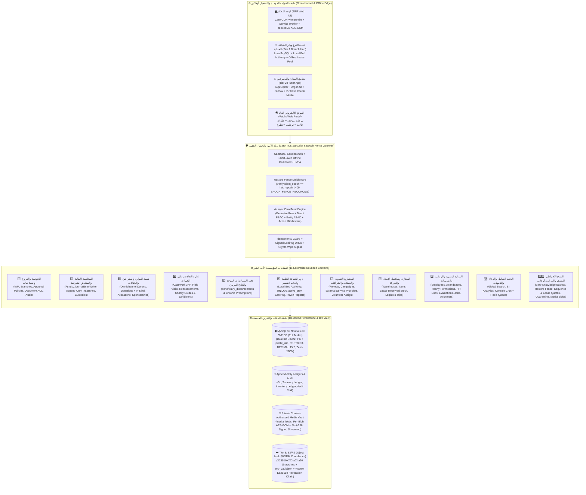
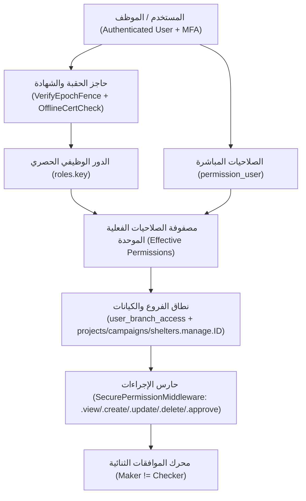
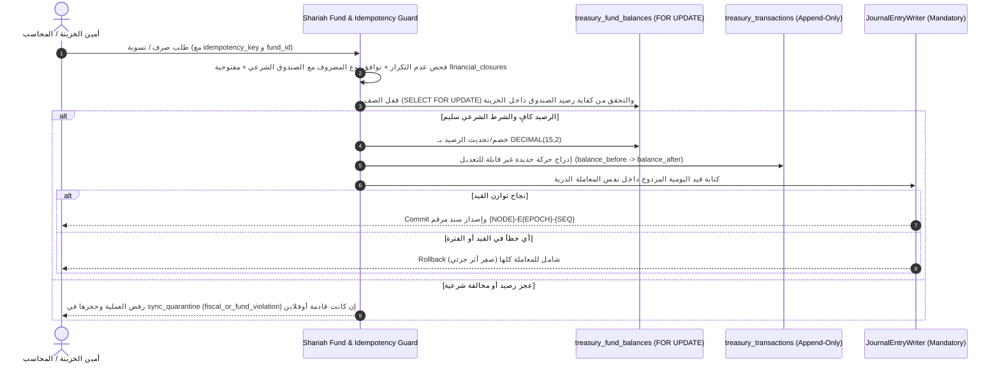
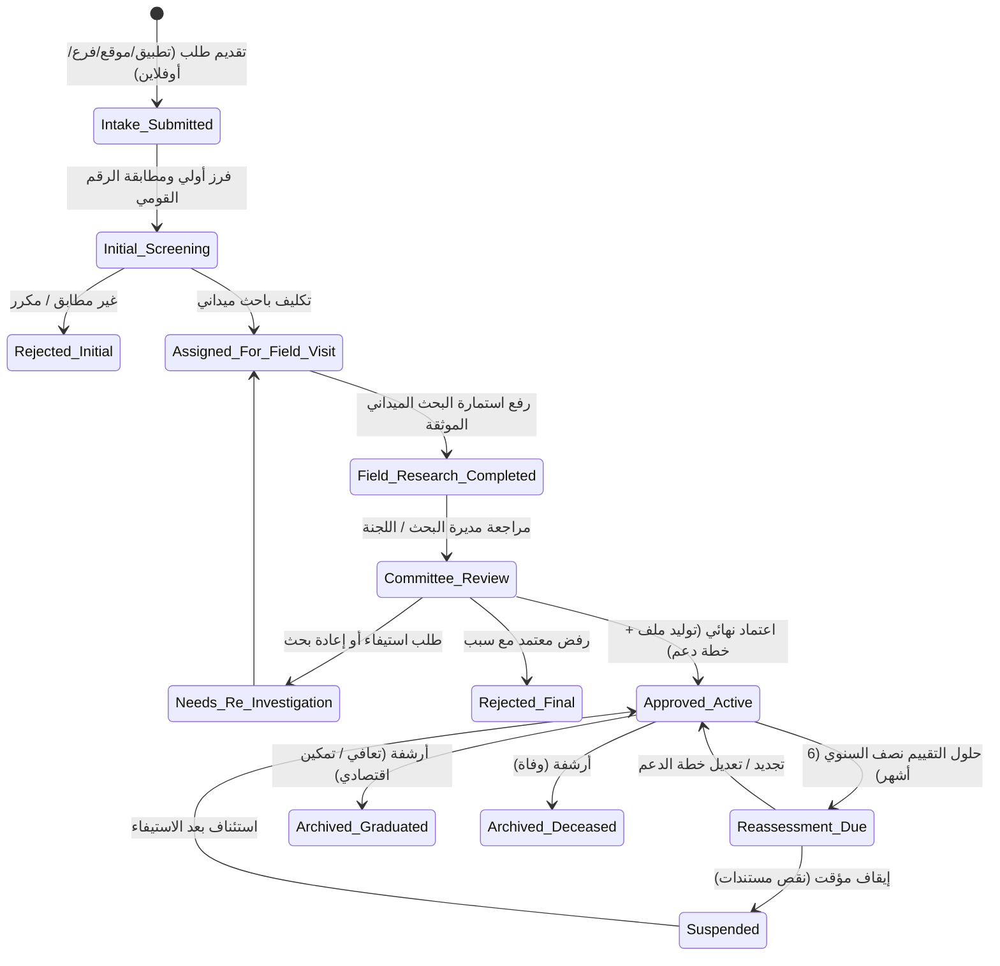
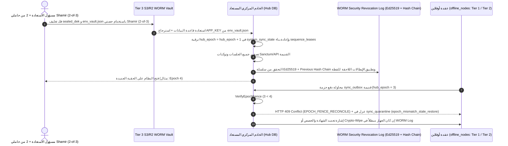

# وثيقة التصميم المعماري المؤسسي الشامل وتوصيف الوحدات (Ensan Enterprise Architecture v2.1)

**تاريخ الإصدار والمراجعة:** 16 نوفمبر 2026  
**حالة الوثيقة:** `قيد التصديق النهائي بعد معالجة ملاحظات فيكتور كايل ولجنة الخبراء` — المرجع المعماري الموحد (`111` جدولاً مؤسسياً في [`ENSAN_V2_1_DATABASE_SCHEMA.md`](./ENSAN_V2_1_DATABASE_SCHEMA.md): `109 - 1 (job_applications_seq) + 3 (charity_guide_exhibitions, hourly_leave_permissions, employee_monthly_permission_balances) = 111` جدولاً معيارياً `3NF`)، يُلغي مسودة `v2.0` ويستوعب وحدات نوفمبر 2026 وبوابات القبول العشر للعمل أوفلاين والنسخ الاحتياطي المشفر.  

**إعداد واعتماد المجلس الأعلى لإعادة التصميم:**
- **البروفيسور مارتن شتاين (Prof. Martin Stein):** كبير مصممي الأنظمة المعمارية في العالم (`DDD & Modular Monolith`).
- **البروفيسور إيثان بروكس (Prof. Ethan Brooks):** خبير الأنظمة الموزعة، التشغيل أوفلاين (`Offline-First`)، والتعافي من الكوارث (`DR`).
- **د. عبد الرحمن السعدي (Dr. Abdulrahman Al-Saadi):** كبير خبراء حوكمة العمل الخيري والزكاة والأوقاف والتنمية الاجتماعية.
- **د. ماركوس فانس (Dr. Marcus Vance):** كبير مدققي الأنظمة المالية ومحاسبة الصناديق غير الربحية (`IPSAS / FASB ASC 958 / AAOIFI`).
- **د. ليلى المنصور (Dr. Layla Al-Mansoor):** خبيرة العمليات الإنسانية، إدارة الحالة الاجتماعية، ودور الضيافة الطبية.
- **م. طارق النجار (Eng. Tariq Al-Najjar):** كبير معماريي الأنظمة المؤسسية والأمن السيبراني والتشفير.
- **م. فيكتور كايل (Viktor Kael — «الشيطان الناقد»):** المراجع الجنائي وصاحب حق الفيتو الهندسي وبوابات القبول العشر.
- **الكوادر الإدارية الستة لمؤسسة إنسان:** أ. خالد المنشاوي (المدير المالي)، أ. سلمى غانم (مديرة البحث الاجتماعي)، د. حاتم الشافعي (مدير دور الضيافة الطبية)، أ. محمود الدسوقي (مدير المخازن والحركة)، أ. ندى جودة (مديرة الموارد البشرية والمتطوعين)، وأ. عمر السخاوي (مدير تنمية الموارد والإعلام الرقمي).

---

## 🧭 أولاً: الركائز المعمارية التسع لـ Ensan v2.1 (The 9 Ironclad Architectural Pillars)

للقضاء النهائي على الترقيع البرمجي، وتكرار الجداول، وانفصام القنوات، والثغرات المالية والأمنية، وضمان استمرارية العمل أوفلاين بالكامل وحماية بيانات المؤسسة ضد الكوارث، يقوم نظام **Ensan v2.1** على **تسع ركائز معمارية غير قابلة للتفاوض**:

1. **معمارية المونوليث المعياري الموجه بالنطاقات (`Modular Monolith with DDD — 11 Bounded Contexts`):**
   - يُقسم النظام إلى **11 نطاق عمل مستقلة** (`10` نطاقات تشغيلية + النطاق `11` للنسخ الاحتياطي والمزامنة أوفلاين). يُمنع وجود `Controller` يتجاوز `200–250 سطراً`، ويُمنع كتابة استعلامات Eloquent أو تعديل الأرصدة داخل الكونترولر؛ كل عملية تمر عبر `Action / UseCase` و`Domain Service` داخل `DB::transaction()`.
2. **بوابة القنوات الموحدة ومصدر الحقيقة الواحد (`Omnichannel Single Source of Truth`):**
   - لوحة التحكم (ERP Web)، الموقع الإلكتروني العام، وتطبيق الهاتف (Flutter Mobile App) تصب جميعها في نفس الجداول الأساسية مع تحديد قناة المصدر `source_channel` وحالة المراجعة `verification_status`، مع توطين كامل لأصول الواجهة (`Zero-CDN Vite Bundle`) لكي لا تتوقف لوحة التحكم لحظة انقطاع الإنترنت.
3. **محاسبة الصناديق الشرعية والقيد المزدوج الإلزامي غير القابل للتعديل (`Immutable Double-Entry & Fund Accounting`):**
   - كل قرش يدخل أو يخرج يرتبط بصندوق شرعي/مالي صريح في جدول **`funds`**، وكل المبالغ المالية تُخزن بدقة **`DECIMAL(15,2)`** (حظر `FLOAT/DOUBLE`).
   - الدفاتر (`journal_entries`, `treasury_transactions`, `inventory_movements`) **غير قابلة للحذف أو التعديل (`Append-Only`)**، وجميع المفاتيح الأجنبية تلتزم بـ **`ON DELETE RESTRICT`**، وتُنفذ القيود المزدوجة حصراً عبر **`JournalEntryWriter`** الذي يُسقط المعاملة بأكملها (`Rollback`) عند أي فشل في التوازن المحاسبي.
4. **الهيكل الجغرافي المرن متعدد الفروع (`Multi-Branch & Geographic Hierarchy`):**
   - إلغاء الجداول والنصوص الجغرافية العشوائية؛ كل كيان (موظف، مستفيد، دار ضيافة، مخزن، خزينة، مشروع، شريك خارجي، ودليل خيرات `charity_guides`) يرتبط بالهرم الجغرافي القياسي: `Governorate (محافظة) ⬅️ City/Center (مركز/مدينة) ⬅️ Branch (فرع)`.
5. **فصل الهوية عن الأدوار التشغيلية (`Party / Role Separation Pattern`):**
   - جدول `users` مخصص **للمصادقة وبيانات الدخول فقط**، بينما تُعزل الكيانات التشغيلية في `employees`, `volunteers`, `donors`, `beneficiaries`, `delegates`. يمكن للمتطوع أو المتبرع الوجود في المنظومة كملف تشغيلي كامل حتى بدون حساب دخول في `users`.
6. **دفتر الأستاذ الموحد للمنافع والمساعدات (`Unified Beneficiary Assistance Ledger`):**
   - كل مساعدة (كفالة شهرية، مساعدة نقدية طارئة أو مباشرة، علاج أورام/مزمن، شنطة موسمية، إقامة دار ضيافة، صرف مخزني) تمر حصراً عبر جدول **`beneficiary_disbursements`** المرتبط مالياً أو مخزنياً بمصدر الصرف الحقيقي. يُمنع منعاً باتاً تسجيل المساعدات داخل `donations` أو اختلاق متبرعين وهميين مثل `D-00000`.
7. **محرك الحوكمة الصفرية والموافقات الثنائية (`Zero-Trust RBAC+PBAC+ABAC & Maker-Checker`):**
   - إغلاق كافة مسارات التصعيد والتمرير الذاتي: التحقق يعتمد حصراً على المفاتيح البرمجية، صانع القرار (Maker) لا يعتمد قراره أبداً (`reviewed_by_user_id != requested_by_user_id`) حتى في التقييمات الوظيفية والتطوعية، وبلا استثناءات أوتوماتيكية في `ChangeRequestService`.
8. **الأوفلاين أولاً بالمعرفات المزدوجة، حصص التأجير، والحجر الصحي (`Offline-First Dual-ID, Lease Quotas & Quarantine`):**
   - **المعرف المزدوج (`Dual-ID`):** كل جدول مؤسسي جديد يجمع بين `id BIGINT UNSIGNED PK` الداخلي و`public_ulid CHAR(26) UNIQUE` المولد أوفلاين دون تصادم ودون الحاجة لـ `HashedRouteKey (AES-256-ECB)` أو `EnsureHashedRouteKeys` (`bootstrap/app.php:33`).
   - **ثنائية العقد (`Tier 1 & Tier 2`):** عقد فروع محلية (`Tier 1 Branch Hub`) + أجهزة ميدانية وتطبيق/PWA مشفر بـ `Argon2id/PBKDF2 + AES-256-GCM` مع تدوير `user_key_kdf_salt` على `offline_certificates` للأجهزة المشتركة و**`Crypto-Wipe`** (`Tier 2`).
   - **الانضباط الصارم:** حصص تأجير مقيدة بالوقت والرصيد (`offline_lease_quotas` بأعمدة منفصلة `allocated_amount`/`allocated_qty`)، حزم تسلسل موقعة (`sequence_leases.signed_lease_grant`)، تخصيص مسبق لأرقام الإيصالات (`offline_receipt_allocations`)، مفتاح عدم التكرار (`idempotency_key UNIQUE`)، فصل البيانات الوصفية (`sync_outbox`/`sync_inbox` بـ `encrypted_payload_blob` + `payload_signature_ed25519`) عن رفع الوسائط المرحلي (`media_blobs(blob_ulid)` بتشفير Per-Blob معزول النطاق)، وعزل أي تعارض حتمياً في **`sync_quarantine`** بالعلل الست الحتمية دون تعطيل بقية الطابور أو إخفائه.
9. **النسخ الاحتياطي المشفر بمعرفة صفرية وحاجز الاستعادة (`Zero-Knowledge Encrypted Backup & Restore Fence`):**
   - حظر استضافة `Shared Hosting / cPanel` والعمل على `VPS/Dedicated` مع مسار تدفق غير مخزن بالذاكرة (`Resumable Unbuffered Streaming < 64MB RAM`).
   - تشفير بمعرفة صفرية (`XChaCha20-Poly1305 / AES-256-GCM`) بتغليف غير متماثل (`X25519 Sealed Envelope`)، وتقسيم مفتاح الطوارئ الخاص عبر **Shamir `2-of-3`** (المدير التنفيذي/رئيس مجلس الإدارة، المدير المالي أ. خالد المنشاوي، المراجع القانوني/كبير المهندسين المعماريين)، وحفظ `env_vault.json` المشفر، وتخزين سحابي غير قابل للحذف (**S3/R2 Object Lock WORM**)، وفصل فحص السلامة الآلي (`automated_integrity_probe`) عن مناورات الاستعادة الفعلية (`manual_shamir_full_drill`), مع **`Restore Fence Protocol`** الذي يرفع `hub_epoch`، ويطبق سجل الإبطال الخارجي **WORM Security Revocation Log** (`Ed25519 + Previous Hash Chain`)، ويجبر حزم العقد القديمة على **`409 EPOCH_FENCE_RECONCILE`** نحو `sync_quarantine`.

---

## 🏗️ ثانياً: المخطط المعماري الشامل لـ Ensan v2.1 (Enterprise System Blueprint)



---

## 🧩 ثالثاً: التوصيف الدقيق المفصل لجميع الوحدات الأحد عشر (`Modules 01–11`)

---

### الوحدة الأولى (Module 01): الحوكمة، الهيكل الجغرافي، الفروع، والأمن السيبراني (`IAM, Organization & Governance`)
**المسؤول الإداري:** الإدارة العليا + م. طارق النجار (مدير التحول الرقمي وأمن المعلومات).  
**الهدف من الوحدة:** فرض هيكلة جغرافية مرنة متعددة الفروع، عزل حسابات الدخول عن الكيانات التشغيلية، إغلاق كافة ثغرات تصعيد الصلاحيات أو تجاوز الموافقات، وإدارة محرك الموافقات الثنائية وسجل التدقيق الجنائي.

#### 1. المكونات والوظائف الدقيقة في `v2.1`:
- **إدارة الفروع والنطاق الجغرافي (`Geographic & Branch Registry`):**
  - التسلسل القياسي: `governorates` ⬅️ `cities` (تشمل المراكز والقرى والأحياء) ⬅️ `branches` (الفروع الرئيسية والفرعية ودور الضيافة).
  - كل فرع يملك كوداً تشغيلياً فريداً (`node_code`) يُستخدم في بادئة الإيصالات وعقد الأوفلاين، ومدير فرع، وخزينة رئيسية، ومخزن رئيسي.
- **نموذج الأمن الهجين رباعي الطبقات الخالي من التصعيد (`Zero-Trust RBAC + Direct PBAC + Entity ABAC + Action Middleware`):**
  - **إزالة ثغرة `User::isSuperAdmin()` وحذف `EnsureHashedRouteKeys`:** إلغاء أي منح تلقائي لصلاحيات المدير العام لأدوار مثل `manager` أو `إدارة`؛ صلاحية الـ Super Admin تُمنح حصراً عبر الحقل الصريح `is_super_admin` والدور النظامي المختوم `super_admin` والموثق بمصادقة ثنائية `MFA`. كما تُحذف سمة `HashedRouteKey (AES-256-ECB)` ويُزال وسيط **`EnsureHashedRouteKeys::class` من `bootstrap/app.php:33`** لصالح `public_ulid CHAR(26)`.
  - **الطبقة 1 — الأدوار الوظيفية الحصرية (`Exclusive Role Assignment`):** تفعيل خيار الإحلال الحصري للدور افتراضياً عند التعيين لمنع تراكم الصلاحيات القديمة عبر `role_user`.
  - **الطبقة 2 — الصلاحيات المباشرة الفردية (`Direct PBAC`):** منح/سحب صلاحيات ذرية لموظف بعينه عبر `permission_user` دون تلويث الدور العام.
  - **الطبقة 3 — عزل الكيانات (`Entity-Scoped ABAC Precedence`):** فحص الصلاحيات المخصصة (`projects.manage.{id}`, `campaigns.manage.{id}`, `medical_shelters.manage.{id}`) بأولوية مطلقة قبل الصلاحيات العامة، وكذلك حصر الرؤية في نطاق الفروع المخولة للمستخدم (`user_branch_access`).
  - **الطبقة 4 — حارس المسارات والإجراءات (`Action-Level Route Enforcement`):** مطابقة كل طلب HTTP (`view`, `create`, `update`, `delete`, `approve`, `export`) مع الصلاحية الفعلية في `SecurePermissionMiddleware`.
- **محرك الموافقات الثنائية الصارم (`Strict Maker-Checker Workflow Engine`):**
  - إزالة مسار التمرير الذاتي (`!$forceRequest`) من `ChangeRequestService`؛ كل عملية مصنفة في جدول **`approval_policies`** (تعديل/عكس قيد، تسوية جردية، صرف فوق السقف، اعتماد حالة بحث، ترحيل مسير رواتب، استعادة نسخة احتياطية، فك حجر صحي) تُنشئ سجل `approval_requests` بحالة `pending`.
  - **حظر الاعتماد الذاتي (`Anti-Self-Approval Hard Rule`):** يُمنع برمجياً وفي قاعدة البيانات أن يكون `reviewed_by_user_id == requested_by_user_id`.
- **الروابط الخارجية المؤقتة الموقعة (`external_access_tokens`):**
  - توثيق أي رابط خارجي لباحث أو أخصائي نفسي أو متبرع عبر `external_access_tokens` بتاريخ انتهاء صلاحية صارم، سقف استخدام (`max_uses`)، وإمكانية إبطال فوري مرتبط بالـ `hub_epoch`.



---

### الوحدة الثانية (Module 02): المحاسبة المالية، الصناديق الشرعية، الخزائن والعهد (`Financial ERP, Fund Accounting & Treasuries`)
**المسؤول الإداري:** أ. خالد المنشاوي (المدير المالي ورئيس المراجعة الداخلية — CFO).  
**الهدف من الوحدة:** تحقيق الامتثال الكامل لمعايير المحاسبة غير الربحية (`IPSAS / AAOIFI / FASB ASC 958`)، وعزل أموال الصناديق الشرعية، وإغلاق كافة ثغرات التلاعب بالأرصدة والقيود.

#### 1. المكونات والوظائف الدقيقة في `v2.1`:
- **محاسبة الصناديق الشرعية والمقيدة (`funds` — Fund Accounting Core):**
  - جدول قياسي إلزامي **`funds`** بتصنيف التقييد **`restriction_type ENUM('sharia_restricted','donor_restricted','unrestricted','operational')`** وحقلي **`allows_admin_expenses BOOLEAN`** و**`max_admin_overhead_pct DECIMAL(5,2)`** لتغطية صناديق زكاة المال، زكاة الفطر، الصدقة الجارية، الكفالات والمشاريع المقيدة، الصدقات العامة، وريع الأوقاف.
  - إلغاء التخمين النصي (`getBalanceBreakdownAttribute`) نهائياً! كل حركة في الخزينة تحمل `fund_id` صريحاً ومفهرساً، ويتم تتبع رصيد كل صندوق داخل كل خزينة عبر جدول **`treasury_fund_balances`** بدقة `DECIMAL(15,2)`.
  - **حارس القيود الشرعية (`Shariah Fund Guard`):** يرفض النظام صرف أي مصروف إداري أو تشغيلي أو رواتب إدارية من الصناديق المقيدة التي يكون فيها `allows_admin_expenses = FALSE` (أو يتجاوز نسبة `max_admin_overhead_pct` المعتمدة شرعياً)، ويشترط الصرف من الصناديق غير المقيدة أو التشغيلية.
- **الخزائن غير القابلة للتعديل والتسوية الجردية (`Append-Only Treasuries & Reconciliation`):**
  - **الحظر المطلق لتدمير التاريخ المالي:** حذف دوال التلاعب في `TreasuryService::updateTreasury()` / `deleteTransaction()` و`TreasuryController::adjustTotals()` نهائياً. يُحظر تعديل `opening_balance` بعد تأسيس الخزينة أو حذف أي حركة مالية (`treasury_transactions` = `Append-Only` مع `ON DELETE RESTRICT`).
  - **البروتوكول الرسمي للتصحيح والتصفير:**
    1. **تحويل الخزينة (`Treasury Transfer`):** لتوريد فائض خزينة دار ضيافة أو فرع إلى الخزينة الرئيسية.
    2. **القيد العكسي (`Reversal Entry`):** لإلغاء حركة خاطئة مع بقاء الحركة الأصلية وحركة العكس ظاهرتين في الدفتر.
    3. **محضر التسوية الجردية (`treasury_reconciliations`):** يوثق `system_balance` و`actual_balance` وسبب الفارق ويُعتمد بموافقة ثنائية (`Maker-Checker`) ليولد حركة `adjustment_in/out` وقيد يومية رسمي.
- **كاتب قيود اليومية الإلزامي (`Mandatory JournalEntryWriter`):**
  - إزالة كتلة `try/catch` التي كانت تبتلع فشل القيد المزدوج في `TreasuryIntegrationService`!
  - كل حركة مالية معتمدة (تبرع، مصروف، مسير رواتب عبر `payroll_accounting_postings`، عهدة، تسوية، قسط كفالة) تستدعي **`JournalEntryWriter::post(...)`** داخل نفس الـ `DB::transaction()` وبمفتاح **`idempotency_key UNIQUE`**. إذا فشل توازن القيد ($\sum \text{Debit} = \sum \text{Credit}$) أو كانت الفترة المحاسبية في **`financial_closures`** مغلقة، يتراجع النظام عن حركة الخزينة بأكملها!
- **العهد النقدية وحصص الأوفلاين (`Petty Cash, Employee Custodies & Offline Cash Leases`):**
  - دورة حياة كاملة للعهد (**`employee_custodies`** & **`custody_settlement_items`**): طلب ⬅️ اعتماد مالي ثنائي ⬅️ صرف ⬅️ تسوية بفواتير مرفقة في `media_blobs(blob_ulid)` الخاصة ⬅️ استعاضة أو إقفال.
  - عند العمل أوفلاين، تُقتطع حصة محددة من العهدة داخل **`offline_lease_quotas`** بنوع `quota_type = 'cash_custody_disbursement'` (`allocated_amount` / `consumed_amount`) بحيث لا يستطيع أمين العهدة صرف مبالغ تتجاوز المخصص المقفول.



---

### الوحدة الثالثة (Module 03): تنمية الموارد، علاقات المتبرعين (CRM)، التبرعات الموحدة، والكفالات (`Omnichannel Fundraising, CRM & Sponsorships`)
**المسؤول الإداري:** أ. عمر السخاوي (مدير تنمية الموارد وعلاقات المتبرعين) + أ. خالد المنشاوي (المدير المالي).  
**الهدف من الوحدة:** توحيد كافة المتبرعين والتبرعات والكفالات من جميع القنوات في سجل واحد نظيف خالٍ من التلوث بعمليات الصرف أو المشاوير.

#### 1. المكونات والوظائف الدقيقة في `v2.1`:
- **سجل المتبرعين الموحد (`donors`):**
  - جدول واحد يخدم الـ ERP والموقع وتطبيق الموبايل، يربط رقم الهاتف/البريد بـ `users.id` (اختيارياً) عند تسجيل المتبرع في التطبيق، مع حظر إنشاء متبرعين وهميين مثل `D-00000`.
- **مسار التبرعات الموحد (`donations` — Pure Fundraising Ledger):**
  - يقتصر جدول `donations` حصراً على **التبرعات الواردة للمؤسسة (النقدية والعينية)** عبر `source_channel ENUM('erp_branch','field_delegate_offline','offline_node','website','mobile_app','bank_transfer','pos')`، مع فصل نوع التبرع في **`donation_kind ENUM('cash','in_kind')`** ووسيلة الدفع في **`payment_method ENUM('cash','vodafone_cash','instapay','bank_deposit','online_card','cheque','pos','in_kind_goods')`**.
  - تُحفظ إيصالات التحويل في جدول **`donation_proofs`** مرتبطة بـ `media_blobs(blob_ulid)` الخاصة المحمية، ولا يترحل التبرع الإلكتروني لحساب الخزينة إلا بعد التحقق (`verified`)، حيث يدخل فوراً في `treasury_transactions` + `treasury_fund_balances` + `JournalEntryWriter`.
  - **تحصيل الميدان أوفلاين:** يُصدر المندوب إيصالاً رسمياً من نطاقه المحجوز في **`sequence_leases`** (`signed_lease_grant`) و**`offline_receipt_allocations`** بصيغة `{NODE}-E{EPOCH}-{SEQ}` ويُرفع عبر `sync_outbox`.
- **تخصيصات التبرع العلائقية (`donation_allocations` — 3NF Zero-JSON):**
  - تقسيم التبرع الواحد إلى عدة وجهات (صندوق شرعي، مشروع، حملة، دار ضيافة، حالة مستفيد) في صفوف علائقية صريحة بمفاتيح أجنبية `ON DELETE RESTRICT`.
- **محرك عقود الكفالات المشتركة والدورية (`sponsorship_contracts` & `sponsorship_installments`):**
  - دعم الكفالة المشتركة (`Co-Sponsorship`) لأسرة أو يتيم أو مريض أورام عبر عدة متبرعين، وحساب إجمالي التغطية الشهرية لحظياً، وتتبع الأقساط المستحقة والمتأخرة وتنبيه فريق علاقات المتبرعين آلياً.

---

### الوحدة الرابعة (Module 04): إدارة الحالة الاجتماعية، البحث الميداني، إعادة التقييم، ودليل الخيرات (`Casework, Social Research & Charity Guides`)
**المسؤول الإداري:** أ. سلمى غانم (مديرة البحث الاجتماعي وإدارة الحالات).  
**الهدف من الوحدة:** هيكلة دورة حياة المستفيد بآلة حالة صارمة وتطبيع بيانات الأسرة والملف الطبي وإغلاق ثغرات تزوير تواريخ الميلاد وربط دليل الخيرات بالهيكل الجغرافي.

#### 1. المكونات والوظائف الدقيقة في `v2.1`:
- **تطبيع ملف المستفيد والأسرة والملف الطبي (3NF Normalization):**
  1. `case_intake_applications`: بوابة موحدة لطلبات التقديم من التطبيق/الموقع/الفرع، مع كشف التكرار بالرقم القومي والهاتف.
  2. `beneficiaries`: الملف الأساسي الموحد لرب الأسرة/الحالة، مرتبط بـ `branch_id`, `city_id`, `public_ulid`، وحاصل درجة الاستحقاق (`vulnerability_grade`).
  3. `beneficiary_household_members`: المعالون والأيتام؛ مع **إلغاء تزوير تاريخ 1 يناير (`startOfYear`/`01-01`) كلياً**! إذا لم يُعرف يوم وشهر الميلاد يُترك `birth_date = NULL` ويُستخدم حقل `birth_year SMALLINT UNSIGNED` و`birth_date_estimated BOOLEAN`.
  4. `beneficiary_medical_profiles`: التشخيص، نوع وموقع الورم، المستشفى، الطبيب، وبروتوكول العلاج.
  5. `beneficiary_documents`: جميع التقارير الطبية والبطاقات محفوظة حصراً في `media_blobs` الخاصة (`private_medical`) — يُحظر حفظ أي ملف في `public` أو `uploads`.
  6. `beneficiary_program_enrollments`: تسجيل المستفيد الواحد في عدة مشاريع أو دور ضيافة في آن واحد دون ازدواجية أو مسح لمشروعه الأصلي.
- **آلة الحالة الصارمة لدورة حياة المستفيد (`Beneficiary Lifecycle State Machine`):**



- **ضبط البحث الميداني وإعادة التقييم التلقائي (`field_visits`, `field_visit_program_assessments` & `beneficiary_reassessments`):**
  - توحيد وحدة القياس الشهرية لكل بنود الدخل والمصروفات، وإدخال مسارات المشاريع المتخصصة (زاد، مدرار، بعثاء الأمل، الأورام، الحالات الخاصة) في الجدول العلائقي **`field_visit_program_assessments`** بدلاً من أعمدة JSON (`medrar_details`, `zad_details`, `ramadan_details`).
  - عند تقديم إعادة التقييم نصف السنوية: التوصية بالتعديل (زيادة/تخفيض/إيقاف/أرشفة) تنشئ تلقائياً `approval_request`؛ وبمجرد الاعتماد الثنائي تتحدث خطة المساعدة والكفالة ويُخطر القسم المالي.
- **دليل العمل الخيري والمعارض الخيرية (`charity_guides` & `charity_guide_exhibitions` — ترقية نوفمبر 2026):**
  - تصحيح البنية النصية في جدول `charity_guides` الحالي وربطه بالهيكل القياسي: `governorate_id` + `city_id` + `village_name` + `branch_id` (بدلاً من افتراض `'كفر الشيخ'` ونصوص المراكز الحرة).
  - فصل حقل المعارض النصي `exhibition_amount` إلى جدول علائقي مستقل **`charity_guide_exhibitions`** (`exhibition_amount DECIMAL(15,2)`, `exhibition_date DATE`, `charity_guide_id FK -> charity_guides(id) ON DELETE RESTRICT`, `notes`) لتتبع جميع المعارض الخيرية والدعاية لكل دليل ومنسق عبر الزمن بدقة مالية وتاريخية كاملة.

---

### الوحدة الخامسة (Module 05): دفتر الأستاذ الموحد للمساعدات والعلاج المزمن (`Unified Assistance Disbursement & Chronic Prescriptions Engine`)
**المسؤول الإداري:** أ. سلمى غانم + أ. خالد المنشاوي + أ. محمود الدسوقي.  
**الهدف من الوحدة:** توحيد سجل كل منفعة تصل إلى المستفيد، وإنهاء ثغرة `recordDirectAid` التي كانت تسجل المساعدات المباشرة في جدول التبرعات بمتبرع وهمي.

#### 1. المكونات والوظائف الدقيقة في `v2.1`:
- **دفتر الأستاذ الموحد للمساعدات (`beneficiary_disbursements`):**
  - يستوعب كل أشكال الصرف المباشر وغير المباشر: `monthly_sponsorship`, `urgent_cash_aid`, `direct_aid_cash`, `in_kind_package`, `chronic_medication`, `medical_procedure`, `seasonal_ramadan_bag`, `seasonal_iftar`, `shelter_accommodation`, `marriage_aid`, `roof_water_aid`.
  - **الإلزام المحاسبي والمخزني:**
    - الصرف النقدي يرتبط إلزامياً بـ `expense_id`, `treasury_transaction_id`, و`fund_id` (أو بـ `offline_lease_quota_id` إذا صُرف من عهدة أوفلاين).
    - الصرف العيني يرتبط إلزامياً بـ `inventory_movement_id` (خصم فعلي من المخزن).
    - الإقامة والإعاشة ترتبط بـ `shelter_stay_id`.
    - المرفقات (روشتات، فواتير، إيصالات استلام) تُحفظ حصراً في `media_blobs(blob_ulid)` الخاصة لا في `public/beneficiaries/direct_aid`.
- **محرك قرارات وخطط العلاج المزمن (`beneficiary_chronic_prescriptions`):**
  - توثيق اسم الدواء، الجرعة، التكلفة الشهرية `DECIMAL(15,2)`، الصيدلية/مقدم الخدمة المورد (**`external_service_provider_id`** المرتبط بـ **`external_service_providers`**)، تاريخ انتهاء القرار، وتنبيه استباقي قبل الانتهاء بـ `15 يوماً`.

---

### الوحدة السادسة (Module 06): دور الضيافة الطبية، رعاية مرضى الأورام، الإعاشة، والدعم النفسي (`Medical Shelters, Oncology Care & Psychosocial Support`)
**المسؤول الإداري:** د. حاتم الشافعي (مدير دور الضيافة الطبية ورعاية مرضى الأورام).  
**الهدف من الوحدة:** تفكيك `GuestHouseWebController.php` (**`1,827 سطراً`** فعلياً بتاريخ 16 نوفمبر 2026) إلى 6 كونترولرز وخدمات معيارية، منع تضارب تسكين الأسرة حتى أثناء العمل أوفلاين، وحماية بيانات المرضى الطبية.

#### 1. المكونات والوظائف الدقيقة في `v2.1`:
1. **`ShelterFacilityController`:** إدارة `medical_shelters` (بديلاً عن `guest_houses`)، `shelter_wings`، و`shelter_beds` بأرقام حقيقية 100% من قاعدة البيانات دون أي ثوابت مصطنعة (`max(3, ...)` أو `max(24, ...)`).
2. **`ShelterBookingController`:** استقبال ومراجعة طلبات الحجز الموحدة (`shelter_booking_requests`) مع فحص تعارضات المواعيد.
3. **`ShelterStayController` و`Local Bed Authority` أوفلاين:**
   - استخدام ملف المستفيد الموحد `beneficiaries` دون تكرار ملفات أو مسح انتمائه لمشروع آخر.
   - توثيق كامل للمرافق، العلامات الحيوية، وملاحظات المغادرة (`departure_notes`) وحالة الخروج في أعمدة صريحة.
   - **سلطة السرير المحلية (`Tier 1 Local Bed Authority`) + قيد SQL الحديدي:** لا يُسمح بتسكين الأسرة أوفلاين من الهواتف المتفرقة؛ يقتصر التسكين أوفلاين على عقدة دار الضيافة المحلية (`offline_nodes` من نوع `tier1_branch_hub`) التي تملك **`offline_lease_quotas (quota_type = 'shelter_bed_allocation')`**. وعلى مستوى قاعدة البيانات في جدول `shelter_stays` يُربط السرير بـ **`shelter_bed_id`** ويُفرض عمود مولّد **`active_stay_flag TINYINT UNSIGNED`** لحالتي الإقامة النشطة فقط (**`active_in_house`** و**`temporary_hospital_leave`**) مع قيد **`UNIQUE (shelter_bed_id, active_stay_flag)`** يضمن فيزيائياً عدم وجود إقامتين نشطتين على سرير واحد مطلقاً، وإذا تعارض تسكين محلي مع حجز إنترنت سابق أثناء المزامنة يُعزل الحجز في `sync_quarantine (double_bed_occupancy)`.
4. **`ShelterCateringController`:** ربط وجبات الإعاشة (`shelter_meals`, `shelter_meal_servings`) بحركة صرف مخزنية رسمية أو مصروف نقدي عبر `JournalEntryWriter`.
5. **`ShelterAssetTicketController`:** أصول الدار (`facility_assets`), صيانتها (**`shelter_asset_maintenances`**)، وتذاكر الشكاوى والصيانة (`support_tickets`).
6. **`PsychosocialSupportController`:** إدارة تقارير وجلسات الدعم النفسي وتقييمات الأطفال والمرضى في جدول **`psychological_support_reports`** (مربوطة بالأسرة `beneficiary_id` أو الطفل عبر `household_member_id` وإقامة الدار `shelter_stay_id`) مع حفظ مرفقاتها في `media_blobs(blob_ulid)` الخاصة.

---

### الوحدة السابعة (Module 07): المشاريع التنموية، الحملات الموسمية، والشراكات المجتمعية (`Projects, Seasonal Campaigns & Partner Network`)
**المسؤول الإداري:** مديرة المشاريع + مدير الحملات الموسمية + مسؤول الشراكات المجتمعية.  
**الهدف من الوحدة:** إدارة المشاريع والحملات بميزانيات وصناديق محددة، وتوحيد كافة مقدمي الخدمات والوسطاء، وتنظيم تكليف المتطوعين داخل المشاريع.

#### 1. المكونات والوظائف الدقيقة في `v2.1`:
- **المشاريع والحملات (`projects` & `campaigns`):**
  - إلغاء الـ Global Scope الخفي `exclude_guest_house` في `Project.php#L84` واستبداله بحقل صريح **`projects.project_type`** (`ENUM('zad_orphans','amal_oncology','midrar_water_roof','medical_shelter','education_support','general_relief')`).
  - ربط كل مشروع/حملة بصندوق مالي (`default_fund_id` / `fund_id`) وميزانية مستهدفة (`target_amount DECIMAL(15,2)`) ومدير مشروع (`manager_user_id`).
- **التوزيعات الموسمية الموحدة (`campaign_distributions`):**
  - توحيد شنط رمضان، كراتين الخير، إفطار صائم، الأضاحي، وكسوة العيد وربطها مباشرة بـ `beneficiary_disbursements` و`inventory_movements` مع `ON DELETE RESTRICT` بدلاً من `CASCADE`.
- **شبكة مقدمي الخدمات الخارجية والشركاء الموحدة (`external_service_providers`, `partner_agreements`, `partner_referrals`):**
  - دمج الجداول الثمانية المكررة (`kafr_el_sheikh_*`, `tanta_workers`, `oncology_medicine_reps`, إلخ) في جدول **`external_service_providers`** مرتبط جغرافياً بالفرع والمدينة والمحافظة.
- **ربط تكليفات المتطوعين بالمشاريع (`volunteer_assignments`):**
  - ربط المتطوعين بالمشروع والدور التشغيلي داخل جدول علائقي `volunteer_assignments` بدلاً من الأعمدة النصية المكررة.

---

### الوحدة الثامنة (Module 08): إدارة سلاسل الإمداد، المخازن، التبرعات العينية، والحركة واللوجيستيات (`Supply Chain, Inventory & Fleet Logistics`)
**المسؤول الإداري:** أ. محمود الدسوقي (مدير المخازن واللوجيستيات والحركة).  
**الهدف من الوحدة:** فرض مصدر حقيقة واحد لأرصدة المخزون مع دعم الصرف المقيد أوفلاين، وتنظيم التبرعات العينية، وفصل المشاوير اللوجيستية نهائياً عن جدول التبرعات.

#### 1. المكونات والوظائف الدقيقة في `v2.1`:
- **محرك المخازن والأرصدة اللحظية وحصص الأوفلاين (`warehouses`, `item_categories`, `items`, `warehouse_stock_balances`, `item_batches`, `inventory_movements`):**
  - ربط كل مخزن بـ `branch_id` (بدلاً من البحث النصي عن `'كفر'` و`'طنطا'`).
  - قفل الأرصدة (`SELECT FOR UPDATE`) عند كل حركة توريد أو صرف، وجعل `inventory_movements` دفتراً غير قابل للتعديل (`Append-Only` مع `ON DELETE RESTRICT`).
  - **دعم الصرف أوفلاين (`Offline Stock Reservation`):** عند تخصيص حصة مخزنية لعقدة فرع أو مندوب (**`offline_lease_quotas`** من نوع **`quota_type = 'warehouse_stock_reservation'`** بأعمدة `allocated_qty` و`consumed_qty` وتشير إلى `item_id` في جدول **`items`**)، تنتقل الكمية المخصصة مؤقتاً إلى `quantity_reserved` في `warehouse_stock_balances` فلا يستطيع أي فرع أو مستخدم آخر سحبها أثناء انقطاع الشبكة!
- **مسار التبرعات العينية المدمج (`donations` + `inventory_movements`):**
  - **لا يوجد جدول منفصل للتبرعات العينية**؛ فالتبرعات العينية مدمجة بالكامل ضمن جدول **`donations`** (`donation_kind = 'in_kind'`، مع `payment_method = 'in_kind_goods'`) مع التقييم المالي التقديري `DECIMAL(15,2)`، وبمجرد استلام الأصناف عبر رحلة لوجيستية وفحصها بالمخزن تُولد حركة إدخال مخزنية في **`inventory_movements`** (`movement_type = 'in_donation'`) مرتبطة بـ `donation_id` وإصدار سند استلام عيني رسمي.
- **الحركة والمناديب والمشاوير (`delegates`, `travel_routes`, `logistics_trips`, `trip_stops`):**
  - عزل المشاوير الميدانية (تحصيل تبرع، استلام عيني، توصيل علاج/مساعدة، نقل مريض، مشوار إداري) في `logistics_trips` و`trip_stops` بعيداً تماماً عن جدول `donations`، مع ربط تكاليف الوقود والمواصلات بـ `expense_id` و`JournalEntryWriter`.

---

### الوحدة التاسعة (Module 09): الموارد البشرية، الحضور الجغرافي، الوثائق، التقييمات، التوظيف، والمتطوعين (`HRMS, Attendances, Documents, Evaluations & Volunteers`)
**المسؤول الإداري:** أ. ندى جودة (مديرة الموارد البشرية وشؤون المتطوعين).  
**الهدف من الوحدة:** توحيد إدارة الموارد البشرية والمتطوعين في بنية 3NF نظيفة، وإغلاق ثغرات وحدات نوفمبر 2026 (الوثائق، أذون الساعات، تقييم النفس، وطلبات التوظيف المكشوفة).

#### 1. المكونات والوظائف الدقيقة في `v2.1`:
- **سجل الموظفين والهيكل الوظيفي (`departments` & `employees`):**
  - فصل الملف الوظيفي بالكامل عن جدول `users` مع ربط اختياري بـ `users.id`، وحفظ الوثائق الثبوتية (العقد، الفيش، البطاقة) في `media_blobs(blob_ulid)` الخاصة (`private_hr`) الخاضعة لـ **`document_access_acl`** ورقابة ملكية صارمة (إغلاق ثغرة IDOR في `PrivateDocumentService::canRead()`).
- **الحضور والانصراف الجغرافي المقاوم لتلاعب الساعة (`employee_attendances`):**
  - أعمدة صريحة للإحداثيات، المسافة عن السياج الجغرافي (`geofence`)، وصورة التحقق في `media_blobs(blob_ulid)`.
  - **أمان الحضور أوفلاين:** تُوقّع بصمة الحضور محلياً بختم زمني تسلسلي ومؤشر مونوتوني للجهاز (`monotonic_counter` + توقيع شهادة الجهاز `offline_certificates`) لمنع تغيير ساعة الهاتف يدوياً لتسجيل حضور وهمي.
- **الإجازات اليومية وأذون الساعات المستقلة (`employee_leaves`, `hourly_leave_permissions` & `employee_monthly_permission_balances`):**
  - **فصل أذون الساعات بالكامل عن جدول الإجازات اليومية:** تقتصر `employee_leaves` على الإجازات اليومية (السنوية، المرضية، العارضة، بدون أجر، الوضع)، بينما تُنقل أذون الساعات إلى جدول مستقل **`hourly_leave_permissions`** (`from_time`, `to_time`, `duration_minutes`) مرتبط بجدول أرصدة الساعات الشهري **`employee_monthly_permission_balances`** (حصة الدقائق الشهرية المسموحة والدقائق المستهلكة والزائدة المخصومة آلياً في مسير الرواتب).
- **محرك مسير الرواتب (`payroll_runs`, `payroll_items` & `payroll_accounting_postings` — 3NF Zero-JSON):**
  - إلغاء تخزين `items_data` كـ JSON! كل مفردة راتب (أساسي، بدلات، إضافي، خصم تأخير/أذون ساعات، سلف، تأمينات، صافي `DECIMAL(15,2)`) محفوظة في صف مستقل داخل `payroll_items` ومربوطة بصندوق غير مقيد (`allows_admin_expenses = TRUE`) وبـ `JournalEntryWriter`.
- **أرشيف وثائق الموارد البشرية (`hr_documents` — إصلاح نوفمبر 2026):**
  - تصحيح الخلل الفوري بإدراج مسار `'hr_documents'` كمسار خاص محمي داخل `media_blobs (visibility_scope = 'private_hr')` و`PrivateDocumentService` و`document_access_acl`، مع عزل صلاحيات الرفع والعرض والأرشفة عبر `hr_documents.view/create/update/delete` (بدلاً من دمجها مع صلاحيات أخرى).
- **منظومة التقييمات المحصنة ضد تقييم النفس (`employee_evaluations` & `volunteer_evaluations`):**
  - **قاعدة الحظر الحتمية (`Anti-Self-Evaluation Constraint`):** منع المقيّم (`evaluator_user_id`) برمجياً وفي الـ Database (`CHECK (evaluator_user_id <> subject_user_id)`) من تقييم نفسه مطلقاً!
  - **فك الارتباط القسري بجدول `users` للمتطوعين:** ربط `employee_evaluations` بـ `employee_id` (جدول `employees`) وربط `volunteer_evaluations` بـ **`volunteer_id`** (جدول `volunteers`) بدلاً من اشتراط وجود حساب دخول في `users.id`، لكي يعمل تقييم المتطوعين أصحاب ملفات البيانات بدون حساب دخول بسلاسة تامة.
  - تطبيع بنود التقييم في جدول علائقي أو أعمدة موحدة صريحة مع حساب النتيجة من 100 وتوثيق تاريخ التقييم والفترة.
- **بوابة طلبات التوظيف المؤمنة (`job_applications` — إصلاح نوفمبر 2026):**
  - **تخزين السيرة الذاتية (`CV`) في القرص الخاص المحمي (`private_hr` في `media_blobs(blob_ulid)`)** بدلاً من القرص العام `public`؛ تحميل السيرة يتم حصراً عبر رابط موقّع قصير الأمد للمستخدم المخول بصلاحية `hr.job_applications.view`.
  - **توليد كود تتبع `128-bit CSPRNG` (دون `job_applications_seq`):** استبدال الكود القصير (`24-bit`) برمز تتبع عشوائي مشفر من **`128-bit CSPRNG`** في `job_applications.tracking_code` دون الحاجة إلى جدول تسلسل رقمي `job_applications_seq`، مقترناً بالتحقق من الهاتف وRate Limiting صارم لمنع تعداد طلبات المتقدمين.
- **منظومة المتطوعين الموحدة (`volunteer_applications`, `volunteers`, `volunteer_assignments`, `volunteer_logs`):**
  - توحيد طلبات التطوع من الويب والموبايل، وإدارة درجات المقابلة (`interview_scores`) في جدول معياري، وإصدار شهادات الساعات التطوعية تلقائياً.

---

### الوحدة العاشرة (Module 10): محرك البحث الشامل، الذكاء التشغيلي، والتنبيهات المجدولة (`Global Search, BI Analytics & Automated Cron Engine`)
**المسؤول الإداري:** جميع الإدارات التنفيذية.  
**الهدف من الوحدة:** توحيد البحث اللحظي عبر الكيانات الـ 11 مع احترام عزل الفروع والكيانات، وتشغيل التقارير الذكية والتنبيهات الاستباقية عبر `Redis Queues` و`routes/console.php`.

#### 1. المكونات والوظائف الدقيقة في `v2.1`:
- **محرك البحث الشامل (`Global Search Engine`):** بحث فوري مقيد بصلاحيات المستخدم ونطاق فرعه ومشاريعه عبر `public_ulid`, الكود، الاسم، الرقم القومي، الهاتف، وأرقام الإيصالات `{NODE}-E{EPOCH}-{SEQ}`.
- **لوحة الذكاء التشغيلي (`BI Analytics`):** استعلامات تقرأ مباشرة من الدفاتر الموحدة (`funds`, `treasury_fund_balances`, `beneficiary_disbursements`, `warehouse_stock_balances`, `backup_snapshots`, `sync_quarantine`) بدلاً من القراءات الوهمية أو النصوص الحرة.
- **محرك الجدولة والتنبيهات (`Automated Scheduler & Workers`):**
  - استبدال `QUEUE_CONNECTION=sync` و`routes/console.php` الفارغ بـ `Redis Queue Workers` تحت إدارة `Supervisor` وجدولة `Cron` تغطي:
    1. تنبيهات تجديد العلاج المزمن (قبل 15 يوماً).
    2. تنبيهات إعادة التقييم نصف السنوية (`next_reassessment_due_at`).
    3. تنبيهات أقساط الكفالات المتأخرة.
    4. تنبيهات الحد الأدنى للمخزون وانتهاء الصلاحية (قبل 30 يوماً).
    5. جدولة مهام النسخ الاحتياطي المشفر، تمارين الاستعادة الدورية (`backup_restore_drills`)، وتنظيف الشهادات والحصص المنتهية (`offline_lease_quotas`).

---

### الوحدة الحادية عشرة (Module 11 — جديدة بالكامل): وحدة النسخ الاحتياطي المشفر، التشغيل أوفلاين بالكامل، محرك المزامنة، والتعافي من الكوارث (`Encrypted Backup, Offline-First Sync & Disaster Recovery`)
**المسؤول الإداري:** م. طارق النجار (الأمن والبنية) + البروفيسور إيثان بروكس + أ. خالد المنشاوي (الاعتماد المالي وحامل الحصة 2 من Shamir).  
**الهدف من الوحدة:** تمكين فروع المؤسسة ودور الضيافة والفرق الميدانية من العمل المستمر عند انقطاع الإنترنت بالكامل، وحماية بيانات المؤسسة بنسخ احتياطية مشفرة بمعرفة صفرية غير قابلة للحذف أو التخريب، مع استعادة متسقة تمنع التضارب وعودة الصلاحيات المسحوبة.

#### 1. تصميم واجهة الوحدة داخل `app_launcher.blade.php`:
تُدمج الوحدة مباشرة داخل بنية الواجهة الفعلية للمؤسسة في `resources/views/dashboard/partials/app_launcher.blade.php` تحت تصنيف **`الإدارة والنظام` (`data-category="admin"`)** وداخل نافذة **`إعدادات النظام والتحكم` (`#modalAppSettings`)** عبر 3 شاشات فرعية محكومة بالصلاحيات (`backup.view/execute/restore`, `offline_sync.manage`, `quarantine.resolve.*`):
1. **مركز النسخ الاحتياطي المشفر والاستعادة (`Backup & DR Vault Center`):** عرض حالة سياسات **`backup_policies`** وسير المهام المستأنفة **`backup_runs`** ولقطات **`backup_snapshots`**، مؤشر سلامة الـ WORM Object Lock، نتائج الفحص الآلي (`automated_integrity_probe`) ومناورات الاستعادة (`manual_shamir_full_drill`) في **`backup_restore_drills`**، زر التشغيل الفوري لنسخة احتياطية مشفرة، ومعالج الاستعادة ثنائي الموافقة (`Shamir 2-of-3` + `Restore Fence`).
2. **لوحة عقد الأوفلاين وحصص الإيصالات والعهد (`Offline Nodes, Sequence Leases & Certificates Console`):** إدارة عقد **`offline_nodes`**، إصدار وإبطال شهادات الأجهزة (`offline_certificates` مع تدوير `user_key_kdf_salt`)، تشغيل أمر المسح التشفيري الفوري (`Crypto-Wipe`)، تخصيص ومراقبة **`offline_lease_quotas`** (`cash_custody_disbursement`, `warehouse_stock_reservation`, `shelter_bed_allocation`)، وإدارة حزم **`sequence_leases`** (`signed_lease_grant`) ونطاقات **`offline_receipt_allocations`**.
3. **غرفة الحجر الصحي للمزامنة (`Sync Quarantine Reconciliation Room`):** استعراض الحالات المعزولة في **`sync_quarantine`** مصنفة حسب العلل الست الحتمية (`conflict_category`)، مقارنة الحدث العائد مع حالة الخادم الحالية، واتخاذ قرار التوفيق وفق **مصفوفة صلاحيات فك الحجر التخصصية (`quarantine.resolve.*`)**:

| الصلاحية التخصصية | فئة التعارض في `sync_quarantine.conflict_category` | المراجع المخول والقاعدة الثنائية (`Maker != Checker`) |
| :--- | :--- | :--- |
| **`quarantine.resolve.epoch`** | `epoch_mismatch_stale_restore` | أ. خالد المنشاوي (للمعاملات المالية) / أ. سلمى غانم (للحالات) بموافقة ثنائية. |
| **`quarantine.resolve.lease_quota`** | `lease_quota_exceeded` | أ. خالد المنشاوي (العهد النقدية) / أ. محمود الدسوقي (المخزون) بعد تسوية العجز. |
| **`quarantine.resolve.shelter_bed`** | `double_bed_occupancy` | د. حاتم الشافعي (مدير دور الضيافة) لنقل المريض لسرير متاح أو إلغاء الحجز المتضارب. |
| **`quarantine.resolve.identity`** | `duplicate_national_id_or_code` | أ. سلمى غانم (دمج أو رفض الملف المكرر دون فقدان التاريخ). |
| **`quarantine.resolve.certificate`** | `expired_or_revoked_certificate` | أ. ندى جودة (HR) مع مراجع أمني لاعتماد أو إبطال قيود الموظف المفصول. |
| **`quarantine.resolve.fiscal_fund`** | `fiscal_or_fund_violation` | أ. خالد المنشاوي (CFO) للتحقق الشرعي والمحاسبي وإصدار قيد تصحيحي أو رفض. |

#### 2. دورة حياة النسخة الاحتياطية المشفرة والاستعادة (`Zero-Knowledge Backup & DR Lifecycle`):
- **البيئة الإلزامية:** خادم `VPS / Dedicated` (حظر `Shared Hosting / cPanel`).
- **الأدوات والتدفق (`Unbuffered Streaming < 64MB RAM`):**
  1. قراءة السياسة من **`backup_policies`** وتسجيل حالة المهمة المستأنفة في **`backup_runs`** (`multipart_upload_id`, `last_completed_part`, `peak_memory_mb < 64.00 MB`).
  2. أخذ لقطة متسقة لقاعدة البيانات عبر `mysqldump --single-transaction --quick` وتمريرها عبر Pipe مباشر لخوارزمية الضغط (`zstd`) ثم التشفير المتدفق (`XChaCha20-Poly1305` / `AES-256-GCM`) بمفتاح جلسة عشوائي `DEK` (`256-bit`).
  3. تغليف `DEK` بالمفتاح العام فقط `X25519` (`sealed_dek`) — **المفتاح الخاص لا يلامس السيرفر مطلقاً**، بل مُقسم عبر **Shamir `2-of-3`** بين الثلاثة المعتمدين: **(1) المدير التنفيذي / رئيس مجلس الإدارة، (2) المدير المالي (أ. خالد المنشاوي)، (3) المراجع القانوني / كبير المهندسين المعماريين (خزنة خارجية معزولة)**.
  4. تشفير ملف **`env_vault.json`** (يحوي `APP_KEY`, `HMAC_SECRET`, أملاح التوقيع) بنفس المظروف وإرفاقه مع حزمة اللقطة في **`backup_snapshots`**.
  5. رفع الأجزاء (`5–10MB Chunks`) عبر `S3 Multipart Upload` إلى حاوية `Tier 3` مفعّل عليها **Object Lock (`COMPLIANCE Mode WORM`)** بحيث لا يستطيع حتى المخترق الجذري حذف اللقطات قبل انتهاء `retention_until`.
  6. **فصل مساري التحقق والاستعادة في `backup_restore_drills`:**
     - **`automated_integrity_probe`:** فحص `Cron` آلي بـ Zero-Knowledge يتحقق من وجود الكائن في S3 Object Lock وتطابق `ciphertext_sha256` و`manifest_hmac_sha256` دون الحاجة لفك التشفير ودون لمس مفاتيح Shamir.
     - **`manual_shamir_full_drill`:** مناورة استعادة كاملة شهرية/ربع سنوية يحضر فيها **اثنان من حاملي حصص Shamir `2-of-3`** لفك التشفير على بيئة Staging معزولة، وتشغيل **`php artisan ledger:verify-integrity`** واختبار **`Restore Fence`**.

#### 3. بروتوكول حاجز الاستعادة (`Restore Fence Protocol`) وسجل الإبطال الخارجي (`WORM Security Revocation Log`):
- **بنية `WORM Security Revocation Log`:** سجل إلحاقي خارج قاعدة البيانات محفوظ في حاوية `S3/R2 Object Lock` على هيئة سلسلة كتل موقّعة رقمياً (**`Ed25519 + Previous Hash Chain`**). عند إبطال أي موظف أو جهاز أو شهادة في `auth_revocation_events`، يُكتب حدث الإبطال فوراً في هذه السلسلة غير القابلة للتعديل، وعند استعادة أي نسخة قديمة يعيد الخادم قراءة السلسلة وتطبيقها فوق قاعدة البيانات المستعادة حتى لا يعود موظف مفصول للعمل!
- **إعادة بناء `sequence_leases` بعد Restore:** عند ترقية `hub_epoch = hub_epoch + 1`، تُلغى حزم التسلسلات السابقة غير المستهلكة وتُعاد صياغة حزم `sequence_leases` جديدة موقعة بـ **`signed_lease_grant`** للحقبة الجديدة (`{NODE}-E{NEW_EPOCH}-{SEQ}`).



#### 4. معمارية الأوفلاين ذات المستويين (`Tier 1 & Tier 2 Offline-First Architecture`):
- **المستوى الأول — عقدة الفرع ودار الضيافة المحلية (`Tier 1: Branch Local Hub Node`):**
  - مسجلة في **`offline_nodes`** (`node_type = 'tier1_branch_hub'`) وتدير شبكة الفرع/الدار المحلية حتى لو انقطع الإنترنت الخارجي.
  - تمتلك **`Local Bed Authority`** لإدارة تسكين الأسرة (`shelter_stays.shelter_bed_id` مع `UNIQUE(shelter_bed_id, active_stay_flag)` لحالتي `active_in_house` و`temporary_hospital_leave`)، وحصة مخصصة في `offline_lease_quotas`.
- **المستوى الثاني — أجهزة الميدان والمتصفح (`Tier 2: Flutter App & Browser PWA`):**
  - **تطبيق الموبايل (Flutter):** قاعدة بيانات محلية مشفرة بـ **`SQLCipher`** ومفاتيح مشتقة بـ **`Argon2id`**.
  - **المتصفح (PWA Offline Shell):** ترقية `public/sw.js` لاستخدام `CacheStorage` المحمل من **`Zero-CDN Vite Bundle`**، وتخزين البيانات في **`IndexedDB`** مشفرة عبر **`WebCrypto AES-256-GCM`** بمفتاح مشتق عبر **`PBKDF2-HMAC-SHA256 (>= 600,000 iterations)`**.
  - **تدوير الملح للأجهزة المشتركة والمسح التشفيري الفوري (`user_key_kdf_salt` & `Crypto-Wipe`):** بالإضافة إلى `key_kdf_salt` على `offline_nodes`، تحمل كل شهادة في **`offline_certificates`** ملحاً مستقلاً **`user_key_kdf_salt`** يدور مع كل شهادة/جلسة مستخدم لعزل مفاتيح المستخدمين على الأجهزة الميدانية المشتركة. عند إبطال الشهادة أو تجاوز `5` محاولات PIN خاطئة، تُتلف المفاتيح وتُمسح بيانات المستخدم محلياً فوراً (`Crypto-Wipe`).

#### 5. حزم التأجير، طوابير المزامنة، الحجر الصحي، ورفع الوسائط وتوطين الأصول:
- **حزم التسلسلات والتأجير (`sequence_leases`, `offline_receipt_allocations` & `offline_lease_quotas`):**
  - تُصدر حزم التسلسلات عبر `sequence_leases` بتوقيع **`signed_lease_grant`** وتتبع أرقامها في `offline_receipt_allocations`.
  - تُقيد التفويضات أوفلاين في `offline_lease_quotas` عبر **`quota_type`** (`cash_custody_disbursement`, `warehouse_stock_reservation`, `shelter_bed_allocation`) مع فصل الأعمدة المالية (`allocated_amount` / `consumed_amount`) عن الكمية (`allocated_qty` / `consumed_qty`).
- **طوابير المزامنة الموقّعة (`sync_outbox` & `sync_inbox`) والحجر الصحي (`sync_quarantine`):**
  - تحمل رسائل المزامنة **`encrypted_payload_blob`** و**`payload_signature_ed25519`** + `idempotency_key UNIQUE` + `hub_epoch`.
  - أي تعارض يُعزل حتمياً في `sync_quarantine` تحت العلل الست لـ `conflict_category`: (`epoch_mismatch_stale_restore`, `lease_quota_exceeded`, `double_bed_occupancy`, `duplicate_national_id_or_code`, `expired_or_revoked_certificate`, `fiscal_or_fund_violation`).
- **رفع الوسائط على مرحلتين بتشفير معزول لكل ملف (`media_blobs(blob_ulid)` — Per-Blob Encryption):**
  - إلغاء الجذور المتضاربة (`local`, `public`, `uploads`) وإغلاق ثغرة PDF في `ImageUploadService`.
  - تُرفع البيانات الوصفية أولاً، ثم الملف عبر مرحلتين (`content_sha256` + رفع الأجزاء القابل للاستئناف). ويُشفّر كل ملف في **`media_blobs(blob_ulid)`** بأسلوب **Per-Blob Encryption** مع بيانات توثيق إضافية معزولة النطاق عبر **`blob_ulid + visibility_scope`** بحيث يُمنع كلياً الخلط أو إعادة استخدام المفاتيح/الوسائط عبر نطاقات مختلفة (`private_hr`, `private_medical`, `private_casework`, `private_finance`, `public_cms`). عند مزامنة `document_access_acl` و`audit_logs` لسجل أُنشئ أوفلاين، يلتزم `SyncIngestionEngine` بإدراج الكيان الأب أولاً ثم ترجمة `entity_public_ulid` و`auditable_public_ulid` داخل نفس `DB::transaction()`.
- **توطين أصول الواجهة بالكامل (`Zero-CDN Vite Bundle`):**
  - حزم الخطوط (`IBM Plex Sans Arabic`) والمكتبات (`Bootstrap 5 RTL`, `Bootstrap Icons`, `SweetAlert2`, `Flatpickr`, `jQuery + Select2`, `Chart.js`) محلياً وبناؤها عبر Vite إلى `public/build/` مع إدراجها في `Precache Manifest` داخل `public/sw.js`، وإزالة كل روابط CDN من `app.blade.php`, `donors/`, `donations/`, و`revenues/`.

---

## 📂 رابعاً: شجرة الكود الهدف (`Target Laravel 12 Modular Domain Directory Structure`)

لضمان عزل النطاقات الـ 11 ومنع عودة الكونترولرز العملاقة أو خلط المسؤوليات، تُنظم ملفات التطبيق في `app/` والموارد على النحو التالي:

```text
app/
├── Domains/
│   ├── Governance/          # الفروع، الجغرافيا، الأدوار الحصرية، Direct PBAC، Entity ABAC، Approval Policies، Document ACL، auth_revocation_events، Audit
│   ├── Finance/             # funds، chart_of_accounts، financial_closures، JournalEntryWriter، Append-Only Treasuries، Reconciliations، employee_custodies
│   ├── Fundraising/         # donors، donations (تشمل العينية + النقدية)، donation_allocations (3NF)، donation_proofs، sponsorship_contracts، installments
│   ├── Casework/            # case_intake_applications، beneficiaries، household_members (estimated_birth_year)، medical_profiles، field_visits، field_visit_program_assessments، reassessments، charity_guides & charity_guide_exhibitions
│   ├── Disbursements/       # beneficiary_disbursements (يشمل المساعدات المباشرة)، beneficiary_chronic_prescriptions
│   ├── MedicalShelter/      # medical_shelters، wings، beds، booking_requests، shelter_stays (shelter_bed_id + active_stay_flag)، meals، shelter_asset_maintenances، psychological_support_reports
│   ├── Programs/            # projects (project_type)، campaigns، campaign_distributions، external_service_providers، partner_agreements، referrals، volunteer_assignments
│   ├── SupplyChain/         # warehouses، item_categories، items، warehouse_stock_balances (with reserved_qty)، item_batches، inventory_movements، suppliers، purchase_orders، delegates، logistics_trips
│   ├── HumanResources/      # departments، employees، employee_attendances، employee_leaves، hourly_leave_permissions، employee_monthly_permission_balances، payroll_runs/items (3NF)، hr_documents، evaluations (anti-self)، job_applications (128-bit CSPRNG)، volunteers
│   ├── Intelligence/        # المحرك الموحد للبحث الشامل (Global Search)، تقارير BI، التنبيهات المجدولة (Console Cron + Redis Queue Jobs)
│   └── BackupSync/          # النطاق 11: BackupStreamingService، EnvelopeCrypto (X25519+XChaCha20+Shamir)، RestoreFenceService، WORMRevocationChain، OfflineCertificateService، SequenceLeaseService، LeaseQuotaService، SyncIngestionEngine، QuarantineService، MediaChunkService
├── Http/
│   ├── Controllers/
│   │   ├── Web/             # كونترولرز رشيقة (<= 200 سطر) مصنفة حسب النطاقات الـ 11 (تضم 6 كونترولرز لدار الضيافة تفكيكاً لـ 1,827 سطراً و3 شاشات للوحدة 11)
│   │   └── Api/V2/          # واجهات موحدة للموقع، تطبيق Flutter، وعقد Tier 1 / Sync / Chunked Media Upload
│   ├── Middleware/          # SecurePermissionMiddleware (Action-Level)، EnsureBranchAccess، EnforceMakerChecker، VerifyEpochFence، EnforceIdempotency، VerifyOfflineCertificate، VerifySignedExternalToken
│   └── Requests/            # FormRequests صارمة لكل عملية
├── Console/
│   └── Commands/            # أوامر النسخ الاحتياطي المتدفق، automated_integrity_probe، ledger:verify-integrity، التنبيهات اليومية، تنظيف الحصص المنتهية
└── Support/
    ├── Enums/               # PHP 8.3 Backed Enums الموحدة (FundRestrictionType, ConflictCategory, QuotaType, ProjectType, ...)
    └── ValueObjects/        # Money (DECIMAL 15,2)، UlidId، EpochReceiptNumber، GeoCoordinates، NationalId

resources/
├── assets/                  # أصول محلية 100% (IBM Plex Sans Arabic, Bootstrap RTL, Icons, Select2, Flatpickr, SweetAlert2, Chart.js)
├── views/
│   └── dashboard/partials/app_launcher.blade.php  # قسم الإدارة والنظام المحدث ببلاطات النسخ الاحتياطي، عقد الأوفلاين، والحجر الصحي
└── js/sw/                   # بناء Service Worker + Precache + IndexedDB AES-GCM Vault + Outbox Engine عبر Vite
```

---

## 🛡️ خامساً: مصفوفة التحقق الأمني وبوابات القبول العشر (Security & Acceptance Verification Matrix)

| البند / التهديد | الحل المعماري الملزم في `v2.1` | التحقق من التطبيق |
| :--- | :--- | :--- |
| **ثغرات `v1` (نوفمبر 2026)** | إزالة `isSuperAdmin` لـ `manager`، حذف `EnsureHashedRouteKeys` من `bootstrap/app.php:33`، إلغاء Auto-Approve في `ChangeRequestService`، إصلاح IDOR في `PrivateDocumentService#L45`، منع تجاوز PDF في `ImageUploadService`، نقل `direct_aid`, `guest-houses/patients`, و`job_applications/cvs` إلى `media_blobs(blob_ulid)` الخاصة، وحماية `hr_documents` عبر `document_access_acl`. | يمر عبر اختبارات أمان آلية (`PHPUnit Security Suite`). |
| **نزاهة البيانات والمالية** | إلغاء `updateTreasury/deleteTransaction/adjustTotals`، إلغاء ابتلاع أخطاء `JournalEntryWriter`، فصل `D-00000` إلى `beneficiary_disbursements`، إلغاء `exclude_guest_house` (`projects.project_type`)، إلغاء تزوير `1 يناير`، تطبيع `charity_guides` و`charity_guide_exhibitions`، فصل `hourly_leave_permissions` و`employee_monthly_permission_balances`، كود `128-bit CSPRNG` في `job_applications.tracking_code` دون `job_applications_seq`، ومنع تقييم النفس وربط `volunteer_evaluations` بـ `volunteers.id`. | تدقيق `SQL Constraints` عبر 111 جدولاً (`RESTRICT`, `DECIMAL(15,2)`, `Zero-JSON`). |
| **النسخ الاحتياطي المشفر** | VPS + Streaming `<64MB RAM` + `XChaCha20-Poly1305` + `X25519` + Shamir `2-of-3` (المدير التنفيذي، المدير المالي، المراجع القانوني/كبير المعماريين) + `env_vault.json` + S3 Object Lock (WORM) + فصل `automated_integrity_probe` عن `manual_shamir_full_drill`. | فحص آلي متكرر + مناورة استعادة فعلية بحضور 2 من 3 وتشغيل `ledger:verify-integrity`. |
| **التشغيل أوفلاين والمزامنة** | `Dual-ID (BIGINT + public_ulid)` + `Restore Fence (hub_epoch + WORM Ed25519 Revocation Chain + 409)` + `sequence_leases (signed_lease_grant)` + `offline_lease_quotas` (`quota_type`, `allocated_amount/qty`) + `UNIQUE(shelter_bed_id, active_stay_flag)` + `sync_quarantine` (6 علل + `quarantine.resolve.*`) + `media_blobs(blob_ulid)` Per-Blob Encryption (`blob_ulid + visibility_scope`) + تدوير `user_key_kdf_salt` و`Crypto-Wipe` + `Zero-CDN`. | اختبار فوضى ميداني (`72h Offline + Epoch Jump Chaos Drill`). |

---

**حالة التصديق على وثيقة المعمارية (`Ensan Enterprise Architecture v2.1`):**  
`قيد التصديق النهائي بعد معالجة ملاحظات فيكتور كايل ولجنة الخبراء` — تم توحيد كافة أسماء الجداول (`111` جدولاً) والأعمدة والـ `ENUMs` وبروتوكولات الأوفلاين والاستعادة مع [`ENSAN_V2_1_DATABASE_SCHEMA.md`](./ENSAN_V2_1_DATABASE_SCHEMA.md) و[`ENSAN_V2_1_BACKUP_OFFLINE_AUDIT_AND_PLAN.md`](./ENSAN_V2_1_BACKUP_OFFLINE_AUDIT_AND_PLAN.md)، بانتظار التوقيع الختامي لم. فيكتور كايل والمجلس الأعلى.
